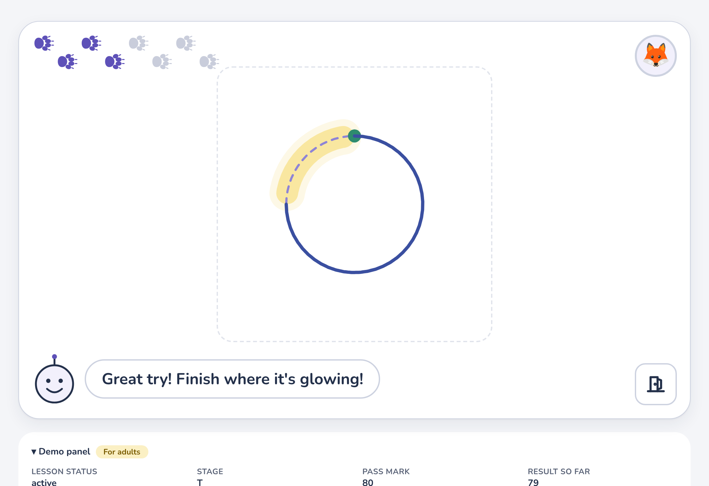
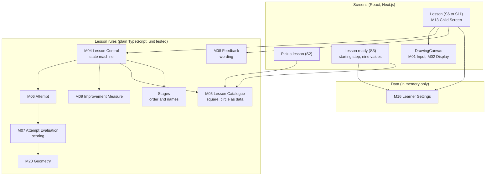
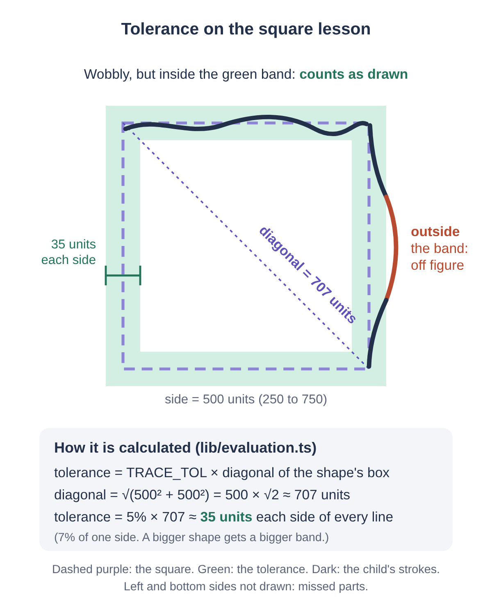
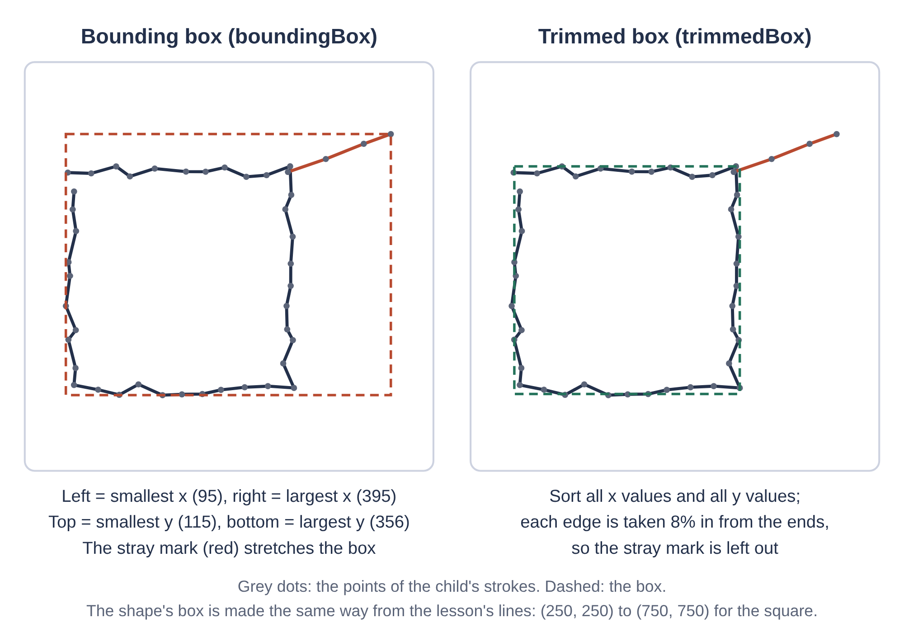
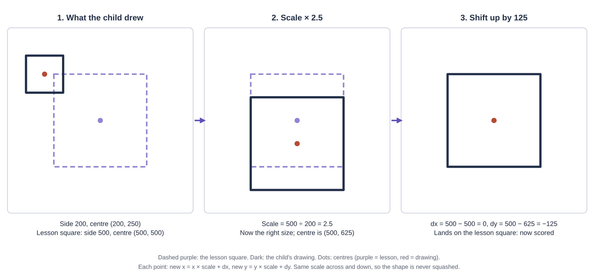
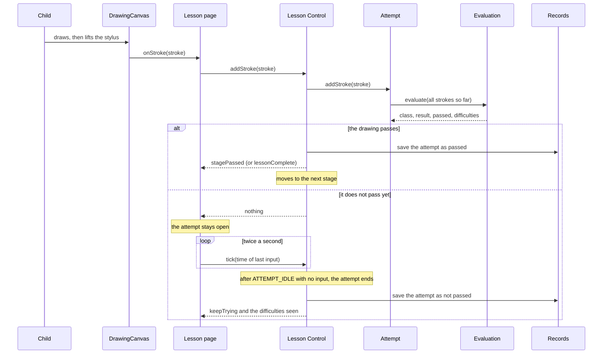

# Squigglr POC: how it works, with all of its code

This document explains the Proof of Concept demonstrated on **November 25, 2026**: what it does, how the code does it, and why it was built this way. It holds all of the code. It sits in `src/` beside the app, and every listing below is a copy of the file of that name in this folder. The app's 65 unit tests pass, it compiles as a production Next.js build, and the square and circle lessons were driven in a real browser (the screenshots below come from that run).

**What the POC is:** a web app, run from a laptop with `npm run dev` and used on an iPad on the same Wi-Fi. An adult picks the Square or Circle lesson, sets the nine practice values and starts it. The child watches a demonstration, then draws through three stages with less help each time. Every attempt is scored against the adult's values, and a demo panel shows the result and the counters as the lesson runs. Nothing is saved.

**Why it is this small.** The POC has to show that the risky part works: that a drawing made on a tablet can be judged fairly and a lesson can be run by the SRS's rules. Profiles, saved records and the adult check are ordinary storage and screens, not risks, so they wait for PH-1. The full version with them is kept on the `POC-extra` branch. One lesson with straight sides and one with curves is enough evidence that the scoring is not tied to one shape: the scoring only sees a figure's paths, so another simple shape is a new catalogue entry, not new code (see [part 3](#p-lesson-data)). It does not show that shapes with crossings or open ends work.

| Lesson ready: the child's settings | Lesson: a part is missing, so it glows and the drawing stays |
| --- | --- |
|  |  |

The screens follow the layout of the team's lo-fi prototype (S1 to S11 in Figma), in the colours of the A-Sense presentation, with one rounded font and soft-edged cards. What the app does follows the SRS, except in five places where the team chose otherwise. [Reference B](#decisions) gives the requirement behind each decision, and [Reference C](#srs) lists every place the app and the SRS differ.

## How to read this

This document is written to be read from top to bottom. It follows one lesson from the first tap to the star at the end, and brings in each file of code at the point where it does its job. Each part says what problem it solves, what to look for in the code, and then shows the code.

The **tour** (parts 1 to 12) explains the code. The **reference** (A to F) at the end holds what you look things up in: what is in scope, why each decision was made and which requirement is behind it, how the app compares with the SRS, and how to build, run and demo it.

**The tour**

1. [The app in one picture](#p-picture)
2. [The words and the data shapes](#p-words)
3. [A lesson is data](#p-lesson-data)
4. [Capturing a stroke](#p-stroke)
5. [Scoring a drawing](#scoring)
6. [One attempt](#p-attempt)
7. [The whole lesson](#lesson-moves)
8. [What the child sees and hears](#p-feedback)
9. [What the adult sets](#settings)
10. [What is kept](#p-kept)
11. [The screens](#p-screens)
12. [How we know it works](#p-tests)

**Reference**

- A. [What is in the POC and what is not](#scope)
- B. [Design decisions and the requirements behind them](#decisions)
- C. [How the app compares with the SRS](#srs)
- D. [Where everything is: the file index](#file-index)
- E. [Setting up, building, running and demoing](#run)
- F. [After the POC](#after)

<a id="p-picture"></a>
## 1. The app in one picture

Five ideas explain how the whole app is put together. Everything later is one of these in detail.

1. **Everything runs in the browser, and nothing is saved.** There is no server code and no database. The laptop's `npm run dev` only serves the pages to the iPad. The adult's values are kept in memory until the page is reloaded.
2. **The rules and the screens are kept apart.** Everything that decides something (is this drawing a square, does the lesson move on, is this setting allowed) is plain TypeScript in `lib/`, with no React in it. The screens in `app/` and `components/` only show what the rules decide. That is why the rules can be tested without a browser.
3. **One file per design module.** Each file in `lib/` is one module of the Module Guide and the MIS, with the same name. If you know the design, you know where the code is.
4. **The drawing area is always 1000 by 1000 units**, whatever the size of the screen. A unit is not a pixel: it is a fraction of the canvas, like a percentage out of 1000 instead of 100. The canvas is always square, and each touch is converted to this grid. For example, the square's top-left corner is at (250, 250): a quarter of the way across, which is 125 pixels on a 500-pixel canvas and 250 pixels on a 1000-pixel one. Lessons, tolerances and saved strokes all use these units, so a drawing is judged the same way on a phone, a tablet and a laptop, and each lesson is defined once.
5. **The lesson logic only acts when the screen calls it, in two ways.** The lesson logic is one object (`LessonControl` in `lib/lessonControl.ts`) that does not watch the screen or keep a clock of its own. The lesson screen calls it:
   - `addStroke(stroke)` each time the child lifts the stylus, with the line just drawn, so it can check the drawing;
   - `tick()` every half second, from a timer on the screen, so it can notice that the child has stopped drawing (for example, to end an attempt or ask "Still drawing?").

   Both calls return a **report**: what the screen should show next, such as a feedback message, a glow or the next stage. The screen only displays the report; it decides nothing itself (see point 2).

The boxes below are the modules of the Module Guide, with their numbers. An arrow means "uses". The tour goes through them roughly from the bottom of the middle box upwards, then the data, then the screens.



<a id="p-words"></a>
## 2. The words and the data shapes

A few words are used everywhere in the code, with the meanings the SRS gives them.

| Word | Meaning | In the code |
| --- | --- | --- |
| Stage | Where the child is in a lesson: **D** demonstration, **T** trace the full outline, **E** endpoints (dots) only, **I** independent, with no guide. | `Stage`, `DrawingStage` |
| Figure | What a lesson teaches: its required parts (lines) and required endpoints (dots). | `Figure` |
| Stroke | One contact of the stylus, from touching down to lifting: a list of points, each with its time. | `Stroke` |
| Attempt | One try at one stage. It can be many strokes. | `Attempt` (part 6) |
| Evaluation | The scoring's verdict on one attempt: whether it is **complete** (every part and dot was drawn), **incomplete** or **invalid** (a tap or nothing, not counted); a **result** from 0 to 100; whether it **passed** (complete and at least the child's pass mark); and its list of drawing problems.<br><br>**How the result is worked out.** Two shares are measured: **drawn**, how much of the shape's outline has the child's line on it inside the tolerance band (catches parts left out), and **on figure**, how much of everything the child drew is inside the band (catches lines drawn away from the shape). Result = 100 × the **lower** of the two. Example: the square's outline is 2,000 units; the child covered 1,800 (drawn = 90%) and drew 2,500 units of line, 2,000 inside the band (on figure = 80%), so the result is 80. The lower one is used because each share alone can be fooled: a scribble over the whole canvas covers the whole square (drawn 100%) but is mostly off it; one perfect side is all on the shape (on figure 100%) but only a quarter of it is drawn. A high result needs both. A line outside the band does not fail the drawing by itself: it lowers on figure, and the stretch of shape it skipped may leave a part under 90% covered, which counts as missing and glows as a hint the child can fill in during the same attempt.| `Evaluation` |
| Drawing problem | One specific problem the scoring found in a drawing, which tells the child what to fix. It is not a level of difficulty; the SRS calls it a "difficulty", and the code calls it a drawing problem to avoid that confusion. There are five kinds, a fixed list (BR-007):<br>• **missed part**: a line of the shape was not drawn, e.g. the square's left side;<br>• **missed endpoint**: no stroke reached one of the dots, e.g. a corner;<br>• **off figure**: some lines went away from the shape;<br>• **too small** (no-guide stage only): the drawing is under 40% of the shape's size;<br>• **stretched** (no-guide stage only): the right shape, out of proportion, e.g. a rectangle for a square.<br>A missed part or endpoint also says which one (`index`), so the screen can make that exact part glow. One attempt can have several drawing problems, and each one picks the feedback message the child sees (`lib/feedback.ts`). | `DrawingProblem` |
| Settings | The nine values an adult sets for one child, such as the pass mark and how many attempts are allowed (all nine are listed in part 9). | `Settings` |
| Report | What the lesson logic hands back to the screen after each stroke or tick: which feedback messages to show, in order, and which drawing problems to make glow. The screen shows it and decides nothing. | `Report` |
| Tolerance | How far the child's line may be from the shape's line and still count as on it. Picture a band around every line of the shape: inside the band counts, outside does not.<br><br>**How it is worked out:** tolerance = `TRACE_TOL` (5%) × the diagonal of the box around the shape (`lib/evaluation.ts:40`). For the square (corners at 250 and 750, side 500): diagonal = √(500² + 500²) ≈ 707 units, so tolerance = 5% × 707 ≈ **35 units** on each side of every line, about 7% of a side. A bigger shape gets a wider band.<br><br> | `TRACE_TOL`, `tolerance()` |
| Fit | Used only at the no-guide stage, where the child may draw the shape anywhere and at any size. Before scoring, the drawing is moved and resized to sit on top of the lesson's shape, so only the shape is judged, not where or how big it was drawn. A fit is that move: every point is multiplied by `scale`, then shifted by `dx` across and `dy` down (`apply()` in `lib/geometry.ts`).<br><br>**How it is worked out** (`boxFit()` in `lib/geometry.ts:90`): take the box around the child's drawing and the box around the shape.<br>**What "the box" is** (`boundingBox()`, `lib/geometry.ts:72`): the code looks at every point of every stroke and finds the smallest x, the largest x, the smallest y and the largest y. It then makes a rectangle from them: its width runs from the smallest x to the largest x, and its height from the smallest y to the largest y. Example: if the child's points run from x = 100 to 300 and y = 150 to 350, the box is 200 wide and 200 tall, with its top-left corner at (100, 150) and its centre at (200, 250). It is a rectangle, not always a square: a drawing wider than it is tall gets a wide box. The shape's box is made the same way from the lesson's own lines; for the square it is (250, 250) to (750, 750).<br><br><br><br>1. **Scale** = the shape box's longer side ÷ the drawing box's longer side. The same scale is used across and down, so a drawing is never squashed into shape.<br>2. **Shift** (`dx`, `dy`) = whatever moves the centre of the scaled drawing onto the centre of the shape.<br><br>**Example:** the child draws a square in the top-left, from (100, 150) to (300, 350): side 200, centre (200, 250). The lesson's square is 250 to 750: side 500, centre (500, 500). Scale = 500 ÷ 200 = 2.5. The scaled centre is (500, 625), so dx = 500 − 500 = 0 and dy = 500 − 625 = −125. Check: the corner (100, 150) becomes (100 × 2.5 + 0, 150 × 2.5 − 125) = (250, 250), the lesson's corner.<br><br><br><br>**The four fits, and how the box for each is worked out.** All four use the same scale-and-shift step above; they differ in which box of the child's drawing goes into it. Each is scored, and the best one is kept (fewest missing parts, then the highest result).<br>1. **Full box** (`boundingBox()`): the smallest and largest x and y of every point of every stroke. Width = smallest x to largest x, height = smallest y to largest y. This is the SRS's wording. Weakness: one stray mark stretches it.<br>2. **Trimmed box** (`trimmedBox()`, 8%): the strokes are first turned into points every 12 units along the line. All x values are put in order from smallest to largest, and so are all y values. Instead of the very first and last value, the left edge is the value 8% of the way into the x list and the right edge the value 8% from the end; the same for top and bottom with the y list. Example: with 72 points, 8% of the way is position 6 (counting from 0), so the 6 smallest and 6 largest x values are skipped. A short stray mark only adds a few points at one end of the list, so they are skipped and the box fits the square.<br>**Why this removes the stray mark, in simple terms.** Think of the x values as a line of people standing in order of height, and the box edges as "the shortest person" and "the tallest person". One very tall visitor makes the tallest person a lot taller. If you instead skip the few tallest people and take the next one, the visitor is skipped and the answer is the tallest *regular* person.<br>Small example, 13 points. The square's points have x values: 100, 100, 100, 100, 150, 200, 200, 250, 300, 300, 300, 300; the stray mark adds one point at x = 395. Sorted: **100**, 100, 100, 100, 150, 200, 200, 250, 300, 300, 300, 300, **395**.<br>• Full box: left = first value = 100, right = last value = **395**. The stray point stretches the box almost 100 units to the right.<br>• Trimmed box: 8% of 13 points rounds to 1, so skip 1 value at each end. Left = 2nd value = 100, right = 2nd-last value = **300**. The stray point was the one skipped, so the box is the square again.<br>**There is no loop.** The number of values to skip is worked out once: 8% of the number of points, rounded (13 points gives 1; 72 points gives 6). Then the code reads the value at that position from each end of the sorted list, and that is the edge. Nothing is checked again.<br>**Where 8% comes from:** it is the team's own choice, `TRIM_SHARE` in `lib/constants.ts`, not from the SRS or a source. A bigger value ignores longer stray marks but starts cutting into real corners; a smaller one ignores less. Change it there and every use follows.<br>Two things make this work: (1) a square has **many** points at its left and right sides (a whole side each), so skipping a few of them does not move the edge; (2) a stray mark has only **a few** points, all at the extreme end, so they are the ones skipped. The same is done separately with the y values for the top and bottom.<br>3. **Trimmed box, nudged** (`refineFit()`): starts from fit 2 and improves it in up to 10 rounds. Each round: every drawn point is paired with the nearest point on the shape, and every shape point with the nearest drawn point, leaving out pairs more than 3 tolerances apart (about 105 units for the square); then the scale and shift that bring the pairs closest together on average are worked out. The nudge is capped: the scale may differ from fit 2's by at most 5%, and the drawing's centre may move at most one tolerance (about 35 units). The cap stops it, for example, from shrinking a square until it sat inside a circle's band and passed the circle lesson.<br>4. **Biggest group only** (`strokeGroups()` and `biggestGroup()` in `lib/geometry.ts`): the strokes are split into groups of strokes that touch or nearly touch (within `GROUP_GAP` = 10% of the whole drawing's longer side). A square drawn as four separate sides is one group; a line drawn far away is a second group. The box of the group with the most line in it is used for the fit, so a long line or a second shape far away cannot stretch it. Only tried when there is more than one group.<br><br>**What stops a far-off mark from ruining the fit.** If the child draws a square and then a mark far away, the plain bounding box stretches to include the mark, and the square would be resized wrongly. Two of the fits prevent this. The trimmed box handles short marks:<br>1. The strokes are turned into points **every 12 units along the line**, so a long line gets many points and a short mark gets few.<br>2. All the x values are sorted, and all the y values are sorted. The box edges are taken **8% in** from each end of those lists, not at the very smallest and largest values.<br>3. A short far-off mark has only a few points, all at the extreme end of the list, so they fall in the 8% that is cut off. The box then fits just the square.<br>4. All four fits are scored and the **best-scoring** one is kept, so the stretched full box loses.<br><br>**Example:** a square with 200-unit sides is 800 units of line, about 67 points. 8% of the points is about 5 points, or roughly 64 units of line. A far-off mark shorter than that is left out by the trimmed box.<br><br>**A longer mark, or a second shape,** is too much for the trimmed box. The biggest-group fit handles it: the far line is its own group, so the box is taken from the square's group alone. Example: a square on the left and a long line on the right; the square is found whole, with nothing missing. This fit only wins when it finds fewer missing parts (or as many, with a higher result), so drawings it does not help behave exactly as before: for example, if only the left and right sides are drawn, the top and bottom are still reported missing and glow.<br><br>**The mark still counts against the drawing.** Even when the fit ignores the mark, the mark is still outside the tolerance band, so it lowers "on figure" and so the result. Drawing a lot away from the shape gives a lower result and the message "Some lines went away from the shape": small slips are forgiven, drawing something else is not. | `Fit`, `boxFit()` |

**Why a stroke keeps the time of each point.** No rule in the POC reads the times: evaluation only uses where the points are. They are kept so that, once records are saved in PH-1, each attempt holds a full record of how the child drew, not only the final shape, in line with the decision to record every value and let the adult choose what to view. With the times, a later version can show how long a stroke took, how fast the child drew, where they hesitated, and a replay at the real speed. None of that can be worked out afterwards if the times are not captured.

`lib/types.ts` declares these shapes and nothing else. They are plain data, with no functions, so a stroke can be copied or saved as it is. Read it once now; every later file uses these names.

<a id="f-types"></a>

`src/lib/types.ts`

```ts
// Types shared between modules (MIS Table "Types shared between modules").
// Everything here is plain data: interfaces, with no methods.

/** A position on the drawing area, in drawing units (the area is 1000 x 1000). */
export interface Point {
  x: number;
  y: number;
}

/** A line through the points, in order. The parts of a figure are paths. */
export type Path = Point[];

/**
 * A position on the drawing area together with when it was drawn.
 * `t` is the time in milliseconds (from Date.now()). No rule reads it yet;
 * it is saved so an attempt keeps a full record of how the child drew
 * (speed, pauses, a replay), not only the final shape.
 */
export interface TimedPoint {
  x: number;
  y: number;
  t: number;
}

/** One stylus contact, from touching down to lifting: its points in the order drawn. */
export interface Stroke {
  points: TimedPoint[];
}

/** D = demonstration, T = trace the outline, E = endpoints only, I = independent. */
export type Stage = "D" | "T" | "E" | "I";
export type DrawingStage = "T" | "E" | "I";

export interface Figure {
  parts: Path[];
  endpoints: Point[];
}

/** What is shown to guide the child at a drawing stage. */
export interface Guide {
  outline: Path[];
  endpoints: Point[];
}

export type DrawingProblemKind = "missedPart" | "missedEndpoint" | "offFigure" | "tooSmall" | "stretched";

/**
 * One drawing problem: a specific thing the scoring found wrong in a drawing,
 * which tells the child what to fix. It is not a level of difficulty.
 * The SRS calls this a "difficulty" (BR-007, the predefined list).
 * `index` says which part or endpoint, so the screen can make that exact part
 * glow; it is 0 for the kinds that are about the whole drawing.
 */
export interface DrawingProblem {
  kind: DrawingProblemKind;
  index: number;
}

/** A problem seen during an attempt, and whether the child fixed it later. */
export interface Observed {
  problem: DrawingProblem;
  corrected: boolean;
}

export type EvalClass = "complete" | "incomplete" | "invalid";
export type Guidance = "assisted" | "independent";

export interface Evaluation {
  class: EvalClass;
  guidance: Guidance;
  /** Stage result, 0 to 100. */
  result: number;
  passed: boolean;
  problems: DrawingProblem[];
  /** The two shares behind the result, kept for the demo panel. */
  drawn: number;
  onFigure: number;
  /** How the drawing was laid over the figure before it was scored. */
  fit: Fit;
}

/** Maps a point of the drawing onto the figure: scale it, then move it by (dx, dy). */
export interface Fit {
  scale: number;
  dx: number;
  dy: number;
}

/** The nine adult-set values of one learner (BR-008). Times are in seconds. */
export interface Settings {
  stagePass: number;
  failStreak: number;
  attemptLimit: number;
  improveWindow: number;
  attemptExtension: number;
  attemptLimitMax: number;
  attemptIdle: number;
  lessonIdlePrompt: number;
  lessonIdleEnd: number;
}

export type SettingName = keyof Settings;

export type FeedbackKind =
  | "stagePassed"
  | "lessonComplete"
  | "keepTrying"
  | "fillIn"
  | "notEvaluable"
  | "checkIn"
  | "lessonEnded";

/** What the child is told after an event, in the order it is given. */
export interface Report {
  feedback: FeedbackKind[];
  problems: DrawingProblem[];
}

/** How a lesson ended, or "inProgress" while it runs. */
export type Ending =
  | "inProgress"
  | "completed"
  | "endedAtLimit"
  | "endedAtMax"
  | "endedIdle"
  | "unfinished";
```

<a id="f-constants"></a>
**The team-fixed values.** `lib/constants.ts` holds every value the team chose and the app uses: the tolerance, how much of a part must be drawn, the trim, the timings, and so on. They are in one file so they are easy to find, to check against the SRS, and to change: change a value here and every use follows. The values an adult sets for each child (pass mark, attempt limits, pauses) are not here; they are in `lib/settings.ts` (part 9), because they differ per child.

`src/lib/constants.ts`

```ts
// The team-fixed values of the app, in one place so they are easy to find,
// to check against the SRS, and to change. Changing a value here changes it
// everywhere it is used.
//
// Not here:
// - the values an adult sets for each child (pass mark, attempt limits,
//   pauses): those are in lib/settings.ts, because they differ per child;
// - colours and sizes that only affect the look of a screen: those stay in
//   their component.

// ---------------------------------------------------------------------------
// The drawing area
// ---------------------------------------------------------------------------

/**
 * The drawing area is always this many units wide and tall, whatever the size
 * of the screen. A unit is a fraction of the canvas, not a pixel: 250 is a
 * quarter of the way across on any screen. Lessons, tolerances and saved
 * strokes all use these units.
 */
export const CANVAS_UNITS = 1000;

/** A quarter circle is drawn as this many short straight pieces. More pieces make a smoother curve. */
export const ARC_PIECES = 16;

// ---------------------------------------------------------------------------
// Scoring a drawing (lib/evaluation.ts)
// ---------------------------------------------------------------------------

/**
 * How far a stroke may be from the shape's line and still count as on it,
 * in percent of the diagonal of the box around the shape.
 * For the square (side 500, diagonal about 707) this is about 35 units.
 */
export const TRACE_TOL = 5;

/** How much of one part of the shape (for example one side) must be drawn for it to count, in percent. */
export const PART_COVER = 90;

/**
 * The least an attempt must have drawn, in total, to be judged at all: the
 * length of all its lines added up, in percent of the diagonal of the box
 * around the shape. Less than this (a tap or a tiny mark) is "too little to
 * judge": the attempt is not counted, and the child is asked to try again.
 * For the square (diagonal about 707) this is about 35 units.
 * The team's own choice, not taken from a source. It has the same value as
 * TRACE_TOL, but means something different, so the two can be changed apart.
 */
export const MIN_DRAWN = 5;

/**
 * With no guide, the smallest a drawing may be: its longer side, in percent of
 * the shape's longer side. Smaller than this and the attempt is not complete,
 * however neat.
 */
export const MIN_DRAW_SCALE = 40;

/**
 * With no guide, how much is left out at each end when finding the trimmed
 * box, in percent of the drawing's points. The x values are sorted and the
 * left and right edges are taken this far in from each end; the same for y.
 * A short stray mark only adds a few points at one end, so it is left out.
 * This value is the team's own choice, not taken from a source.
 */
export const TRIM_SHARE = 8;

/**
 * With no guide, the drawing is turned into points this many units apart
 * along each line before the boxes are found. Spacing them evenly means a
 * long line has more points than a short mark, whatever the drawing speed.
 */
export const SAMPLE_STEP = 12;

/**
 * The nudged fit may change the size of the drawing by at most this factor
 * compared with the trimmed-box fit: 1.05 is 5% bigger or smaller.
 * Without a limit, a square could be shrunk until it sat inside a circle's
 * tolerance band and passed the circle lesson.
 */
export const NUDGE_MAX_SCALE = 1.05;

/**
 * When nudging, a drawn point and a point of the shape are only paired up if
 * they are at most this many tolerances apart.
 */
export const NUDGE_REACH = 3;

/**
 * When measuring how much of one line lies near another, the line is checked
 * at points this many units apart. Smaller is more exact but slower.
 */
export const MEASURE_STEP = 4;

/**
 * With no guide, two strokes belong to the same group when they come this
 * close, in percent of the longer side of the whole drawing's box. Used to
 * find the main drawing and ignore a separate mark far away when fitting.
 */
export const GROUP_GAP = 10;

// ---------------------------------------------------------------------------
// The lesson rules
// ---------------------------------------------------------------------------

/** The most hints (a missing part glowing) one attempt gives before it ends. */
export const MAX_HINTS = 2;

/** Smallest rise in the average stage result, in points, that counts as improving. */
export const IMPROVE_MARGIN = 5;

// ---------------------------------------------------------------------------
// Timings (all in milliseconds)
// ---------------------------------------------------------------------------

/** How long the demonstration takes to draw the whole shape once. */
export const DEMO_DRAW_MS = 4000;

/** How long the finished shape stays on screen after the demonstration, before practice starts. */
export const DEMO_HOLD_MS = 1000;

/** How long the demonstration stage lasts in total, before practice starts by itself. */
export const DEMO_MS = DEMO_DRAW_MS + DEMO_HOLD_MS;

/** How long a passed attempt stays on screen with its feedback. */
export const SHOW_PASSED_MS = 2500;

/** How long an attempt that did not pass stays on screen with its feedback (there is more to look at). */
export const SHOW_NOT_PASSED_MS = 5000;

/** For this long after a stylus touches the screen, finger and palm touches do not draw. */
export const PALM_MS = 1000;

/** How fast the arrow at the dots travels, in drawing units a second: slow enough for a young child to follow. */
export const ARROW_SPEED = 150;

/** How long the arrow rests at the end of its trip before setting off again. */
export const ARROW_REST_MS = 900;

/** While the stylus is held down, even held still, how often that counts as input (so the pause does not run). */
export const HELD_INPUT_MS = 250;

/** How often the lesson screen asks the lesson logic whether the child has paused (calls `tick`). */
export const TICK_MS = 500;
```

<a id="p-lesson-data"></a>
## 3. A lesson is data

**The problem.** The app must teach a square and a circle now and six more shapes later, without a rule being rewritten each time.

**How.** A lesson is an entry in a list (`LESSONS` in `catalogue.ts`), not code. Each entry has a name and a **figure**: the shape, in drawing units, given as two lists.

- **Parts:** the pieces the child must draw, each a `Path` (a line through points, in order). For the square these are its four sides; for the circle, its four quarter arcs.
- **Endpoints:** the dots shown at the endpoints-only stage. For the square, its four corners.

Nothing else about a lesson is written by hand. The app works everything out from the figure: the demonstration draws the parts in order; the guide at each stage is the outline, the dots or nothing; and the scoring measures the drawing against the same parts. So a lesson cannot show one shape and score another, and no rule changes when a lesson is added.

**Helpers that build a figure.** Writing every part out by hand would be long and easy to get wrong, so a figure is built by a small helper function from a few numbers:

- `polygon(corners)` is for any closed shape with straight sides. It is given the corners in drawing order and makes one side from each corner to the next, with the last corner joining back to the first. The corners are also the dots. For example, the square is `polygon` with its four corners (250, 250), (750, 250), (750, 750) and (250, 750), which gives four sides: top, right, bottom and left.
- `circle(centre, radius)` is for a circle. It makes four quarter arcs with `arc`, each of `ARC_PIECES` (16) short straight pieces, and puts the dots where the quarters meet, with `pointOnCircle`. The circle lesson is `circle({ x: 500, y: 500 }, 250)`. Before, the circle was built inline with two `.map` calls, and its dots came from an "arc" of zero length whose first point was taken; a second curved lesson would have copied that trick.

**Why this is cleaner.** Before, the square's corners were a separate list above the catalogue, and the sides were made from it with one hard-to-read line (`corners.map((c, i) => [c, corners[(i + 1) % 4]])`). A reader had to look in two places and work out that line to see the shape. Now:

- each lesson holds its own corners, so everything about a shape is in its entry and nothing sits outside the list;
- the rule "a side runs from one corner to the next, and the last joins the first" is written once, in `polygon`, with a comment, instead of once per shape;
- a lesson entry reads as a description of the shape (here are the corners), not as code that builds it;
- a mistake in that rule is fixed in one place, for every straight-sided shape at once.

**Adding a shape later.** A shape with straight sides needs no new code, only a new entry with its corners:

| Shape | Entry |
| --- | --- |
| Triangle | `polygon` with 3 corners |
| Rectangle | `polygon` with 4 corners, wider than tall |
| Hexagon | `polygon` with 6 corners |

A shape with curves uses `circle` or `arc`, or a new helper written once for that kind of curve. Even then only the catalogue changes: the scoring, the stages and the screens do not, because they only ever read a figure's parts and endpoints. This is why lessons are data: a new lesson is one more entry, whatever the shape, and the rules are tested once for all of them.

**What to look for.**

- `polygon()`, `circle()`, `arc()` and `pointOnCircle()`: the helpers that build a figure.
- `LESSONS`: the whole catalogue. Adding the triangle is one more entry.
- `guide()`: what the child is shown at each stage.
- `problems()`: what may be said about a drawing at each stage. "Too small" and "stretched" exist only where there is no guide.

<a id="f-catalogue"></a>

`src/lib/catalogue.ts`

```ts
// M05 Lesson Catalogue. Lessons are data: adding a lesson means adding an
// entry to LESSONS, with no change to the rules (NFR-MAINT-001).
// The drawing area is 1000 x 1000 units, whatever the size of the screen.

import { ARC_PIECES } from "./constants";
import type { DrawingProblem, DrawingStage, Figure, Guide, Path, Point } from "./types";

/** The kinds of lesson in the SRS catalogue. The POC has shapes only. */
export type LessonCategory = "line" | "shape" | "simpleDrawing";

export interface Lesson {
  id: string;
  name: string;
  category: LessonCategory;
  /** The required parts, in the order the demonstration draws them, and the required endpoints. */
  figure: Figure;
}

/**
 * The point on a circle at an angle, in degrees clockwise from the top
 * (0 is the top, 90 the right, 180 the bottom, 270 the left).
 */
function pointOnCircle(centre: Point, radius: number, angle: number): Point {
  const radians = (angle * Math.PI) / 180;
  return { x: centre.x + radius * Math.sin(radians), y: centre.y - radius * Math.cos(radians) };
}

/** A piece of a circle, from one angle to another, as ARC_PIECES short straight lines. */
function arc(centre: Point, radius: number, from: number, to: number): Path {
  const path: Path = [];
  for (let i = 0; i <= ARC_PIECES; i++) {
    const angle = from + ((to - from) * i) / ARC_PIECES;
    path.push(pointOnCircle(centre, radius, angle));
  }
  return path;
}

/**
 * A circle as four quarter arcs, drawn clockwise from the top. The four
 * points where the arcs meet (top, right, bottom, left) are its dots.
 * The SRS lists no endpoints for the circle, which would leave the
 * endpoints-only stage with nothing to show, so these four are used.
 */
function circle(centre: Point, radius: number): Figure {
  const quarters = [0, 90, 180, 270];
  const parts: Path[] = quarters.map((start) => arc(centre, radius, start, start + 90));
  const endpoints: Point[] = quarters.map((angle) => pointOnCircle(centre, radius, angle));
  return { parts: parts, endpoints: endpoints };
}

/**
 * A closed shape with straight sides, such as a square or a triangle. Each
 * side runs from one corner to the next, and the last corner joins back to
 * the first. The corners are also the dots shown at the endpoints-only stage.
 */
function polygon(corners: Point[]): Figure {
  const parts: Path[] = [];
  for (let i = 0; i < corners.length; i++) {
    const next = corners[(i + 1) % corners.length]; // after the last corner comes the first
    parts.push([corners[i], next]);
  }
  return { parts: parts, endpoints: corners };
}

export const LESSONS: Lesson[] = [
  {
    id: "square",
    name: "Square",
    category: "shape",
    // Four sides; four corners (SRS Table "Initial lesson catalogue").
    // Clockwise from the top left corner.
    figure: polygon([
      { x: 250, y: 250 },
      { x: 750, y: 250 },
      { x: 750, y: 750 },
      { x: 250, y: 750 },
    ]),
  },
  {
    id: "circle",
    name: "Circle",
    category: "shape",
    // Four quarter arcs; the four points where they meet are the dots.
    figure: circle({ x: 500, y: 500 }, 250),
  },
];

export function lesson(id: string): Lesson {
  for (const entry of LESSONS) {
    if (entry.id === id) {
      return entry;
    }
  }
  throw new Error("unknownLesson");
}

/** The whole figure as the outline at T, only the endpoints at E, nothing at I. */
export function guide(id: string, stage: DrawingStage): Guide {
  const figure = lesson(id).figure;
  if (stage === "T") return { outline: figure.parts, endpoints: [] };
  if (stage === "E") return { outline: [], endpoints: figure.endpoints };
  return { outline: [], endpoints: [] };
}

/**
 * The predefined problems of a stage: any missed part, any missed
 * endpoint, or drawing off the figure. With no guide, a drawing can also be
 * too small, or stretched (the right shape, but too wide or too tall).
 */
export function problems(id: string, stage: DrawingStage): DrawingProblem[] {
  const figure = lesson(id).figure;
  const all: DrawingProblem[] = [];
  for (let index = 0; index < figure.parts.length; index++) {
    all.push({ kind: "missedPart", index: index });
  }
  for (let index = 0; index < figure.endpoints.length; index++) {
    all.push({ kind: "missedEndpoint", index: index });
  }
  all.push({ kind: "offFigure", index: 0 });
  if (stage === "I") {
    all.push({ kind: "tooSmall", index: 0 });
    all.push({ kind: "stretched", index: 0 });
  }
  return all;
}
```

<a id="p-stroke"></a>
## 4. Capturing a stroke

**The problem.** Turn a stylus, a finger or a mouse moving on glass into a stroke the rules can use, the same on every device.

**How.** `DrawingCanvas.tsx` is the only code that touches the browser's pointer events and the canvas. It does two separate jobs.

*Input.* On touch-down it starts a stroke, on each move it adds a point, and on lift it hands the finished stroke up through `onStroke`. It decides nothing about the lesson. Along the way it:

- maps each position into the 1000 by 1000 drawing area, so a point keeps its place if the canvas is resized;
- leaves out a position that is off the drawing area, and one that repeats the last;
- thins out positions closer together than two units, which keeps a long drawing quick to score;
- follows one contact at a time, and lets a stylus take over from a resting palm;
- reports every input through `onInput`, and keeps reporting while the stylus is held down, so a child resting the stylus mid-line is not taken to have paused.

*Display.* The `paint` function draws whatever it is given, in this order: the glow over a missing stretch, the guide, the start dot and the moving arrow, the demonstration, and the child's strokes on top.

**What to look for.** `toPoint` (the mapping), `add` (one point), the four `onPointer...` handlers at the bottom, and `paint`.

<a id="f-canvas"></a>

`src/components/DrawingCanvas.tsx`

```tsx
"use client";

import { useCallback, useEffect, useRef } from "react";
import { ARROW_REST_MS, ARROW_SPEED, CANVAS_UNITS, DEMO_DRAW_MS, HELD_INPUT_MS, PALM_MS } from "@/lib/constants";
import type { Guide, Path, Point, Stroke } from "@/lib/types";

// M01 Input Device and M02 Display in one component. It turns the browser's
// pointer events into strokes in drawing units (the area is always
// 1000 x 1000, whatever the screen), and paints the guide, the strokes, the
// demonstration and the "look here" marks.

/** Positions closer together than this, in drawing units, are thinned out. */
const MIN_STEP = 2;

/**
 * The arrow that shows the child which way to go, from one dot to the next.
 * Each trip covers one leg, then the arrow rests; the next trip starts where
 * the last one ended. After the last leg it starts again at the first.
 */
interface Arrow {
  /** The legs, in order: for a lesson, its parts (the square's sides, the circle's quarters). */
  legs: Path[];
}

/** A point on a path, and the direction of travel there (an angle in radians). */
/** One band of the glow over a missing stretch. */
interface GlowBand {
  colour: string;
  /** In drawing units. */
  width: number;
}

interface PointOnPath {
  at: Point;
  angle: number;
}

interface Props {
  guide: Guide;
  /** The finished strokes of the current attempt. */
  strokes: Stroke[];
  /** Called at each stylus lift with the finished stroke. */
  onStroke: (stroke: Stroke) => void;
  /** Called when the browser cuts a contact off (pointercancel). */
  onCancel: () => void;
  /** Called with the time of every accepted input, for the idle rules. */
  onInput: (time: number) => void;
  disabled?: boolean;
  /** When set, the paths are drawn one after another, once, and then stay on screen. */
  demonstration?: Path[];
  /** Places to point the child to, without drawing the missing line for them. */
  marks?: Point[];
  /** Stretches of the figure that were not drawn, shown as a glow. */
  glow?: Path[];
  /** Where the drawing starts, shown as a green dot, as in the demonstration. */
  startDot?: Point;
  /**
   * A small arrow that travels from one dot to the next, to show which way to
   * go: one leg per trip, a rest, then the next leg, and round again. It moves
   * along the shape; it does not draw it. It is only shown while the child is
   * not drawing.
   */
  arrow?: Arrow;
}

function trace(ctx: CanvasRenderingContext2D, path: Point[], upTo = Infinity) {
  ctx.beginPath();
  let drawn = 0;
  path.forEach((p, i) => {
    if (i === 0) return ctx.moveTo(p.x, p.y);
    const a = path[i - 1];
    const len = Math.hypot(p.x - a.x, p.y - a.y);
    if (drawn >= upTo) return;
    const t = Math.min(1, (upTo - drawn) / len);
    ctx.lineTo(a.x + (p.x - a.x) * t, a.y + (p.y - a.y) * t);
    drawn += len;
  });
  if (path.length === 1) ctx.arc(path[0].x, path[0].y, 1, 0, Math.PI * 2);
  ctx.stroke();
}

/** The point a distance `d` along the path, and the direction of travel there. */
function along(path: Point[], d: number): PointOnPath {
  let left = d;
  for (let i = 1; i < path.length; i++) {
    const a = path[i - 1];
    const b = path[i];
    const len = Math.hypot(b.x - a.x, b.y - a.y);
    if (left <= len || i === path.length - 1) {
      const t = len === 0 ? 0 : Math.min(1, left / len);
      return { at: { x: a.x + (b.x - a.x) * t, y: a.y + (b.y - a.y) * t }, angle: Math.atan2(b.y - a.y, b.x - a.x) };
    }
    left -= len;
  }
  return { at: path[0], angle: 0 };
}

/** The length of the arrow's tail. */
const ARROW_TAIL = 70;

const pathLength = (path: Point[]) =>
  path.reduce((sum, p, i) => (i === 0 ? 0 : sum + Math.hypot(p.x - path[i - 1].x, p.y - path[i - 1].y)), 0);

export function DrawingCanvas(props: Props) {
  const canvasRef = useRef<HTMLCanvasElement>(null);
  const current = useRef<Stroke | null>(null);
  const pointerId = useRef<number | null>(null);
  /** When a stylus last touched. A palm resting beside it must not draw. */
  const penAt = useRef(0);
  const latest = useRef(props);
  latest.current = props;

  const paint = useCallback((demoProgress?: number, arrowLeg?: number, arrowAt?: number) => {
    const canvas = canvasRef.current;
    if (canvas === null) return;
    const ctx = canvas.getContext("2d");
    if (ctx === null) return;
    const now = latest.current;
    const guide = now.guide;
    const strokes = now.strokes;
    const demonstration = now.demonstration;
    const startDot = now.startDot;
    const arrow = now.arrow;
    let marks: Point[] = [];
    if (now.marks !== undefined) {
      marks = now.marks;
    }
    let glow: Path[] = [];
    if (now.glow !== undefined) {
      glow = now.glow;
    }
    const scale = canvas.width / CANVAS_UNITS;
    ctx.setTransform(scale, 0, 0, scale, 0, 0);
    ctx.clearRect(0, 0, CANVAS_UNITS, CANVAS_UNITS);
    ctx.lineCap = "round";
    ctx.lineJoin = "round";

    // The glow over a stretch that was not drawn: a wide pale band, under everything else.
    // Two bands: a wide very pale one, then a narrower, stronger one on top.
    const bands: GlowBand[] = [
      { colour: "#fdf8e6", width: 130 },
      { colour: "#f9e7a0", width: 80 },
    ];
    for (const band of bands) {
      ctx.strokeStyle = band.colour;
      ctx.lineWidth = band.width;
      glow.forEach((p) => trace(ctx, p));
    }

    // Marks that show where something is missing: a soft glow, drawn under the strokes.
    marks.forEach((p) => {
      ctx.fillStyle = "#f9e7a0";
      ctx.beginPath();
      ctx.arc(p.x, p.y, 60, 0, Math.PI * 2);
      ctx.fill();
      ctx.strokeStyle = "#7a5c00";
      ctx.lineWidth = 5;
      ctx.setLineDash([14, 14]);
      ctx.stroke();
      ctx.setLineDash([]);
    });

    // The guide: a dashed outline (stage T) or dots at the endpoints (stage E).
    ctx.strokeStyle = "#8e84d6";
    ctx.lineWidth = 8;
    ctx.setLineDash([22, 22]);
    guide.outline.forEach((p) => trace(ctx, p));
    ctx.setLineDash([]);
    ctx.fillStyle = "#8e84d6";
    guide.endpoints.forEach((p) => {
      ctx.beginPath();
      ctx.arc(p.x, p.y, 20, 0, Math.PI * 2);
      ctx.fill();
    });

    // Where to start, and which way to go.
    if (startDot) {
      ctx.fillStyle = "#2e8b6e";
      ctx.beginPath();
      ctx.arc(startDot.x, startDot.y, 24, 0, Math.PI * 2);
      ctx.fill();
    }
    if (arrow && arrowLeg !== undefined && arrowAt !== undefined && current.current === null) {
      // The arrow: a head with a short tail behind it, `arrowAt` along leg number `arrowLeg`.
      const leg = arrow.legs[arrowLeg];
      const head = along(leg, arrowAt);
      ctx.strokeStyle = "#2e8b6e";
      ctx.fillStyle = "#2e8b6e";
      ctx.lineWidth = 10;
      ctx.beginPath();
      for (let d = Math.max(0, arrowAt - ARROW_TAIL); d <= arrowAt; d += 8) {
        const p = along(leg, d).at;
        if (d === Math.max(0, arrowAt - ARROW_TAIL)) ctx.moveTo(p.x, p.y);
        else ctx.lineTo(p.x, p.y);
      }
      ctx.lineTo(head.at.x, head.at.y);
      ctx.stroke();
      ctx.translate(head.at.x, head.at.y);
      ctx.rotate(head.angle);
      ctx.beginPath();
      ctx.moveTo(30, 0);
      ctx.lineTo(-12, -24);
      ctx.lineTo(-12, 24);
      ctx.closePath();
      ctx.fill();
      ctx.setTransform(scale, 0, 0, scale, 0, 0);
    }

    // The demonstration: each part drawn in turn.
    if (demonstration && demoProgress !== undefined) {
      const total = demonstration.reduce((sum, p) => sum + pathLength(p), 0);
      let budget = demoProgress * total;
      ctx.strokeStyle = "#23304a";
      ctx.lineWidth = 14;
      for (const part of demonstration) {
        if (budget <= 0) break;
        trace(ctx, part, budget);
        budget -= pathLength(part);
      }
      // A green dot shows where the drawing starts.
      const first = demonstration[0]?.[0];
      if (first) {
        ctx.fillStyle = "#2e8b6e";
        ctx.beginPath();
        ctx.arc(first.x, first.y, 22, 0, Math.PI * 2);
        ctx.fill();
      }
    }

    // The child's strokes, exactly as drawn. Dark ink, so the child's line stands
    // out over the lavender guide: 4:1 contrast, above the 3:1 that WCAG 2.2
    // (1.4.11 Non-text Contrast) asks for. The old blue (#3a4fa0) gave only 2.3:1.
    ctx.strokeStyle = "#23304a";
    ctx.lineWidth = 12;
    strokes.forEach((s) => trace(ctx, s.points));
    if (current.current) trace(ctx, current.current.points);
  }, []);

  // Keep the canvas sharp at any size, and repaint when it is resized.
  useEffect(() => {
    const canvas = canvasRef.current!;
    const resize = () => {
      const side = canvas.clientWidth * (window.devicePixelRatio || 1);
      canvas.width = side;
      canvas.height = side;
      paint();
    };
    resize();
    const observer = new ResizeObserver(resize);
    observer.observe(canvas);
    return () => observer.disconnect();
  }, [paint]);

  // The arrow's trips are timed from when it appears, and not from each
  // repaint of the screen around it. Each time it appears it starts at the first leg.
  const arrowShown = props.arrow !== undefined;
  const arrowSince = useRef(0);
  useEffect(() => {
    arrowSince.current = performance.now();
  }, [arrowShown]);

  // Repaint when what should be shown changes, and run the demonstration or the arrow.
  useEffect(() => {
    if (!props.demonstration && !arrowShown) return void paint();
    let frame = 0;
    const start = performance.now();
    const loop = (now: number) => {
      if (props.demonstration) {
        // The demonstration draws the shape once over DEMO_DRAW_MS, then keeps the
        // finished shape on screen until practice starts. It does not loop, so it
        // never starts drawing again just before the stage changes.
        const progress = (now - start) / DEMO_DRAW_MS;
        paint(Math.min(1, progress));
      } else if (latest.current.arrow !== undefined) {
        // Which leg the arrow is on, and how far along it: each leg takes its length at
        // ARROW_SPEED, then a rest of ARROW_REST_MS, and after the last leg it goes round again.
        const legs = latest.current.arrow.legs;
        const tripMs: number[] = [];
        let roundMs = 0;
        for (const leg of legs) {
          const ms = (pathLength(leg) / ARROW_SPEED) * 1000 + ARROW_REST_MS;
          tripMs.push(ms);
          roundMs += ms;
        }
        let elapsed = (now - arrowSince.current) % roundMs;
        let legIndex = 0;
        while (elapsed >= tripMs[legIndex]) {
          elapsed -= tripMs[legIndex];
          legIndex += 1;
        }
        const legLength = pathLength(legs[legIndex]);
        paint(undefined, legIndex, Math.min(legLength, (elapsed / 1000) * ARROW_SPEED));
      }
      frame = requestAnimationFrame(loop);
    };
    frame = requestAnimationFrame(loop);
    return () => cancelAnimationFrame(frame);
  }, [props.demonstration, arrowShown, props.startDot, props.guide, props.strokes, props.marks, props.glow, paint]);

  /** Maps a pointer position to drawing units, so a point keeps its place if the canvas is resized. */
  /** Maps a pointer position to drawing units, so a point keeps its place if the canvas is resized. */
  const toPoint = (e: React.PointerEvent<HTMLCanvasElement>) => {
    const rect = e.currentTarget.getBoundingClientRect();
    const unit = (v: number) => Math.round(v * CANVAS_UNITS * 10) / 10; // a tenth of a unit is finer than any screen
    return {
      x: unit((e.clientX - rect.left) / rect.width),
      y: unit((e.clientY - rect.top) / rect.height),
      t: Date.now(),
    };
  };

  /** Adds the pointer's position to the stroke being drawn. `last` is the point at the stylus lift. */
  const add = (e: React.PointerEvent<HTMLCanvasElement>, last = false) => {
    const stroke = current.current;
    if (!stroke) return;
    const p = toPoint(e);
    latest.current.onInput(p.t);
    // A position that is not on the drawing area cannot be mapped to it, and is left out (SAF-AHM-002).
    if (p.x < 0 || p.x > CANVAS_UNITS || p.y < 0 || p.y > CANVAS_UNITS) return;
    const before = stroke.points[stroke.points.length - 1];
    // The same position reported twice counts once (SAF-AHM-001). Positions
    // closer together than the eye can tell are thinned out, which keeps a
    // long drawing quick to check and small to save.
    if (before) {
      const moved = Math.hypot(p.x - before.x, p.y - before.y);
      if (moved === 0 || (moved < MIN_STEP && !last)) return;
    }
    stroke.points.push(p);
    paint();
  };

  // While the stylus is held down, even held still, the child is still
  // drawing: that is input, and the pause that ends an attempt must not run.
  useEffect(() => {
    const timer = setInterval(() => {
      if (pointerId.current !== null) latest.current.onInput(Date.now());
    }, HELD_INPUT_MS);
    return () => clearInterval(timer);
  }, []);

  // If the drawing area is switched off in the middle of a stroke, the
  // unfinished stroke is dropped. It belongs to no attempt.
  useEffect(() => {
    if (props.disabled && pointerId.current !== null) {
      current.current = null;
      pointerId.current = null;
      paint();
    }
  }, [props.disabled, paint]);

  return (
    <canvas
      ref={canvasRef}
      aria-label="Drawing area"
      className="aspect-square w-full rounded-3xl border-2 border-dashed border-line bg-white"
      onPointerDown={(e) => {
        if (props.disabled) return;
        const pen = e.pointerType === "pen";
        if (pen) penAt.current = Date.now();
        // A stylus wins over a resting palm: a touch is ignored while a stylus
        // is in use, and a stylus takes over from a touch already down.
        if (e.pointerType === "touch" && Date.now() - penAt.current < PALM_MS) return;
        if (pointerId.current !== null) {
          if (!pen) return; // one contact at a time
          current.current = null;
        }
        pointerId.current = e.pointerId;
        e.currentTarget.setPointerCapture(e.pointerId);
        current.current = { points: [] };
        add(e);
      }}
      onPointerMove={(e) => {
        if (e.pointerId !== pointerId.current) return;
        if (e.pointerType === "pen") penAt.current = Date.now();
        add(e);
      }}
      onPointerUp={(e) => {
        if (e.pointerId !== pointerId.current) return;
        add(e, true);
        pointerId.current = null;
        const stroke = current.current;
        current.current = null;
        // A contact that never touched the drawing area leaves no stroke.
        if (stroke && stroke.points.length > 0) props.onStroke(stroke);
        else paint();
      }}
      onPointerCancel={(e) => {
        if (e.pointerId !== pointerId.current) return;
        const wasDrawing = current.current !== null;
        current.current = null;
        pointerId.current = null;
        paint();
        if (wasDrawing) props.onCancel();
      }}
    />
  );
}
```

<a id="scoring"></a>
## 5. Scoring a drawing

**The problem.** Given the strokes so far and the lesson's figure, say whether the drawing is complete, how good it is, and whether it passes for this child.

### The rule

Each lesson has a **figure**: its required parts and required endpoints. The square has four sides and four corners.

- **Tolerance.** A point is "on" a line when it is within `TRACE_TOL` = 5% of the figure's diagonal. For the square that is about 35 units, 7% of a side.

  

  Picture it as a band around every line of the shape, 35 units wide on each side (the green band). Any part of the child's stroke inside the band counts as drawn on that line, however much it wobbles. Any part outside the band does not count, and lowers the "on figure" share below. A bigger tolerance makes a wider band, so messier drawings pass.

- **Drawn.** The share of the shape's outline that has the child's line on it, inside the band. It catches parts left out. Example: the square's outline is 2,000 units long (4 sides of 500); if 1,800 units of it are covered, drawn = 90%.
- **On figure.** The share of everything the child drew that is inside the band. It catches lines drawn away from the shape. Example: the child drew 2,500 units of line in total and 2,000 of them are inside the band, so on figure = 80%.
- **Result.** `100 × min(drawn, on figure)`: the lower of the two shares, as a number from 0 to 100. In the example, min(90%, 80%) gives a result of 80.

  **Why the lower of the two.** Each share on its own can be fooled. A scribble over the whole canvas covers the entire square (drawn = 100%), but most of it is outside the band (on figure is low). One perfect side and nothing else is all on the shape (on figure = 100%), but only a quarter of the shape is drawn (drawn = 25%). Taking the lower share means a high result needs the whole shape drawn **and** the drawing kept on it.
- **Complete.** Every part has at least `PART_COVER` = 90% of its length drawn, and every endpoint has a stroke within the tolerance.
- **Pass.** Complete, and the result is at least the child's pass mark.
- **No guide.** At the last stage there is nothing on screen to trace, so the child may draw the shape anywhere and at any size. Before scoring, the drawing is moved and resized (by the same amount across and down) to sit on top of the lesson's shape; this is the **fit**. So where and how big the child drew does not matter, only the shape. Four ways of fitting it are tried and the best-scoring one is kept: by its bounding box (the SRS's wording); by the box of the bulk of the drawing, leaving out the outermost 8% on each side, so a short stray mark or an overshoot does not throw it off; that second fit nudged by at most 5% in size and one tolerance in position; and by the box of the biggest group of strokes only, so a long line or a second shape drawn away from the main drawing does not stretch the box. The nudge is kept small on purpose: with a free fit, a square could be shrunk until it sat inside a circle's tolerance and passed the circle lesson.

  

- **Stretched.** With no guide, if parts seem to be missing, the drawing is also laid over the figure by width and height separately. If every part is then there, nothing is missing: the drawing is the right shape out of proportion, such as a rectangle for a square. It still does not pass, but the child is told "Try making it as tall as it is wide" and no glow is shown beside lines they did draw.
- **Minimum size.** With no guide, the drawing's longer side must be at least `MIN_DRAW_SCALE` = 40% of the figure's. Smaller is incomplete, and reported as too small.
- **Invalid.** No strokes, a missing coordinate, or less drawn than the tolerance (a tap). An invalid attempt is not counted.

**What happens when a line goes outside the band.** A line outside the band does not fail the drawing on its own. Two things follow from the rules above:

1. **The result goes down.** The stray length lowers "on figure". If a tenth of the drawing is outside the band, on figure is 90%, and the drawing can still pass at a pass mark of 80, as long as it is complete.
2. **The part it skipped may count as missing.** Where the line left the band, that stretch of the shape is not covered. If less than 90% of a part is covered (`PART_COVER`), the part is missing and the drawing is incomplete.

The child can fix a missing part in the same attempt, with no wait. When the child pauses and a part is missing, the lesson gives a hint: that part glows and the drawing stays on screen (part 7, at most two hints in an attempt). Drawing over the glowing part inside the band covers it. The glow shows what is still missing, not the line that went outside; that line cannot be erased, so it still lowers the result a little. The message "Some lines went away from the shape" is the only feedback about the stray line itself.

Measured on prepared squares:

| Drawing | Result | Class | Passes at 80? |
| --- | --- | --- | --- |
| Exact square | 100 | complete | Yes |
| Square drawn 20 units off | 100 | complete | Yes |
| Wobble of up to 30 units | 100 | complete | Yes |
| Wobble of up to 40 units | 71 | incomplete | No |
| Three sides only | 79 | incomplete | No |
| Square plus one stray line across it | 83 | complete | Yes (no at a pass mark of 90) |
| Square plus a large scribble | below 70 | complete | No |

Measured with no guide, at the lowest pass mark of 70:

| Drawing | Passes? |
| --- | --- |
| A square at 60% size in a corner, plus a stray mark far away | Yes |
| A square whose last side runs well past the corner | Yes |
| A square 14% or 20% wider than tall | Yes |
| A rectangle 25% or 40% wider than tall | No, stretched |
| A square at 20% size | No, too small |
| Three sides only | No, a part is missing |
| A triangle, or a circle, in the square lesson | No |
| A square in the circle lesson, any size | No |
| A circle at half size, anywhere | Yes |

The measuring is our own code (`lib/geometry.ts`), not a drawing library. A library such as Paper.js would not make it more accurate: the lengths and distances are exact for straight pieces, and curves are checked every 4 units of a 1000-unit canvas. What decides a pass is the rule (the tolerance, the 90% cover, the fit), not the arithmetic.

### The code

Two files. `geometry.ts` is the measuring kit: lengths, distances, boxes, and the fits used when there is no guide. `evaluation.ts` uses it to apply the rule above.

**What to look for in `geometry.ts`.** `lengthWithin` is the function the scoring leans on. It cuts a path into short pieces and adds up the pieces that lie near another set of paths. It is used both ways round: how much of the figure has drawing near it, and how much of the drawing is near the figure. `boxFit`, `trimmedBox`, `refineFit` and `strokeGroups` are what the four ways of laying a drawing over the figure are built from. `longerSide` and `stretchOnto` are written once here and used by both the fits and the stretched check.

<a id="f-geometry"></a>

`src/lib/geometry.ts`

```ts
// M20 Geometry. Pure functions on points and paths. Nothing here knows about
// the canvas, the browser or a drawing library.

import { MEASURE_STEP } from "./constants";
import type { Fit, Path, Point, Stroke } from "./types";

export interface Box {
  minX: number;
  minY: number;
  maxX: number;
  maxY: number;
}

export function toPath(stroke: Stroke): Path {
  return stroke.points.map((p) => ({ x: p.x, y: p.y })); // the same points without their times
}

function dist(a: Point, b: Point): number {
  return Math.hypot(a.x - b.x, a.y - b.y);
}

/** Length of a path; 0 for a path with fewer than two points. */
export function length(path: Path): number {
  let total = 0;
  for (let i = 1; i < path.length; i++) total += dist(path[i - 1], path[i]);
  return total;
}

function distanceToSegment(p: Point, a: Point, b: Point): number {
  const dx = b.x - a.x;
  const dy = b.y - a.y;
  const len2 = dx * dx + dy * dy;
  if (len2 === 0) return dist(p, a);
  const t = Math.max(0, Math.min(1, ((p.x - a.x) * dx + (p.y - a.y) * dy) / len2));
  return dist(p, { x: a.x + t * dx, y: a.y + t * dy });
}

/** Smallest distance from p to any of the paths. Infinity if there is no point. */
export function distance(p: Point, paths: Path[]): number {
  let best = Infinity;
  for (const path of paths) {
    if (path.length === 1) best = Math.min(best, dist(p, path[0]));
    for (let i = 1; i < path.length; i++) {
      best = Math.min(best, distanceToSegment(p, path[i - 1], path[i]));
    }
  }
  return best;
}

/**
 * Length of the parts of `path` that are within distance d of a path in
 * `others`. The path is cut into pieces no longer than MEASURE_STEP units; a piece counts
 * when its midpoint is within d.
 */
export function lengthWithin(path: Path, others: Path[], d: number): number {
  const step = MEASURE_STEP;
  let total = 0;
  for (let i = 1; i < path.length; i++) {
    const a = path[i - 1];
    const b = path[i];
    const segLen = dist(a, b);
    if (segLen === 0) continue;
    const pieces = Math.max(1, Math.ceil(segLen / step));
    const pieceLen = segLen / pieces;
    for (let j = 0; j < pieces; j++) {
      const t = (j + 0.5) / pieces;
      const mid = { x: a.x + (b.x - a.x) * t, y: a.y + (b.y - a.y) * t };
      if (distance(mid, others) <= d) total += pieceLen;
    }
  }
  return total;
}

export function boundingBox(paths: Path[]): Box {
  const box = { minX: Infinity, minY: Infinity, maxX: -Infinity, maxY: -Infinity };
  for (const path of paths) {
    for (const p of path) {
      box.minX = Math.min(box.minX, p.x);
      box.minY = Math.min(box.minY, p.y);
      box.maxX = Math.max(box.maxX, p.x);
      box.maxY = Math.max(box.maxY, p.y);
    }
  }
  return box;
}

/** The longer of the box's width and height. */
export function longerSide(box: Box): number {
  return Math.max(box.maxX - box.minX, box.maxY - box.minY);
}

/**
 * Lays paths over a target box by width and height separately: the left edge
 * of `box` goes to the target's left edge, its right edge to the target's
 * right edge, and the same for top and bottom. Unlike boxFit, this can
 * stretch a drawing, for example a rectangle into a square.
 */
export function stretchOnto(paths: Path[], box: Box, target: Box): Path[] {
  const sx = (target.maxX - target.minX) / (box.maxX - box.minX);
  const sy = (target.maxY - target.minY) / (box.maxY - box.minY);
  return paths.map((path) =>
    path.map((p) => ({
      x: target.minX + (p.x - box.minX) * sx,
      y: target.minY + (p.y - box.minY) * sy,
    })),
  );
}

export function diagonal(box: Box): number {
  return Math.hypot(box.maxX - box.minX, box.maxY - box.minY);
}

/** The move and uniform scale that lay `box` over `target`: centres together, longer sides equal. */
export function boxFit(box: Box, target: Box): Fit {
  const longer = longerSide(box);
  let scale = 1; // a single point cannot be scaled; it is only moved
  if (longer > 0) {
    scale = longerSide(target) / longer;
  }
  return {
    scale: scale,
    dx: (target.minX + target.maxX) / 2 - ((box.minX + box.maxX) / 2) * scale,
    dy: (target.minY + target.maxY) / 2 - ((box.minY + box.maxY) / 2) * scale,
  };
}

/**
 * The bounding box of the bulk of the points: on each side, the outermost
 * `trim` share of the points is left out. A short stray mark, or a line that
 * runs on past a corner, then no longer stretches the box.
 */
export function trimmedBox(points: Point[], trim: number): Box {
  const xs = points.map((p) => p.x).sort((a, b) => a - b);
  const ys = points.map((p) => p.y).sort((a, b) => a - b);
  const at = (sorted: number[], share: number) => sorted[Math.round(share * (sorted.length - 1))];
  return { minX: at(xs, trim), minY: at(ys, trim), maxX: at(xs, 1 - trim), maxY: at(ys, 1 - trim) };
}

export const IDENTITY: Fit = { scale: 1, dx: 0, dy: 0 };

export function apply(fit: Fit, p: Point): Point {
  return { x: p.x * fit.scale + fit.dx, y: p.y * fit.scale + fit.dy };
}
export function applyAll(fit: Fit, paths: Path[]): Path[] {
  return paths.map((path) => path.map((p) => apply(fit, p)));
}
/** The Fit that undoes `fit`. */
export function inverse(fit: Fit): Fit {
  return { scale: 1 / fit.scale, dx: -fit.dx / fit.scale, dy: -fit.dy / fit.scale };
}

/** Points along the paths, no more than `step` apart. */
export function sample(paths: Path[], step: number): Point[] {
  const out: Point[] = [];
  for (const path of paths) {
    if (path.length === 1) out.push(path[0]);
    for (let i = 1; i < path.length; i++) {
      const a = path[i - 1];
      const b = path[i];
      const pieces = Math.max(1, Math.ceil(dist(a, b) / step));
      for (let j = i === 1 ? 0 : 1; j <= pieces; j++) {
        out.push({ x: a.x + ((b.x - a.x) * j) / pieces, y: a.y + ((b.y - a.y) * j) / pieces });
      }
    }
  }
  return out;
}

/**
 * Nudges a Fit so that the drawing lies more closely over the figure. Each
 * round pairs every drawn point with its nearest figure point, and every
 * figure point with its nearest drawn point, leaves out pairs further apart
 * than `reach`, and solves for the scale and move that bring the pairs
 * closest together.
 *
 * It is only a nudge: the scale may change by at most `maxScale` (1.05 is 5%)
 * and the drawing may move by at most `maxShift`. Without those limits the
 * search could shrink a square until it sat inside a circle's tolerance.
 */
export function refineFit(
  drawn: Point[],
  figure: Point[],
  start: Fit,
  reach: number,
  maxScale: number,
  maxShift: number,
): Fit {
  if (drawn.length === 0) return start;
  const centre = {
    x: drawn.reduce((sum, p) => sum + p.x, 0) / drawn.length,
    y: drawn.reduce((sum, p) => sum + p.y, 0) / drawn.length,
  };
  const home = apply(start, centre);
  const nearest = (p: Point, among: Point[]) => {
    let index = 0;
    let d = Infinity;
    for (let i = 0; i < among.length; i++) {
      const di = dist(p, among[i]);
      if (di < d) {
        d = di;
        index = i;
      }
    }
    return { index, d };
  };

  let fit = start;
  for (let round = 0; round < 10; round++) {
    const moved = drawn.map((p) => apply(fit, p));
    const from: Point[] = [];
    const to: Point[] = [];
    moved.forEach((q, i) => {
      const n = nearest(q, figure);
      if (n.d <= reach) {
        from.push(drawn[i]);
        to.push(figure[n.index]);
      }
    });
    figure.forEach((f) => {
      const n = nearest(f, moved);
      if (n.d <= reach) {
        from.push(drawn[n.index]);
        to.push(f);
      }
    });
    if (from.length < 3) break;

    const mean = (ps: Point[]) => ({
      x: ps.reduce((sum, p) => sum + p.x, 0) / ps.length,
      y: ps.reduce((sum, p) => sum + p.y, 0) / ps.length,
    });
    const a = mean(from);
    const b = mean(to);
    let num = 0;
    let den = 0;
    for (let i = 0; i < from.length; i++) {
      num += (from[i].x - a.x) * (to[i].x - b.x) + (from[i].y - a.y) * (to[i].y - b.y);
      den += (from[i].x - a.x) ** 2 + (from[i].y - a.y) ** 2;
    }
    if (den === 0) break;
    const scale = Math.min(start.scale * maxScale, Math.max(start.scale / maxScale, num / den));
    let next: Fit = { scale, dx: b.x - scale * a.x, dy: b.y - scale * a.y };
    // Keep the drawing's centre within maxShift of where the starting fit put it.
    const at = apply(next, centre);
    const moved2 = dist(at, home);
    if (moved2 > maxShift) {
      const k = maxShift / moved2;
      const target = { x: home.x + (at.x - home.x) * k, y: home.y + (at.y - home.y) * k };
      next = { scale, dx: target.x - scale * centre.x, dy: target.y - scale * centre.y };
    }
    fit = next;
  }
  return fit;
}

/** The smallest distance between any point of path a and any line of path b. */
function pathGap(a: Path, b: Path): number {
  let best = Infinity;
  for (const p of a) {
    const d = distance(p, [b]);
    if (d < best) {
      best = d;
    }
  }
  return best;
}

/**
 * Splits the strokes into groups of strokes that touch or nearly touch.
 * Two strokes are in the same group when they come within `gap` units of
 * each other, directly or through other strokes of the group. For example a
 * square drawn as four separate sides is one group, and a line drawn far away
 * from it is a second group.
 *
 * Returns the groups, each a list of paths.
 */
export function strokeGroups(paths: Path[], gap: number): Path[][] {
  // groupOf[i] is the group number of stroke i. Every stroke starts alone.
  const groupOf: number[] = [];
  for (let i = 0; i < paths.length; i++) {
    groupOf.push(i);
  }

  // Join two groups: every stroke of group `from` moves to group `to`.
  const join = (from: number, to: number) => {
    for (let i = 0; i < groupOf.length; i++) {
      if (groupOf[i] === from) {
        groupOf[i] = to;
      }
    }
  };

  for (let i = 0; i < paths.length; i++) {
    for (let j = i + 1; j < paths.length; j++) {
      const close = pathGap(paths[i], paths[j]) <= gap || pathGap(paths[j], paths[i]) <= gap;
      if (close && groupOf[i] !== groupOf[j]) {
        join(groupOf[j], groupOf[i]);
      }
    }
  }

  // Collect the strokes of each group number into a list.
  const byNumber = new Map<number, Path[]>();
  for (let i = 0; i < paths.length; i++) {
    const number = groupOf[i];
    let group = byNumber.get(number);
    if (group === undefined) {
      group = [];
      byNumber.set(number, group);
    }
    group.push(paths[i]);
  }
  return Array.from(byNumber.values());
}

/** The group with the most line in it (the longest total length). */
export function biggestGroup(groups: Path[][]): Path[] {
  let best: Path[] = [];
  let bestLength = -1;
  for (const group of groups) {
    let total = 0;
    for (const path of group) {
      total += length(path);
    }
    if (total > bestLength) {
      best = group;
      bestLength = total;
    }
  }
  return best;
}
```

**What to look for in `evaluation.ts`.** `evaluate` has no memory: the same strokes always give the same answer. It reads as five numbered steps, and each rule it uses is a small function of its own:

1. `isValid`: is there anything to judge? If not, `invalidEvaluation`.
2. `score`: the two shares and the list of missing parts and endpoints, for paths that already lie where they should be compared.
3. `bestFit`, at stage I only: tries the four fits and keeps the best (`better` compares two).
4. `stretchedScore` and `isTooSmall`, at stage I only: the check for a stretched drawing, and the minimum size.
5. The last lines of `evaluate`: complete, passed, and the drawing problems that are allowed at this stage.

The numbers the team will calibrate, `TRACE_TOL`, `PART_COVER`, `MIN_DRAWN` and `MIN_DRAW_SCALE`, are in `lib/constants.ts` and nowhere else.

<a id="f-evaluation"></a>

`src/lib/evaluation.ts`

```ts
// M07 Attempt Evaluation. Scores the strokes of an attempt against a lesson's
// figure, as SRS Section 9.2 defines it. Stateless and deterministic.

import {
  IDENTITY,
  applyAll,
  biggestGroup,
  boundingBox,
  boxFit,
  diagonal,
  distance,
  length,
  lengthWithin,
  longerSide,
  refineFit,
  sample,
  stretchOnto,
  strokeGroups,
  toPath,
  trimmedBox,
  type Box,
} from "./geometry";
import {
  GROUP_GAP,
  MIN_DRAW_SCALE,
  MIN_DRAWN,
  NUDGE_MAX_SCALE,
  NUDGE_REACH,
  PART_COVER,
  SAMPLE_STEP,
  TRACE_TOL,
  TRIM_SHARE,
} from "./constants";
import type { DrawingProblem, DrawingStage, EvalClass, Evaluation, Figure, Fit, Guidance, Path, Point, Stroke } from "./types";

export type Evaluate = (
  strokes: Stroke[],
  figure: Figure,
  stage: DrawingStage,
  allowed: DrawingProblem[],
  stagePass: number,
) => Evaluation;

export function tolerance(figure: Figure): number {
  return (TRACE_TOL / 100) * diagonal(boundingBox(figure.parts));
}

/** The least total length of line an attempt needs to be judged: MIN_DRAWN percent of the figure's diagonal. */
function minDrawn(figure: Figure): number {
  return (MIN_DRAWN / 100) * diagonal(boundingBox(figure.parts));
}

function isValid(strokes: Stroke[], least: number): boolean {
  if (strokes.length === 0) return false;
  for (const s of strokes) {
    if (s.points.length === 0) return false;
    for (const p of s.points) {
      if (!Number.isFinite(p.x) || !Number.isFinite(p.y)) return false;
    }
  }
  // A tap or a mark shorter than `least` in total is too little to judge.
  const total = strokes.reduce((sum, s) => sum + length(toPath(s)), 0);
  return total >= least;
}

interface Score {
  found: DrawingProblem[];
  drawn: number;
  onFigure: number;
  result: number;
}

/** Scores paths that already lie where they are to be compared with the figure. */
function score(paths: Path[], figure: Figure, tol: number): Score {
  const found: DrawingProblem[] = [];

  // Share of the figure that was drawn, and which required parts are missing.
  let figureLength = 0;
  let figureCovered = 0;
  figure.parts.forEach((part, index) => {
    const partLength = length(part);
    const covered = lengthWithin(part, paths, tol);
    figureLength += partLength;
    figureCovered += covered;
    if (covered < (PART_COVER / 100) * partLength) found.push({ kind: "missedPart", index: index });
  });

  figure.endpoints.forEach((endpoint, index) => {
    if (distance(endpoint, paths) > tol) found.push({ kind: "missedEndpoint", index: index });
  });

  // Share of what was drawn that lies on the figure.
  const drawnLength = paths.reduce((sum, p) => sum + length(p), 0);
  const drawnOnFigure = paths.reduce((sum, p) => sum + lengthWithin(p, figure.parts, tol), 0);

  const drawn = figureCovered / figureLength;
  const onFigure = drawnOnFigure / drawnLength;
  return { found, drawn, onFigure, result: 100 * Math.min(drawn, onFigure) };
}

/** Whether score `a` is better than score `b`: fewer missing parts first, then a higher result. */
function better(a: Score, b: Score): boolean {
  if (a.found.length !== b.found.length) {
    return a.found.length < b.found.length;
  }
  return a.result > b.result;
}

/** A way of laying the drawing over the figure, with the score it gives. */
interface ScoredFit {
  fit: Fit;
  score: Score;
}

/**
 * With no guide, where and how big the child drew does not matter: the whole
 * drawing is moved and uniformly scaled onto the figure before it is scored.
 * Four ways of laying it over the figure are tried, and the one that scores
 * best is kept:
 *  1. by its bounding box, exactly as the SRS states it;
 *  2. by its trimmed box (the box of the bulk of the drawing), so that a
 *     short stray mark or a line that runs on past a corner does not throw
 *     everything off;
 *  3. the second, nudged a little (at most 5% in size and one tolerance in
 *     position) towards the closest fit;
 *  4. by the box of the biggest group of strokes only, so that a long line or
 *     a second shape drawn away from the main drawing does not stretch the
 *     box. The other strokes are still scored, so they still count as off the
 *     shape. This fit only wins when it finds fewer missing parts (or as
 *     many, with a higher result), so it changes nothing else.
 */
function bestFit(drawing: Path[], points: Point[], figure: Figure, tol: number): ScoredFit {
  const figureBox = boundingBox(figure.parts);
  const byBulk = boxFit(trimmedBox(points, TRIM_SHARE / 100), figureBox);
  const candidates: Fit[] = [
    boxFit(boundingBox(drawing), figureBox),
    byBulk,
    refineFit(points, sample(figure.parts, SAMPLE_STEP), byBulk, NUDGE_REACH * tol, NUDGE_MAX_SCALE, tol),
  ];
  const gap = (GROUP_GAP / 100) * longerSide(boundingBox(drawing));
  const groups = strokeGroups(drawing, gap);
  if (groups.length > 1) {
    candidates.push(boxFit(boundingBox(biggestGroup(groups)), figureBox));
  }

  let best: ScoredFit = { fit: candidates[0], score: score(applyAll(candidates[0], drawing), figure, tol) };
  for (let i = 1; i < candidates.length; i++) {
    const other = score(applyAll(candidates[i], drawing), figure, tol);
    if (better(other, best.score)) {
      best = { fit: candidates[i], score: other };
    }
  }
  return best;
}

/**
 * If parts seem to be missing, checks whether the drawing is the right shape
 * pulled out of proportion, such as a rectangle for a square. Laid over the
 * figure by width and height separately, such a drawing has every part.
 * Returns the score of the stretched drawing if it has every part, or null.
 */
function stretchedScore(drawing: Path[], points: Point[], figure: Figure, tol: number): Score | null {
  const figureBox = boundingBox(figure.parts);
  const boxes: Box[] = [trimmedBox(points, TRIM_SHARE / 100), boundingBox(drawing)];
  for (const box of boxes) {
    const flat = box.maxX - box.minX === 0 || box.maxY - box.minY === 0;
    if (flat) {
      continue; // a straight line cannot be stretched into a shape
    }
    const asPulled = score(stretchOnto(drawing, box, figureBox), figure, tol);
    if (asPulled.found.length === 0) {
      return asPulled;
    }
  }
  return null;
}

/** With no guide, a drawing smaller than MIN_DRAW_SCALE of the figure is a speck, not a drawing of the shape. */
function isTooSmall(drawing: Path[], figure: Figure): boolean {
  const longer = longerSide(boundingBox(drawing));
  const figureLonger = longerSide(boundingBox(figure.parts));
  return longer < (MIN_DRAW_SCALE / 100) * figureLonger;
}

/** The result for input too small or broken to judge. */
function invalidEvaluation(guidance: Guidance): Evaluation {
  return { class: "invalid", guidance: guidance, result: 0, passed: false, problems: [], drawn: 0, onFigure: 0, fit: IDENTITY };
}

/**
 * Scores an attempt, in five steps:
 *  1. input too small or broken to judge is "invalid";
 *  2. with a guide, the drawing is scored where it is;
 *     with no guide, it is first laid over the figure by the best fit;
 *  3. with no guide, a drawing with parts missing may be a stretched version of the shape;
 *  4. with no guide, a drawing may be too small;
 *  5. the problems found are listed, and the attempt passes if it is complete
 *     and its result reaches the pass mark.
 */
export const evaluate: Evaluate = (strokes, figure, stage, allowed, stagePass) => {
  if (figure.parts.length === 0) throw new Error("emptyFigure");
  let guidance: Guidance = "assisted";
  if (stage === "I") {
    guidance = "independent";
  }
  const tol = tolerance(figure);

  // 1. Something to judge?
  if (!isValid(strokes, minDrawn(figure))) {
    return invalidEvaluation(guidance);
  }

  // 2. Score the drawing: where it is, or laid over the figure.
  const drawing = strokes.map(toPath);
  let fit: Fit = IDENTITY;
  let best = score(drawing, figure, tol);
  let stretched = false;
  let tooSmall = false;
  if (stage === "I") {
    const points = sample(drawing, SAMPLE_STEP);
    const chosen = bestFit(drawing, points, figure, tol);
    fit = chosen.fit;
    best = chosen.score;

    // 3. Parts missing only because the shape is pulled out of proportion?
    if (best.found.length > 0) {
      const asPulled = stretchedScore(drawing, points, figure, tol);
      if (asPulled !== null) {
        stretched = true;
        // Nothing is missing: the child is told "stretched", not shown a glow beside lines they did draw.
        best = { found: [], drawn: best.drawn, onFigure: asPulled.onFigure, result: best.result };
      }
    }

    // 4. Big enough to be a drawing of the shape?
    tooSmall = isTooSmall(drawing, figure);
  }

  // 5. The problems, and the verdict.
  const found: DrawingProblem[] = best.found.slice();
  const complete = found.length === 0 && !tooSmall && !stretched;
  if (stretched) {
    found.push({ kind: "stretched", index: 0 });
  }
  if (tooSmall) {
    found.push({ kind: "tooSmall", index: 0 });
  }
  if (100 * best.onFigure < stagePass) {
    found.push({ kind: "offFigure", index: 0 });
  }
  // Only the problems the team predefined for this stage are reported.
  const reported = found.filter((d) => allowed.some((a) => a.kind === d.kind && a.index === d.index));

  let evalClass: EvalClass = "incomplete";
  if (complete) {
    evalClass = "complete";
  }
  return {
    class: evalClass,
    guidance: guidance,
    result: best.result,
    passed: complete && best.result >= stagePass,
    problems: reported,
    drawn: best.drawn,
    onFigure: best.onFigure,
    fit: fit,
  };
};
```

<a id="p-attempt"></a>
## 6. One attempt

**The problem.** A square can take four strokes, and the child has no "done" button. Something has to decide when a try is over.

**How.** `attempt.ts` holds one try at one stage. It is given two things.

- **A stroke, at each stylus lift** (`addStroke`). It scores all the strokes so far. If they pass, the attempt ends at once as passed. If not, it stays open: the child may simply not have finished.
- **The time, twice a second** (`checkIdle`). Nothing happens until the child has paused for the adult's "pause that ends an attempt". Then one of three things:
  - the drawing cannot be judged (a tap): the attempt ends as invalid, and is not counted;
  - a part or an endpoint is missing, and there are hints left: the attempt stays open, and `checkIdle` answers "give a hint". The pause starts again. There are at most two hints, and the second only if the child drew something after the first;
  - otherwise the attempt ends as not passed.

It also keeps `seen`, the list of drawing problems noticed along the way. A drawing problem that the child later fixes is marked corrected, never removed, which is what the SRS asks of the attempt record (saved from PH-1).

**What to look for.** `MAX_HINTS`, `addStroke`, `checkIdle` and `note`.

<a id="f-attempt"></a>

`src/lib/attempt.ts`

```ts
// M06 Attempt. One attempt at one drawing stage: it collects strokes, has
// them evaluated at every stylus lift, and decides when it has ended.

import { MAX_HINTS } from "./constants";
import type { Evaluate } from "./evaluation";
import type { DrawingProblem, DrawingProblemKind, DrawingStage, Evaluation, Figure, Observed, Stroke } from "./types";

export type Outcome = "open" | "passed" | "notPassed" | "invalid" | "interrupted";

/** Everything an attempt needs to know when it starts. */
export interface AttemptSetup {
  stage: DrawingStage;
  figure: Figure;
  /** The drawing problems that may be reported at this stage. */
  allowed: DrawingProblem[];
  /** The pass mark (STAGE_PASS). */
  stagePass: number;
  /** The pause, in seconds, after which an attempt that has not passed gets a hint or ends (ATTEMPT_IDLE). */
  attemptIdle: number;
  evaluate: Evaluate;
}

const same = (a: DrawingProblem, b: DrawingProblem) => a.kind === b.kind && a.index === b.index;

export class Attempt {
  strokes: Stroke[] = [];
  /** The evaluation after the most recent stylus lift. */
  last: Evaluation | null = null;
  /** Every problem seen so far. A correction marks it; it is never removed. */
  seen: Observed[] = [];
  outcome: Outcome = "open";
  endedAt: number | null = null;
  /** How many times the child has been shown what is missing in this attempt. */
  hints = 0;
  private hintAt = 0;
  private strokesAtHint = 0;

  readonly stage: DrawingStage;
  private setup: AttemptSetup;

  constructor(setup: AttemptSetup) {
    this.setup = setup;
    this.stage = setup.stage;
  }

  /** Called at each stylus lift. Evaluates all strokes so far; a pass ends the attempt at once. */
  addStroke(stroke: Stroke, now: number): void {
    if (this.outcome !== "open") throw new Error("attemptEnded");
    this.strokes.push(stroke);
    const s = this.setup;
    this.last = s.evaluate(this.strokes, s.figure, s.stage, s.allowed, s.stagePass);
    // Something drawn off the figure is noted at every lift. A missed part or
    // endpoint, or a drawing that is still small, is not: the child may simply
    // not have finished yet.
    // With no guide the drawing is laid over the figure as a whole, so a
    // half-finished one looks off the figure until it is done. There, nothing
    // is noted until the attempt ends.
    if (this.stage !== "I") {
      this.note(
        this.last.problems.filter((d) => d.kind === "offFigure"),
        ["offFigure"],
      );
    }
    // After a hint, what was missing and is now drawn is marked corrected.
    if (this.hints > 0) this.note(this.missing(), ["missedPart", "missedEndpoint"]);
    if (this.last.passed) this.end("passed", now);
  }

  /**
   * Called twice a second (every TICK_MS = 500 ms). Once attemptIdle has passed with no input,
   * an attempt that has not passed either gets a hint or ends.
   *
   * A hint: if a part or an endpoint is missing, the child is shown where,
   * the drawing stays, and the pause starts again, so they can finish it. The
   * attempt gives at most MAX_HINTS, and a second one only if the child drew
   * something after the first. Otherwise the attempt ends as not passed.
   *
   * Returns true when a hint was just given.
   */
  checkIdle(now: number, lastInputAt: number): boolean {
    if (this.outcome !== "open" || this.strokes.length === 0 || this.last === null) return false;
    if (now - Math.max(lastInputAt, this.hintAt) < this.setup.attemptIdle * 1000) return false;
    if (this.last.class === "invalid") {
      this.end("invalid", now);
      return false;
    }
    const drewSinceHint = this.strokes.length > this.strokesAtHint;
    if (this.missing().length > 0 && this.hints < MAX_HINTS && (this.hints === 0 || drewSinceHint)) {
      this.hints += 1;
      this.hintAt = now;
      this.strokesAtHint = this.strokes.length;
      // What is missing is now on record. If the child fills it in, it is marked corrected, not removed.
      this.note(this.missing(), ["missedPart", "missedEndpoint"]);
      return true;
    }
    this.note(this.last.problems, ["missedPart", "missedEndpoint", "offFigure", "tooSmall", "stretched"]);
    this.end("notPassed", now);
    return false;
  }

  /** The parts and endpoints the drawing still lacks: what the child could finish. */
  missing(): DrawingProblem[] {
    if (this.last === null) {
      return []; // nothing drawn yet
    }
    return this.last.problems.filter((d) => d.kind === "missedPart" || d.kind === "missedEndpoint");
  }

  /** Ends the attempt with no result, keeping its strokes and problems. */
  interrupt(now: number): void {
    if (this.outcome !== "open") throw new Error("attemptEnded");
    this.last = null;
    this.end("interrupted", now);
  }

  private end(outcome: Outcome, now: number): void {
    this.outcome = outcome;
    this.endedAt = now;
  }

  private note(observedNow: DrawingProblem[], kinds: DrawingProblemKind[]): void {
    for (const entry of this.seen) {
      if (kinds.includes(entry.problem.kind)) {
        entry.corrected = !observedNow.some((d) => same(d, entry.problem));
      }
    }
    for (const d of observedNow) {
      if (!this.seen.some((entry) => same(entry.problem, d))) {
        this.seen.push({ problem: d, corrected: false });
      }
    }
  }
}
```

<a id="lesson-moves"></a>
## 7. The whole lesson

**The problem.** Decide which stage the child is at, when an attempt counts, and when the lesson moves on, offers the adult a go-back suggestion, gives its one extension, or ends.

### The rule

The state and the rules are those of SRS Section 9.2. In order, after each attempt that ends:

| What happened | What the lesson does |
| --- | --- |
| The drawing passes, at trace or corners | Moves to the next stage. The streak and the results compared for "improving" start again; the stage's failed and counted attempts and its extension are kept for that stage, so a stage entered again continues from where it was (SRS BR-002). |
| The drawing passes with no guide | Completes the lesson: the child gets the star. No other lesson starts. |
| It does not pass, a part or endpoint is missing, and the pause runs out | A hint: the missing part glows, the drawing stays, and the pause starts again. At most two in an attempt, the second only if the child drew after the first. Nothing is counted yet. |
| The attempt is invalid or interrupted | Starts a new attempt. Nothing is counted. An attempt is interrupted when the browser cuts the contact off or the adult leaves. |
| It does not pass, the failed attempts have reached the limit, and the child is not improving | Ends the lesson. |
| It does not pass, the limit is reached, the child is improving, and the cap is not reached | Gives the one extension. |
| The extension is used up, or the cap is reached | Ends the lesson. |
| It does not pass, the streak has reached the streak setting, the child is not improving, at corners or no guide | Offers the adult a go-back suggestion. The stage does not change and the child keeps practising. |
| Anything else | A new attempt at the same stage. |

"Improving" means the average of the last `IMPROVE_WINDOW` results is at least 5 points above the average of the same number of results before them.

A suggestion that the adult declines resets the streak. One that is accepted moves to the earlier stage the adult picks, with the counts that stage already had in this lesson. One that is never answered stays pending until a pass or the end of the lesson clears it.

### What happens at a stylus lift



### The code

`improvement.ts` is the "improving" rule on its own, a few lines, so a different measure later changes only that file.

<a id="f-improvement"></a>

`src/lib/improvement.ts`

```ts
// M09 Improvement Measure. The measure is this module's secret, so a different
// way of deciding "improving" changes only this file.

import { IMPROVE_MARGIN } from "./constants";

/**
 * True when the average of the last `window` results is at least
 * IMPROVE_MARGIN above the average of the `window` results before them.
 * False when there are fewer than 2 * window results.
 */
export function improving(history: number[], window: number): boolean {
  const m = history.length;
  if (m < 2 * window) return false;
  const avg = (xs: number[]) => xs.reduce((a, b) => a + b, 0) / xs.length;
  const recent = avg(history.slice(m - window));
  const before = avg(history.slice(m - 2 * window, m - window));
  return recent - before >= IMPROVE_MARGIN;
}
```

`lessonControl.ts` is the centre of the app. It has no screen and no timers of its own.

**What to look for.**

- **The fields at the top** are the state of SRS Section 9.2. Each comment gives the SRS's letter: `failed` is n_f, `streak` is k, `history` is H, and so on.
- **`select`** starts a lesson, with the adult's settings as they are at that moment. A later change to the settings does not reach a lesson already running.
- **`addStroke`** passes the stroke to the attempt. On a pass it moves to the next stage (`stages.next`), or completes the lesson.
- **`tick`** is called twice a second with the time of the child's last input. It lets the attempt notice a pause, then handles the lesson's own idle check-in and idle end.
- **`afterFailedAttempt`** is the transition table of the SRS, in the table's order: end at the limit, or grant the extension, or offer a suggestion, or start a new attempt.
- **`enterStage`** keeps the counts of the stage being left and picks up those of the stage entered, so a stage entered again continues from where it was.

Every one of these returns a `Report`, or changes the state the screen reads. The class never touches the screen, and saves nothing.

`stages.ts` holds the stages in order, with their names, and answers "which stage comes next" and "which stages come before this one". Lesson Control, the Lesson ready screen, the progress trail and the go-back card all read it, so a stage is renamed or added in one place.

<a id="f-stages"></a>

`src/lib/stages.ts`

```ts
// The stages of a lesson, in order, with their names. Every other file reads
// the order and the names from here, so a stage is renamed, or a new one
// added, in this one place.

import type { DrawingStage, Stage } from "./types";

/** One stage of a lesson, as the screens show it. */
export interface StageInfo {
  id: Stage;
  /** The step number the adult sees: 0 for the demonstration, then 1, 2 and 3. */
  number: number;
  name: string;
}

/** Every stage, in the order a lesson goes through them. */
export const STAGES: StageInfo[] = [
  { id: "D", number: 0, name: "Watch" },
  { id: "T", number: 1, name: "Full outline" },
  { id: "E", number: 2, name: "Endpoints only" },
  { id: "I", number: 3, name: "On my own" },
];

/** The stages where the child draws, in order (every stage except the demonstration). */
export const DRAWING_STAGES: DrawingStage[] = ["T", "E", "I"];

/** The position of a stage in the lesson: 0 for the demonstration, 3 for the last. */
export function position(stage: Stage): number {
  for (let i = 0; i < STAGES.length; i++) {
    if (STAGES[i].id === stage) {
      return i;
    }
  }
  throw new Error("unknownStage");
}

export function info(stage: Stage): StageInfo {
  return STAGES[position(stage)];
}

/** Of two stages, the one further into the lesson. */
export function later(a: Stage, b: Stage): Stage {
  if (position(a) >= position(b)) {
    return a;
  }
  return b;
}

/** The drawing stage after this one, or null after the last. */
export function next(stage: DrawingStage): DrawingStage | null {
  const index = DRAWING_STAGES.indexOf(stage);
  if (index === DRAWING_STAGES.length - 1) {
    return null;
  }
  return DRAWING_STAGES[index + 1];
}

/** The drawing stages before this one, first stage first. Empty for the first drawing stage. */
export function earlier(stage: DrawingStage): DrawingStage[] {
  return DRAWING_STAGES.slice(0, DRAWING_STAGES.indexOf(stage));
}
```

<a id="f-control"></a>

`src/lib/lessonControl.ts`

```ts
// M04 Guided Lesson Control. The state machine of SRS Section 9.2: which stage
// the child is at, when an attempt counts, and when the lesson moves on,
// offers a go-back suggestion, grants its one extension or ends.
// It has no UI and no timers of its own: the screen calls addStroke at each
// stylus lift and tick twice a second (every TICK_MS = 500 ms).
// In the POC nothing is saved: the lesson lives only while its screen is open.

import { Attempt } from "./attempt";
import * as catalogue from "./catalogue";
import { evaluate as realEvaluate, type Evaluate } from "./evaluation";
import { improving } from "./improvement";
import { copySettings, defaults } from "./settings";
import * as stages from "./stages";
import type { DrawingStage, Ending, Report, Settings, Stage, Stroke } from "./types";

export type Status = "noLesson" | "active" | "suggested" | "ended";

const NOTHING: Report = { feedback: [], problems: [] };

/** What the lesson needs from outside. Tests replace the scoring and the clock. */
export interface Deps {
  /** Gives each attempt's result. Left out, the real scoring is used. */
  evaluate?: Evaluate;
  /** The time in milliseconds. Left out, Date.now is used. */
  now?: () => number;
}

/**
 * The counts that belong to one drawing stage of the lesson. They are kept for
 * each stage, so a stage entered again (after the adult accepts a go-back)
 * continues from where it was (SRS BR-002, Section 9.2).
 */
interface StageCounts {
  failed: number;
  evaluable: number;
  extended: boolean;
  sinceExtension: number;
}

function zeroCounts(): StageCounts {
  return { failed: 0, evaluable: 0, extended: false, sinceExtension: 0 };
}

export class LessonControl {
  // The letters are the MIS names (M04) of the same state variables.
  /** q: whether a lesson is running, waiting on a suggestion, or over. */
  status: Status = "noLesson";
  /** l: the lesson. */
  lessonId = "";
  /** l: the stage the child is at. */
  stage: Stage = "D";
  /** f: the furthest stage reached in this lesson. */
  furthest: Stage = "D";
  /** n_f: failed attempts at this stage. */
  failed = 0;
  /** n_a: counted (evaluable) attempts at this stage. */
  evaluable = 0;
  /** k: failed attempts in a row. Starts again at 0 whenever the stage changes. */
  streak = 0;
  /** H: the results of the counted attempts since this stage was entered. */
  history: number[] = [];
  /** s: whether a go-back suggestion is waiting for the adult. */
  suggestionPending = false;
  /** z: whether this stage's one extension has been granted. */
  extended = false;
  /** x: counted attempts made since the extension was granted. */
  sinceExtension = 0;
  /** set: the adult's values, read once when the lesson starts. */
  settings: Settings;
  /** The attempt in progress, or null between attempts and after the lesson. */
  attempt: Attempt | null = null;
  ending: Ending = "inProgress";
  /** Whether the idle check-in is showing. */
  prompted = false;
  /** The attempt that ended last, for the screen and the demo panel. */
  lastAttempt: Attempt | null = null;

  private startAt: DrawingStage = "T";
  private activityBase = 0;
  /** The counts of the drawing stages the child has left, kept for a return. */
  private savedCounts: Record<DrawingStage, StageCounts> = { T: zeroCounts(), E: zeroCounts(), I: zeroCounts() };
  private evaluate: Evaluate;
  private now: () => number;

  constructor(deps: Deps) {
    // Tests can pass their own scoring and clock; the app uses the real ones.
    if (deps.evaluate !== undefined) {
      this.evaluate = deps.evaluate;
    } else {
      this.evaluate = realEvaluate;
    }
    if (deps.now !== undefined) {
      this.now = deps.now;
    } else {
      this.now = Date.now;
    }
    this.settings = defaults(); // replaced by the adult's values in select()
  }

  /**
   * The adult chooses a lesson and its starting stage. The demonstration is
   * always shown first (UC-003 step 1); practice then starts at the chosen stage.
   * The settings are read once, here: a later change applies to the next lesson.
   */
  select(lessonId: string, start: Stage, settings: Settings): void {
    catalogue.lesson(lessonId); // throws unknownLesson
    if (this.isRunning()) {
      this.stop();
    }
    this.lessonId = lessonId;
    this.settings = copySettings(settings); // a copy, so a later change on screen does not reach this lesson
    if (start === "D") {
      this.startAt = "T";
    } else {
      this.startAt = start;
    }
    this.stage = "D";
    this.furthest = start;
    this.status = "active";
    this.ending = "inProgress";
    this.lastAttempt = null;
    this.attempt = null;
    this.savedCounts = { T: zeroCounts(), E: zeroCounts(), I: zeroCounts() };
    this.loadCounts(zeroCounts());
    this.resetForNewStage();
  }

  /** The demonstration has played: practice starts at the chosen stage. */
  beginPractice(): void {
    if (this.status !== "active" || this.stage !== "D") throw new Error("notAtDemonstration");
    this.enterStage(this.startAt);
  }

  /** A finished stroke. A pass ends the attempt here, at the stylus lift. */
  addStroke(stroke: Stroke): Report {
    if (!this.isRunning() || this.attempt === null) throw new Error("noAttempt");
    const attempt = this.attempt;
    attempt.addStroke(stroke, this.now());
    if (attempt.outcome !== "passed") return NOTHING;

    const stage = attempt.stage;
    this.lastAttempt = attempt;
    this.evaluable += 1;
    this.suggestionPending = false; // a pass answers a pending suggestion: it is no longer needed
    this.status = "active";

    const nextStage = stages.next(stage);
    if (nextStage === null) {
      this.finish("completed");
      return { feedback: ["lessonComplete"], problems: [] };
    }
    this.enterStage(nextStage);
    return { feedback: ["stagePassed"], problems: [] };
  }

  /**
   * Called twice a second (every TICK_MS = 500 ms) with the time of the child's last input.
   * Ends an idle attempt, applies the stopping rules, and handles the
   * lesson's own idle check-in and idle end.
   */
  tick(lastInputAt: number | null): Report {
    if (!this.isRunning()) return NOTHING;
    const now = this.now();
    let lastInput = 0;
    if (lastInputAt !== null) {
      lastInput = lastInputAt;
    }
    const lastActivity = Math.max(lastInput, this.activityBase);
    const idleSeconds = (now - lastActivity) / 1000;

    if (idleSeconds >= this.settings.lessonIdleEnd) {
      this.finish("endedIdle");
      return { feedback: ["lessonEnded"], problems: [] };
    }

    const attempt = this.attempt;
    if (attempt !== null) {
      if (attempt.checkIdle(now, lastActivity)) {
        // The drawing stays, and the child is shown what to finish.
        return { feedback: ["fillIn"], problems: attempt.missing() };
      }
      if (attempt.outcome === "invalid") {
        // Not counted (FR-LRN-010, FR-LRN-032).
        this.newAttempt();
        return { feedback: ["notEvaluable"], problems: [] };
      }
      if (attempt.outcome === "notPassed") return this.afterFailedAttempt(attempt);
    }

    if (idleSeconds >= this.settings.lessonIdlePrompt) {
      if (!this.prompted) {
        this.prompted = true;
        return { feedback: ["checkIn"], problems: [] };
      }
    } else {
      this.prompted = false;
    }
    return NOTHING;
  }

  /** The input was cut off (for example a pointercancel). The attempt is dropped and not counted. */
  interrupt(): void {
    if (!this.isRunning() || this.attempt === null) return;
    if (this.attempt.strokes.length > 0) {
      this.attempt.interrupt(this.now());
      this.lastAttempt = this.attempt;
    }
    this.newAttempt();
  }

  /** The adult answers a go-back suggestion. Accepting needs an earlier stage. */
  answerSuggestion(accept: boolean, stage: DrawingStage | null): void {
    if (!this.suggestionPending) throw new Error("noSuggestion");
    if (!accept) {
      this.suggestionPending = false;
      this.status = "active";
      this.streak = 0; // a new suggestion needs a whole new streak
      return;
    }
    if (stage === null || stages.position(stage) >= stages.position(this.stage)) {
      throw new Error("notEarlierStage");
    }
    this.suggestionPending = false;
    this.status = "active";
    this.dropOpenAttempt();
    this.enterStage(stage);
  }

  /** The adult leaves the lesson. It ends as unfinished. */
  stop(): void {
    if (!this.isRunning()) return;
    this.dropOpenAttempt();
    this.finish("unfinished");
  }

  // ----- the rules -----

  private afterFailedAttempt(attempt: Attempt): Report {
    const s = this.settings;
    const evaluation = attempt.last;
    if (evaluation === null) throw new Error("notEvaluated"); // an attempt that did not pass was evaluated
    this.lastAttempt = attempt;
    this.evaluable += 1;
    this.failed += 1;
    this.streak += 1;
    this.history.push(evaluation.result);
    if (this.extended) {
      this.sinceExtension += 1;
    }

    const notCorrected = attempt.seen.filter((o) => !o.corrected);
    const report: Report = {
      feedback: ["keepTrying"], // the effort is acknowledged first (NFR-UX-016)
      problems: notCorrected.map((o) => o.problem),
    };
    const isImproving = improving(this.history, s.improveWindow);
    const atCap = this.evaluable >= s.attemptLimitMax;

    // The first rule that holds applies, in this order (SRS Table "Guided lesson state transitions").
    let endAtLimit: boolean;
    if (this.extended) {
      endAtLimit = this.sinceExtension >= s.attemptExtension || atCap;
    } else {
      endAtLimit = this.failed >= s.attemptLimit && (!isImproving || atCap);
    }

    if (endAtLimit) {
      if (atCap) {
        this.finish("endedAtMax");
      } else {
        this.finish("endedAtLimit");
      }
      report.feedback.push("lessonEnded");
      return report;
    }
    if (!this.extended && this.failed >= s.attemptLimit && isImproving) {
      this.extended = true; // granted once per stage
      this.sinceExtension = 0;
    } else if (this.status === "active" && !this.suggestionPending && this.canSuggest() && this.streak >= s.failStreak && !isImproving) {
      // The stage does not change; the child keeps practising while it is pending.
      this.suggestionPending = true;
      this.status = "suggested";
    }
    this.newAttempt();
    return report;
  }

  /** A go-back can only be suggested where there is an earlier drawing stage to go back to. */
  private canSuggest(): boolean {
    if (this.stage === "D") {
      return false;
    }
    return stages.earlier(this.stage).length > 0;
  }

  // ----- helpers -----

  private isRunning(): boolean {
    return this.status === "active" || this.status === "suggested";
  }

  /** The streak, the history and the idle clocks start again whenever the stage changes. */
  private resetForNewStage(): void {
    this.streak = 0;
    this.history = [];
    this.suggestionPending = false;
    this.prompted = false;
    this.activityBase = this.now();
  }

  private enterStage(stage: DrawingStage): void {
    // Keep the counts of the stage being left, and pick up those of the stage entered.
    if (this.stage !== "D") {
      this.savedCounts[this.stage] = {
        failed: this.failed,
        evaluable: this.evaluable,
        extended: this.extended,
        sinceExtension: this.sinceExtension,
      };
    }
    this.stage = stage;
    this.furthest = stages.later(this.furthest, stage);
    this.loadCounts(this.savedCounts[stage]);
    this.resetForNewStage();
    this.newAttempt();
  }

  private loadCounts(counts: StageCounts): void {
    this.failed = counts.failed;
    this.evaluable = counts.evaluable;
    this.extended = counts.extended;
    this.sinceExtension = counts.sinceExtension;
  }

  private newAttempt(): void {
    if (this.stage === "D") throw new Error("notAtDrawingStage");
    const stage = this.stage;
    this.attempt = new Attempt({
      stage: stage,
      figure: catalogue.lesson(this.lessonId).figure,
      allowed: catalogue.problems(this.lessonId, stage),
      stagePass: this.settings.stagePass,
      attemptIdle: this.settings.attemptIdle,
      evaluate: this.evaluate,
    });
  }

  /** Drops an attempt in progress, for example when the adult leaves. It is not counted. */
  private dropOpenAttempt(): void {
    if (this.attempt !== null && this.attempt.outcome === "open" && this.attempt.strokes.length > 0) {
      this.attempt.interrupt(this.now());
    }
    this.attempt = null;
  }

  private finish(ending: Ending): void {
    this.suggestionPending = false;
    this.status = "ended";
    this.ending = ending;
    this.attempt = null;
  }
}
```

<a id="p-feedback"></a>
## 8. What the child sees and hears

**The problem.** The lesson says *which* feedback to give ("keep trying", "a part is missing"). Something else must decide what that looks and sounds like, so that the specialists can change the wording without anyone touching a rule.

**How.** `feedback.ts` maps each kind of feedback to its words, and holds the helper's line for each stage ("Watch me!", "Your turn!", "Now join the dots!", "Now draw it on your own!"). Every message describes the drawing, never the child.

<a id="f-feedback"></a>

`src/lib/feedback.ts`

```ts
// M08 Feedback. What each message says and shows. Lesson Control decides
// which feedback is given; this file decides only its wording and look, so
// either can change without the other. Every message describes the drawing,
// never the child, and nothing marks a drawing as "wrong".

import type { DrawingProblemKind, FeedbackKind, Stage } from "./types";

export interface Feedback {
  message: string;
  image: string;
  colour: string;
}

// The three colours of a message, so they are chosen in one place.
/** A step or the lesson is done. */
const PASSED_COLOUR = "#24735b";
/** Encouragement: try again, finish it, keep going. */
const ENCOURAGE_COLOUR = "#5e51b8";
/** Something about the drawing to fix. */
const PROBLEM_COLOUR = "#b84a30";

const KINDS: Record<FeedbackKind, Feedback> = {
  stagePassed: { message: "You did it! Here comes the next one.", image: "🌟", colour: PASSED_COLOUR },
  lessonComplete: { message: "Great practising! Here's your sticker!", image: "🎉", colour: PASSED_COLOUR },
  fillIn: { message: "Great try! Finish where it's glowing!", image: "✨", colour: ENCOURAGE_COLOUR },
  keepTrying: { message: "Great try! Let's draw it again.", image: "💪", colour: ENCOURAGE_COLOUR },
  notEvaluable: { message: "Let's try that one again.", image: "✏️", colour: ENCOURAGE_COLOUR },
  checkIn: { message: "Still drawing? Tap to keep going.", image: "👋", colour: ENCOURAGE_COLOUR },
  lessonEnded: { message: "Great practising! Here's your sticker!", image: "🌈", colour: ENCOURAGE_COLOUR },
};

const PROBLEMS: Record<DrawingProblemKind, Feedback> = {
  missedPart: { message: "Look where it's glowing.", image: "🧩", colour: PROBLEM_COLOUR },
  missedEndpoint: { message: "The line missed a dot.", image: "📍", colour: PROBLEM_COLOUR },
  offFigure: { message: "Some lines went away from the shape.", image: "↗️", colour: PROBLEM_COLOUR },
  tooSmall: { message: "Try drawing it bigger.", image: "🔍", colour: PROBLEM_COLOUR },
  stretched: { message: "Try making it as tall as it is wide.", image: "↔️", colour: PROBLEM_COLOUR },
};

/** What the helper says at the start of each stage. */
const STAGE_LINES: Record<Stage, string> = {
  D: "Watch me!",
  T: "Your turn!",
  E: "Now join the dots!",
  I: "Now draw it on your own!",
};

export function stageLine(stage: Stage): string {
  return STAGE_LINES[stage];
}

export function feedback(kind: FeedbackKind): Feedback {
  return KINDS[kind];
}

export function problemFeedback(kind: DrawingProblemKind): Feedback {
  return PROBLEMS[kind];
}

/** Every approved message, so the wording can be reviewed in one place. */
export function allFeedback(): string[] {
  const all: string[] = [];
  for (const f of Object.values(KINDS)) {
    all.push(f.message);
  }
  for (const f of Object.values(PROBLEMS)) {
    all.push(f.message);
  }
  for (const line of Object.values(STAGE_LINES)) {
    all.push(line);
  }
  return all;
}
```

`audio.ts` makes the sound, with no sound files: a chime and a closing tune from the browser's Web Audio, and the helper's lines from the browser's own voice. Browsers only allow sound after a tap, so the adult's "Start lesson" tap calls `unlock`.

<a id="f-audio"></a>

`src/lib/audio.ts`

```ts
// M03 Audio Output. A soft chime when a step is done, a short tune when the
// lesson ends, and the helper's lines spoken aloud. Everything is made by
// the browser: there are no sound files. Lesson Control and the rules know
// nothing about sound; the lesson screen decides when to call these.

let context: AudioContext | null = null;
let on = true;

/** Whether sound is on. */
export function isEnabled(): boolean {
  return on;
}

/** Turns sound on or off, from the adult's "Helper talks" switch (NFR-UX-010). */
export function setEnabled(enabled: boolean): void {
  on = enabled;
  if (!enabled && typeof speechSynthesis !== "undefined") speechSynthesis.cancel();
}

/**
 * Browsers only allow sound after a tap. Call this from a tap (the adult's
 * "Start lesson") so the lesson can make sound from then on.
 */
export function unlock(): void {
  try {
    if (context === null && typeof window.AudioContext !== "undefined") {
      context = new window.AudioContext();
    }
    if (context !== null) {
      void context.resume();
    }
    // An empty line wakes the browser's voice, which also needs a tap first.
    if (typeof speechSynthesis !== "undefined") speechSynthesis.speak(new SpeechSynthesisUtterance(""));
  } catch {
    // No sound on this device. The lesson works without it.
  }
}

/** One soft note. `at` is seconds from now. */
function note(frequency: number, at: number, length: number): void {
  if (!context) return;
  const start = context.currentTime + at;
  const oscillator = context.createOscillator();
  const gain = context.createGain();
  oscillator.type = "sine";
  oscillator.frequency.value = frequency;
  gain.gain.setValueAtTime(0, start);
  gain.gain.linearRampToValueAtTime(0.18, start + 0.02);
  gain.gain.exponentialRampToValueAtTime(0.001, start + length);
  oscillator.connect(gain).connect(context.destination);
  oscillator.start(start);
  oscillator.stop(start + length);
}

/** One note of a tune. */
interface Note {
  /** In hertz. */
  frequency: number;
  /** Seconds from now. */
  at: number;
  /** Seconds. */
  length: number;
}

function play(notes: Note[]): void {
  if (!on || context === null) return;
  try {
    void context.resume();
    for (const n of notes) {
      note(n.frequency, n.at, n.length);
    }
  } catch {
    // Sound is a help, never a need.
  }
}

/** A step is done. */
export function chime(): void {
  play([
    { frequency: 784, at: 0, length: 0.35 },
    { frequency: 1047, at: 0.12, length: 0.5 },
  ]);
}

/** The lesson is over. */
export function tune(): void {
  play([
    { frequency: 523, at: 0, length: 0.3 },
    { frequency: 659, at: 0.15, length: 0.3 },
    { frequency: 784, at: 0.3, length: 0.3 },
    { frequency: 1047, at: 0.45, length: 0.7 },
  ]);
}

/** Says one of the helper's lines, in place of whatever it was saying. */
export function say(text: string): void {
  if (!on || typeof speechSynthesis === "undefined") return;
  try {
    speechSynthesis.cancel();
    const line = new SpeechSynthesisUtterance(text);
    line.rate = 0.9;
    line.pitch = 1.2;
    speechSynthesis.speak(line);
  } catch {
    // The text is still on screen.
  }
}

/** Stops anything being said, for when the lesson screen is left. */
export function hush(): void {
  if (typeof speechSynthesis !== "undefined") speechSynthesis.cancel();
}
```

<a id="settings"></a>
## 9. What the adult sets

**The problem.** Nine values control the lesson. Each has a range, some have rules between them, and a bad value must never reach a lesson.

### The values

| Setting | Range | Default | What it changes |
| --- | --- | --- | --- |
| Pass mark (`STAGE_PASS`) | 70 to 90 | 80 | How accurate a complete drawing must be. |
| Failed attempts before a suggestion (`FAIL_STREAK`) | 3 to 5 | 4 | When a go-back suggestion is offered. |
| Failed attempts before the lesson ends (`ATTEMPT_LIMIT`) | 6 to 10 | 8 | When the lesson ends or is extended. |
| Improvement window (`IMPROVE_WINDOW`) | 1 to 3 | 2 | How many attempts are compared to decide "improving". |
| Extra attempts when improving (`ATTEMPT_EXTENSION`) | 1 to 3 | 2 | The size of the one extension. |
| Most attempts at one stage (`ATTEMPT_LIMIT_MAX`) | 8 to 12 | 10 | The hard cap. |
| Pause that ends an attempt (`ATTEMPT_IDLE`) | 5 to 15 s | 10 s | How long the app waits after the last stroke before ending an attempt that has not passed. |
| Pause before a check-in (`LESSON_IDLE_PROMPT`) | 30 to 60 s | 45 s | When "Still drawing?" appears. |
| Pause that ends the lesson (`LESSON_IDLE_END`) | 90 to 180 s | 135 s | When an abandoned lesson ends. |

On the Lesson ready screen, "Neatness" Low, Medium and High set the pass mark to 70, 80 and 90, and "Get a grown-up after" is the failed-attempts-before-a-suggestion value. The other seven are under "More settings".

The first six ranges are the SRS's. The last three are proposed here. A value outside its range cannot be chosen, nor can a limit that is not above the streak, or a cap below the limit. A lesson uses the values as they were when it started.

### The code

**What to look for in `settings.ts`.**

- `RANGES`: every range in one table. The default is always the middle of the range.
- `defaults`: the nine middles, worked out from `RANGES`, so a range changes in one place and its default follows.
- `check`: names every value that cannot be chosen. The Lesson ready screen and the tests both use it, so the screen cannot allow what the rules reject.
- `chosen` and `choose`: the values the adult chose last, kept in memory until the page is reloaded. `choose` refuses values that `check` rejects, and both hand out a copy (`copySettings`), so a screen editing its copy cannot change a lesson already running.

<a id="f-settings"></a>

`src/lib/settings.ts`

```ts
// M16 Learner Settings. Ranges, defaults and the rules between values, and
// the values the adult chose for this session.

import type { SettingName, Settings } from "./types";

export interface Range {
  min: number;
  max: number;
  default: number;
  label: string;
  unit: string;
  help: string;
}

function range(min: number, max: number, label: string, unit: string, help: string): Range {
  const middle = Math.round((min + max) / 2); // BR-008: the default is the middle of the range
  return { min: min, max: max, default: middle, label: label, unit: unit, help: help };
}

/**
 * The first six ranges are the SRS's. The SRS leaves the three idle ranges
 * "TBD", so those are this POC's proposal. They are chosen so that
 * attemptIdle < lessonIdlePrompt < lessonIdleEnd holds for every allowed value.
 */
export const RANGES: Record<SettingName, Range> = {
  stagePass: range(70, 90, "Pass mark", "points", "How accurate a complete drawing must be to pass a stage."),
  failStreak: range(3, 5, "Failed attempts before a suggestion", "attempts", "Failed attempts in a row before Squigglr suggests going back a stage."),
  attemptLimit: range(6, 10, "Failed attempts before the lesson ends", "attempts", "Failed attempts at one stage before the lesson ends or is extended."),
  improveWindow: range(1, 3, "Improvement window", "attempts", "How many recent attempts are compared with the ones before them."),
  attemptExtension: range(1, 3, "Extra attempts when improving", "attempts", "Extra attempts given once if the child is improving at the limit."),
  attemptLimitMax: range(8, 12, "Most attempts at one stage", "attempts", "The hard cap on attempts at one stage, extension included."),
  attemptIdle: range(5, 15, "Pause that ends an attempt", "seconds", "Time with no drawing after which an attempt that has not passed ends."),
  lessonIdlePrompt: range(30, 60, "Pause before a check-in", "seconds", "Time with no drawing before the child sees a check-in."),
  lessonIdleEnd: range(90, 180, "Pause that ends the lesson", "seconds", "Time with no drawing after which the lesson ends."),
};

export const SETTING_NAMES = Object.keys(RANGES) as SettingName[];

/** The recommended values: the middle of each range (BR-008). */
export function defaults(): Settings {
  return {
    stagePass: RANGES.stagePass.default,
    failStreak: RANGES.failStreak.default,
    attemptLimit: RANGES.attemptLimit.default,
    improveWindow: RANGES.improveWindow.default,
    attemptExtension: RANGES.attemptExtension.default,
    attemptLimitMax: RANGES.attemptLimitMax.default,
    attemptIdle: RANGES.attemptIdle.default,
    lessonIdlePrompt: RANGES.lessonIdlePrompt.default,
    lessonIdleEnd: RANGES.lessonIdleEnd.default,
  };
}

/**
 * The values that cannot be saved: outside their range, not whole numbers, or
 * breaking a rule between values (both values of a broken rule are given).
 * An empty list means the settings can be saved.
 */
export function check(s: Settings): SettingName[] {
  const bad = new Set<SettingName>();
  for (const name of SETTING_NAMES) {
    const v = s[name];
    const r = RANGES[name];
    if (!Number.isInteger(v) || v < r.min || v > r.max) bad.add(name);
  }
  // Each rule between two values: if it is broken, both values are marked.
  markIfBroken(bad, s.attemptLimit > s.failStreak, "attemptLimit", "failStreak");
  markIfBroken(bad, s.attemptLimitMax >= s.attemptLimit, "attemptLimitMax", "attemptLimit");
  markIfBroken(bad, s.attemptIdle < s.lessonIdlePrompt, "attemptIdle", "lessonIdlePrompt");
  markIfBroken(bad, s.lessonIdlePrompt < s.lessonIdleEnd, "lessonIdlePrompt", "lessonIdleEnd");
  return Array.from(bad);
}

function markIfBroken(bad: Set<SettingName>, ruleHolds: boolean, a: SettingName, b: SettingName): void {
  if (!ruleHolds) {
    bad.add(a);
    bad.add(b);
  }
}

/** A separate copy of the values, so changing one does not change the other. */
export function copySettings(s: Settings): Settings {
  const copy = defaults();
  for (const name of SETTING_NAMES) {
    copy[name] = s[name];
  }
  return copy;
}

// The values the adult chose on the Lesson ready screen. The POC saves
// nothing: they are kept only while the app is open, and a reload brings
// back the recommended values (the middle of each range, BR-008).
let chosenValues: Settings = defaults();

/** The values the adult chose, or the recommended ones if nothing was chosen yet. */
export function chosen(): Settings {
  return copySettings(chosenValues);
}

/** Keeps the adult's values for the lessons started from now on. Throws if any value fails `check`. */
export function choose(s: Settings): void {
  if (check(s).length > 0) throw new Error("invalidSettings");
  chosenValues = copySettings(s);
}
```

`examples.ts` builds the example drawings for the Neatness pop-up from the lesson's own figure, with just as many stray lines as each pass mark allows. A test checks each one against the scoring.

<a id="f-examples"></a>

`src/lib/examples.ts`

```ts
// Example drawings for the pass mark (BR-008): for a given mark, a complete
// drawing of the figure with as many extra lines as that mark still lets
// through. They are made here, not stored, so they always agree with the
// scoring in evaluation.ts.

import { boundingBox, length } from "./geometry";
import type { Figure, Point, Stroke, TimedPoint } from "./types";

// How the example zigzag is shaped. These only change how the example
// pictures look, not the scoring, so they stay in this file.
/** How long the zigzag is compared with the most the pass mark lets through: a little less, so it passes. */
const SAFETY_MARGIN = 0.94;
/** Half the width of the zigzag, as a share of the figure's shorter side. */
const ZIGZAG_HALF_WIDTH = 0.28;
/** The most rows the zigzag has. */
const ZIGZAG_MAX_ROWS = 7;

/** Turns a list of points into a stroke, giving each point a made-up time (its position in the list). */
function toStroke(points: Point[]): Stroke {
  const timed: TimedPoint[] = points.map((p, i) => ({ x: p.x, y: p.y, t: i }));
  return { points: timed };
}

/**
 * The figure drawn exactly, plus a zigzag in the middle of it that lies off
 * the figure. The zigzag is just short enough that the share of the drawing
 * on the figure stays at the mark.
 */
export function passingExample(figure: Figure, mark: number): Stroke[] {
  const figureLength = figure.parts.reduce((sum, p) => sum + length(p), 0);
  // onFigure = figureLength / (figureLength + extra) >= mark / 100, with a small margin.
  const extra = figureLength * (100 / mark - 1) * SAFETY_MARGIN;

  const box = boundingBox(figure.parts);
  const cx = (box.minX + box.maxX) / 2;
  const cy = (box.minY + box.maxY) / 2;
  const half = Math.min(box.maxX - box.minX, box.maxY - box.minY) * ZIGZAG_HALF_WIDTH;
  const rowGap = half / 3;

  const zigzag: Point[] = [{ x: cx - half, y: cy - half }];
  let left = extra;
  let row = 0;
  while (left > 0 && row < ZIGZAG_MAX_ROWS) {
    const y = cy - half + row * rowGap;
    const fromLeft = row % 2 === 0;
    const run = Math.min(left, 2 * half);
    let endX = cx + half - run; // going right to left
    if (fromLeft) {
      endX = cx - half + run;
    }
    zigzag.push({ x: endX, y: y });
    left -= run;
    if (left <= 0) break;
    const drop = Math.min(left, rowGap);
    let sideX = cx - half;
    if (fromLeft) {
      sideX = cx + half;
    }
    zigzag.push({ x: sideX, y: y + drop });
    left -= drop;
    row += 1;
  }

  const strokes: Stroke[] = figure.parts.map(toStroke);
  strokes.push(toStroke(zigzag));
  return strokes;
}
```

<a id="p-kept"></a>
## 10. What is kept

Nothing. The POC saves no children, no settings and no records: it only has to show that a drawing can be judged and a lesson run, and saving is neither. The adult's values last until the page is reloaded (`chosen()` and `choose()` in `settings.ts`, [part 9](#f-settings)), and a lesson lives only while its screen is open.

The full version, with child profiles, saved settings, saved attempt and lesson records and the practice history screen, is kept on the `POC-extra` branch and comes back in PH-1 (see [Reference A](#scope)).

## 11. The screens

The screens are in the order an adult and a child meet them. They follow the lo-fi prototype, whose screen numbers are given.

### Shared pieces

Every screen sits in the same frame and uses the same few pieces, so these come first.

`app/layout.tsx` and `app/globals.css`: the page shell, and the stylesheet that names every colour and the font once. The screens use those names.

<a id="f-layout"></a>

`src/app/layout.tsx`

```tsx
import type { Metadata, Viewport } from "next";
import "@fontsource/nunito/400.css";
import "@fontsource/nunito/700.css";
import "@fontsource/nunito/800.css";
import "./globals.css";

export const metadata: Metadata = {
  title: "Squigglr",
  description: "Guided drawing practice for young children.",
};

export const viewport: Viewport = { width: "device-width", initialScale: 1, maximumScale: 1 };

interface RootLayoutProps {
  children: React.ReactNode;
}

export default function RootLayout({ children }: RootLayoutProps) {
  return (
    <html lang="en">
      <body className="min-h-screen font-sans antialiased">
        <main className="px-3 py-5 sm:px-6 sm:py-8">{children}</main>
      </body>
    </html>
  );
}
```

`src/app/globals.css`

```css
@import "tailwindcss";

/*
 * The look: one rounded sans-serif for everything, thin line icons, white
 * cards with soft edges and a light shadow, and plenty of space, in the
 * manner of a calm note-taking app. The colours are those of the team's
 * A-Sense presentation. The layout of the screens follows the lo-fi
 * prototype.
 *
 * On an iPad or a Mac the font is the system's own rounded face. Elsewhere
 * Nunito, an open rounded font, is loaded in its place.
 */
@theme {
  --font-sans: ui-rounded, "SF Pro Rounded", Nunito, "Segoe UI", system-ui, sans-serif;

  --color-ink: #23304a;
  --color-muted: #5b6478;
  --color-brand: #5e51b8;
  --color-stroke: #23304a; /* same as --color-ink: dark enough to stand out over the lavender guide (4:1, WCAG 2.2 1.4.11) */
  --color-panel: #f4f5f8;
  --color-line: #e1e4ec;
  /* The edge of a card or a button: light, but clear against white. */
  --color-edge: #cdd2e0;
  --shadow-card: 0 1px 2px rgb(35 48 74 / 0.06), 0 8px 24px rgb(35 48 74 / 0.07);
  --color-lavender: #f2f0fc;
  --color-lavender-deep: #dcd7f5;
  --color-mint: #edf7f2;
  --color-mint-deep: #d3eee3;
  --color-green: #24735b;
  --color-peach: #fef3ec;
  --color-peach-deep: #fde1d3;
  --color-coral: #b84a30;
  --color-butter: #fbf0c4;
  --color-butter-ink: #7a5c00;
}

body {
  background: var(--color-panel);
  color: var(--color-ink);
}

h1,
h2 {
  font-weight: 800;
  letter-spacing: -0.01em;
}

/* On a tablet: no grey flash on a tap, no wait for a double tap, and no
   pop-up menu or text selection when a finger rests on a button. */
button,
a,
summary {
  -webkit-tap-highlight-color: transparent;
  -webkit-touch-callout: none;
  touch-action: manipulation;
  user-select: none;
  -webkit-user-select: none;
}

/* A brief "pop": a step of the trail that was just reached, and a drawing
   that just passed. It runs once, while the child is not drawing. */
@keyframes pop {
  0% {
    transform: scale(1);
  }
  40% {
    transform: scale(1.3);
  }
  100% {
    transform: scale(1);
  }
}
.pop {
  animation: pop 700ms ease-out 1;
}
.pop-gently {
  animation: pop 700ms ease-out 1;
  animation-name: pop-gently;
}
@keyframes pop-gently {
  0% {
    transform: scale(1);
  }
  40% {
    transform: scale(1.04);
  }
  100% {
    transform: scale(1);
  }
}
@media (prefers-reduced-motion: reduce) {
  .pop,
  .pop-gently {
    animation: none;
  }
}

/* The drawing area must not scroll or zoom the page while the child draws. */
canvas {
  touch-action: none;
  user-select: none;
  -webkit-user-select: none;
}
```

`Screen.tsx`: the rounded frame, with Back on the left and the heading in the middle.

<a id="f-screen"></a>

`src/components/Screen.tsx`

```tsx
import Link from "next/link";
import { BackIcon } from "./icons";
import { Squiggle } from "./Squiggle";

// The frame every screen sits in. It follows the lo-fi prototype: one
// rounded "tablet" with the heading in the middle, Back on the left.

export const buttonClass =
  "inline-flex items-center gap-2 rounded-2xl border-2 border-edge bg-white px-4 py-2 text-lg font-bold text-ink hover:bg-lavender";

interface FrameProps {
  children: React.ReactNode;
  className?: string;
  /** The name above the frame. Left off the lesson, where the height is needed for drawing. */
  brand?: boolean;
}

export function Frame({
  children,
  className = "",
  brand = true,
}: FrameProps) {
  return (
    <div className="mx-auto max-w-5xl">
      {brand && (
        <div className="mb-3 flex items-center gap-2 px-2 text-xl font-bold">
          Squigglr
          <Squiggle className="w-9" />
        </div>
      )}
      <div className={`relative rounded-[2rem] border border-edge shadow-card bg-white p-5 sm:p-8 ${className}`}>{children}</div>
    </div>
  );
}

interface ScreenProps {
  title: React.ReactNode;
  subtitle?: React.ReactNode;
  /** Where Back goes; no Back button when left out. */
  back?: string;
  /** Shown in the top right corner. */
  right?: React.ReactNode;
  children: React.ReactNode;
}

export function Screen({
  title,
  subtitle,
  back,
  right,
  children,
}: ScreenProps) {
  return (
    <Frame className="min-h-[38rem]">
      <div className="grid grid-cols-[1fr_auto_1fr] items-start gap-3">
        <div>
          {back && (
            <Link href={back} className={buttonClass}>
              <BackIcon className="h-5 w-5" />
              Back
            </Link>
          )}
        </div>
        <div className="text-center">
          <h1 className="text-3xl font-bold sm:text-4xl">{title}</h1>
          {subtitle && <p className="mt-2 text-lg text-muted">{subtitle}</p>}
        </div>
        <div className="flex justify-end">{right}</div>
      </div>
      {children}
    </Frame>
  );
}
```

`icons.tsx`, `LessonIcon.tsx` and `Squiggle.tsx`: the pictures. `icons.tsx` has the trail of paw prints that shows progress, the helper, the sticker, and the small picture of what each stage shows. `LessonIcon` and the stage pictures are drawn from the lesson's own figure, so a new lesson gets its pictures with no extra work.

<a id="f-icons"></a>

`src/components/icons.tsx`

```tsx
// The small pictures used across the screens. They follow the lo-fi
// prototype (the trail of prints, the helper, the sticker, the grown-ups lock) and
// are drawn here so they take the app's colours.

import type { DrawingStage, Figure, Point } from "@/lib/types";

const INK = "#23304a";
const BRAND = "#5e51b8";

interface IconProps {
  className?: string;
}

const line = {
  fill: "none",
  stroke: "currentColor",
  strokeWidth: 2,
  strokeLinecap: "round",
  strokeLinejoin: "round",
} as const;

export const BackIcon = ({ className }: IconProps) => (
  <svg viewBox="0 0 24 24" className={className} aria-hidden="true" {...line}>
    <path d="M15 5l-7 7 7 7" />
  </svg>
);

export const PlayIcon = ({ className }: IconProps) => (
  <svg viewBox="0 0 24 24" className={className} aria-hidden="true">
    <path d="M7 4.5v15a1 1 0 0 0 1.5.86l12.5-7.5a1 1 0 0 0 0-1.72L8.5 3.64A1 1 0 0 0 7 4.5z" fill="currentColor" />
  </svg>
);

export const DoorIcon = ({ className }: IconProps) => (
  <svg viewBox="0 0 24 24" className={className} aria-hidden="true" {...line} strokeWidth={2.4}>
    <path d="M6 20V4h8v16" />
    <path d="M14 6l4 1.5v9L14 18" />
    <path d="M3 20h18" />
    <circle cx="11.2" cy="12" r="0.6" fill="currentColor" />
  </svg>
);

/** The helper who speaks to the child: a friendly round face with an antenna. */
export const Helper = ({ className }: IconProps) => (
  <svg viewBox="0 0 72 84" className={className} aria-hidden="true">
    <line x1="36" y1="6" x2="36" y2="18" stroke={INK} strokeWidth={3} strokeLinecap="round" />
    <circle cx="36" cy="6" r="4" fill={BRAND} />
    <circle cx="36" cy="50" r="30" fill="#f2f0fc" stroke={INK} strokeWidth={3} />
    <circle cx="26" cy="45" r="3.5" fill={INK} />
    <circle cx="46" cy="45" r="3.5" fill={INK} />
    <path d="M24 58 Q36 69 48 58" fill="none" stroke={INK} strokeWidth={3} strokeLinecap="round" />
  </svg>
);

/** A paw print: a round pad and four toes. */
const PRINT = (
  <>
    <ellipse cx="10" cy="18" rx="6" ry="5.5" />
    <circle cx="3.6" cy="10.5" r="2.3" />
    <circle cx="7.8" cy="6.5" r="2.3" />
    <circle cx="12.2" cy="6.5" r="2.3" />
    <circle cx="16.4" cy="10.5" r="2.3" />
  </>
);

interface StepProps {
  /** Whether this step has been reached (coloured) or not yet (grey). */
  done: boolean;
}

/**
 * One step of the trail: a left and a right print, toes pointing the way the
 * trail goes, the second a pace ahead of the first.
 */
function Step(props: StepProps) {
  const print = PRINT;
  let colour = "#c9cddb"; // grey: not reached yet
  if (props.done) {
    colour = BRAND;
  }
  // A print is drawn toes-up in a 20 x 26 box. Turned a quarter turn, its toes point right.
  const walking = (x: number, y: number) => `translate(${x + 26} ${y}) rotate(90)`;
  return (
    <svg
      viewBox="0 0 56 44"
      className="h-14 w-[4.5rem]"
      aria-hidden="true"
      fill={colour}
      stroke={colour}
      strokeWidth={1.2}
    >
      <g transform={walking(0, 0)}>{print}</g>
      <g transform={walking(28, 22)}>{print}</g>
    </svg>
  );
}

/**
 * Progress through the lesson as a trail of prints walking across the
 * screen: watch, then the three drawing steps. The step just reached grows for a moment,
 * so the child sees the trail move on.
 */
interface FootprintsProps {
  /** The index of the step the child has reached: 0 watch, 1 trace, 2 dots, 3 on their own. */
  reached: number;
  labels: string[];
}

export function Footprints({ reached, labels }: FootprintsProps) {
  return (
    <ol className="flex" aria-label="Steps of the lesson">
      {labels.map((label, i) => (
        <li
          key={i === reached ? `${label}-now-${reached}` : label}
          aria-label={label}
          aria-current={i === reached ? "step" : undefined}
          className={i === reached && reached > 0 ? "pop" : undefined}
        >
          <Step done={i <= reached} />
        </li>
      ))}
    </ol>
  );
}

/** The practice sticker: given at the end of a lesson for practising, whatever the result. */
export const Sticker = ({ className }: IconProps) => (
  <svg viewBox="0 0 120 120" className={className} aria-hidden="true">
    <circle cx="60" cy="60" r="55" fill="#fdf8e6" stroke={INK} strokeWidth={2.5} strokeDasharray="9 8" />
    <path
      d="M60 22l11.2 23.4 25.6 3.4-18.7 17.8 4.6 25.4L60 79.8 37.3 92l4.6-25.4-18.7-17.8 25.6-3.4z"
      fill="#fbf0c4"
      stroke={INK}
      strokeWidth={2.5}
      strokeLinejoin="round"
    />
    <circle cx="53" cy="56" r="2.6" fill={INK} />
    <circle cx="67" cy="56" r="2.6" fill={INK} />
    <path d="M52 65 Q60 72 68 65" fill="none" stroke={INK} strokeWidth={2.6} strokeLinecap="round" />
  </svg>
);

/** Turns a list of points into SVG path text: "M x y" for the first point, then "L x y" for each next one. */
function d(points: Point[]): string {
  const parts = points.map((p, i) => `${i === 0 ? "M" : "L"}${p.x.toFixed(1)} ${p.y.toFixed(1)}`);
  return parts.join(" ");
}

/** What the child sees at a drawing stage, as a small picture: the dotted outline, the dots, or a blank page. */
interface StageGuideProps {
  figure: Figure;
  stage: DrawingStage;
  className?: string;
}

export function StageGuide({ figure, stage, className }: StageGuideProps) {
  return (
    <svg viewBox="0 0 1000 1000" className={className} aria-hidden="true">
      {stage === "I" && (
        <rect x="150" y="150" width="700" height="700" rx="90" fill="#ffffff" stroke="#e1e4ec" strokeWidth={28} />
      )}
      {stage === "T" &&
        figure.parts.map((part, i) => (
          <path
            key={i}
            d={d(part)}
            fill="none"
            stroke="#8e84d6"
            strokeWidth={36}
            strokeLinecap="round"
            strokeDasharray="4 78"
          />
        ))}
      {stage === "E" && figure.endpoints.map((p, i) => <circle key={i} cx={p.x} cy={p.y} r={56} fill="#8e84d6" />)}
    </svg>
  );
}
```

<a id="f-lessonicon"></a>

`src/components/LessonIcon.tsx`

```tsx
import type { Figure } from "@/lib/types";

/** A lesson's figure as a small drawing, in the pen colour. */
interface LessonIconProps {
  figure: Figure;
  className?: string;
}

export function LessonIcon({ figure, className = "" }: LessonIconProps) {
  return (
    <svg viewBox="0 0 1000 1000" className={className} aria-hidden="true">
      {figure.parts.map((part, i) => (
        <path
          key={i}
          d={part.map((p, j) => `${j === 0 ? "M" : "L"}${p.x.toFixed(1)} ${p.y.toFixed(1)}`).join(" ")}
          fill="none"
          stroke="#3a4fa0"
          strokeWidth={40}
          strokeLinecap="round"
          strokeLinejoin="round"
        />
      ))}
    </svg>
  );
}
```

<a id="f-squiggle"></a>

`src/components/Squiggle.tsx`

```tsx
/** The wavy line from the presentation: the mark beside the name. */
interface SquiggleProps {
  className?: string;
  colour?: string;
}

export function Squiggle({ className = "", colour = "#5e51b8" }: SquiggleProps) {
  return (
    <svg viewBox="0 0 64 20" className={className} aria-hidden="true" fill="none">
      <path
        d="M3 12 C 9 0, 15 0, 21 10 S 33 20, 39 10 S 51 0, 61 9"
        stroke={colour}
        strokeWidth={3}
        strokeLinecap="round"
      />
    </svg>
  );
}
```

### Pick a lesson (S2)

One picture per lesson, read from the catalogue.

<a id="f-page-pick"></a>

`src/app/page.tsx`

```tsx
"use client";

import Link from "next/link";
import { LessonIcon } from "@/components/LessonIcon";
import { Screen } from "@/components/Screen";
import { LESSONS } from "@/lib/catalogue";

// S2 "Pick a lesson", the first screen. Each card is a picture of the shape.
// Only the grown-up uses this screen, so the child never has to choose
// anything. The POC has no profiles: there is no "Who's practising?" screen.

export default function PickALesson() {
  return (
    <Screen title="Pick a lesson" subtitle="Grown-ups: tap a picture to choose the lesson.">
      <div className="mt-12 flex flex-wrap justify-center gap-8">
        {LESSONS.map((lesson) => (
          <Link
            key={lesson.id}
            href={`/lessons/${lesson.id}`}
            aria-label={`${lesson.name} lesson`}
            className="flex h-60 w-60 flex-col items-center justify-center rounded-3xl border-2 border-edge bg-white hover:bg-lavender"
          >
            <LessonIcon figure={lesson.figure} className="h-40 w-40" />
            <span className="mt-2 text-lg font-bold text-muted">{lesson.name}</span>
          </Link>
        ))}
      </div>
    </Screen>
  );
}
```

### Lesson ready (S3)

The lesson, where the child starts, and the nine values, each with a line saying what it changes. It starts from the values chosen last. "Start lesson" keeps the values with `settings.choose`, turns the helper's voice on or off, unlocks sound, and opens the lesson. `NeatnessInfo.tsx` is the pop-up behind the "i".

<a id="f-page-ready"></a>

`src/app/lessons/[id]/page.tsx`

```tsx
"use client";

import { useParams, useRouter } from "next/navigation";
import { useEffect, useState } from "react";
import { PlayIcon, StageGuide } from "@/components/icons";
import { LessonIcon } from "@/components/LessonIcon";
import { NEATNESS, NeatnessInfo } from "@/components/NeatnessInfo";
import { Screen } from "@/components/Screen";
import * as audio from "@/lib/audio";
import { LESSONS } from "@/lib/catalogue";
import * as settings from "@/lib/settings";
import * as stages from "@/lib/stages";
import type { DrawingStage, SettingName, Settings } from "@/lib/types";

/** The part of the web address that names the lesson, e.g. "square" in /lesson/square. */
// A `type`, not an `interface`: Next.js needs this form for useParams.
type RouteParams = {
  id: string;
};

// S3 "Lesson ready". The chosen lesson and the settings, each with one line
// saying what it changes. The grown-up can start straight away or change any
// of them first. The values are the nine adult-set values of BR-008: three up
// front, as in the prototype, and the rest under "More settings". The POC
// saves nothing: the values are kept only while the app is open.

const MORE: SettingName[] = [
  "stagePass",
  "attemptLimit",
  "attemptLimitMax",
  "improveWindow",
  "attemptExtension",
  "attemptIdle",
  "lessonIdlePrompt",
  "lessonIdleEnd",
];

/** A rule between two settings, and how it is explained to the adult when it is broken. */
interface SettingRule {
  /** The two settings the rule is about. */
  names: SettingName[];
  text: string;
}

const RULES: SettingRule[] = [
  {
    names: ["attemptLimit", "failStreak"],
    text: "The failed attempts before the lesson ends must be more than the tries before a grown-up is called.",
  },
  {
    names: ["attemptLimitMax", "attemptLimit"],
    text: "The most attempts at one step cannot be fewer than the failed attempts before the lesson ends.",
  },
];

interface StepperProps {
  name: SettingName;
  values: Settings;
  set: (name: SettingName, value: number) => void;
  big?: boolean;
}

function Stepper({
  name,
  values,
  set,
  big = false,
}: StepperProps) {
  const r = settings.RANGES[name];
  const box = big ? "h-14 w-14 text-3xl" : "h-11 w-11 text-2xl";
  return (
    <span className="inline-flex items-center gap-3">
      <button
        type="button"
        aria-label={`Less: ${r.label}`}
        disabled={values[name] <= r.min}
        onClick={() => set(name, values[name] - 1)}
        className={`${box} rounded-xl border-2 border-edge bg-white font-bold hover:bg-lavender disabled:border-line disabled:text-line`}
      >
        −
      </button>
      <output id={name} className={`${big ? "text-4xl" : "text-2xl"} min-w-8 text-center font-bold`}>
        {values[name]}
      </output>
      <button
        type="button"
        aria-label={`More: ${r.label}`}
        disabled={values[name] >= r.max}
        onClick={() => set(name, values[name] + 1)}
        className={`${box} rounded-xl border-2 border-edge bg-white font-bold hover:bg-lavender disabled:border-line disabled:text-line`}
      >
        +
      </button>
    </span>
  );
}

export default function LessonReady() {
  const { id } = useParams<RouteParams>();
  const router = useRouter();
  const lesson = LESSONS.find((l) => l.id === id);
  const [start, setStart] = useState<DrawingStage>("T");
  const [values, setValues] = useState<Settings>(settings.defaults());
  const [info, setInfo] = useState(false);
  const [talks, setTalks] = useState(true);

  // Show the values chosen earlier in this session, if any.
  useEffect(() => {
    if (lesson === undefined) {
      router.replace("/");
      return;
    }
    setValues(settings.chosen());
    setTalks(audio.isEnabled());
  }, [lesson, router]);

  if (lesson === undefined) return null;

  /** Changes one value. React needs a new object to redraw, so the values are copied first. */
  const set = (name: SettingName, value: number) => {
    const next = settings.copySettings(values);
    next[name] = value;
    setValues(next);
  };
  const bad = settings.check(values);
  const brokenRules = RULES.filter((rule) => rule.names.every((n) => bad.includes(n)));

  const begin = () => {
    if (bad.length > 0) return;
    settings.choose(values);
    audio.setEnabled(talks);
    audio.unlock(); // sound is only allowed after a tap, and this is the last one before the lesson
    router.push(`/lesson/${lesson.id}?start=${start}`);
  };

  return (
    <Screen title="The lesson is ready" back="/">
      <div className="mt-6 grid gap-8 md:grid-cols-[16rem_1fr]">
        <div>
          <div className="mx-auto flex h-44 w-44 items-center justify-center rounded-3xl border-2 border-edge bg-white">
            <LessonIcon figure={lesson.figure} className="h-32 w-32" />
          </div>
          <p className="mt-2 text-center text-2xl font-bold">{lesson.name} lesson</p>

          <div className="mt-6 rounded-3xl bg-lavender p-5">
            <h2 className="text-2xl font-bold">Hand the tablet to the child</h2>
            <p className="mt-2 text-lg">
              Tap &ldquo;Start lesson&rdquo;, then give the child the tablet and stylus. The helper shows what to do.
            </p>
            <button
              onClick={begin}
              disabled={bad.length > 0}
              className="mt-4 flex w-full items-center justify-center gap-2 rounded-2xl border-[3px] border-brand bg-brand py-3 text-2xl font-bold text-white hover:opacity-90 disabled:border-line disabled:bg-line"
            >
              <PlayIcon className="h-6 w-6" />
              Start lesson
            </button>
          </div>
        </div>

        <div className="divide-y-2 divide-line">
          <section className="pb-5">
            <h2 className="font-sans text-2xl font-bold">The child starts at:</h2>
            <div className="mt-2 grid grid-cols-3 gap-3" role="radiogroup" aria-label="Starting step">
              {stages.DRAWING_STAGES.map((stage) => {
                const step = stages.info(stage);
                const selected = start === stage;
                return (
                  <button
                    key={stage}
                    type="button"
                    role="radio"
                    aria-checked={selected}
                    onClick={() => setStart(stage)}
                    className={`relative rounded-2xl bg-white px-2 pt-2 pb-1 text-center ${
                      selected ? "border-4 border-brand bg-lavender" : "border-2 border-edge"
                    }`}
                  >
                    <span className="absolute top-2 left-2 flex h-7 w-7 items-center justify-center rounded-full border-2 border-edge bg-white text-sm font-bold">
                      {step.number}
                    </span>
                    {selected && (
                      <span className="absolute top-2 right-2 flex h-7 w-7 items-center justify-center rounded-full bg-brand text-sm font-bold text-white">
                        ✓
                      </span>
                    )}
                    <StageGuide figure={lesson.figure} stage={stage} className="mx-auto h-16 w-16" />
                    <span className="text-lg font-bold">{step.name}</span>
                  </button>
                );
              })}
            </div>
            <p className="mt-2 text-muted">
              Where the child begins. After that the lesson moves on by itself: 1, 2, then 3.
            </p>
          </section>

          <section className="py-5">
            <div className="flex flex-wrap items-center gap-3">
              <h2 className="font-sans text-2xl font-bold">Helper talks</h2>
              <button
                type="button"
                role="switch"
                aria-checked={talks}
                aria-label="Helper talks"
                onClick={() => setTalks((t) => !t)}
                className={`relative h-10 w-[4.5rem] rounded-full border-2 ${
                  talks ? "border-brand bg-brand" : "border-edge bg-panel"
                }`}
              >
                <span
                  className={`absolute top-1 h-7 w-7 rounded-full bg-white shadow-card transition-all ${
                    talks ? "left-9" : "left-1"
                  }`}
                />
              </button>
              <span className="text-2xl font-bold">{talks ? "On" : "Off"}</span>
            </div>
            <p className="mt-2 text-muted">
              The helper says each step out loud, with a sound when a step is done. The child may not read yet.
            </p>
          </section>

          <section className="py-5">
            <div className="flex flex-wrap items-center gap-3 text-2xl font-bold">
              Get a grown-up after
              <Stepper name="failStreak" values={values} set={set} big />
              tries in a row
            </div>
            <p className="mt-2 text-muted">
              If the child gets stuck on step 2 or 3 this many times, the tablet calls you over.
            </p>
          </section>

          <section className="py-5">
            <div className="flex flex-wrap items-center gap-3">
              <h2 className="font-sans text-2xl font-bold">Neatness</h2>
              <button
                type="button"
                onClick={() => setInfo(true)}
                aria-label="About neatness"
                className="h-11 w-11 rounded-full border-2 border-edge bg-white text-xl font-bold hover:bg-lavender"
              >
                i
              </button>
              <div className="flex gap-2" role="radiogroup" aria-label="Neatness">
                {NEATNESS.map(({ mark, name }) => {
                  const selected = values.stagePass === mark;
                  return (
                    <button
                      key={mark}
                      type="button"
                      role="radio"
                      aria-checked={selected}
                      onClick={() => set("stagePass", mark)}
                      className={`rounded-full border-2 px-5 py-2 text-xl font-bold ${
                        selected ? "border-brand bg-brand text-white" : "border-edge bg-white hover:bg-lavender"
                      }`}
                    >
                      {name}
                    </button>
                  );
                })}
              </div>
            </div>
            <p className="mt-2 text-muted">
              How neat a drawing must be before the lesson moves on. Tap i to learn more.
              {!NEATNESS.some((n) => n.mark === values.stagePass) && ` Now set to a pass mark of ${values.stagePass}.`}
            </p>
          </section>

          <details className="pt-5">
            <summary className="cursor-pointer text-xl font-bold text-brand">More settings</summary>
            <div className="mt-3 space-y-3">
              {MORE.map((name) => {
                const r = settings.RANGES[name];
                return (
                  <div
                    key={name}
                    className={`flex flex-wrap items-center gap-x-4 gap-y-2 rounded-2xl p-3 ${
                      bad.includes(name) ? "bg-peach" : "bg-panel"
                    }`}
                  >
                    <div className="min-w-0 flex-1 basis-60">
                      <p className="text-lg font-bold">{r.label}</p>
                      <p className="text-muted">{r.help}</p>
                    </div>
                    <Stepper name={name} values={values} set={set} />
                    <span className="w-24 text-sm text-muted">
                      {r.unit}
                      <br />
                      {r.min} to {r.max}
                    </span>
                  </div>
                );
              })}
              <button
                type="button"
                onClick={() => setValues(settings.defaults())}
                className="rounded-2xl border-2 border-edge bg-white px-4 py-2 font-bold hover:bg-lavender"
              >
                Back to the recommended settings
              </button>
            </div>
          </details>

          {brokenRules.map((rule) => (
            <p key={rule.text} role="alert" className="mt-3 rounded-2xl bg-peach px-4 py-3 font-bold text-coral">
              {rule.text}
            </p>
          ))}
        </div>
      </div>

      {info && <NeatnessInfo figure={lesson.figure} onClose={() => setInfo(false)} />}
    </Screen>
  );
}
```

<a id="f-neatness"></a>

`src/components/NeatnessInfo.tsx`

```tsx
"use client";

import { passingExample } from "@/lib/examples";
import type { Figure } from "@/lib/types";
import { StrokePreview } from "./StrokePreview";

// The "i" pop-up beside Neatness (prototype S3-info). It shows, for each
// choice, an example drawing that still moves the child on (BR-008). The
// examples are made from the scoring itself, so they are always true to it.

export const NEATNESS = [
  { mark: 70, name: "Low", text: "Moves on even when many lines wander away from the shape. Good when just starting." },
  { mark: 80, name: "Medium", text: "Moves on when most of the lines stay close to the shape." },
  { mark: 90, name: "High", text: "Moves on only when nearly every line stays close to the shape. Can feel hard." },
];

interface NeatnessInfoProps {
  figure: Figure;
  /** Called when the adult closes the pop-up. */
  onClose: () => void;
}

export function NeatnessInfo({ figure, onClose }: NeatnessInfoProps) {
  return (
    <div className="fixed inset-0 z-40 flex items-center justify-center bg-ink/40 p-4" role="dialog" aria-label="Neatness">
      <div className="max-h-full w-full max-w-3xl overflow-auto rounded-3xl border border-edge shadow-card bg-white p-6 sm:p-8">
        <h2 className="text-3xl font-bold">Neatness</h2>
        <p className="mt-2 text-lg">
          How neat the child&apos;s drawing has to be before the lesson moves on to the next step. Every part of the
          shape always has to be drawn, and lines close to the shape always count. Neatness sets how much of the
          drawing may wander further away: a wobble that goes past the shape, or an extra line.
        </p>
        <p className="mt-4 font-bold text-muted">The messiest drawing that still moves on:</p>
        <div className="mt-3 grid gap-4 sm:grid-cols-3">
          {NEATNESS.map(({ mark, name, text }) => (
            <div key={mark} className="text-center">
              <div className="flex justify-center">
                <StrokePreview strokes={passingExample(figure, mark)} figure={figure} size="lg" />
              </div>
              <p className="mt-2 text-xl font-bold">
                {name}
                {mark === 80 && " (recommended)"}
              </p>
              <p className="text-muted">{text}</p>
            </div>
          ))}
        </div>
        <div className="mt-6 flex justify-end">
          <button
            onClick={onClose}
            className="rounded-2xl border-2 border-edge bg-white px-8 py-2 text-xl font-bold hover:bg-lavender"
          >
            Got it
          </button>
        </div>
      </div>
    </div>
  );
}
```

`StrokePreview.tsx` draws a set of strokes small, beside their figure. The Neatness pop-up uses it for the three example drawings.

<a id="f-preview"></a>

`src/components/StrokePreview.tsx`

```tsx
import type { Figure, Point, Stroke } from "@/lib/types";

/** Turns a list of points into SVG path text: "M x y" for the first point, then "L x y" for each next one. */
function d(points: Point[]): string {
  const parts = points.map((p, i) => `${i === 0 ? "M" : "L"}${p.x.toFixed(1)} ${p.y.toFixed(1)}`);
  return parts.join(" ");
}

const SIZES = { sm: "h-24 w-24", md: "h-28 w-28", lg: "h-44 w-44" };

interface StrokePreviewProps {
  strokes: Stroke[];
  figure: Figure;
  size?: keyof typeof SIZES;
}

/** A saved attempt, redrawn from its actual strokes, with the lesson's figure faintly behind it. */
export function StrokePreview({
  strokes,
  figure,
  size = "md",
}: StrokePreviewProps) {
  return (
    <svg viewBox="0 0 1000 1000" className={`shrink-0 rounded-2xl border-2 border-edge bg-white ${SIZES[size]}`}>
      {figure.parts.map((part, i) => (
        <path key={`f${i}`} d={d(part)} fill="none" stroke="#dcd7f5" strokeWidth={30} strokeLinecap="round" />
      ))}
      {strokes.map((s, i) => (
        <path
          key={i}
          d={d(s.points)}
          fill="none"
          stroke="#23304a"
          strokeWidth={26}
          strokeLinecap="round"
          strokeLinejoin="round"
        />
      ))}
    </svg>
  );
}
```

### The lesson (S6 to S11)

This is the one screen where everything from parts 3 to 8 meets. It is long, but it only does five things.

1. **Starts the lesson.** When the screen opens, it creates one `LessonControl`, calls `select` with the lesson, the starting stage and `settings.chosen()`, and keeps it for as long as the screen is open. Leaving the screen calls `stop`.
2. **Sends it the child's input.** `onStroke` passes each finished stroke to `addStroke`. A timer calls `tick` twice a second (every 500 ms). The same timer starts practice when the demonstration has played (it draws the shape once over `DEMO_DRAW_MS`, 4 s, then holds the finished shape for `DEMO_HOLD_MS`, 1 s).
3. **Shows what comes back.** `show` takes each report. For a hint it lights up what is missing and leaves the drawing alone. For an attempt that ended it holds the drawing on screen for a moment (2.5 or 5 seconds), plays the chime or tune, then clears the canvas.
4. **Chooses what the helper says.** `bubble` is the latest feedback, or else the line for the stage, and it is spoken aloud whenever it changes.
5. **Waits for the adult.** While the go-back card is open, `paused` is set, and the timer does nothing: the adult's time is not the child's pause.

`highlight` and `undrawn` work out where the glow goes: the stretches of the figure that no drawn line comes near, laid back over the drawing where the child made it.

The demo panel at the bottom reads the lesson's state straight off the `LessonControl`, which is why it can show the counters live.

<a id="f-page-lesson"></a>

`src/app/lesson/[id]/page.tsx`

```tsx
"use client";

import { useParams, useRouter } from "next/navigation";
import { useCallback, useEffect, useReducer, useRef, useState } from "react";
import { DrawingCanvas } from "@/components/DrawingCanvas";
import { DoorIcon, Footprints, Helper, StageGuide, Sticker } from "@/components/icons";
import { LessonIcon } from "@/components/LessonIcon";
import { Frame, buttonClass } from "@/components/Screen";
import * as audio from "@/lib/audio";
import * as catalogue from "@/lib/catalogue";
import { tolerance } from "@/lib/evaluation";
import { problemFeedback, feedback, stageLine } from "@/lib/feedback";
import { apply, applyAll, distance, inverse, toPath } from "@/lib/geometry";
import { DEMO_MS, MAX_HINTS, SHOW_NOT_PASSED_MS, SHOW_PASSED_MS, TICK_MS } from "@/lib/constants";
import { LessonControl } from "@/lib/lessonControl";
import * as settings from "@/lib/settings";
import * as stages from "@/lib/stages";
import type { DrawingProblem, DrawingProblemKind, DrawingStage, Evaluation, Figure, Fit, Guide, Path, Point, Report, Stage, Stroke } from "@/lib/types";

/** The part of the web address that names the lesson, e.g. "square" in /lesson/square. */
// A `type`, not an `interface`: Next.js needs this form for useParams.
type RouteParams = {
  id: string;
};

// M13 Child Screen (prototype S6 to S11, without its Start again button).
// It shows the lesson and relays input: each finished stroke goes to Lesson
// Control, which is also ticked twice a second. All the rules live in
// lib/lessonControl.ts; nothing here decides a pass.

/** The names on the progress trail, one for each stage, in order. */
const STEP_LABELS: string[] = stages.STAGES.map((step) => step.name);
const NO_GUIDE: Guide = { outline: [], endpoints: [] };
const NO_FIT: Fit = { scale: 1, dx: 0, dy: 0 };

/** The stretches of a part of the figure that no drawn line comes near. */
function undrawn(part: Path, drawn: Path[], tol: number): Path[] {
  const runs: Path[] = [];
  let run: Path = [];
  for (let i = 1; i < part.length; i++) {
    const a = part[i - 1];
    const b = part[i];
    const pieces = Math.max(1, Math.ceil(Math.hypot(b.x - a.x, b.y - a.y) / 10));
    for (let j = 0; j <= pieces; j++) {
      const p = { x: a.x + ((b.x - a.x) * j) / pieces, y: a.y + ((b.y - a.y) * j) / pieces };
      if (distance(p, drawn) > tol) run.push(p);
      else if (run.length > 0) {
        runs.push(run);
        run = [];
      }
    }
  }
  if (run.length > 0) runs.push(run);
  return runs.filter((r) => r.length > 1);
}

export default function LessonPage() {
  const { id } = useParams<RouteParams>();
  const router = useRouter();
  const control = useRef<LessonControl | null>(null);
  const lastInput = useRef<number | null>(null);
  const strokesRef = useRef<Stroke[]>([]);
  const [, refresh] = useReducer((n: number) => n + 1, 0);
  const [strokes, setStrokesState] = useState<Stroke[]>([]);
  const [report, setReport] = useState<Report | null>(null);
  const [marks, setMarks] = useState<Point[]>([]);
  const [glow, setGlow] = useState<Path[]>([]);
  const [showing, setShowing] = useState(false); // a finished attempt is on screen
  const [card, setCard] = useState(false); // the go-back card is open
  const [panel, setPanel] = useState(true);
  /** While a finished attempt is on screen: the stage it was made at, so its guide stays under it. */
  const [shownStage, setShownStage] = useState<Stage | null>(null);
  const clearTimer = useRef<ReturnType<typeof setTimeout> | null>(null);
  /** True while the go-back card is open. The lesson waits. */
  const paused = useRef(false);
  /** True once the child has been shown what is missing in the attempt on screen. */
  const hinted = useRef(false);
  /** When the current stage came up, for the demonstration and the arrow. */
  const stageSince = useRef(Date.now());
  const [celebrate, setCelebrate] = useState(false);

  const setStrokes = (next: Stroke[]) => {
    strokesRef.current = next;
    setStrokesState(next);
  };

  // Start the lesson with the values the adult chose on the Lesson ready screen.
  useEffect(() => {
    if (!catalogue.LESSONS.some((l) => l.id === id)) {
      router.replace("/");
      return;
    }
    // The starting stage comes from the web address, for example /lesson/square?start=E.
    const asked = new URLSearchParams(window.location.search).get("start");
    let start: DrawingStage = "T";
    if (asked === "E" || asked === "I") {
      start = asked;
    }
    const c = new LessonControl({});
    c.select(id, start, settings.chosen());
    control.current = c;
    stageSince.current = Date.now();
    refresh();
    return () => {
      audio.hush();
      if (clearTimer.current) clearTimeout(clearTimer.current);
      c.stop(); // leaving the screen ends the lesson as unfinished
    };
  }, [id, router]);

  /**
   * Lights up what the drawing on screen still lacks. The glow is worked out
   * on the figure, then laid back over the drawing where the child made it.
   * (With a guide the two are the same place.)
   */
  const highlight = useCallback((problems: DrawingProblem[], fit: Fit) => {
    const c = control.current;
    if (c === null) return;
    const figure: Figure = catalogue.lesson(c.lessonId).figure;
    const back = inverse(fit);
    const drawn = applyAll(fit, strokesRef.current.map(toPath));
    setGlow(
      applyAll(
        back,
        problems
          .filter((d) => d.kind === "missedPart")
          .flatMap((d) => undrawn(figure.parts[d.index], drawn, tolerance(figure))),
      ),
    );
    setMarks(
      problems.filter((d) => d.kind === "missedEndpoint").map((d) => apply(back, figure.endpoints[d.index])),
    );
  }, []);

  /** Shows what Lesson Control reported after an event. */
  const show = useCallback(
    (r: Report, stageOfAttempt: Stage) => {
      if (r.feedback.length === 0) return;
      setReport(r);
      const c = control.current;
      if (c === null || r.feedback[0] === "checkIn") return;

      if (r.feedback[0] === "fillIn") {
        // A hint: the drawing stays and the child can go on drawing. What is
        // missing glows until they finish it or the attempt ends.
        hinted.current = true;
        highlight(r.problems, fitOf(currentEvaluation(c)));
        return;
      }

      // An attempt just ended: leave it on screen for a moment, then clear it.
      const passed = r.feedback[0] === "stagePassed" || r.feedback[0] === "lessonComplete";
      if (passed) {
        setGlow([]);
        setMarks([]);
        audio.chime();
      } else {
        highlight(r.problems, fitOf(lastEvaluation(c)));
      }
      if (r.feedback.includes("lessonComplete") || r.feedback.includes("lessonEnded")) audio.tune();
      // A child who has already been shown the glow does not need it held up as long again.
      const hold = passed || hinted.current ? SHOW_PASSED_MS : SHOW_NOT_PASSED_MS;
      hinted.current = false;
      setCelebrate(passed);
      setShowing(true);
      setShownStage(stageOfAttempt);
      clearTimer.current = setTimeout(() => {
        setStrokes([]);
        setMarks([]);
        setGlow([]);
        setShowing(false);
        setShownStage(null);
        setCelebrate(false);
        setReport((current) => (current === r ? null : current));
        lastInput.current = Date.now(); // the idle clocks start again once the child can draw
        stageSince.current = Date.now();
      }, hold);
    },
    [highlight],
  );

  // Tick: lets an idle attempt end, and runs the lesson's idle rules.
  useEffect(() => {
    const timer = setInterval(() => {
      const c = control.current;
      if (!c || showing || paused.current) return;
      const stage = c.stage;
      const running = c.status === "active" || c.status === "suggested";
      // The demonstration plays, then practice starts by itself (UC-003 step 1).
      if (running && stage === "D" && Date.now() - stageSince.current >= DEMO_MS) {
        c.beginPractice();
        lastInput.current = Date.now();
        stageSince.current = Date.now();
        refresh();
        return;
      }
      show(c.tick(lastInput.current), stage);
      refresh();
    }, TICK_MS);
    return () => clearInterval(timer);
  }, [show, showing]);

  // The helper says its line aloud whenever the line changes.
  const line = useRef("");
  const spoken = useRef("");
  useEffect(() => {
    if (line.current && line.current !== spoken.current) {
      spoken.current = line.current;
      audio.say(line.current);
    }
  });

  const c = control.current;
  if (!c) return null;
  const lesson = catalogue.lesson(c.lessonId);
  const running = c.status === "active" || c.status === "suggested";
  // The evaluation the demo panel shows: the attempt in progress, or the one just finished while it is on screen.
  let live = currentEvaluation(c);
  if (live === null && showing) {
    live = lastEvaluation(c);
  }
  const suggested = c.status === "suggested";
  // The guide on screen: the current stage's, or, while a finished attempt is
  // still showing, the one that attempt was drawn over.
  let guideStage: Stage = "D";
  if (shownStage !== null) {
    guideStage = shownStage;
  } else if (running) {
    guideStage = c.stage;
  }
  const guide = guideStage === "D" ? NO_GUIDE : catalogue.guide(c.lessonId, guideStage);

  // What the helper says: the latest feedback, or else the line for this stage.
  const bubble = !running
    ? feedback(c.ending === "completed" ? "lessonComplete" : "lessonEnded").message
    : report
      ? feedback(report.feedback[0]).message
      : stageLine(c.stage);
  line.current = bubble;
  // Under the bubble: what was seen in the drawing. Not after a hint, where the bubble already says it.
  const hints: DrawingProblemKind[] = [];
  if (report !== null && running && report.feedback[0] !== "fillIn") {
    for (const problem of report.problems) {
      if (!hints.includes(problem.kind)) {
        hints.push(problem.kind); // each kind once
      }
    }
  }
  // With a guide: a green dot where the drawing starts, as in the demonstration.
  const drawing = running && !showing && c.stage !== "D";
  const startDot = drawing && (c.stage === "T" || c.stage === "E") ? lesson.figure.parts[0][0] : undefined;
  // With only the dots to go by, an arrow travels from the start dot to the next dot, rests, then
  // goes from that dot to the next, and so on round the shape, to show which way to go.
  const arrowOn = drawing && c.stage === "E" && strokes.length === 0;

  const onStroke = (stroke: Stroke) => {
    if (!running || c.stage === "D") return;
    const stage = c.stage;
    setStrokes(strokesRef.current.concat([stroke]));
    const r = c.addStroke(stroke);
    // After a hint, the glow follows the drawing: what has been filled in stops glowing.
    const now = currentEvaluation(c);
    if (r.feedback.length === 0 && hinted.current && c.attempt !== null && now !== null) {
      highlight(c.attempt.missing(), now.fit);
    }
    show(r, stage);
    refresh();
  };

  /**
   * Opens the go-back card. While it is open the lesson waits: the adult's
   * time at the card is not the child's pause, so no attempt ends and no idle
   * clock runs. (The full app puts this behind the adult check; the POC has none.)
   */
  const openCard = () => {
    paused.current = true;
    setCard(true);
  };

  const answer = (accept: boolean, stage: DrawingStage | null) => {
    c.answerSuggestion(accept, stage);
    if (accept) setStrokes([]);
    setReport(null);
    setCard(false);
    paused.current = false;
    lastInput.current = Date.now();
    refresh();
  };

  const leave = () => router.push("/");

  const childButton =
    "flex h-16 w-16 items-center justify-center rounded-2xl border-2 border-edge bg-white hover:bg-lavender disabled:border-line disabled:text-line";

  return (
    <>
      <Frame brand={false} className="!p-4 sm:!p-5">
        {/* The progress trail, with a small picture beside it at every stage that reminds the child
            what to draw. The row keeps its height when the picture is gone, so nothing moves. */}
        <div className="flex min-h-16 items-center gap-6">
          <Footprints reached={reachedStep(c)} labels={STEP_LABELS} />
          {running && (
            <div className="flex h-16 w-16 items-center justify-center rounded-2xl border-2 border-edge bg-white">
              <LessonIcon figure={lesson.figure} className="h-11 w-11" />
            </div>
          )}
        </div>

        {/* The drawing area: as big as the screen allows while staying square. Its width is the
            smallest of the full width and the screen height minus about 16rem, which is the room
            the progress trail above and the helper below need. dvh is the visible height,
            so the browser's own toolbar on a tablet is not counted. Never smaller than 22rem. The
            area starts below the trail, so it never covers the footsteps. */}
        <div className="relative mx-auto mt-3 w-full max-w-[min(100%,max(22rem,calc(100dvh-16rem)))]">
          <div className={`relative min-w-0 flex-1 ${celebrate ? "pop-gently" : ""}`}>
            <DrawingCanvas
              guide={guide}
              startDot={startDot}
              arrow={
                arrowOn
                  ? { legs: lesson.figure.parts }
                  : undefined
              }
              strokes={strokes}
              marks={marks}
              glow={glow}
              demonstration={running && c.stage === "D" ? lesson.figure.parts : undefined}
              disabled={!running || c.stage === "D" || showing}
              onStroke={onStroke}
              onCancel={() => {
                c.interrupt();
                hinted.current = false;
                setStrokes([]);
                setGlow([]);
                setMarks([]);
                setReport(null);
                refresh();
              }}
              onInput={(t) => {
                lastInput.current = t;
                if (report !== null && report.feedback[0] === "checkIn") setReport(null);
              }}
            />

            {!running && (
              <div className="absolute inset-0 flex items-center justify-center rounded-3xl bg-white">
                <Sticker className="pop h-3/5 w-3/5" />
              </div>
            )}
          </div>
        </div>

        <div className="mt-4 flex flex-wrap items-end justify-between gap-3">
          <div className="flex min-w-0 items-center gap-3" aria-live="polite">
            <Helper className="h-20 w-[4.25rem] shrink-0" />
            <div>
              <p className="rounded-[2rem] border-2 border-edge bg-white px-6 py-3 text-2xl font-bold">{bubble}</p>
              {hints.length > 0 && (
                <p className="mt-1 pl-6 text-lg font-bold text-butter-ink">
                  {hints
                    .slice(0, 2)
                    .map((kind) => problemFeedback(kind).message)
                    .join(" ")}
                </p>
              )}
            </div>
          </div>

          <div className="flex items-center gap-3">
            {running && suggested && (
              <button onClick={openCard} className={`${buttonClass} border-brand text-brand`}>
                Grown-ups
              </button>
            )}
            {running && (
              <button onClick={leave} aria-label="Leave the lesson (grown-ups)" className={childButton}>
                <DoorIcon className="h-8 w-8" />
              </button>
            )}
            {!running && (
              <button onClick={leave} className={buttonClass}>
                Back to the lessons
              </button>
            )}
          </div>
        </div>
      </Frame>

      {/* The go-back suggestion (UC-005). It waits behind the Grown-ups button, which appears when a
          suggestion is pending, and never blocks practice. Nothing is said to the child about it. */}
      {card && suggested && c.stage !== "D" && (
        <GoBackCard
          figure={lesson.figure}
          stage={c.stage}
          streak={c.streak}
          onAnswer={answer}
          onLater={() => {
            setCard(false);
            paused.current = false;
            lastInput.current = Date.now();
          }}
        />
      )}

      {/* For the demonstration to the teaching team, not for the child. */}
      <div className="mx-auto mt-5 max-w-5xl rounded-3xl bg-white p-5 text-sm">
        <button onClick={() => setPanel((p) => !p)} className="flex items-center gap-2 font-bold">
          {panel ? "▾" : "▸"} Demo panel
          <span className="rounded-full bg-butter px-3 py-0.5 text-xs text-butter-ink">For adults</span>
        </button>
        {panel && (
          <dl className="mt-3 grid grid-cols-2 gap-x-6 gap-y-1 sm:grid-cols-4" data-testid="panel">
            <Item label="Lesson status" value={c.status} />
            <Item label="Stage" value={c.stage} />
            <Item label="Pass mark" value={c.settings.stagePass} />
            <Item label="Result so far" value={live ? Math.round(live.result) : "none"} />
            <Item label="Figure drawn" value={live ? `${Math.round(live.drawn * 100)}%` : "none"} />
            <Item label="Drawing on figure" value={live ? `${Math.round(live.onFigure * 100)}%` : "none"} />
            <Item label="Class" value={live !== null ? live.class : "none"} />
            <Item label="Failed at this stage" value={`${c.failed} of ${c.settings.attemptLimit}`} />
            <Item label="Attempts at this stage" value={`${c.evaluable} of ${c.settings.attemptLimitMax}`} />
            <Item label="Failed in a row" value={`${c.streak} (suggest at ${c.settings.failStreak})`} />
            <Item
              label="Extension"
              value={c.extended ? `${c.sinceExtension} of ${c.settings.attemptExtension} used` : "not given"}
            />
            <Item label="Attempt ends after" value={`${c.settings.attemptIdle} s with no drawing`} />
            <Item label="Hints this attempt" value={`${c.attempt !== null ? c.attempt.hints : 0} of ${MAX_HINTS}`} />
          </dl>
        )}
      </div>
    </>
  );
}

interface StepTileProps {
  figure: Figure;
  stage: DrawingStage;
  caption: string;
  strong?: boolean;
}

function StepTile({
  figure,
  stage,
  caption,
  strong = false,
}: StepTileProps) {
  return (
    <div className="text-center">
      <div
        className={`relative h-28 w-28 rounded-2xl bg-white ${strong ? "border-4 border-brand" : "border-2 border-edge"}`}
      >
        <span className="absolute top-1.5 left-1.5 flex h-7 w-7 items-center justify-center rounded-full border-2 border-edge bg-white text-sm font-bold">
          {stages.info(stage).number}
        </span>
        <StageGuide figure={figure} stage={stage} className="h-full w-full p-3" />
      </div>
      <p className="mt-1 text-muted">
        {caption}: {stages.info(stage).name}
      </p>
    </div>
  );
}

interface ItemProps {
  label: string;
  value: string | number;
}

function Item({ label, value }: ItemProps) {
  return (
    <div>
      <dt className="text-xs font-bold tracking-wide text-muted uppercase">{label}</dt>
      <dd className="font-bold">{value}</dd>
    </div>
  );
}

/** The evaluation of the attempt in progress, or null if nothing has been drawn in it. */
function currentEvaluation(c: LessonControl): Evaluation | null {
  if (c.attempt === null) {
    return null;
  }
  return c.attempt.last;
}

/** The evaluation of the attempt that ended last, or null. */
function lastEvaluation(c: LessonControl): Evaluation | null {
  if (c.lastAttempt === null) {
    return null;
  }
  return c.lastAttempt.last;
}

/** How the drawing was laid over the figure, or no change at all if there is no evaluation. */
function fitOf(evaluation: Evaluation | null): Fit {
  if (evaluation === null) {
    return NO_FIT;
  }
  return evaluation.fit;
}

/** The step reached on the progress trail: the current stage, or the last one once the lesson is complete. */
function reachedStep(c: LessonControl): number {
  if (c.ending === "completed") {
    return stages.STAGES.length - 1;
  }
  return stages.position(c.stage);
}

interface GoBackCardProps {
  figure: Figure;
  /** The stage the child is stuck at. */
  stage: DrawingStage;
  /** How many attempts in a row did not pass. */
  streak: number;
  /** The adult's answer: accept with the stage to go back to, or decline with null. */
  onAnswer: (accept: boolean, stage: DrawingStage | null) => void;
  onLater: () => void;
}

/**
 * The go-back suggestion (UC-005). It waits behind the Grown-ups button,
 * which appears when a suggestion is pending, and never blocks practice.
 * Nothing is said to the child about it. There is one button for each
 * earlier drawing stage, so a new stage would need no change here.
 */
function GoBackCard({ figure, stage, streak, onAnswer, onLater }: GoBackCardProps) {
  const now = stages.info(stage);
  const choices = stages.earlier(stage);
  return (
    <div className="fixed inset-0 z-40 flex items-center justify-center bg-ink/40 p-4" role="dialog" aria-label="Go back a step?">
      <div className="w-full max-w-2xl rounded-3xl border border-edge shadow-card bg-white p-6 sm:p-8">
        <p className="text-xl font-bold">Grown-ups</p>
        <p className="mt-3 text-2xl">
          The child has tried step {now.number}, &ldquo;{now.name}&rdquo;, {streak} times in a row.
        </p>
        <div className="mt-4 flex flex-wrap items-center gap-4">
          <StepTile figure={figure} stage={stage} caption="Now" />
          <span className="text-4xl" aria-hidden="true">
            →
          </span>
          {choices.map((earlier) => (
            <StepTile key={earlier} figure={figure} stage={earlier} caption="Back to" strong />
          ))}
        </div>
        <p className="mt-5 text-2xl">Go back to an earlier step?</p>
        <div className="mt-3 flex flex-wrap gap-3">
          {choices.map((earlier) => (
            <button
              key={earlier}
              onClick={() => onAnswer(true, earlier)}
              className="rounded-2xl border-2 border-edge bg-white px-5 py-3 text-xl font-bold hover:bg-lavender"
            >
              Yes, go back to step {stages.info(earlier).number}
            </button>
          ))}
          <button
            onClick={() => onAnswer(false, null)}
            className="rounded-2xl border-2 border-edge bg-white px-5 py-3 text-xl font-bold hover:bg-lavender"
          >
            No, keep trying step {now.number}
          </button>
        </div>
        <p className="mt-4 text-muted">Either way, the child carries on alone once you hand the tablet back.</p>
        <button onClick={onLater} className="mt-3 font-bold text-brand underline">
          Decide later
        </button>
      </div>
    </div>
  );
}
```

## 12. How we know it works

`npm test` runs 65 tests in under a second. They follow the V&V Plan's own method: prepared drawings for the scoring, and attempts with a given result for the rules.

| Area | What is checked |
| --- | --- |
| Scoring, square | An exact square scores 100. Four separate strokes count as one attempt. A missing side or corner is incomplete and reported. Inside the tolerance passes, outside fails. A stray line lowers the result. The same drawing passes at a pass mark of 70 and fails at 90. With no guide, position and size do not matter. No strokes, a tap and a missing coordinate are invalid. The result is repeatable. |
| Scoring, circle | An exact circle passes, an open one does not, a square does not. |
| Progression | Trace to corners to no guide to complete. The adult's starting stage is used. Pass at the mark and not one point below, at 70, 80 and 90. Incomplete never passes. A retry follows a failed attempt. |
| Drawing problems | With no guide, a square drawn one side at a time is not noted as off the shape; with a guide, a stray line is noted and later marked corrected. |
| A chance to finish | After the pause, a drawing with a side missing is kept and the child is shown what to finish. Finishing it passes, as one attempt, with the side recorded as corrected. With nothing drawn after the hint, the attempt ends at the next pause. A second hint is given only if the child drew, and then the attempt ends. A complete but messy drawing gets no hint. |
| Not counted | Invalid input is not counted. An interrupted attempt is not counted. A stylus lift alone does not end an attempt. |
| Stopping | The lesson ends at the limit. One extension when improving, then the end. A pass during the extension still moves on. The cap is never passed. The adult's limit is used. |
| Suggestion | Offered at the streak, never at trace, held back while improving. Declining needs a new streak. Accepting moves to the chosen earlier stage and keeps the furthest stage. A stage entered again keeps the counts it had, so its limit is not reset. A pass clears a pending suggestion. The adult's streak is used. |
| Idle | The check-in appears once, then the lesson ends. |
| Settings | The defaults are the middle of each range. Out of range is rejected. Both values of a broken rule are named. The adult's values are kept for the next lesson, as a copy. |
| No guide | A stray mark far away does not spoil the fit. A square a little wider than tall passes; a long thin rectangle does not. A very small drawing is incomplete and reported as too small. A rectangle or an oval is reported as stretched, not as missing parts; a rectangle with a side missing is still reported as missing a part. The wrong shape does not pass even at the lowest pass mark. A smaller circle drawn anywhere passes. |
| Pass mark examples | For both lessons at 70, 80 and 90: the example drawing is complete, passes at its mark, and would not pass six points higher. |

The tests read like the rules. `testHelpers.ts` makes prepared strokes. In `rules.test.ts`, look at `harness` first: it replaces the scoring and the clock, so a test can say "this attempt scored 79" and "five seconds pass" directly. That is the only way to test exact boundaries, and it is how the V&V Plan says the rule tests are to be run.

<a id="f-test-helpers"></a>

`src/lib/testHelpers.ts`

```ts
// Helpers for the unit tests: prepared strokes.

import type { Path, Point, Stroke, TimedPoint } from "./types";

/** A stroke through the given points, with extra points every 10 units, like real input. */
export function stroke(...points: Point[]): Stroke {
  const out: TimedPoint[] = [];
  points.forEach((p, i) => {
    if (i === 0) {
      out.push({ x: p.x, y: p.y, t: 0 });
      return;
    }
    const a = points[i - 1];
    const n = Math.max(1, Math.ceil(Math.hypot(p.x - a.x, p.y - a.y) / 10));
    for (let j = 1; j <= n; j++) {
      out.push({ x: a.x + ((p.x - a.x) * j) / n, y: a.y + ((p.y - a.y) * j) / n, t: out.length });
    }
  });
  return { points: out };
}

export const strokeOf = (path: Path): Stroke => stroke(...path);

/** A closed square drawn in one stroke, moved by (dx, dy) and scaled about its centre. */
export function squareStroke(dx = 0, dy = 0, scale = 1): Stroke {
  const c = (v: number) => 500 + (v - 500) * scale;
  const p = (x: number, y: number) => ({ x: c(x) + dx, y: c(y) + dy });
  return stroke(p(250, 250), p(750, 250), p(750, 750), p(250, 750), p(250, 250));
}
```

<a id="f-test-eval"></a>

`src/lib/evaluation.test.ts`

```ts
import { describe, expect, it } from "vitest";
import { Attempt } from "./attempt";
import * as catalogue from "./catalogue";
import { evaluate } from "./evaluation";
import { squareStroke, stroke, strokeOf } from "./testHelpers";
import type { DrawingStage, Stroke } from "./types";

const run = (id: string, strokes: Stroke[], stage: DrawingStage = "T", stagePass = 80) =>
  evaluate(strokes, catalogue.lesson(id).figure, stage, catalogue.problems(id, stage), stagePass);

describe("evaluate: square", () => {
  it("passes an exact square with a result of 100", () => {
    const e = run("square", [squareStroke()]);
    expect(e.class).toBe("complete");
    expect(e.result).toBeCloseTo(100);
    expect(e.passed).toBe(true);
    expect(e.guidance).toBe("assisted");
  });

  it("evaluates four separate strokes together as one attempt", () => {
    const sides = catalogue.lesson("square").figure.parts.map(strokeOf);
    expect(run("square", sides.slice(0, 3)).passed).toBe(false);
    expect(run("square", sides).passed).toBe(true);
  });

  it("a square with one side missing is incomplete and does not pass", () => {
    const e = run("square", catalogue.lesson("square").figure.parts.slice(0, 3).map(strokeOf));
    expect(e.class).toBe("incomplete");
    // Not 75: the two ends of the missing side lie within the tolerance of the
    // sides next to it, so they count as drawn. See "Findings" in the plan.
    expect(e.result).toBeCloseTo(78.6, 0);
    expect(e.passed).toBe(false);
    expect(e.problems).toContainEqual({ kind: "missedPart", index: 3 });
  });

  it("reports a missed corner", () => {
    // The top side stops short of the top-right corner, and the right side starts below it.
    const e = run("square", [
      stroke({ x: 250, y: 250 }, { x: 700, y: 250 }),
      stroke({ x: 750, y: 300 }, { x: 750, y: 750 }, { x: 250, y: 750 }, { x: 250, y: 250 }),
    ]);
    expect(e.passed).toBe(false);
    expect(e.problems).toContainEqual({ kind: "missedEndpoint", index: 1 });
  });

  it("accepts a square drawn within the tolerance and rejects one drawn outside it", () => {
    expect(run("square", [squareStroke(20, 20)]).passed).toBe(true); // tolerance is about 35 units
    expect(run("square", [squareStroke(60, 60)]).passed).toBe(false);
  });

  it("does not pass a complete square with a lot drawn off the figure", () => {
    const scribble = stroke({ x: 300, y: 300 }, { x: 700, y: 700 }, { x: 300, y: 700 }, { x: 700, y: 300 });
    const e = run("square", [squareStroke(), scribble]);
    expect(e.class).toBe("complete");
    expect(e.result).toBeLessThan(70);
    expect(e.passed).toBe(false);
    expect(e.problems).toContainEqual({ kind: "offFigure", index: 0 });
  });

  it("uses the adult's pass mark: the same drawing passes at 70 and fails at 90", () => {
    // A complete square plus an extra line off the figure: about 83% of the drawing is on the figure.
    const drawing = [squareStroke(), stroke({ x: 300, y: 500 }, { x: 700, y: 500 })];
    const result = run("square", drawing).result;
    expect(result).toBeGreaterThan(70);
    expect(result).toBeLessThan(90);
    expect(run("square", drawing, "T", 70).passed).toBe(true);
    expect(run("square", drawing, "T", 90).passed).toBe(false);
  });

  it("at the independent stage, position and size do not matter", () => {
    const small = squareStroke(-200, 150, 0.5);
    expect(run("square", [small], "E").passed).toBe(false);
    const e = run("square", [small], "I");
    expect(e.passed).toBe(true);
    expect(e.guidance).toBe("independent");
  });

  it("at the independent stage, a stray mark far from the square does not spoil the fit", () => {
    const drawing = [squareStroke(-150, 100, 0.6), stroke({ x: 900, y: 80 }, { x: 960, y: 120 })];
    const e = run("square", drawing, "I");
    expect(e.class).toBe("complete");
    expect(e.passed).toBe(true);
  });

  it("at the independent stage, a long line far from the square does not stretch the fit, but still counts as off the shape", () => {
    // A small square on the left, and a long line on the right: far more than the 8% trim can leave out.
    const square = squareStroke(-200, 0, 0.5);
    const farLine = stroke({ x: 700, y: 200 }, { x: 950, y: 800 });
    const e = run("square", [square, farLine], "I");
    const kinds = e.problems.map((d) => d.kind);
    // The square is found whole: no side or corner is missing.
    expect(kinds).not.toContain("missedPart");
    expect(kinds).not.toContain("missedEndpoint");
    // The line is still part of the drawing, so it lowers the result and is reported.
    expect(kinds).toContain("offFigure");
    expect(e.passed).toBe(false);
  });

  it("at the independent stage, two squares side by side do not pass", () => {
    const left = squareStroke(-250, 0, 0.4);
    const right = squareStroke(250, 0, 0.4);
    const e = run("square", [left, right], "I");
    expect(e.passed).toBe(false);
    expect(e.problems.map((d) => d.kind)).toContain("offFigure");
  });

  it("at the independent stage, only the left and right sides: the top and bottom are reported as missing", () => {
    const leftSide = stroke({ x: 250, y: 250 }, { x: 250, y: 750 });
    const rightSide = stroke({ x: 750, y: 250 }, { x: 750, y: 750 });
    const missing = run("square", [leftSide, rightSide], "I")
      .problems.filter((d) => d.kind === "missedPart")
      .map((d) => d.index);
    // The square's parts are, in order: 0 top, 1 right, 2 bottom, 3 left.
    expect(missing).toEqual([0, 2]);
  });

  it("at the independent stage, a square drawn a little wider than tall still passes", () => {
    const p = (x: number, y: number) => ({ x: 500 + (x - 500) * 1.14, y });
    const wide = stroke(p(250, 250), p(750, 250), p(750, 750), p(250, 750), p(250, 250));
    expect(run("square", [wide], "I").passed).toBe(true);
  });

  it("at the independent stage, a rectangle is not a square, and is reported as stretched, not as missing parts", () => {
    // 435 wide and 316 tall, as drawn on a tablet by the team.
    const wide = stroke({ x: 290, y: 240 }, { x: 725, y: 240 }, { x: 725, y: 556 }, { x: 290, y: 556 }, { x: 290, y: 240 });
    const thin = stroke({ x: 200, y: 400 }, { x: 800, y: 400 }, { x: 800, y: 600 }, { x: 200, y: 600 }, { x: 200, y: 400 });
    for (const drawing of [wide, thin]) {
      const e = run("square", [drawing], "I", 70);
      expect(e.passed).toBe(false);
      expect(e.class).toBe("incomplete");
      expect(e.problems).toEqual([{ kind: "stretched", index: 0 }]);
    }
  });

  it("at the independent stage, an oval is reported as stretched in the circle lesson", () => {
    const oval = catalogue
      .lesson("circle")
      .figure.parts.map((part) => strokeOf(part.map((p) => ({ x: 500 + (p.x - 500) * 1.5, y: p.y }))));
    expect(run("circle", oval, "I", 70).problems).toEqual([{ kind: "stretched", index: 0 }]);
  });

  it("at the independent stage, a rectangle with a side missing is still reported as missing a part", () => {
    const open = stroke({ x: 290, y: 240 }, { x: 725, y: 240 }, { x: 725, y: 556 }, { x: 290, y: 556 });
    const kinds = run("square", [open], "I", 70).problems.map((d) => d.kind);
    expect(kinds).toContain("missedPart");
    expect(kinds).not.toContain("stretched");
  });

  it("at the independent stage, a very small drawing is incomplete and reported as too small", () => {
    const e = run("square", [squareStroke(0, 0, 0.2)], "I");
    expect(e.class).toBe("incomplete");
    expect(e.passed).toBe(false);
    expect(e.problems).toContainEqual({ kind: "tooSmall", index: 0 });
    // With a guide, size is set by the guide, so "too small" is never reported there.
    expect(run("square", [squareStroke(0, 0, 0.2)], "T").problems).not.toContainEqual({ kind: "tooSmall", index: 0 });
  });

  it("is invalid for no strokes, a tap, or a missing coordinate, and never passes", () => {
    expect(run("square", []).class).toBe("invalid");
    expect(run("square", [stroke({ x: 250, y: 250 })]).class).toBe("invalid");
    const broken = squareStroke();
    broken.points[3].x = NaN;
    const e = run("square", [broken]);
    expect(e.class).toBe("invalid");
    expect(e.passed).toBe(false);
  });

  it("gives the same result every time for the same input", () => {
    const drawing = [squareStroke(15, -10)];
    expect(run("square", drawing)).toEqual(run("square", drawing));
  });
});

describe("what an attempt notes about the drawing (FR-REC-003)", () => {
  const sides = catalogue.lesson("square").figure.parts.map(strokeOf);
  const attemptAt = (stage: DrawingStage) =>
    new Attempt({
      stage: stage,
      figure: catalogue.lesson("square").figure,
      allowed: catalogue.problems("square", stage),
      stagePass: 80,
      attemptIdle: 5,
      evaluate: evaluate,
    });

  it("with no guide, a square drawn one side at a time is not noted as off the shape along the way", () => {
    const attempt = attemptAt("I");
    sides.forEach((side, i) => attempt.addStroke(side, i));
    expect(attempt.outcome).toBe("passed");
    expect(attempt.seen).toEqual([]);
  });

  it("with a guide, a line off the shape is noted, and marked corrected once the drawing is mostly on it", () => {
    const attempt = attemptAt("T");
    attempt.addStroke(stroke({ x: 300, y: 500 }, { x: 700, y: 500 }), 0);
    expect(attempt.seen).toEqual([{ problem: { kind: "offFigure", index: 0 }, corrected: false }]);
    sides.forEach((side, i) => attempt.addStroke(side, i + 1));
    expect(attempt.outcome).toBe("passed");
    expect(attempt.seen).toEqual([{ problem: { kind: "offFigure", index: 0 }, corrected: true }]);
  });
});

describe("evaluate: circle", () => {
  const parts = catalogue.lesson("circle").figure.parts;

  it("passes an exact circle", () => {
    expect(run("circle", parts.map(strokeOf)).passed).toBe(true);
  });

  it("does not pass a circle left open", () => {
    const e = run("circle", parts.slice(0, 3).map(strokeOf));
    expect(e.class).toBe("incomplete");
    expect(e.passed).toBe(false);
  });

  it("does not pass a square drawn in the circle lesson", () => {
    expect(run("circle", [squareStroke()]).passed).toBe(false);
  });

  it("with no guide, the wrong shape does not pass even at the lowest pass mark", () => {
    const triangle = stroke({ x: 500, y: 250 }, { x: 750, y: 750 }, { x: 250, y: 750 }, { x: 500, y: 250 });
    expect(run("circle", [squareStroke()], "I", 70).passed).toBe(false);
    expect(run("circle", [squareStroke(100, -80, 0.6)], "I", 70).passed).toBe(false);
    expect(run("square", parts.map(strokeOf), "I", 70).passed).toBe(false);
    expect(run("square", [triangle], "I", 70).passed).toBe(false);
  });

  it("with no guide, a smaller circle drawn anywhere passes", () => {
    const small = parts.map((part) => strokeOf(part.map((p) => ({ x: p.x * 0.5 + 50, y: p.y * 0.5 + 300 }))));
    expect(run("circle", small, "I").passed).toBe(true);
  });
});
```

<a id="f-test-rules"></a>

`src/lib/rules.test.ts`

```ts
import { describe, expect, it } from "vitest";
import * as catalogue from "./catalogue";
import type { Evaluate } from "./evaluation";
import { IDENTITY } from "./geometry";
import { improving } from "./improvement";
import { LessonControl } from "./lessonControl";
import { check, choose, chosen, defaults } from "./settings";
import { stroke, strokeOf } from "./testHelpers";
import type { Settings, Stage, Stroke } from "./types";

// As the V&V Plan does for its rule tests, each attempt's completeness and
// result are given directly, so exact boundary values can be set.
type Prepared = number | "inv" | { result: number; complete: false };

function harness(start: Stage = "T", overrides: Partial<Settings> = {}) {
  const settings = { ...defaults(), ...overrides };
  let now = 1_000_000;
  let next: Prepared = 0;

  const evaluate: Evaluate = (_x, _f, stage, _ds, stagePass) => {
    const guidance = stage === "I" ? "independent" : "assisted";
    if (next === "inv") {
      return { class: "invalid", guidance, result: 0, passed: false, problems: [], drawn: 0, onFigure: 0, fit: IDENTITY };
    }
    const result = typeof next === "number" ? next : next.result;
    const complete = typeof next === "number";
    return {
      class: complete ? "complete" : "incomplete",
      guidance,
      result,
      passed: complete && result >= stagePass,
      problems: [],
      drawn: result / 100,
      onFigure: result / 100,
      fit: IDENTITY,
    };
  };

  const control = new LessonControl({ evaluate, now: () => now });
  control.select("square", start, settings);
  control.beginPractice();

  /** One whole attempt: draw, then (if it did not pass) wait out ATTEMPT_IDLE. */
  const attempt = (prepared: Prepared) => {
    next = prepared;
    now += 1000;
    const drawnAt = now;
    const report = control.addStroke(stroke({ x: 0, y: 0 }, { x: 100, y: 0 }));
    if (report.feedback.length > 0) return report;
    now += settings.attemptIdle * 1000;
    return control.tick(drawnAt);
  };
  const attempts = (...list: Prepared[]) => list.map(attempt);

  return { control, settings, attempt, attempts, wait: (s: number) => void (now += s * 1000), time: () => now };
}

describe("progression (FR-LRN-023, I6 to I8)", () => {
  it("a pass moves T to E to I, and a pass at I completes the lesson", () => {
    const h = harness();
    expect(h.control.stage).toBe("T");
    expect(h.attempt(85).feedback).toEqual(["stagePassed"]);
    expect(h.control.stage).toBe("E");
    expect(h.attempt(85).feedback).toEqual(["stagePassed"]);
    expect(h.control.stage).toBe("I");
    expect(h.attempt(85).feedback).toEqual(["lessonComplete"]);
    expect(h.control.status).toBe("ended");
    expect(h.control.ending).toBe("completed");
    expect(h.control.furthest).toBe("I");
    expect(h.control.lastAttempt?.stage).toBe("I");
  });

  it("starts at the stage the adult chose", () => {
    const h = harness("E");
    expect(h.control.stage).toBe("E");
  });

  it("passes at the pass mark and not one point below it", () => {
    for (const mark of [70, 80, 90]) {
      const h = harness("T", { stagePass: mark });
      expect(h.attempt(mark - 1).feedback).toEqual(["keepTrying"]);
      expect(h.control.stage).toBe("T");
      expect(h.attempt(mark).feedback).toEqual(["stagePassed"]);
    }
  });

  it("an incomplete drawing never passes, whatever its result (I3)", () => {
    const h = harness();
    expect(h.attempt({ result: 95, complete: false }).feedback).toEqual(["keepTrying"]);
    expect(h.control.stage).toBe("T");
  });

  it("a failed attempt is followed by a retry at the same stage", () => {
    const h = harness();
    h.attempt(40);
    expect(h.control.status).toBe("active");
    expect(h.control.attempt?.outcome).toBe("open");
    expect(h.control.failed).toBe(1);
  });
});

describe("attempts that do not count", () => {
  it("invalid input is not counted", () => {
    const h = harness();
    expect(h.attempt("inv").feedback).toEqual(["notEvaluable"]);
    expect(h.control.failed).toBe(0);
    expect(h.control.evaluable).toBe(0);
  });

  it("an interrupted attempt is not counted", () => {
    const h = harness();
    h.control.addStroke(stroke({ x: 0, y: 0 }, { x: 100, y: 0 }));
    h.control.interrupt();
    expect(h.control.failed).toBe(0);
    expect(h.control.evaluable).toBe(0);
    expect(h.control.lastAttempt?.outcome).toBe("interrupted");
    expect(h.control.stage).toBe("T");
  });

  it("a stylus lift alone does not end an attempt that has not passed", () => {
    const h = harness();
    h.control.addStroke(stroke({ x: 0, y: 0 }, { x: 100, y: 0 }));
    h.wait(h.settings.attemptIdle - 1);
    expect(h.control.tick(h.time() - (h.settings.attemptIdle - 1) * 1000).feedback).toEqual([]);
    expect(h.control.failed).toBe(0);
  });
});

describe("a chance to finish what is missing", () => {
  // The real scoring is used here, with a square drawn one side at a time.
  const sides = catalogue.lesson("square").figure.parts.map(strokeOf);
  const stray = stroke({ x: 400, y: 450 }, { x: 600, y: 550 });

  function lesson() {
    const settings = defaults();
    let now = 1_000_000;
    let lastInput = now;
    const control = new LessonControl({ now: () => now });
    control.select("square", "T", settings);
    control.beginPractice();
    return {
      control,
      draw: (s: Stroke) => {
        now += 1000;
        lastInput = now;
        return control.addStroke(s);
      },
      /** Waits out the pause that ends an attempt, then lets the lesson look. */
      pause: () => {
        now += settings.attemptIdle * 1000;
        return control.tick(lastInput);
      },
    };
  }

  it("after the pause, a drawing with a side missing is kept and the child is shown what to finish", () => {
    const l = lesson();
    sides.slice(0, 3).forEach(l.draw);
    const report = l.pause();
    expect(report.feedback).toEqual(["fillIn"]);
    expect(report.problems).toEqual([{ kind: "missedPart", index: 3 }]);
    expect(l.control.attempt?.outcome).toBe("open");
    expect(l.control.attempt?.strokes).toHaveLength(3);
    expect(l.control.failed).toBe(0);
    expect(l.control.lastAttempt).toBeNull();
  });

  it("finishing the missing side passes, as one attempt, with the side recorded as corrected", () => {
    const l = lesson();
    sides.slice(0, 3).forEach(l.draw);
    l.pause();
    expect(l.draw(sides[3]).feedback).toEqual(["stagePassed"]);
    expect(l.control.stage).toBe("E");
    const passed = l.control.lastAttempt;
    expect(passed).toMatchObject({ outcome: "passed", stage: "T" });
    expect(passed?.strokes).toHaveLength(4);
    expect(passed?.seen).toEqual([
      { problem: { kind: "missedPart", index: 3 }, corrected: true },
    ]);
  });

  it("if nothing is drawn after the hint, the attempt ends at the next pause and counts as one failed attempt", () => {
    const l = lesson();
    sides.slice(0, 3).forEach(l.draw);
    l.pause();
    expect(l.pause().feedback).toEqual(["keepTrying"]);
    expect(l.control.failed).toBe(1);
    expect(l.control.attempt?.strokes).toHaveLength(0);
    expect(l.control.lastAttempt?.outcome).toBe("notPassed");
    expect(l.control.lastAttempt?.seen).toEqual([
      { problem: { kind: "missedPart", index: 3 }, corrected: false },
    ]);
  });

  it("gives a second hint if the child drew but the side is still missing, and then ends the attempt", () => {
    const l = lesson();
    sides.slice(0, 3).forEach(l.draw);
    expect(l.pause().feedback).toEqual(["fillIn"]);
    l.draw(stray);
    expect(l.pause().feedback).toEqual(["fillIn"]);
    l.draw(stray);
    expect(l.pause().feedback).toEqual(["keepTrying"]); // two hints is the most
    expect(l.control.failed).toBe(1);
    expect(l.control.evaluable).toBe(1);
  });

  it("gives no hint when nothing is missing: a complete drawing with too many stray lines just ends", () => {
    const l = lesson();
    l.draw(stroke({ x: 300, y: 300 }, { x: 700, y: 700 }, { x: 300, y: 700 }, { x: 700, y: 300 }));
    sides.forEach(l.draw);
    expect(l.control.attempt?.last?.class).toBe("complete");
    expect(l.pause().feedback).toEqual(["keepTrying"]);
    expect(l.control.failed).toBe(1);
  });
});

describe("stopping rules (FR-LRN-019 to FR-LRN-021)", () => {
  it("ends the lesson at ATTEMPT_LIMIT when the child is not improving", () => {
    const h = harness();
    const reports = h.attempts(40, 40, 40, 40, 40, 40, 40, 40);
    expect(reports[6].feedback).toEqual(["keepTrying"]);
    expect(reports[7].feedback).toEqual(["keepTrying", "lessonEnded"]);
    expect(h.control.ending).toBe("endedAtLimit");
    expect(h.control.furthest).toBe("T");
    expect(h.control.evaluable).toBe(8);
  });

  it("grants one extension when improving at the limit, then ends", () => {
    const h = harness();
    h.attempts(40, 40, 40, 40, 40, 40, 50, 50); // last two average 50, the two before 40
    expect(h.control.status).toBe("active");
    expect(h.control.extended).toBe(true);
    h.attempt(60);
    expect(h.control.status).toBe("active");
    h.attempt(60); // ATTEMPT_EXTENSION (2) used up
    expect(h.control.status).toBe("ended");
    expect(h.control.ending).toBe("endedAtMax"); // 10 attempts is also ATTEMPT_LIMIT_MAX
    expect(h.control.evaluable).toBe(10);
  });

  it("a pass during the extension still moves on", () => {
    const h = harness();
    h.attempts(40, 40, 40, 40, 40, 40, 50, 50);
    expect(h.attempt(85).feedback).toEqual(["stagePassed"]);
    expect(h.control.stage).toBe("E");
    expect(h.control.extended).toBe(false);
  });

  it("never goes past ATTEMPT_LIMIT_MAX (I5)", () => {
    const h = harness("T", { attemptLimit: 8, attemptLimitMax: 8 });
    h.attempts(40, 40, 40, 40, 40, 40, 50, 50); // improving, but already at the cap
    expect(h.control.status).toBe("ended");
    expect(h.control.ending).toBe("endedAtMax");
    expect(h.control.extended).toBe(false);
  });

  it("uses the adult's limit", () => {
    const h = harness("T", { attemptLimit: 6 });
    h.attempts(40, 40, 40, 40, 40, 40);
    expect(h.control.status).toBe("ended");
  });
});

describe("go-back suggestion (FR-LRN-019, FR-LRN-033 to FR-LRN-036)", () => {
  it("is offered after FAIL_STREAK failures in a row at E, and changes nothing by itself", () => {
    const h = harness("E");
    h.attempts(40, 40, 40);
    expect(h.control.status).toBe("active");
    h.attempt(40);
    expect(h.control.status).toBe("suggested");
    expect(h.control.stage).toBe("E");
    expect(h.control.suggestionPending).toBe(true);
    h.attempt(40); // practice continues, and the suggestion still waits
    expect(h.control.status).toBe("suggested");
  });

  it("is never offered at T, which has no earlier drawing stage", () => {
    const h = harness("T");
    h.attempts(40, 40, 40, 40, 40);
    expect(h.control.status).toBe("active");
    expect(h.control.suggestionPending).toBe(false);
  });

  it("is held back while the child is improving", () => {
    const h = harness("E");
    h.attempts(30, 30, 40, 40); // last two average 10 above the two before
    expect(h.control.status).toBe("active");
  });

  it("declining keeps the stage and needs a whole new streak", () => {
    const h = harness("E");
    h.attempts(40, 40, 40, 40);
    h.control.answerSuggestion(false, null);
    expect(h.control.status).toBe("active");
    expect(h.control.stage).toBe("E");
    expect(h.control.failed).toBe(4); // the counts are kept
    h.attempts(40, 40, 40);
    expect(h.control.status).toBe("active");
  });

  it("accepting moves to the earlier stage the adult chose and keeps the furthest stage", () => {
    const h = harness("I");
    h.attempts(40, 40, 40, 40);
    expect(() => h.control.answerSuggestion(true, "I")).toThrow("notEarlierStage");
    h.control.answerSuggestion(true, "T");
    expect(h.control.stage).toBe("T");
    expect(h.control.failed).toBe(0); // T was never practised in this lesson
    expect(h.control.furthest).toBe("I");
    expect(h.control.suggestionPending).toBe(false);
  });

  it("a stage entered again keeps the counts it had (SRS BR-002, Section 9.2)", () => {
    const h = harness("E");
    h.attempts(40, 40, 40, 40); // 4 failed at E, suggestion offered
    h.control.answerSuggestion(true, "T");
    expect(h.control.failed).toBe(0);
    h.attempt(85); // pass at T: back to E
    expect(h.control.stage).toBe("E");
    expect(h.control.failed).toBe(4); // E's earlier failures still count towards its limit
    expect(h.control.evaluable).toBe(4);
    expect(h.control.streak).toBe(0); // the streak starts again
    expect(h.control.history).toEqual([]); // and so do the results compared for improving
    h.attempts(40, 40, 40);
    expect(h.control.status).not.toBe("ended");
    h.attempt(40); // the 8th failure at E: ATTEMPT_LIMIT
    expect(h.control.ending).toBe("endedAtLimit");
  });

  it("a pass clears a pending suggestion", () => {
    const h = harness("E");
    h.attempts(40, 40, 40, 40);
    h.attempt(85);
    expect(h.control.stage).toBe("I");
    expect(h.control.suggestionPending).toBe(false);
    expect(h.control.status).toBe("active");
  });

  it("uses the adult's streak", () => {
    const h = harness("E", { failStreak: 3 });
    h.attempts(40, 40, 40);
    expect(h.control.status).toBe("suggested");
  });
});

describe("lesson idle (SAF-RAY-009)", () => {
  it("shows a check-in, then ends the lesson", () => {
    const h = harness();
    h.wait(h.settings.lessonIdlePrompt);
    expect(h.control.tick(null).feedback).toEqual(["checkIn"]);
    expect(h.control.tick(null).feedback).toEqual([]); // shown once
    h.wait(h.settings.lessonIdleEnd);
    expect(h.control.tick(null).feedback).toEqual(["lessonEnded"]);
    expect(h.control.ending).toBe("endedIdle");
  });
});

describe("improving", () => {
  it("is false without 2 x window results", () => {
    expect(improving([10, 90, 90], 2)).toBe(false);
  });
  it("needs a rise of at least IMPROVE_MARGIN", () => {
    expect(improving([40, 40, 44, 44], 2)).toBe(false);
    expect(improving([40, 40, 45, 45], 2)).toBe(true);
    expect(improving([40, 45], 1)).toBe(true);
  });
});

describe("settings check (BR-008)", () => {
  it("accepts the defaults, which are the middle of each range", () => {
    expect(check(defaults())).toEqual([]);
    expect(defaults()).toMatchObject({ stagePass: 80, failStreak: 4, attemptLimit: 8, attemptLimitMax: 10 });
  });
  it("rejects a value outside its range", () => {
    expect(check({ ...defaults(), stagePass: 69 })).toEqual(["stagePass"]);
    expect(check({ ...defaults(), stagePass: 91 })).toEqual(["stagePass"]);
    expect(check({ ...defaults(), improveWindow: 1.5 })).toEqual(["improveWindow"]);
  });
  it("keeps the adult's values for the next lesson, as a copy", () => {
    const values = { ...defaults(), stagePass: 90 };
    choose(values);
    values.stagePass = 70; // a later change on screen does not reach what was chosen
    expect(chosen().stagePass).toBe(90);
    expect(() => choose({ ...defaults(), stagePass: 95 })).toThrow("invalidSettings");
    choose(defaults());
  });

  it("gives both values of a broken rule", () => {
    expect(check({ ...defaults(), attemptLimit: 10, attemptLimitMax: 8 }).sort()).toEqual([
      "attemptLimit",
      "attemptLimitMax",
    ]);
  });
});
```

<a id="f-test-examples"></a>

`src/lib/examples.test.ts`

```ts
import { describe, expect, it } from "vitest";
import * as catalogue from "./catalogue";
import { evaluate } from "./evaluation";
import { passingExample } from "./examples";

describe("pass mark examples (BR-008)", () => {
  for (const { id } of catalogue.LESSONS) {
    for (const mark of [70, 80, 90]) {
      it(`${id} at ${mark}: the example just passes, and would not pass 6 points higher`, () => {
        const figure = catalogue.lesson(id).figure;
        const strokes = passingExample(figure, mark);
        const at = evaluate(strokes, figure, "T", catalogue.problems(id, "T"), mark);
        expect(at.class).toBe("complete");
        expect(at.passed).toBe(true);
        expect(at.result).toBeLessThan(mark + 6);
      });
    }
  }
});
```

Beyond the unit tests, four scripted runs drive the real app in a browser: the whole site, the square lesson through every screen, the edge cases, and the changes from the peer session. They are not in the repository yet; adding them to CI is in [Reference F](#after).

---

# Reference

<a id="scope"></a>
## A. What is in the POC and what is not

**In:**

- Run from a laptop with `npm run dev` and used on an iPad on the same Wi-Fi. No sign-in and no hosting.
- Two lessons, Square and Circle, stored as data.
- The full lesson flow: demonstration, full outline, endpoints only, on my own.
- Scoring as SRS Section 9.2 defines it, checked at every stylus lift.
- All nine adult-set values, with their ranges and rules, and every one of them changes how a lesson runs. They are kept until the page is reloaded.
- Retry, the go-back suggestion, the one extension, the attempt limit, the hard cap and the two lesson idle timers.
- Feedback from a fixed list: the effort acknowledged first, then what was seen in the drawing, with a glow where a part is missing.
- A chance to finish: when a part is missing, the drawing stays and the child can fill it in, up to twice in an attempt.
- Sound: the helper's lines spoken by the browser's voice, a chime when a step is done and a short tune at the end, with an on/off switch.
- A practice sticker at the end of a lesson.
- Example drawings for each pass mark, made from the scoring itself.
- A demo panel on the lesson screen that shows the live result and the counters, for showing the teaching team what the rules are doing.

**Out, on purpose:**

- Accounts and sign-in, and the progress summary (the Development Plan leaves these out of the POC).
- Child profiles and avatars, saved settings, saved attempt and lesson records, the Practice history screen, the adult check and the Grown-ups page. These are fixed logic or storage, not feasibility risks, so they come in PH-1. They were built, and are kept on the `POC-extra` branch.
- Hosting. The app is not put online, and the specialists do not try it; their feedback on the app comes after the POC.
- The supported-device notice and keeping attempts while offline. The SRS requires both; they are not needed to show the lesson working.
- The creative space, and with it the two refinement experiments of the Development Plan. See the scope decision below.

**Tried and taken out again, because the SRS does not have them:** an eraser and pencil beside the drawing, a "Start again" button, a weekly "practice story" with stickers for the days practised, and a "Let's get a grown-up!" line from the helper. The last three came from the lo-fi prototype. [Reference C](#srs) gives the requirement each one ran against.

**Put back after the peer session:** the practice sticker at the end of a lesson, and finishing a missing part on the same drawing. Both are in the prototype, both were taken out for the SRS, and both were restored on the evidence of the session. See [the peer session table](#peer-session).

<a id="scope-decision"></a>
### Scope decision: the creative space is left out of the POC

The Development Plan's POC has four experiments. The team has decided to demonstrate two of them and to leave the two that belong to the creative space for after the POC.

| Experiment in the Development Plan | In the POC? |
| --- | --- |
| 1. Capture drawing input on the target tablet | Yes. Drawing works with a finger and with a stylus on an iPad. |
| 4. Run the square lesson end to end | Yes. This app, with the square and the circle, on an iPad. |
| 2. Reversible geometric refinement (tidy a drawing with geometry, keep it editable, undo it exactly) | No. Deferred. |
| 3. Model-based creative enhancement (a pretrained model returns drawing instructions for the app to apply) | No. Deferred. |

Why:

- **The two halves do not depend on each other.** The Development Plan says so itself: only experiments 2 and 3 concern creative drawing, the input experiment and the square lesson "do not depend on refinement", and a refinement risk that stays unresolved "does not hold back the other core goals". Guided practice and adult control can be shown working without it.
- **The lesson is the larger part of the product.** Getting the scoring, the stopping rules and all nine settings right took the time there was.
- **A rushed refinement experiment would prove little.** Both experiments need an agreed set of supported drawings, pass criteria written down before the run, and for the model a measured share of valid responses. Done in the days left before the demonstration on November 25, they would be a demo of a library call, not evidence about the risk.
- **The creative space needs things the lesson does not.** A drawing library with editable paths (Paper.js in the Development Plan), an edit history for undo, and for experiment 3 a paid model service with a key to keep safe. None of that is in the app yet, by design.

What this leaves open, and what the team owes:

- **The main technical risk is still unanswered.** The Development Plan calls editable refinement "the main technical uncertainty". Nothing in this POC reduces it. It should be the first thing investigated after the POC, before Revision 0 work on the creative space starts. The plan's own fallbacks still stand: if geometric refinement fails, narrow the supported drawings; if the model fails, use geometric refinement only.
- **Goal G.4 (editable creative drawing and refinement) has no evidence behind it yet.**
- **The documents no longer match.** The Development Plan's POC section lists four experiments, and the SRS schedules the basic creative drawing requirements, FR-CRT-001 to FR-CRT-007, for PH-1. Both need updating, and the Development Plan says a change like this is to be agreed with the supervisor.

The SRS schedules the suggestion, extension and limit rules for Revision 0 (PH-2). They are in the POC anyway, because without them most of the nine settings would change nothing, and showing that the settings drive the lesson is the point of the demo.

<a id="decisions"></a>
## B. Design decisions and the requirements behind them

Identifiers are those of the SRS (`docs/SRS/SRS.tex`) unless a different document is named. "UC" is a product use case, "FR" a functional requirement, "NFR" a nonfunctional one, "SAF" a safety requirement from the Hazard Analysis, "BR" a business rule, "CON" a constraint.

### What the app is built from

| Decision | Requirements and sources | Why |
| --- | --- | --- |
| A website: Next.js, React, TypeScript (strict), Tailwind, Vitest; run locally, not hosted | CON-001, CON-002; Development Plan (technology table) | A website that needs no installation is a mandated constraint. The stack is the one the Development Plan chose. |
| The rules are plain TypeScript in `lib/`, with no React in them | V&V Plan ("in Vitest against the module that applies the lesson rules"); NFR-PERF-004 | The rules can be unit tested without a browser, and the same input always gives the same result. The screens only show what the rules decide. |
| One file per design module, same names | Module Guide; MIS; NFR-MAINT-002 | Anyone holding the MIS can find the code for a module. `src/TraceToDesign.md` lists the mapping. |
| Lessons are data in `catalogue.ts` | NFR-MAINT-001; FR-LRN-001; LC-001 | A lesson is added, changed or removed without touching a rule. |
| Nothing is saved; the adult's values are kept in memory | Development Plan (POC plan) | Saving is not a feasibility risk. Leaving it out removes the Storage, Learner Profile and Attempt Record modules from the POC, and with them most of the screens. The full version with `localStorage` is on `POC-extra`, and the Module Guide's hosted database comes in PH-1. |
| Plain canvas and our own Geometry module, no drawing library | MIS M20 ("no access program depends on the drawing library"); FR-LRN-007 | A guided lesson needs to draw lines and measure them. Paper.js, named in the Development Plan, is for the creative space and comes in with it. |
| The drawing area is always 1000 by 1000 units | SAF-AHM-002 | A point keeps its place when the canvas is resized or the tablet is turned, and an attempt can be redrawn at any size. The MIS says CSS pixels; units meet the same requirement with less work. |
| Stylus, finger and mouse all draw; a stylus wins over a palm | CON-003; SAF-AHM-001 | CON-003 asks for a stylus, with finger input as a stretch goal. Accepting a mouse lets the demo run on a laptop. One contact is followed at a time, and the same position reported twice counts once. |
| A tablet on the same Wi-Fi can open the laptop's dev server | CON-003 | `npm run dev` serves its scripts only to its own computer unless other hosts are allowed, so a tablet showed the page but no button worked. Private network addresses are allowed in `next.config.ts`. |

### How the code is organized

The code follows one rule: **a class only for something that changes over time and has rules about how it may change; everything else is plain data, described by an interface, and handled by functions.**

| Decision | Requirements and sources | Why |
| --- | --- | --- |
| `Attempt` and `LessonControl` are classes | FR-LRN-024, FR-LRN-038, FR-LRN-039; MIS M04 and M06 (their state variables) | Both live for a while and change step by step: an attempt gets strokes one at a time, gives hints and ends once; the lesson moves stage, counts failed attempts and ends. A class keeps that state together with the methods that are allowed to change it, and the methods refuse a change the rules do not allow (for example, `addStroke` throws once the attempt has ended, `attempt.ts:39`). Their starting values are written in the class, as in Java: a new `Attempt` starts with `endedAt = null`. |
| Everything else (`Point`, `Stroke`, `Lesson`, `Evaluation`, `Settings`) is an interface in `types.ts` | NFR-MAINT-001, NFR-MAINT-002 | This data is made once and then only read, so it has no rules to protect and needs no methods. All the shapes are in one file, so a reader finds every one in the same place (`types.ts` is to the data what `constants.ts` is to the numbers). |
| The scoring and geometry are functions that take data and return new data | V&V Plan (unit tests on the rules); NFR-PERF-004 | `evaluate(strokes, figure, stage, ...)` changes nothing and always gives the same answer for the same input. A test passes an object in and checks what comes out, with no set-up. |
| Data objects have no default values; a missing field does not compile | NFR-MAINT-002 | A forgotten field is caught by the compiler instead of silently taking a default. Where a field may really be absent it is marked optional (`?`) and is `undefined`, the closest thing to Java's `null`. |
| `Settings` is an interface, with its defaults made by `defaults()` in `settings.ts` | BR-008 ("set to the middle of its range"); SAF-RAY-008 | The defaults are not typed in. Each one is worked out from its range (`RANGES`, the SRS's min and max): the middle of 70 to 90 is 80. So a range changes in one place and its default follows. The settings screen holds a changed copy in React state while the adult edits, and a lesson keeps its own copy from when it started; both are plain data copied with `copySettings`, not a class. A `Settings` class with the defaults written as fields would repeat the numbers that `RANGES` already holds. |
| The screens get plain objects in their props | React | React redraws a screen when it is given a new object. Changing a field of a class instance in place is not noticed, so the screen would not update. |
| The stages are one list in `stages.ts` | NFR-MAINT-001; SRS Section 9.2 | The order, numbers and names of the stages, and which stage comes next or before, are written once. Lesson Control, the Lesson ready screen, the trail and the go-back card all read them. |
| The scoring and the clock are passed into `LessonControl` (`Deps`) | V&V Plan (rule tests with a given result) | This is dependency injection, as when a Java constructor takes an interface. The app passes the real `evaluate` and `Date.now`; a test passes a stand-in that returns "this attempt scored 79", so exact boundaries can be tested. |
| `catalogue`, `feedback`, `settings`, `geometry` and `stages` are modules of functions, not classes | NFR-MAINT-002 | They hold no state that changes (except the chosen settings), so there is nothing for an object to protect. A Java reader can think of each file as a class with only static methods. |
| Errors are thrown as short codes (`"noAttempt"`, `"attemptEnded"`, `"invalidSettings"`) | NFR-MAINT-002 | Each one is a screen calling the rules at the wrong time, which is a bug, not something to show the child. A short fixed code is easy to search for and to check in a test. |

### Who can do what

| Decision | Requirements and sources | Why |
| --- | --- | --- |
| No sign-in, no profiles and no adult check | Development Plan (POC plan) | They add nothing to what the POC must prove, and the demo is run by the team. SAF-RAY-001 still requires an adult check in the product; the full version on `POC-extra` has one (a sum), and it comes back in PH-1. |
| The adult chooses the lesson and the starting step; a pass moves on by itself | CON-007; BR-002, BR-003; FR-LRN-016, FR-LRN-018, FR-LRN-023 | The child never chooses, skips or goes back. |
| On the lesson screen the child has no control at all; Leave is for the adult | FR-LRN-024; FACT-007; NFR-UX-001, NFR-UX-002 | The team did not accept the child restarting, and child screens are to be calm with few controls. So there is no eraser, no "Start again", no submit button and no start button: the child only draws. |

### How a lesson runs

| Decision | Requirements and sources | Why |
| --- | --- | --- |
| The demonstration plays once, then practice starts by itself at the adult's chosen step | UC-003 step 1 ("shows the demonstration ... then moves to the starting stage"); FR-LRN-003, FR-LRN-025 | The app used to wait for the child to press a start button. In the peer session the tester began drawing during the demonstration; a clear "Your turn!" with a chime marks the change. Drawing during the demonstration does nothing. The MIS has `beginPractice` go from the demonstration to tracing only; UC-003 is followed. |
| The drawing is checked at every stylus lift; a pass ends the attempt at once | FR-LRN-038, FR-LRN-039 | The child should not have to decide when a drawing is done. |
| A stylus held down, even held still, counts as drawing | FR-LRN-024 (the pause is "with no input after the last stroke") | Otherwise a child resting the stylus mid-line would have the attempt ended under them. |
| The lesson waits while the go-back card is open | FR-LRN-024 | The adult's time at the card is not the child's pause, so no attempt ends and no idle clock runs meanwhile. The card has a "Decide later" that leaves the suggestion pending (FR-LRN-034). |
| After the pause, a drawing with a part missing is kept and the child is shown what to finish | FR-LRN-024 (**goes against it**); SAF-MOU-001; FR-REC-003; NFR-UX-016 | The SRS ends the attempt at the first pause. The app first gives a hint: the missing part glows, the drawing stays, and the pause starts again. If the child finishes it, the attempt passes. An attempt gives at most two hints, and the second only if the child drew something after the first; then it ends as one not-passed attempt. This is the prototype's S8, which the peer tester followed without help. A drawing with nothing missing (too messy, too small, stretched) gets no hint, because drawing more cannot fix it. |
| The pause that ends an attempt is set by the adult: 5 to 15 s, default 10 | FR-LRN-024; BR-008 | The SRS leaves the range "TBD". It was 5 to 15 s at first, then 3 to 7 s after ten seconds felt too long on a tablet. On Nov. 25 the team set it back to 5 to 15 s, because 3 to 7 s could end an attempt while a young child was still pausing between strokes. The adult can pick a shorter pause for a child who does not need one. The range still needs to be confirmed. |
| The lesson idle ranges are 30 to 60 s and 90 to 180 s | SAF-RAY-009; BR-008 | Also "TBD" in the SRS. The three ranges do not overlap, so the rule that each is shorter than the next can never be broken. |
| A go-back suggestion waits behind a quiet Grown-ups button | FR-LRN-019, FR-LRN-034; UC-005; SAF-RAY-001; NFR-UX-001 | The SRS has the suggestion shown "without blocking practice" and answered by the adult. The card has one button for each earlier drawing stage, from `stages.earlier`. The prototype covers the lesson with a card and has the helper say "Let's get a grown-up!"; neither is in the SRS, and nothing flashes while the child draws. |
| A finished attempt stays on screen with its feedback: 5 s if it did not pass, 2.5 s if it passed or the child had already been given a hint | FR-LRN-014; NFR-UX-016; SAF-MOU-001 | The SRS does not say what happens on screen when an attempt ends. Without a pause the drawing would vanish and the feedback would refer to nothing. |
| Feedback is a fixed list in one file, effort first, never "wrong" | BR-007; FR-LRN-014, FR-LRN-022; NFR-UX-004, NFR-UX-016 | Every message describes the drawing, not the child. |
| A missing part is shown by a glow where it should be, not drawn in | SAF-MOU-001; NFR-UX-004 | The child is shown where, and still has to draw it. |

### How a drawing is judged

| Decision | Requirements and sources | Why |
| --- | --- | --- |
| Scoring is the SRS's: tolerance band, 90% of every part, result = the lower of two shares | SRS Section 9.2; FR-LRN-011, FR-LRN-013 | See [part 5](#scoring). |
| With no guide, the drawing is laid over the figure by a fit that ignores stray marks | SRS Section 9.2 (stage I); FR-LRN-013 | The SRS lays it over by its bounding box. One stray dot, or a line that runs past a corner, stretches that box and fails a good drawing. The SRS's fit is still tried, and is used whenever it scores best. **Goes beyond the SRS wording.** |
| With no guide, a drawing must be at least 40% of the figure's size | SRS Section 9.2 says size does "not affect the result"; FR-LRN-011 | Once any size is scaled up to the figure, a speck passes as a square. The team decided, after trying it on a tablet, that position and size should not matter only down to a minimum. **Contradicts the SRS sentence; the team is asked to change it** (see [Reference C](#srs)). |
| Two more things can be said about a drawing made with no guide: "too small" and "stretched" | BR-007; FR-LRN-014; NFR-UX-004 | The SRS lets the team define the drawing problems in advance. A rectangle drawn for a square used to be shown a glow where a square's sides would be, right beside lines the child had drawn. It is now told "Try making it as tall as it is wide". The MIS lists three kinds of drawing problem; these two need adding to it. |
| A small picture of the shape stays up at every stage | FR-LRN-006, FR-LRN-027 | The SRS forbids a tracing outline at the dots and with no guide, and endpoint guides at the last. The picture is neither, and sits beside the drawing area, but a strict reading could object. The peer tester found the last step clearer than the dots because of the picture. It is shown at every stage so the child can always look back at the shape and the screen keeps the same layout from stage to stage. The team should confirm it with the specialists. |
| At the dots, a green dot marks the start and a moving arrow shows which way to go | FR-LRN-005, FR-LRN-027; NFR-UX-001 | The peer tester expected a five-year-old to join two dots with a straight line. A small arrow now travels slowly from the start dot to the next dot and rests, then from that dot to the next, and so on round the shape, one side per trip. On Nov. 25 the team changed it from repeating the first side, so the child sees the whole way round without waiting. It is a moving arrow, not a line that grows, so it shows the way without drawing the shape for the child (SAF-MOU-001). It stops as soon as the child draws, so nothing moves while they draw. The SRS shows only the endpoints at this step; whether an arrow is a guide is for the team to decide. |

### What the adult sees

| Decision | Requirements and sources | Why |
| --- | --- | --- |
| All nine values are set on the Lesson ready screen | BR-008; FR-LRN-017; UC-001 | Three are up front, as in the prototype, and the rest under "More settings". A value outside its range, or one that breaks a rule between values, cannot be chosen. |
| The first lesson starts on the recommended settings | BR-008 ("a value the adult does not choose is set to the middle of its range"); SAF-RAY-008 | Until the adult changes them, the values are the middle of each range. Changed values last until the page is reloaded. |
| "Neatness" Low, Medium, High is the pass mark at 70, 80, 90, with an example drawing for each | BR-008 ("shows example drawings of what its minimum and maximum look like") | The examples are made from the scoring itself, and a test checks each one. |
| Drawing problems are noted as the SRS describes, with one exception | FR-REC-003 (applies once records are saved) | With a guide, a line off the shape is noted at each stylus lift and marked corrected later. With no guide nothing is noted until the attempt ends, because a half-finished drawing laid over the figure always looks off it. |
| A practice sticker ends the lesson | Not in the SRS; BR-006; NFR-UX-004 | The prototype ends a lesson with a sticker, given for practising whatever the result. It was taken out because the SRS has no reward, and put back after the peer session, where the tester called it right for the end of a lesson. It judges nothing, so it does not go against BR-006. The SRS should say whether a reward is wanted. |
| The helper's lines are spoken, with a chime when a step is done | NFR-UX-010; NFR-UX-002 | A child who cannot read gets nothing from a speech bubble, and the peer session was run with the lines read aloud. The voice is the browser's own for now, with an on/off switch. |
| A demo panel shows the result and the counters | BR-006; FR-LRN-022 | It lets the teaching team see the rules working. The SRS does not want a result shown to the child, so the panel is labelled for adults and must be hidden before real use. |
| Screen layouts follow the lo-fi prototype; colours follow the A-Sense presentation; the style is one rounded font, thin line icons and soft-edged white cards | NFR-UX-001, NFR-UX-002, NFR-UX-004 | The prototype was tried with a parent and child, so its layout is the best evidence the team has. It is black and white on purpose; the colours come from the slides. The team wanted the calm, plain feel of a note-taking app, which also suits the SRS's call for uncluttered child screens. On an iPad or a Mac the font is the system's rounded face; elsewhere Nunito, an open rounded font, is loaded in its place. |
| Progress through the lesson is a trail of paw prints, walking across the screen | NFR-UX-002; NFR-UX-001; G.1 | Pictures, not text, and nothing for the child to press. The peer tester saw the prototype's footprints filling in but did not read them as progress, and asked for prints that walk along a path and move when a step is done. The step just reached grows for a moment, while input is paused, so nothing moves while the child draws. |

<a id="peer-session"></a>
### After the paper-prototype session with another group

The team ran the lo-fi prototype with a member of another group, who played a parent and then a five-year-old. This is what was said and what was done about it.

| What the session showed | What changed |
| --- | --- |
| The tester started drawing during the demonstration ("I guess I wasn't supposed to draw yet"). | Drawing during the demonstration does nothing. Practice now starts by itself with "Your turn!" and a chime, with no button. |
| "Great try! Finish where it's glowing" was followed without help. | The app now works this way: the drawing stays, the gap glows, and finishing it passes. Before, the drawing was cleared and the child started again. |
| At the dots, a five-year-old might draw a straight line from one dot to the next. An arrow that moves a little way in a curve would show the direction, and a longer one after a while with no input. | A green start dot and a small arrow that travels slowly from it to the next dot, rests, then on to the next, one side per trip, round the shape. |
| The last step was clearer than the dots, because of the picture in the corner. A picture at the dots would help too. | The picture of the shape is shown at the dots as well. |
| More dots for the circle would show where a wrong shape misses. | Already the case: the circle has four dots, where the prototype had two. |
| The footprints were noticed but not read as progress. Prints pointing along a path, moving when a step is done, with the screen paused and a sound, would draw the eye. | The trail now walks across the screen, and the step just reached grows for a moment while input is paused and a chime plays. The drawing that passed also grows slightly. |
| Not too many of these effects. | One movement and one sound per step, and none while the child draws. |
| The star at the end is right for the end of a lesson; between steps a word or a sound is enough. | The sticker is back at the end. Between steps: the helper's line and a chime. |
| "Practice story" was not understood from its name and icon alone. "History" and a history icon were suggested. | Renamed "Practice history", with a clock-and-arrow icon, on `POC-extra`. Not in the POC. |
| The "i" beside "This shows practice, not an assessment" looked like the tappable "i" beside Neatness, and was tapped. | The note has no "i" (on `POC-extra`). Only the tappable one keeps it. |
| The Neatness pop-up and the settings were understood at once. "Helper talks" was read as a voice-over for a child who cannot read. | Kept. "Helper talks" is now a real switch. |
| The child's name on the avatar was "very helpful". | Not changed: the SRS allows no name (BR-001). The team should weigh this before profiles come back in PH-1. |
| The weekly page with stickers for days and the drawings was liked. | Not changed: it is the progress summary, which is outside the POC. It is one screen to restore if the team wants it. |

<a id="srs"></a>
## C. How the app compares with the SRS

### Where the app goes beyond or against the SRS

Five things in the app are not what the SRS says. Each is a change the team asked for after trying the app on a tablet, or one that makes the SRS's own rule sturdier. The SRS should be changed to match, or the app changed back.

| In the app | What the SRS says | What to change |
| --- | --- | --- |
| With no guide, a drawing smaller than 40% of the figure does not pass, and the child is told "Try drawing it bigger" (`MIN_DRAW_SCALE` in `lib/evaluation.ts`). | Section 9.2: at the independent stage "position and size on the screen therefore do not affect the result". | **Change the requirement.** Reword it so that position does not affect the result, and size does not above a minimum, and add `MIN_DRAW_SCALE` to the symbolic constants. Without a minimum, a speck passes as a square. |
| With no guide, the drawing is laid over the figure in four ways and the best is kept. | Section 9.2: the attempt is "moved and uniformly scaled so that its bounding box is centred on the figure's and its longer side matches". | Loosen the wording to "moved and uniformly scaled onto the figure", leaving the method to the design. The SRS's own fit is one of the four. |
| After the pause, a drawing with a part missing is not ended. The child is shown what to finish, up to twice. | FR-LRN-024: an attempt that has not passed ends "after `ATTEMPT_IDLE` with no input, and by no other event except an interruption". | **Change the requirement** to allow a hint before the attempt ends, and say how many. Add a feedback kind for it to `FeedbackKindT` in the MIS. |
| A practice sticker at the end of a lesson. | No reward is specified. | Say whether a reward is wanted. |
| Two more predefined drawing problems, with no guide only: "too small" and "stretched". | BR-007 lets the team define drawing problems; the MIS type `DifficultyT` lists three kinds. | Add the two kinds to `DifficultyT` in the MIS. |

### Where the prototype and the SRS differ

The screens follow the lo-fi prototype's layout. Where the prototype and the SRS disagree, the app follows the SRS.

| Prototype | SRS | In the app |
| --- | --- | --- |
| Children have a first name (Mia, Omar). | A profile is an identifier and an avatar, no name (BR-001). | No profiles in the POC; pictures only on `POC-extra`. |
| "Grown-ups" and "Leave" open by holding for 2 seconds. | A check that a child cannot complete by tapping icons (SAF-RAY-001). | No check in the POC; a sum on `POC-extra`. |
| After a gap, the child's line stays and "finishing where it glows" passes (S8). | An attempt that has not passed ends after `ATTEMPT_IDLE`, and a new attempt starts (FR-LRN-024, FR-LRN-015). | As the prototype, since the peer session: the line stays and the gap glows, up to twice, before the attempt ends. See the first table. |
| The helper says "Let's get a grown-up!" and a card covers the lesson (S9 + O11). | The suggestion is shown without blocking practice (FR-LRN-034, UC-005). | A quiet Grown-ups button; the card opens only for the adult. The line is not used. |
| "Start again" wipes the try (S7 to S10). | The child never restarts (FACT-007), and an attempt ends by a pass, a pause or an interruption only (FR-LRN-024). | No such button. |
| A practice sticker ends the lesson (S11). | No reward is specified. | Kept, since the peer session. See the first table. |
| A weekly "practice story" with a sticker for each day practised (S5). | The progress summary is specified separately, for the final phase; the POC plan has none. | Not built. |
| Three settings, plus the helper's voice. | Nine adult-set values (BR-008), and an audio setting (NFR-UX-010). | The prototype's three and the voice switch up front, the other values under "More settings". |
| A small picture of the shape stays up at "On my own" (S10). | No outline at the endpoint stage (FR-LRN-027), no outline or endpoint guides at the independent stage (FR-LRN-006). | Kept, and shown at every stage, to be confirmed with the specialists after the POC. |
| The demonstration moves on by itself (S6). | The child "continues after viewing the example" (Section 9.2); UC-003 has Squigglr move on. | By itself, after one play. |

### What the SRS requires that the POC does not have yet

A recorded voice for the helper (the POC uses the browser's own; NFR-UX-010), the notice for an unsupported device (SAF-RAY-002), keeping attempts on the device while the connection is down (SAF-RAY-003), the adult check (SAF-RAY-001), profiles, saved records, accounts and the progress summary are outside the POC. The creative space was in it and has been left out by the team: see the [scope decision](#scope-decision).

### Gaps found in the SRS and MIS

Building the rules turned up ten places where the documents are silent or do not match what they define. Each has the choice made here.

1. **The pass mark only measures stray drawing.** A complete drawing has at least 90% of every part drawn (`PART_COVER`), so its "drawn" share is always at least 90. The pass mark ranges from 70 to 90, so it can only ever fail a complete drawing on the other share, "on figure". A wobbly or short line fails on completeness before the pass mark is looked at. In the measurements of [part 5](#scoring), a wobble of 30 units scores 100 and a wobble of 40 is incomplete, with nothing in between. If the adult's pass mark is meant to grade how closely the child follows the line, the team should lower `PART_COVER`, tighten `TRACE_TOL`, or score distance from the line and not only inside or outside a band. This is the calibration of open issue OI-05, and it is the most important thing to settle before Revision 0.
2. **"A square with one side missing scores at most 75" is not true under the SRS's own definition.** It scores about 79, because the two ends of the missing side lie within the tolerance of the neighbouring sides and count as drawn. It is still incomplete and cannot pass. The sentence in SRS Section 9.2 should be reworded.
3. **The circle has no endpoints, so its endpoints-only stage would show nothing.** The POC uses the four points where the quarter arcs meet.
4. **The three idle ranges are "TBD".** Proposed: 5 to 15, 30 to 60 and 90 to 180 seconds.
5. **"Valid" has no concrete definition.** Here: at least one stroke, every coordinate a number, and at least `MIN_DRAWN` (5% of the shape's diagonal, about 35 units for the square) of line drawn in total, so that a tap or a brush of the palm is not counted as a failed attempt. The value is the team's own choice.
6. **When "drawn off the figure" is observed is not defined.** Here: when the on-figure share is below the pass mark.
7. **UC-003 and the MIS disagree on a later starting stage.** UC-003 shows the demonstration and then moves to the starting stage; the MIS has `beginPractice` go from D to T. The POC follows UC-003.
8. **What happens on screen when an attempt ends is not specified.** The POC keeps the drawing and its feedback up for 5 seconds after an attempt that did not pass and 2.5 seconds after a pass, during which input is off and the idle clocks do not run.
9. **The tolerance is generous for shape.** With `TRACE_TOL` = 5, a rectangle 20% wider than tall passes as a square with no guide, and an oval 20% wider than tall passes as a circle. That may be right for young children, but it is the team's call, and it is the same OI-05 calibration as gap 1.
10. **Laying the drawing over the figure "by its bounding box" is fragile.** One stray dot changes the box and fails a good drawing. See the second row of the first table in this reference.

<a id="file-index"></a>
## D. Where everything is: the file index

The app is the `src/` folder of this repository.

```
src/
  package.json, tsconfig.json, next.config.ts, postcss.config.mjs, vitest.config.mts
  lib/          the rules and the data: no React
  components/   the canvas, the screen frame, the pictures
  app/          one folder per page
  plan-img/     the screenshots in this document
```

| File | MIS module | What it does |
| --- | --- | --- |
| [`lib/types.ts`](#f-types) | Shared types | The data shapes every module uses. |
| [`lib/constants.ts`](#f-constants) | Shared constants | Every team-fixed value (tolerances, limits, timings) in one place. |
| [`lib/geometry.ts`](#f-geometry) | M20 Geometry | Lengths, distances, bounding boxes, fit to a box. |
| [`lib/evaluation.ts`](#f-evaluation) | M07 Attempt Evaluation | Scores strokes against a figure. |
| [`lib/catalogue.ts`](#f-catalogue) | M05 Lesson Catalogue | The square and the circle, as data. |
| [`lib/attempt.ts`](#f-attempt) | M06 Attempt | One attempt: strokes, evaluation at each lift, when it ends. |
| [`lib/improvement.ts`](#f-improvement) | M09 Improvement Measure | The "improving" rule. |
| [`lib/stages.ts`](#f-stages) | part of M04 Lesson Control | The stages in order, their names, next and earlier. |
| [`lib/lessonControl.ts`](#f-control) | M04 Lesson Control | The lesson's state machine. |
| [`lib/feedback.ts`](#f-feedback) | M08 Feedback | The wording and look of every message. |
| [`lib/audio.ts`](#f-audio) | M03 Audio Output | The chime, the closing tune and the helper's spoken lines. |
| [`lib/settings.ts`](#f-settings) | M16 Learner Settings | Ranges, defaults, checks, and the values chosen last. |
| [`lib/examples.ts`](#f-examples) | part of M16 Learner Settings | Example drawings for each pass mark. |
| [`components/DrawingCanvas.tsx`](#f-canvas) | M01 Input Device, M02 Display | Pointer events to strokes; paints everything. |
| [`components/Screen.tsx`](#f-screen) | part of M18 Adult View | The frame every screen sits in: Back and heading. |
| [`components/icons.tsx`](#f-icons) | part of M02 Display | The trail of prints, the helper, stage pictures, small icons. |
| [`components/LessonIcon.tsx`](#f-lessonicon) | part of M02 Display | A lesson's figure as a small picture. |
| [`components/StrokePreview.tsx`](#f-preview) | part of M02 Display | Draws strokes small, for the Neatness examples. |
| [`components/NeatnessInfo.tsx`](#f-neatness) | part of M18 Adult View | The pop-up that explains Neatness with examples. |
| [`components/Squiggle.tsx`](#f-squiggle) | part of M18 Adult View | The squiggle mark. |
| [`app/page.tsx`](#f-page-pick) | part of M18 Adult View | S2 Pick a lesson: the first screen. |
| [`app/lessons/[id]/page.tsx`](#f-page-ready) | part of M18 Adult View | S3 Lesson ready: starting step and the nine values. |
| [`app/lesson/[id]/page.tsx`](#f-page-lesson) | M13 Child Screen | S6 to S10: the lesson itself. |
| [`app/layout.tsx`, `app/globals.css`](#f-layout) | | The page frame and styles. |
| [Configuration files](#f-config) | | `package.json` and the tool settings. |
| [`lib/evaluation.test.ts`](#f-test-eval), [`lib/rules.test.ts`](#f-test-rules), [`lib/examples.test.ts`](#f-test-examples), [`lib/testHelpers.ts`](#f-test-helpers) | | The unit tests. |

Not in the POC: M10 Attempt Record, M14 Adult Access, M15 Learner Profile, M23 Storage (all four on `POC-extra`), M11 and M12 (creative space), M17 Progress Summary, M21, M22, M24 Connection Recovery, M25 Audit Log.

<a id="run"></a>
## E. Setting up, building, running and demoing

### The setup files

<a id="f-config"></a>

`src/package.json`

```json
{
  "name": "squigglr",
  "version": "0.1.0",
  "private": true,
  "scripts": {
    "dev": "next dev",
    "build": "next build",
    "start": "next start",
    "typecheck": "tsc --noEmit",
    "test": "vitest run"
  },
  "dependencies": {
    "@fontsource/nunito": "^5.3.0",
    "next": "^16.4.6",
    "react": "^19.3.1",
    "react-dom": "^19.3.1"
  },
  "devDependencies": {
    "@tailwindcss/postcss": "^4.3.5",
    "@types/node": "^26.6.6",
    "@types/react": "^19.3.0",
    "@types/react-dom": "^19.3.0",
    "tailwindcss": "^4.3.5",
    "typescript": "^7.0.2",
    "vitest": "^5.1.0"
  }
}
```

`src/tsconfig.json`

```json
{
  "compilerOptions": {
    "target": "ES2022",
    "lib": [
      "dom",
      "dom.iterable",
      "esnext"
    ],
    "strict": true,
    "noEmit": true,
    "module": "esnext",
    "moduleResolution": "bundler",
    "resolveJsonModule": true,
    "isolatedModules": true,
    "esModuleInterop": true,
    "skipLibCheck": true,
    "jsx": "react-jsx",
    "incremental": true,
    "plugins": [
      {
        "name": "next"
      }
    ],
    "paths": {
      "@/*": [
        "./*"
      ]
    },
    "allowJs": true
  },
  "include": [
    "next-env.d.ts",
    "**/*.ts",
    "**/*.tsx",
    ".next/types/**/*.ts",
    ".next/dev/types/**/*.ts"
  ],
  "exclude": [
    "node_modules"
  ]
}
```

`src/next.config.ts`

```ts
import type { NextConfig } from "next";

const config: NextConfig = {
  // Strict mode mounts every screen twice in development, which would start
  // and stop each lesson twice.
  reactStrictMode: false,

  // `npm run dev` only serves the app's scripts to the computer it runs on,
  // unless other hosts are listed here. Without this, a tablet on the same
  // Wi-Fi shows the page but no button responds. These are the private
  // network address ranges, so a tablet can open http://<laptop address>:3000.
  allowedDevOrigins: ["192.168.*.*", "10.*.*.*", "172.*.*.*", "*.local"],
};

export default config;
```

`src/postcss.config.mjs`

```js
export default { plugins: { "@tailwindcss/postcss": {} } };
```

`src/vitest.config.mts`

```ts
import { defineConfig } from "vitest/config";
import { fileURLToPath } from "node:url";

export default defineConfig({
  resolve: { alias: { "@": fileURLToPath(new URL(".", import.meta.url)) } },
  test: { include: ["lib/**/*.test.ts"] },
});
```

`src/.gitignore`:

```
node_modules
.next
next-env.d.ts
*.tsbuildinfo
```

### Build order

Each step ends in something that can be checked. Steps 2 to 4 need no browser and can be done by different people at the same time once step 1 is merged.

1. **Set up the project.** In `src/`, add the [configuration files](#f-config) and `src/.gitignore`, then run `npm install`. Check: `npm run typecheck` runs.
2. **Types, geometry, scoring, catalogue.** Add [`types.ts`](#f-types), [`geometry.ts`](#f-geometry), [`evaluation.ts`](#f-evaluation), [`catalogue.ts`](#f-catalogue), [`testHelpers.ts`](#f-test-helpers) and [`evaluation.test.ts`](#f-test-eval). Check: the scoring tests pass.
3. **Lesson rules.** Add [`attempt.ts`](#f-attempt), [`improvement.ts`](#f-improvement), [`stages.ts`](#f-stages), [`lessonControl.ts`](#f-control), [`feedback.ts`](#f-feedback) and [`rules.test.ts`](#f-test-rules). Check: all the rule tests pass.
4. **Settings.** Add [`settings.ts`](#f-settings) (it needs `stages.ts` from step 3). Check: the settings tests pass.
5. **Frame and adult screens.** Add the [layout](#f-layout), [screen frame](#f-screen), [icons](#f-icons), [lesson icon](#f-lessonicon), [pass mark examples](#f-examples), [`StrokePreview.tsx`](#f-preview) and [neatness pop-up](#f-neatness), then [pick a lesson](#f-page-pick) and [lesson ready](#f-page-ready). Check: change a value, start a lesson, go back, and the changed value is still there on the Lesson ready screen.
6. **The lesson.** Add [`DrawingCanvas.tsx`](#f-canvas) and the [lesson page](#f-page-lesson). Check: the square and circle lessons can be completed with a mouse.
7. **Run it on the iPad** ([Reference E](#run)) and draw with a stylus. This is experiment 1 of the Development Plan. The team has drawn with a finger and a stylus on an iPad; the automated runs used a mouse. Record the device and browser versions, and repeat on a second device or browser.
8. **Calibrate.** Have adults draw good and poor squares on the tablet, and decide whether `TRACE_TOL` = 5 is right ([gap 1](#srs)).
9. **Rehearse** the [demo script](#run), and fill in `src/TraceToDesign.md` from the [file index](#file-index).

Commands, from `src/`:

```bash
npm install
```

```bash
npm run dev
```

```bash
npm test
```

```bash
npm run build
```

### Running it on the iPad

The POC is not hosted. For the demo it runs on a laptop and is used on an iPad:

1. Put the laptop and the iPad on the same Wi-Fi. A phone hotspot works if the room's network blocks devices from reaching each other.
2. On the laptop, in `src/`, run `npm run dev`.
3. It prints a "Network" address, for example `http://192.168.1.20:3000`. Open that address in Safari on the iPad.

`next.config.ts` allows private network addresses for this; without that, the page appears but no button responds. Reloading the page puts the settings back to the defaults, since nothing is saved.

### Demo script

About eight minutes, with no slides.

1. **Pick a lesson.** Point out the two lessons, one with straight sides and one with curves. Tap the square.
2. **Lesson ready.** Show the three settings up front, each with its line of explanation. Tap "i" beside Neatness: three example drawings, made from the scoring itself. Choose High. Open "More settings", set "Pause that ends an attempt" to 3, and show that − and + stop at the ends of each range. Tap "Start lesson".
3. **Watch, then full outline.** The demonstration plays and the helper says "Watch me!". Practice starts by itself with "Your turn!" and a chime. Draw three sides and stop. The demo panel shows a result near 79 and "incomplete". After the pause the missing side glows, the helper says "Great try! Finish where it's glowing!", and the drawing stays.
4. **Finish it.** Draw the missing side. It passes at the lift, with no button: a chime, a paw print steps forward, and the outline is replaced by dots.
5. **Endpoints only, then on my own.** At the dots, point out the green start dot, the moving arrow and the picture of the shape in the corner. Pass the dots. With no guide, draw a small square in a corner of the canvas: it still passes, the tune plays and the sticker appears. In a second lesson, show the two things that do not pass with no guide: a tiny square ("Try drawing it bigger") and a rectangle ("Try making it as tall as it is wide").
6. **The circle.** Start the circle lesson and trace it: the same scoring passes it, with no code of its own beyond its catalogue entry. The demo panel shows the result, the stage and the counters after each attempt.
7. **Settings change the lesson.** Start the square with Neatness Low and draw a square with a stray line across it: it passes. Do the same at High: it does not.
8. **Stopping rules,** if there is time. Start at "Endpoints only" with "Get a grown-up after" at 3 and scribble three times: a Grown-ups button appears, the grown-up opens the card and chooses, and meanwhile the child's canvas keeps working.

<a id="after"></a>
## F. After the POC

[`KNOWN-LIMITS.md`](KNOWN-LIMITS.md) lists what the app does not do yet, with what it would take to close each one.

- **Investigate editable refinement**, the experiment left out of this POC (see the [scope decision](#scope-decision)), and update the Development Plan and the SRS phases to match.
- **Settle the three SRS changes** in [Reference C](#srs), the minimum size first.
- **Profiles, records and the adult check (PH-1).** Bring them back from the `POC-extra` branch, then put the hosted database behind the Storage module and add accounts, as the MIS interfaces already allow.
- **Share the app with the specialists** once it is hosted, and get their feedback on the lesson.
- **The rest of the catalogue.** Lines, triangle, house and sun are new entries in `LESSONS`.
- **Left out above:** the supported-device notice, offline keeping of attempts, the progress summary, the creative space.
- **Checks in CI.** ESLint, Prettier and a Playwright run of the lesson, as the Development Plan lists.
- **Hide the demo panel** before anyone uses the app with a child.
