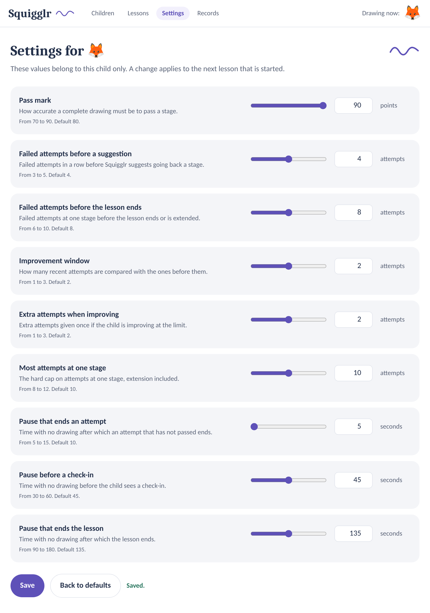
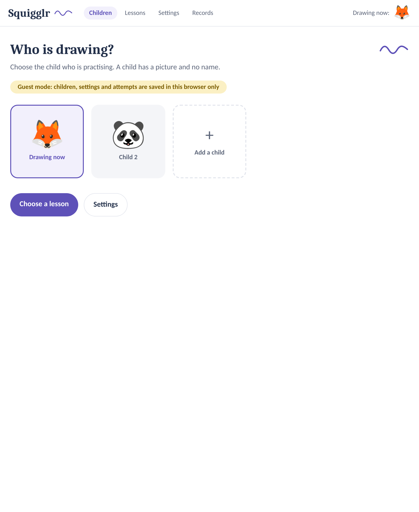
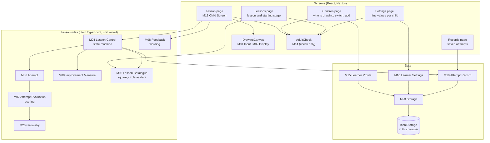
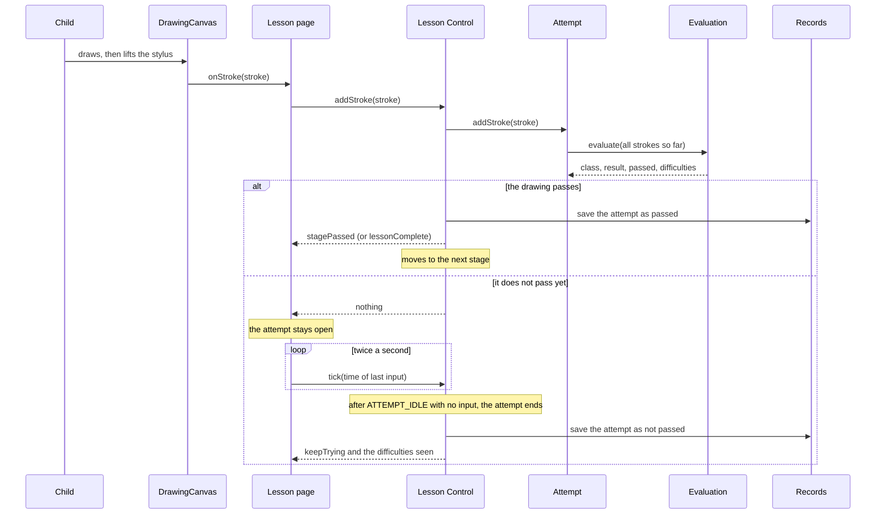

# Squigglr POC: Implementation Plan and Code

This is the plan for the Proof of Concept due **November 23, 2026**, with all of its code. It sits in `src/` beside the app, and every listing below is a copy of the file of that name in this folder. The app's 39 unit tests pass, it compiles as a production Next.js build, and the square lesson was driven from start to finish in a real browser (the screenshots below come from that run).

**What the POC is:** a website where an adult adds a child, sets that child's nine practice values, and starts the Square or Circle lesson. The child watches a demonstration, then draws through three stages with less help each time. Every attempt is scored against the adult's values and saved under that child.

| Lesson, after an attempt that did not pass | Settings for one child |
| --- | --- |
|  |  |

| Who is drawing | Records for one child |
| --- | --- |
|  |  |

## Contents

1. [Solution diagram](#1-solution-diagram)
2. [What is in the POC and what is not](#2-what-is-in-the-poc-and-what-is-not)
3. [Design choices](#3-design-choices)
4. [How a drawing is scored](#4-how-a-drawing-is-scored)
5. [How a lesson moves](#5-how-a-lesson-moves)
6. [The nine settings](#6-the-nine-settings)
7. [Project layout and file index](#7-project-layout-and-file-index)
8. [The code, part by part](#8-the-code-part-by-part)
9. [Tests](#9-tests)
10. [Build order](#10-build-order)
11. [Deploying and the domain](#11-deploying-and-the-domain)
12. [Demo script](#12-demo-script)
13. [Findings for the SRS and MIS](#13-findings-for-the-srs-and-mis)
14. [After the POC](#14-after-the-poc)

## 1. Solution diagram

Everything runs in the browser. There is no server code and no database in the POC: Vercel only serves the pages, and the data lives in the browser's `localStorage`.

The boxes are the modules of the Module Guide, with their numbers. An arrow means "uses".



What happens when the child lifts the stylus:



## 2. What is in the POC and what is not

**In:**

- Guest mode: no sign-in. Several children, each a picture with no name. One is "drawing now", and an adult can switch.
- Two lessons, Square and Circle, stored as data.
- The full lesson flow: demonstration, trace the outline, corners only, no guide.
- Scoring exactly as SRS Section 9.2 defines it, checked at every stylus lift.
- All nine adult-set values per child, with their ranges and rules, and every one of them changes how a lesson runs.
- Retry, the go-back suggestion, the one extension, the attempt limit, the hard cap and the two lesson idle timers.
- A record of every attempt (actual strokes, stage, outcome, result, difficulties, the settings in use) and of every start of a lesson, saved per child.
- A demo panel on the lesson screen that shows the live result and the counters, for showing the teaching team what the rules are doing.

**Out, on purpose:**

- Accounts and sign-in, the progress summary and the creative space (the Development Plan leaves these out of the POC).
- A database. Records stay in one browser. See [After the POC](#14-after-the-poc).
- Sound, the supported-device notice, the example drawings for the pass mark, and keeping unsaved records while offline.
- The two refinement experiments of the Development Plan. They are separate from the hosted app and are not covered here.

The SRS schedules the suggestion, extension and limit rules for Revision 0. They are in the POC anyway, because without them most of the nine settings would change nothing, and showing that the settings drive the lesson is the point of the demo.

## 3. Design choices

| Choice | Why | Where it differs from the documents |
| --- | --- | --- |
| Next.js, React, TypeScript (strict), Tailwind, Vitest, Vercel | The stack the Development Plan already chose. | None. |
| The rules are plain TypeScript in `lib/`, with no React in them | They can be unit tested without a browser, as the V&V Plan asks ("in Vitest against the module that applies the lesson rules"). The screens only show what the rules decide. | None. This is the MIS's module split. |
| One file per MIS module, same names | Anyone holding the MIS can find the code for a module, and `src/TraceToDesign.md` is easy to fill in. | None. |
| `localStorage` behind the Storage module | No backend to build, secure or pay for before the demo. Only `lib/storage.ts` touches it, so Supabase replaces one file later. | The MG plans a hosted PostgreSQL database. Records do not leave the device. |
| Guest mode, with only the adult check kept from Adult Access | Sign-in adds nothing to what the POC must prove. The adult check stays because the rules need it: a child must not be able to start a lesson, change settings or answer a suggestion. | M14 has accounts; here it is one sum to answer. |
| Plain canvas and our own Geometry module, no Paper.js | A guided lesson needs to draw lines and measure them. That is a few functions, and the MIS already says Geometry must not depend on the drawing library. Paper.js is for the creative space. | The Development Plan names Paper.js; it comes in with the creative space. |
| The drawing area is always 1000 by 1000 units | A stroke means the same thing on a phone, a tablet and a laptop, and a saved attempt can be redrawn at any size. | The MIS says CSS pixels. Units keep SAF-AHM-002 (a point keeps its place when the canvas is resized) with no extra work. |
| Mouse and finger are accepted, as well as a stylus | The demo can be given on a laptop. Only one contact is followed at a time, so a resting palm is ignored. | CON-003 asks for a stylus; finger input is its stretch goal. |
| The evaluator and the clock can be replaced in tests | A test can say "this attempt scored 79" and "ten seconds pass" directly, which is the only way to test exact boundaries. | None. |
| Idle ranges: 5 to 15 s, 30 to 60 s, 90 to 180 s | The SRS leaves them "TBD". Five seconds is the shortest pause that ends an attempt, and the default is 10. The three ranges do not overlap, so the rule "attempt idle < check-in < lesson end" can never be broken. | New values. The team should confirm them. |
| The demonstration is always shown first | UC-003 says so. Practice then starts at the stage the adult chose. | The MIS says `beginPractice` goes from D to T only. |
| A finished attempt stays on screen for 2.5 s with its feedback | Without it, a failed drawing would vanish the instant the attempt ends and the feedback would refer to nothing. | Not specified. |
| The look follows the team's A-Sense presentation | One look across the slides and the product: navy serif headings, a plain sans-serif body, lavender, mint, peach and butter panels, a purple accent, the pen's blue for strokes, and the squiggle mark. The colours are named once, in `app/globals.css`. | The slides use Cambria and Calibri, which cannot be shipped with a website. Devices that have them use them; others get Caladea and Carlito, open fonts with the same letter widths. |
| A demo panel shows the result and counters | The teaching team can see the rules working. It is labelled for adults and can be closed. | The SRS does not want a score shown to the child. Remove or hide the panel before real use. |

## 4. How a drawing is scored

Each lesson has a **figure**: its required parts and required endpoints. The square has four sides and four corners.

- **Tolerance.** A point is "on" a line when it is within `TRACE_TOL` = 5% of the figure's diagonal. For the square that is about 35 units, 7% of a side.
- **Drawn.** The share of the figure's length that has a stroke within the tolerance.
- **On figure.** The share of the child's drawn length that is within the tolerance of the figure.
- **Result.** `100 × min(drawn, on figure)`.
- **Complete.** Every part has at least `PART_COVER` = 90% of its length drawn, and every endpoint has a stroke within the tolerance.
- **Pass.** Complete, and the result is at least the child's pass mark.
- **No guide.** At the last stage the drawing is first moved and scaled to fit the figure's box, so where and how big the child drew does not matter.
- **Invalid.** No strokes, a missing coordinate, or less drawn than the tolerance (a tap). An invalid attempt is not saved and not counted.

Measured on prepared squares:

| Drawing | Result | Class | Passes at 80? |
| --- | --- | --- | --- |
| Exact square | 100 | complete | Yes |
| Square drawn 20 units off | 100 | complete | Yes |
| Wobble of up to 30 units | 100 | complete | Yes |
| Wobble of up to 40 units | 71 | incomplete | No |
| Three sides only | 79 | incomplete | No |
| Square plus one stray line across it | 83 | complete | Yes (no at a pass mark of 90) |
| Square plus a large scribble | below 70 | complete | No |

## 5. How a lesson moves

The state and the rules are those of SRS Section 9.2. In order, after each attempt that ends:

| What happened | What the lesson does |
| --- | --- |
| The drawing passes, at trace or corners | Saves it, moves to the next stage, resets the stage's counts. |
| The drawing passes with no guide | Saves it and completes the lesson. No other lesson starts. |
| The attempt is invalid or interrupted | Starts a new attempt. Nothing is counted. An interrupted attempt is saved, marked interrupted. |
| It does not pass, the failed attempts have reached the limit, and the child is not improving | Ends the lesson. |
| It does not pass, the limit is reached, the child is improving, and the cap is not reached | Gives the one extension. |
| The extension is used up, or the cap is reached | Ends the lesson. |
| It does not pass, the streak has reached the streak setting, the child is not improving, at corners or no guide | Offers the adult a go-back suggestion. The stage does not change and the child keeps practising. |
| Anything else | A new attempt at the same stage. |

"Improving" means the average of the last `IMPROVE_WINDOW` results is at least 5 points above the average of the same number of results before them.

A suggestion that the adult declines resets the streak. One that is accepted moves to the earlier stage the adult picks. One that is never answered stays pending and is recorded as ignored if a pass or the end of the lesson clears it.

## 6. The nine settings

| Setting | Range | Default | What it changes |
| --- | --- | --- | --- |
| Pass mark (`STAGE_PASS`) | 70 to 90 | 80 | How accurate a complete drawing must be. |
| Failed attempts before a suggestion (`DIFFICULTY_STREAK`) | 3 to 5 | 4 | When a go-back suggestion is offered. |
| Failed attempts before the lesson ends (`ATTEMPT_LIMIT`) | 6 to 10 | 8 | When the lesson ends or is extended. |
| Improvement window (`IMPROVE_WINDOW`) | 1 to 3 | 2 | How many attempts are compared to decide "improving". |
| Extra attempts when improving (`ATTEMPT_EXTENSION`) | 1 to 3 | 2 | The size of the one extension. |
| Most attempts at one stage (`ATTEMPT_LIMIT_MAX`) | 8 to 12 | 10 | The hard cap. |
| Pause that ends an attempt (`ATTEMPT_IDLE`) | 5 to 15 s | 10 s | How long the app waits after the last stroke before ending an attempt that has not passed. |
| Pause before a check-in (`LESSON_IDLE_PROMPT`) | 30 to 60 s | 45 s | When "Still drawing?" appears. |
| Pause that ends the lesson (`LESSON_IDLE_END`) | 90 to 180 s | 135 s | When an abandoned lesson ends. |

The first six ranges are the SRS's. The last three are proposed here. A value outside its range cannot be saved, nor can a limit that is not above the streak, or a cap below the limit. A lesson uses the values as they were when it started.

## 7. Project layout and file index

The app is the `src/` folder of this repository.

```
src/
  package.json, tsconfig.json, next.config.ts, postcss.config.mjs, vitest.config.mts
  lib/          the rules and the data: no React
  components/   the canvas, the adult check, the header
  app/          one folder per page
  plan-img/     the screenshots in this document
```

| File | MIS module | What it does |
| --- | --- | --- |
| [`lib/types.ts`](#f-types) | Shared types | The data shapes every module uses. |
| [`lib/geometry.ts`](#f-geometry) | M20 Geometry | Lengths, distances, bounding boxes, fit to a box. |
| [`lib/evaluation.ts`](#f-evaluation) | M07 Attempt Evaluation | Scores strokes against a figure. |
| [`lib/catalogue.ts`](#f-catalogue) | M05 Lesson Catalogue | The square and the circle, as data. |
| [`lib/attempt.ts`](#f-attempt) | M06 Attempt | One attempt: strokes, evaluation at each lift, when it ends. |
| [`lib/improvement.ts`](#f-improvement) | M09 Improvement Measure | The "improving" rule. |
| [`lib/lessonControl.ts`](#f-control) | M04 Lesson Control | The lesson's state machine. |
| [`lib/feedback.ts`](#f-feedback) | M08 Feedback | The wording and look of every message. |
| [`lib/settings.ts`](#f-settings) | M16 Learner Settings | Ranges, defaults, checks, load and save. |
| [`lib/profiles.ts`](#f-profiles) | M15 Learner Profile | Children and the active child. |
| [`lib/records.ts`](#f-records) | M10 Attempt Record | Lesson records and attempt records. |
| [`lib/storage.ts`](#f-storage) | M23 Storage | The only file that touches `localStorage`. |
| [`components/DrawingCanvas.tsx`](#f-canvas) | M01 Input Device, M02 Display | Pointer events to strokes; paints everything. |
| [`components/AdultCheck.tsx`](#f-adultcheck) | M14 Adult Access (check only) | The sum an adult answers. |
| [`components/useActiveLearner.ts`](#f-useactive) | part of M18 Adult View | Reads the active child for a page. |
| [`components/Header.tsx`](#f-header) | part of M18 Adult View | Navigation and "drawing now". |
| [`components/StrokePreview.tsx`](#f-preview) | part of M02 Display | Redraws a saved attempt. |
| [`components/LessonIcon.tsx`](#f-lessonicon) | part of M02 Display | A lesson's figure as a small picture. |
| [`components/Squiggle.tsx`](#f-squiggle) | part of M18 Adult View | The squiggle mark and the page title. |
| [`app/page.tsx`](#f-page-children) | part of M18 Adult View | Who is drawing: switch and add a child. |
| [`app/lessons/page.tsx`](#f-page-lessons) | part of M18 Adult View | Choose a lesson and a starting stage. |
| [`app/lesson/[id]/page.tsx`](#f-page-lesson) | M13 Child Screen | The lesson itself. |
| [`app/settings/page.tsx`](#f-page-settings) | part of M18 Adult View | The nine values. |
| [`app/records/page.tsx`](#f-page-records) | part of M18 Adult View | The saved attempts. |
| [`app/layout.tsx`, `app/globals.css`](#f-layout) | | The page frame and styles. |
| [Configuration files](#f-config) | | `package.json` and the tool settings. |
| [`lib/evaluation.test.ts`](#f-test-eval), [`lib/rules.test.ts`](#f-test-rules), [`lib/testHelpers.ts`](#f-test-helpers) | | The unit tests. |

Not in the POC: M03 Audio, M11 and M12 (creative space), M17 Progress Summary, M21, M22, M24 Connection Recovery, M25 Audit Log.

## 8. The code, part by part

### 8.1 Shared types

<a id="f-types"></a>
**`lib/types.ts`**. Every module speaks in these shapes, taken from the MIS table of shared types. They are plain data, so a stroke or a record can be saved as JSON as it is.

`src/lib/types.ts`

```ts
// Types shared between modules (MIS Table "Types shared between modules").
// Everything here is plain data, so it can be saved as JSON.

/** A position on the drawing area, in drawing units (the area is 1000 x 1000). */
export interface Point {
  x: number;
  y: number;
}

/** A line through the points, in order. The parts of a figure are paths. */
export type Path = Point[];

/** One stylus contact: its points in the order drawn, each with its time (ms). */
export interface Stroke {
  points: (Point & { t: number })[];
}

/** D = demonstration, T = trace the outline, E = endpoints only, I = independent. */
export type Stage = "D" | "T" | "E" | "I";
export type DrawingStage = "T" | "E" | "I";

export interface Figure {
  parts: Path[];
  endpoints: Point[];
}

/** What is shown to guide the child at a drawing stage. */
export interface Guide {
  outline: Path[];
  endpoints: Point[];
}

export type DifficultyKind = "missedPart" | "missedEndpoint" | "offFigure";

/** One predefined difficulty (BR-007). `index` is the part or endpoint; 0 for offFigure. */
export interface Difficulty {
  kind: DifficultyKind;
  index: number;
}

/** A difficulty seen during an attempt, and whether the child fixed it later. */
export interface Observed {
  difficulty: Difficulty;
  corrected: boolean;
}

export type EvalClass = "complete" | "incomplete" | "invalid";
export type Guidance = "assisted" | "independent";

export interface Evaluation {
  class: EvalClass;
  guidance: Guidance;
  /** Stage result, 0 to 100. */
  result: number;
  passed: boolean;
  difficulties: Difficulty[];
  /** The two shares behind the result, kept for the demo panel. */
  drawn: number;
  onFigure: number;
}

/** The nine adult-set values of one learner (BR-008). Times are in seconds. */
export interface Settings {
  stagePass: number;
  difficultyStreak: number;
  attemptLimit: number;
  improveWindow: number;
  attemptExtension: number;
  attemptLimitMax: number;
  attemptIdle: number;
  lessonIdlePrompt: number;
  lessonIdleEnd: number;
}

export type SettingName = keyof Settings;

export type FeedbackKind =
  | "stagePassed"
  | "lessonComplete"
  | "keepTrying"
  | "notEvaluable"
  | "checkIn"
  | "lessonEnded";

/** What the child is told after an event, in the order it is given. */
export interface Report {
  feedback: FeedbackKind[];
  difficulties: Difficulty[];
}

export interface Learner {
  id: string;
  avatar: string;
  createdAt: number;
}

export type RecordOutcome = "passed" | "notPassed" | "interrupted";

export interface AttemptRecord {
  id: string;
  lessonRecordId: string;
  lesson: string;
  stage: DrawingStage;
  outcome: RecordOutcome;
  /** Absent for an interrupted attempt. */
  result: number | null;
  difficulties: Observed[];
  settings: Settings;
  strokes: Stroke[];
  endedAt: number;
}

export type Ending =
  | "inProgress"
  | "completed"
  | "endedAtLimit"
  | "endedAtMax"
  | "endedIdle"
  | "unfinished";

export type SuggestionResponse = "pending" | "accepted" | "declined" | "ignored";

export interface Suggestion {
  from: DrawingStage;
  offeredAt: number;
  response: SuggestionResponse;
  /** The earlier stage the adult chose, or null if not accepted. */
  stage: DrawingStage | null;
}

export interface LessonRecord {
  id: string;
  learner: string;
  lesson: string;
  start: Stage;
  furthest: Stage;
  passes: Record<DrawingStage, number>;
  extensions: number;
  ending: Ending;
  suggestions: Suggestion[];
  startedAt: number;
}
```

### 8.2 Scoring

<a id="f-geometry"></a>
**`lib/geometry.ts`**. The measuring tools. `lengthWithin` is the one the scoring leans on: it cuts a path into short pieces and adds up the pieces that lie near another set of paths. It is used both ways round, for "how much of the figure was drawn" and "how much of the drawing is on the figure".

`src/lib/geometry.ts`

```ts
// M20 Geometry. Pure functions on points and paths. Nothing here knows about
// the canvas, the browser or a drawing library.

import type { Path, Point, Stroke } from "./types";

export interface Box {
  minX: number;
  minY: number;
  maxX: number;
  maxY: number;
}

export function toPath(stroke: Stroke): Path {
  return stroke.points.map(({ x, y }) => ({ x, y }));
}

function dist(a: Point, b: Point): number {
  return Math.hypot(a.x - b.x, a.y - b.y);
}

/** Length of a path; 0 for a path with fewer than two points. */
export function length(path: Path): number {
  let total = 0;
  for (let i = 1; i < path.length; i++) total += dist(path[i - 1], path[i]);
  return total;
}

function distanceToSegment(p: Point, a: Point, b: Point): number {
  const dx = b.x - a.x;
  const dy = b.y - a.y;
  const len2 = dx * dx + dy * dy;
  if (len2 === 0) return dist(p, a);
  const t = Math.max(0, Math.min(1, ((p.x - a.x) * dx + (p.y - a.y) * dy) / len2));
  return dist(p, { x: a.x + t * dx, y: a.y + t * dy });
}

/** Smallest distance from p to any of the paths. Infinity if there is no point. */
export function distance(p: Point, paths: Path[]): number {
  let best = Infinity;
  for (const path of paths) {
    if (path.length === 1) best = Math.min(best, dist(p, path[0]));
    for (let i = 1; i < path.length; i++) {
      best = Math.min(best, distanceToSegment(p, path[i - 1], path[i]));
    }
  }
  return best;
}

/**
 * Length of the parts of `path` that are within distance d of a path in
 * `others`. The path is cut into pieces no longer than `step`; a piece counts
 * when its midpoint is within d.
 */
export function lengthWithin(path: Path, others: Path[], d: number, step = 4): number {
  let total = 0;
  for (let i = 1; i < path.length; i++) {
    const a = path[i - 1];
    const b = path[i];
    const segLen = dist(a, b);
    if (segLen === 0) continue;
    const pieces = Math.max(1, Math.ceil(segLen / step));
    const pieceLen = segLen / pieces;
    for (let j = 0; j < pieces; j++) {
      const t = (j + 0.5) / pieces;
      const mid = { x: a.x + (b.x - a.x) * t, y: a.y + (b.y - a.y) * t };
      if (distance(mid, others) <= d) total += pieceLen;
    }
  }
  return total;
}

export function boundingBox(paths: Path[]): Box {
  const box = { minX: Infinity, minY: Infinity, maxX: -Infinity, maxY: -Infinity };
  for (const path of paths) {
    for (const p of path) {
      box.minX = Math.min(box.minX, p.x);
      box.minY = Math.min(box.minY, p.y);
      box.maxX = Math.max(box.maxX, p.x);
      box.maxY = Math.max(box.maxY, p.y);
    }
  }
  return box;
}

export function diagonal(box: Box): number {
  return Math.hypot(box.maxX - box.minX, box.maxY - box.minY);
}

/**
 * Moves and uniformly scales the paths so that their bounding box is centred
 * on `target` and its longer side matches the target's longer side (stage I).
 */
export function fitToBox(paths: Path[], target: Box): Path[] {
  const box = boundingBox(paths);
  const longer = Math.max(box.maxX - box.minX, box.maxY - box.minY);
  const targetLonger = Math.max(target.maxX - target.minX, target.maxY - target.minY);
  const scale = longer > 0 ? targetLonger / longer : 1;
  const cx = (box.minX + box.maxX) / 2;
  const cy = (box.minY + box.maxY) / 2;
  const tx = (target.minX + target.maxX) / 2;
  const ty = (target.minY + target.maxY) / 2;
  return paths.map((path) =>
    path.map((p) => ({ x: tx + (p.x - cx) * scale, y: ty + (p.y - cy) * scale })),
  );
}
```

<a id="f-evaluation"></a>
**`lib/evaluation.ts`**. One function, `evaluate`, that turns strokes and a figure into a class, a result and a pass or no pass. It keeps no state and gives the same answer every time for the same input. `TRACE_TOL` and `PART_COVER` live here and nowhere else, so the team's calibration changes two lines.

`src/lib/evaluation.ts`

```ts
// M07 Attempt Evaluation. Scores the strokes of an attempt against a lesson's
// figure, exactly as SRS Section 9.2 defines it. Stateless and deterministic.

import { boundingBox, diagonal, distance, fitToBox, length, lengthWithin, toPath } from "./geometry";
import type { Difficulty, DrawingStage, Evaluation, Figure, Path, Stroke } from "./types";

/** Largest distance that counts as "on the figure", in percent of the figure's diagonal. */
export const TRACE_TOL = 5;
/** Share of a required part that must be drawn for the part to count, in percent. */
export const PART_COVER = 90;

export type Evaluate = (
  strokes: Stroke[],
  figure: Figure,
  stage: DrawingStage,
  allowed: Difficulty[],
  stagePass: number,
) => Evaluation;

export function tolerance(figure: Figure): number {
  return (TRACE_TOL / 100) * diagonal(boundingBox(figure.parts));
}

function isValid(strokes: Stroke[], tol: number): boolean {
  if (strokes.length === 0) return false;
  for (const s of strokes) {
    if (s.points.length === 0) return false;
    for (const p of s.points) {
      if (!Number.isFinite(p.x) || !Number.isFinite(p.y)) return false;
    }
  }
  // A tap or a mark shorter than the tolerance is too little to judge.
  const total = strokes.reduce((sum, s) => sum + length(toPath(s)), 0);
  return total >= tol;
}

export const evaluate: Evaluate = (strokes, figure, stage, allowed, stagePass) => {
  if (figure.parts.length === 0) throw new Error("emptyFigure");
  const guidance = stage === "I" ? "independent" : "assisted";
  const tol = tolerance(figure);

  if (!isValid(strokes, tol)) {
    return { class: "invalid", guidance, result: 0, passed: false, difficulties: [], drawn: 0, onFigure: 0 };
  }

  // With no guide, where and how big the child drew does not matter.
  let drawnPaths: Path[] = strokes.map(toPath);
  if (stage === "I") drawnPaths = fitToBox(drawnPaths, boundingBox(figure.parts));

  const found: Difficulty[] = [];

  // Share of the figure that was drawn, and which required parts are missing.
  let figureLength = 0;
  let figureCovered = 0;
  figure.parts.forEach((part, index) => {
    const partLength = length(part);
    const covered = lengthWithin(part, drawnPaths, tol);
    figureLength += partLength;
    figureCovered += covered;
    if (covered < (PART_COVER / 100) * partLength) found.push({ kind: "missedPart", index });
  });

  figure.endpoints.forEach((endpoint, index) => {
    if (distance(endpoint, drawnPaths) > tol) found.push({ kind: "missedEndpoint", index });
  });

  // Share of what was drawn that lies on the figure.
  const drawnLength = drawnPaths.reduce((sum, p) => sum + length(p), 0);
  const drawnOnFigure = drawnPaths.reduce((sum, p) => sum + lengthWithin(p, figure.parts, tol), 0);

  const drawn = figureCovered / figureLength;
  const onFigure = drawnOnFigure / drawnLength;
  const result = 100 * Math.min(drawn, onFigure);

  const complete = found.length === 0;
  if (100 * onFigure < stagePass) found.push({ kind: "offFigure", index: 0 });

  return {
    class: complete ? "complete" : "incomplete",
    guidance,
    result,
    passed: complete && result >= stagePass,
    // Only the difficulties the team predefined for this stage are reported.
    difficulties: found.filter((d) => allowed.some((a) => a.kind === d.kind && a.index === d.index)),
    drawn,
    onFigure,
  };
};
```

<a id="f-catalogue"></a>
**`lib/catalogue.ts`**. The lessons, as data. To add the triangle, add an entry: no rule changes. The guide for each stage is derived from the figure, so a lesson cannot show an outline that differs from what it is scored against.

`src/lib/catalogue.ts`

```ts
// M05 Lesson Catalogue. Lessons are data: adding a lesson means adding an
// entry to LESSONS, with no change to the rules (NFR-MAINT-001).
// The drawing area is 1000 x 1000 units, whatever the size of the screen.

import type { Difficulty, DrawingStage, Figure, Guide, Path, Point } from "./types";

export interface Lesson {
  id: string;
  name: string;
  category: "line" | "shape" | "simpleDrawing";
  /** The required parts, in the order the demonstration draws them, and the required endpoints. */
  figure: Figure;
}

/** A quarter of a circle as a path of short straight pieces. Angles in degrees, clockwise from the top. */
function arc(cx: number, cy: number, r: number, from: number, to: number, pieces = 16): Path {
  const path: Path = [];
  for (let i = 0; i <= pieces; i++) {
    const a = ((from + ((to - from) * i) / pieces) * Math.PI) / 180;
    path.push({ x: cx + r * Math.sin(a), y: cy - r * Math.cos(a) });
  }
  return path;
}

const corners: Point[] = [
  { x: 250, y: 250 },
  { x: 750, y: 250 },
  { x: 750, y: 750 },
  { x: 250, y: 750 },
];

export const LESSONS: Lesson[] = [
  {
    id: "square",
    name: "Square",
    category: "shape",
    // Four sides; four corners (SRS Table "Initial lesson catalogue").
    figure: {
      parts: corners.map((c, i) => [c, corners[(i + 1) % 4]]),
      endpoints: corners,
    },
  },
  {
    id: "circle",
    name: "Circle",
    category: "shape",
    // Four quarter arcs, which together close the circle. The SRS lists no
    // endpoints for the circle, which would leave the endpoints-only stage
    // with nothing to show, so the POC uses the four points where the arcs meet.
    figure: {
      parts: [0, 90, 180, 270].map((a) => arc(500, 500, 250, a, a + 90)),
      endpoints: [0, 90, 180, 270].map((a) => arc(500, 500, 250, a, a, 1)[0]),
    },
  },
];

export function lesson(id: string): Lesson {
  const found = LESSONS.find((l) => l.id === id);
  if (!found) throw new Error("unknownLesson");
  return found;
}

/** The whole figure as the outline at T, only the endpoints at E, nothing at I. */
export function guide(id: string, stage: DrawingStage): Guide {
  const { figure } = lesson(id);
  if (stage === "T") return { outline: figure.parts, endpoints: [] };
  if (stage === "E") return { outline: [], endpoints: figure.endpoints };
  return { outline: [], endpoints: [] };
}

/** The predefined difficulties of a stage: any missed part, any missed endpoint, or drawing off the figure. */
export function difficulties(id: string, _stage: DrawingStage): Difficulty[] {
  const { figure } = lesson(id);
  return [
    ...figure.parts.map((_, index): Difficulty => ({ kind: "missedPart", index })),
    ...figure.endpoints.map((_, index): Difficulty => ({ kind: "missedEndpoint", index })),
    { kind: "offFigure", index: 0 },
  ];
}
```

### 8.3 The lesson rules

<a id="f-attempt"></a>
**`lib/attempt.ts`**. One attempt. It is evaluated at every stylus lift and ends at once on a pass. Otherwise it stays open until `checkIdle` finds that the pause has run out. It also keeps the list of difficulties seen, marking one as corrected rather than removing it.

`src/lib/attempt.ts`

```ts
// M06 Attempt. One attempt at one drawing stage: it collects strokes, has
// them evaluated at every stylus lift, and decides when it has ended.

import type { Evaluate } from "./evaluation";
import type { Difficulty, DrawingStage, Evaluation, Figure, Observed, Stroke } from "./types";

export type Outcome = "open" | "passed" | "notPassed" | "invalid" | "interrupted";

const same = (a: Difficulty, b: Difficulty) => a.kind === b.kind && a.index === b.index;

export class Attempt {
  strokes: Stroke[] = [];
  /** The evaluation after the most recent stylus lift. */
  last: Evaluation | null = null;
  /** Every difficulty seen so far. A correction marks it; it is never removed. */
  seen: Observed[] = [];
  outcome: Outcome = "open";
  endedAt: number | null = null;

  constructor(
    readonly lesson: string,
    readonly stage: DrawingStage,
    private figure: Figure,
    private allowed: Difficulty[],
    private stagePass: number,
    /** Seconds. */
    private attemptIdle: number,
    private evaluate: Evaluate,
  ) {}

  /** Called at each stylus lift. Evaluates all strokes so far; a pass ends the attempt at once. */
  addStroke(stroke: Stroke, now: number): void {
    if (this.outcome !== "open") throw new Error("attemptEnded");
    this.strokes.push(stroke);
    this.last = this.evaluate(this.strokes, this.figure, this.stage, this.allowed, this.stagePass);
    // Something drawn off the figure is noted at every lift. A missed part or
    // endpoint is not: the child may simply not have drawn it yet.
    this.note(this.last.difficulties.filter((d) => d.kind === "offFigure"), ["offFigure"]);
    if (this.last.passed) this.end("passed", now);
  }

  /** Ends an open attempt that has strokes once attemptIdle has passed since the last input. */
  checkIdle(now: number, lastInputAt: number): void {
    if (this.outcome !== "open" || this.strokes.length === 0 || this.last === null) return;
    if (now - lastInputAt < this.attemptIdle * 1000) return;
    if (this.last.class === "invalid") {
      this.end("invalid", now);
      return;
    }
    this.note(this.last.difficulties, ["missedPart", "missedEndpoint", "offFigure"]);
    this.end("notPassed", now);
  }

  /** Ends the attempt with no result, keeping its strokes and difficulties. */
  interrupt(now: number): void {
    if (this.outcome !== "open") throw new Error("attemptEnded");
    this.last = null;
    this.end("interrupted", now);
  }

  private end(outcome: Outcome, now: number): void {
    this.outcome = outcome;
    this.endedAt = now;
  }

  private note(observedNow: Difficulty[], kinds: Difficulty["kind"][]): void {
    for (const entry of this.seen) {
      if (kinds.includes(entry.difficulty.kind)) {
        entry.corrected = !observedNow.some((d) => same(d, entry.difficulty));
      }
    }
    for (const d of observedNow) {
      if (!this.seen.some((entry) => same(entry.difficulty, d))) {
        this.seen.push({ difficulty: d, corrected: false });
      }
    }
  }
}
```

<a id="f-improvement"></a>
**`lib/improvement.ts`**. The "improving" rule on its own, so a different measure later changes only this file.

`src/lib/improvement.ts`

```ts
// M09 Improvement Measure. The measure is this module's secret, so a different
// way of deciding "improving" changes only this file.

/** Smallest rise in the average stage result that counts as improvement. */
export const IMPROVE_MARGIN = 5;

/**
 * True when the average of the last `window` results is at least
 * IMPROVE_MARGIN above the average of the `window` results before them.
 * False when there are fewer than 2 * window results.
 */
export function improving(history: number[], window: number): boolean {
  const m = history.length;
  if (m < 2 * window) return false;
  const avg = (xs: number[]) => xs.reduce((a, b) => a + b, 0) / xs.length;
  const recent = avg(history.slice(m - window));
  const before = avg(history.slice(m - 2 * window, m - window));
  return recent - before >= IMPROVE_MARGIN;
}
```

<a id="f-control"></a>
**`lib/lessonControl.ts`**. The centre of the app. Its fields are the state of SRS Section 9.2 (the comments give the SRS's letters), and `afterFailedAttempt` is the transition table, in the table's order. It has no timers and no screen: the page calls `addStroke` and `tick`, and shows the report that comes back.

`src/lib/lessonControl.ts`

```ts
// M04 Guided Lesson Control. The state machine of SRS Section 9.2: which stage
// the child is at, when an attempt counts, and when the lesson moves on,
// offers a go-back suggestion, grants its one extension or ends.
// It has no UI and no timers of its own: the screen calls addStroke at each
// stylus lift and tick about once a second.

import { Attempt } from "./attempt";
import * as catalogue from "./catalogue";
import { evaluate as realEvaluate, type Evaluate } from "./evaluation";
import { improving } from "./improvement";
import type { RecordStore } from "./records";
import type { DrawingStage, Ending, Evaluation, Report, Settings, Stage, Stroke } from "./types";

export type Status = "noLesson" | "active" | "suggested" | "ended";

const ORDER: Stage[] = ["D", "T", "E", "I"];
const later = (a: Stage, b: Stage): Stage => (ORDER.indexOf(a) >= ORDER.indexOf(b) ? a : b);
const NOTHING: Report = { feedback: [], difficulties: [] };

export interface Deps {
  records: RecordStore;
  /** Tests replace these to give each attempt's result and the time directly. */
  evaluate?: Evaluate;
  now?: () => number;
}

export class LessonControl {
  status: Status = "noLesson"; // q
  lessonId = ""; // l (the lesson)
  learner = ""; // p
  stage: Stage = "D"; // l (the stage)
  furthest: Stage = "D"; // f
  failed = 0; // n_f: failed attempts at this stage
  evaluable = 0; // n_a: counted attempts at this stage
  streak = 0; // k: failed attempts in a row
  history: number[] = []; // H: results of the counted attempts at this stage
  suggestionPending = false; // s
  extended = false; // z
  sinceExtension = 0; // x
  settings!: Settings;
  attempt: Attempt | null = null;
  ending: Ending = "inProgress";
  /** Whether the idle check-in is showing. */
  prompted = false;
  /** The evaluation of the attempt that ended last, for the demo panel. */
  lastFinal: Evaluation | null = null;

  private startAt: DrawingStage = "T";
  private recordId = "";
  private suggestionIndex = 0;
  private activityBase = 0;
  private records: RecordStore;
  private evaluate: Evaluate;
  private now: () => number;

  constructor(deps: Deps) {
    this.records = deps.records;
    this.evaluate = deps.evaluate ?? realEvaluate;
    this.now = deps.now ?? Date.now;
  }

  /**
   * The adult chooses a lesson and its starting stage. The demonstration is
   * always shown first (UC-003 step 1); practice then starts at the chosen stage.
   * The settings are read once, here: a later change applies to the next lesson.
   */
  select(learner: string, lessonId: string, start: Stage, settings: Settings): void {
    catalogue.lesson(lessonId); // throws unknownLesson
    if (this.status === "active" || this.status === "suggested") this.stop();
    this.learner = learner;
    this.lessonId = lessonId;
    this.settings = { ...settings };
    this.startAt = start === "D" ? "T" : start;
    this.stage = "D";
    this.furthest = start;
    this.status = "active";
    this.ending = "inProgress";
    this.lastFinal = null;
    this.attempt = null;
    this.resetStage();
    this.recordId = this.records.startLesson(learner, lessonId, start);
  }

  /** The child continues after the demonstration. */
  beginPractice(): void {
    if (this.status !== "active" || this.stage !== "D") throw new Error("notAtDemonstration");
    this.enterStage(this.startAt);
  }

  /** A finished stroke. A pass ends the attempt here, at the stylus lift. */
  addStroke(stroke: Stroke): Report {
    if (!this.isRunning() || this.attempt === null) throw new Error("noAttempt");
    const attempt = this.attempt;
    attempt.addStroke(stroke, this.now());
    if (attempt.outcome !== "passed") return NOTHING;

    const stage = attempt.stage;
    this.lastFinal = attempt.last;
    this.save(attempt, "passed");
    this.records.recordPass(this.recordId, stage);
    this.evaluable += 1;
    this.clearSuggestion("ignored");

    if (stage === "I") {
      this.finish("completed");
      return { feedback: ["lessonComplete"], difficulties: [] };
    }
    this.enterStage(stage === "T" ? "E" : "I");
    return { feedback: ["stagePassed"], difficulties: [] };
  }

  /**
   * Called about once a second with the time of the child's last input.
   * Ends an idle attempt, applies the stopping rules, and handles the
   * lesson's own idle check-in and idle end.
   */
  tick(lastInputAt: number | null): Report {
    if (!this.isRunning()) return NOTHING;
    const now = this.now();
    const lastActivity = Math.max(lastInputAt ?? 0, this.activityBase);
    const idleSeconds = (now - lastActivity) / 1000;

    if (idleSeconds >= this.settings.lessonIdleEnd) {
      this.finish("endedIdle");
      return { feedback: ["lessonEnded"], difficulties: [] };
    }

    const attempt = this.attempt;
    if (attempt !== null) {
      attempt.checkIdle(now, lastActivity);
      if (attempt.outcome === "invalid") {
        // Not saved and not counted (FR-LRN-010, FR-LRN-032).
        this.newAttempt();
        return { feedback: ["notEvaluable"], difficulties: [] };
      }
      if (attempt.outcome === "notPassed") return this.afterFailedAttempt(attempt);
    }

    if (idleSeconds >= this.settings.lessonIdlePrompt) {
      if (!this.prompted) {
        this.prompted = true;
        return { feedback: ["checkIn"], difficulties: [] };
      }
    } else {
      this.prompted = false;
    }
    return NOTHING;
  }

  /** The input was cut off (for example a pointercancel). Kept apart, never counted. */
  interrupt(): void {
    if (!this.isRunning() || this.attempt === null) return;
    if (this.attempt.strokes.length > 0) {
      this.attempt.interrupt(this.now());
      this.save(this.attempt, "interrupted");
    }
    this.newAttempt();
  }

  /** The adult answers a go-back suggestion. Accepting needs an earlier stage. */
  answerSuggestion(accept: boolean, stage?: DrawingStage): void {
    if (!this.suggestionPending) throw new Error("noSuggestion");
    if (!accept) {
      this.clearSuggestion("declined");
      this.streak = 0; // a new suggestion needs a whole new streak
      return;
    }
    if (stage === undefined || ORDER.indexOf(stage) >= ORDER.indexOf(this.stage)) {
      throw new Error("notEarlierStage");
    }
    this.clearSuggestion("accepted", stage);
    this.interruptOpenAttempt();
    this.enterStage(stage);
  }

  /** The adult leaves the lesson. It ends as unfinished. */
  stop(): void {
    if (!this.isRunning()) return;
    this.interruptOpenAttempt();
    this.finish("unfinished");
  }

  // ----- the rules -----

  private afterFailedAttempt(attempt: Attempt): Report {
    const s = this.settings;
    this.lastFinal = attempt.last;
    this.save(attempt, "notPassed");
    this.evaluable += 1;
    this.failed += 1;
    this.streak += 1;
    this.history.push(attempt.last!.result);
    if (this.extended) this.sinceExtension += 1;

    const report: Report = {
      feedback: ["keepTrying"], // the effort is acknowledged first (NFR-UX-016)
      difficulties: attempt.seen.filter((o) => !o.corrected).map((o) => o.difficulty),
    };
    const isImproving = improving(this.history, s.improveWindow);
    const atCap = this.evaluable >= s.attemptLimitMax;

    // The first rule that holds applies, in this order (SRS Table "Guided lesson state transitions").
    const endAtLimit = this.extended
      ? this.sinceExtension >= s.attemptExtension || atCap
      : this.failed >= s.attemptLimit && (!isImproving || atCap);

    if (endAtLimit) {
      this.finish(atCap ? "endedAtMax" : "endedAtLimit");
      report.feedback.push("lessonEnded");
      return report;
    }
    if (!this.extended && this.failed >= s.attemptLimit && isImproving) {
      this.extended = true; // granted once per stage
      this.sinceExtension = 0;
      this.records.recordExtension(this.recordId);
    } else if (
      this.status === "active" &&
      !this.suggestionPending &&
      (this.stage === "E" || this.stage === "I") &&
      this.streak >= s.difficultyStreak &&
      !isImproving
    ) {
      // The stage does not change; the child keeps practising while it is pending.
      this.suggestionPending = true;
      this.status = "suggested";
      this.suggestionIndex = this.records.offerSuggestion(this.recordId, this.stage, this.now());
    }
    this.newAttempt();
    return report;
  }

  // ----- helpers -----

  private isRunning(): boolean {
    return this.status === "active" || this.status === "suggested";
  }

  private resetStage(): void {
    this.failed = 0;
    this.evaluable = 0;
    this.streak = 0;
    this.history = [];
    this.suggestionPending = false;
    this.extended = false;
    this.sinceExtension = 0;
    this.prompted = false;
    this.activityBase = this.now();
  }

  private enterStage(stage: DrawingStage): void {
    this.stage = stage;
    this.furthest = later(this.furthest, stage);
    this.resetStage();
    this.newAttempt();
  }

  private newAttempt(): void {
    const stage = this.stage as DrawingStage;
    this.attempt = new Attempt(
      this.lessonId,
      stage,
      catalogue.lesson(this.lessonId).figure,
      catalogue.difficulties(this.lessonId, stage),
      this.settings.stagePass,
      this.settings.attemptIdle,
      this.evaluate,
    );
  }

  private interruptOpenAttempt(): void {
    if (this.attempt !== null && this.attempt.outcome === "open" && this.attempt.strokes.length > 0) {
      this.attempt.interrupt(this.now());
      this.save(this.attempt, "interrupted");
    }
    this.attempt = null;
  }

  private clearSuggestion(response: "accepted" | "declined" | "ignored", stage: DrawingStage | null = null): void {
    if (!this.suggestionPending) return;
    this.records.answerSuggestion(this.recordId, this.suggestionIndex, response, stage);
    this.suggestionPending = false;
    this.status = "active";
  }

  private save(attempt: Attempt, outcome: "passed" | "notPassed" | "interrupted"): void {
    this.records.saveAttempt(this.recordId, {
      lesson: attempt.lesson,
      stage: attempt.stage,
      outcome,
      result: outcome === "interrupted" ? null : attempt.last!.result,
      difficulties: attempt.seen,
      settings: this.settings,
      strokes: attempt.strokes, // the actual strokes, never a corrected shape (BR-004)
      endedAt: attempt.endedAt!,
    });
  }

  private finish(ending: Ending): void {
    this.clearSuggestion("ignored");
    this.status = "ended";
    this.ending = ending;
    this.attempt = null;
    this.records.endLesson(this.recordId, ending, this.furthest);
  }
}
```

<a id="f-feedback"></a>
**`lib/feedback.ts`**. What each message says. Lesson Control picks the kind of feedback; this file owns the words, so the specialists' wording changes can be made here without touching a rule.

`src/lib/feedback.ts`

```ts
// M08 Feedback. What each message says and shows. Lesson Control decides
// which feedback is given; this file decides only its wording and look, so
// either can change without the other. Every message describes the drawing,
// never the child, and nothing marks a drawing as "wrong".

import type { DifficultyKind, FeedbackKind } from "./types";

export interface Feedback {
  message: string;
  image: string;
  colour: string;
}

const KINDS: Record<FeedbackKind, Feedback> = {
  stagePassed: { message: "You did it! Here comes the next one.", image: "🌟", colour: "#24735b" },
  lessonComplete: { message: "All done! What a drawing!", image: "🎉", colour: "#24735b" },
  keepTrying: { message: "Nice try! Let's draw it again.", image: "💪", colour: "#5e51b8" },
  notEvaluable: { message: "Let's try that one again.", image: "✏️", colour: "#5e51b8" },
  checkIn: { message: "Still drawing? Tap to keep going.", image: "👋", colour: "#5e51b8" },
  lessonEnded: { message: "Good practice today!", image: "🌈", colour: "#5e51b8" },
};

const DIFFICULTIES: Record<DifficultyKind, Feedback> = {
  missedPart: { message: "A piece of the shape is not drawn yet.", image: "🧩", colour: "#b84a30" },
  missedEndpoint: { message: "The line did not reach a corner.", image: "📍", colour: "#b84a30" },
  offFigure: { message: "Some lines went away from the shape.", image: "↗️", colour: "#b84a30" },
};

export const feedback = (kind: FeedbackKind): Feedback => KINDS[kind];
export const difficultyFeedback = (kind: DifficultyKind): Feedback => DIFFICULTIES[kind];
/** Every approved message, so the wording can be reviewed in one place. */
export const allFeedback = (): Feedback[] => [...Object.values(KINDS), ...Object.values(DIFFICULTIES)];
```

### 8.4 Data

<a id="f-storage"></a>
**`lib/storage.ts`**. Four functions: `get`, `put`, `list`, `remove`. Nothing else in the app knows where data is kept. A saved attempt cannot be changed.

`src/lib/storage.ts`

```ts
// M23 Storage. The only file that touches localStorage. Every other module
// saves and reads through these four functions, so moving to a hosted
// database (Supabase, in the Development Plan) changes only this file.

export type Kind = "learner" | "settings" | "lessonRecord" | "attempt" | "active";

interface Item<T> {
  id: string;
  owner: string | null; // the learner the item belongs to, or null
  value: T;
}

const PREFIX = "squigglr:v1";
const key = (kind: Kind, id: string) => `${PREFIX}:${kind}:${id}`;

// On the server (and in unit tests) there is no localStorage; use memory.
const memory = new Map<string, string>();
const store = {
  get: (k: string) => (typeof localStorage === "undefined" ? (memory.get(k) ?? null) : localStorage.getItem(k)),
  set: (k: string, v: string) => (typeof localStorage === "undefined" ? void memory.set(k, v) : localStorage.setItem(k, v)),
  remove: (k: string) => (typeof localStorage === "undefined" ? void memory.delete(k) : localStorage.removeItem(k)),
  keys: () =>
    typeof localStorage === "undefined"
      ? [...memory.keys()]
      : Array.from({ length: localStorage.length }, (_, i) => localStorage.key(i)!),
};

export function get<T>(kind: Kind, id: string): T | null {
  const raw = store.get(key(kind, id));
  return raw === null ? null : (JSON.parse(raw) as Item<T>).value;
}

/**
 * Saves an item, creating or replacing it. A saved attempt is never replaced
 * (FR-REC-009): saving the same attempt again changes nothing, and saving a
 * different one under the same id is refused.
 */
export function put<T>(kind: Kind, id: string, value: T, owner: string | null = null): void {
  const next = JSON.stringify({ id, owner, value } satisfies Item<T>);
  if (kind === "attempt") {
    const existing = store.get(key(kind, id));
    if (existing !== null) {
      if (existing === next) return;
      throw new Error("unchangeable");
    }
  }
  store.set(key(kind, id), next);
}

/** Every item of a kind, or only those of one learner. */
export function list<T>(kind: Kind, owner?: string): T[] {
  const start = `${PREFIX}:${kind}:`;
  return store
    .keys()
    .filter((k) => k.startsWith(start))
    .map((k) => JSON.parse(store.get(k)!) as Item<T>)
    .filter((item) => owner === undefined || item.owner === owner)
    .map((item) => item.value);
}

export function remove(kind: Kind, id: string): void {
  store.remove(key(kind, id));
}

export function newId(): string {
  return typeof crypto !== "undefined" && "randomUUID" in crypto
    ? crypto.randomUUID()
    : `${Date.now()}-${Math.random().toString(36).slice(2)}`;
}
```

<a id="f-settings"></a>
**`lib/settings.ts`**. The ranges, the defaults (the middle of each range) and `check`, which names every value that cannot be saved. The Settings page and the tests both use `check`, so the screen cannot allow something the rules reject.

`src/lib/settings.ts`

```ts
// M16 Learner Settings. Ranges, defaults and the rules between values.
// Saving goes through the Storage module.

import * as storage from "./storage";
import type { SettingName, Settings } from "./types";

export interface Range {
  min: number;
  max: number;
  default: number;
  label: string;
  unit: string;
  help: string;
}

const range = (min: number, max: number, label: string, unit: string, help: string): Range => ({
  min,
  max,
  default: Math.round((min + max) / 2), // BR-008: the default is the middle of the range
  label,
  unit,
  help,
});

/**
 * The first six ranges are the SRS's. The SRS leaves the three idle ranges
 * "TBD", so those are this POC's proposal. They are chosen so that
 * attemptIdle < lessonIdlePrompt < lessonIdleEnd holds for every allowed value.
 */
export const RANGES: Record<SettingName, Range> = {
  stagePass: range(70, 90, "Pass mark", "points", "How accurate a complete drawing must be to pass a stage."),
  difficultyStreak: range(3, 5, "Failed attempts before a suggestion", "attempts", "Failed attempts in a row before Squigglr suggests going back a stage."),
  attemptLimit: range(6, 10, "Failed attempts before the lesson ends", "attempts", "Failed attempts at one stage before the lesson ends or is extended."),
  improveWindow: range(1, 3, "Improvement window", "attempts", "How many recent attempts are compared with the ones before them."),
  attemptExtension: range(1, 3, "Extra attempts when improving", "attempts", "Extra attempts given once if the child is improving at the limit."),
  attemptLimitMax: range(8, 12, "Most attempts at one stage", "attempts", "The hard cap on attempts at one stage, extension included."),
  attemptIdle: range(5, 15, "Pause that ends an attempt", "seconds", "Time with no drawing after which an attempt that has not passed ends."),
  lessonIdlePrompt: range(30, 60, "Pause before a check-in", "seconds", "Time with no drawing before the child sees a check-in."),
  lessonIdleEnd: range(90, 180, "Pause that ends the lesson", "seconds", "Time with no drawing after which the lesson ends."),
};

export const SETTING_NAMES = Object.keys(RANGES) as SettingName[];

export function defaults(): Settings {
  const s = {} as Settings;
  for (const name of SETTING_NAMES) s[name] = RANGES[name].default;
  return s;
}

/**
 * The values that cannot be saved: outside their range, not whole numbers, or
 * breaking a rule between values (both values of a broken rule are given).
 * An empty list means the settings can be saved.
 */
export function check(s: Settings): SettingName[] {
  const bad = new Set<SettingName>();
  for (const name of SETTING_NAMES) {
    const v = s[name];
    const r = RANGES[name];
    if (!Number.isInteger(v) || v < r.min || v > r.max) bad.add(name);
  }
  const rule = (ok: boolean, a: SettingName, b: SettingName) => {
    if (!ok) {
      bad.add(a);
      bad.add(b);
    }
  };
  rule(s.attemptLimit > s.difficultyStreak, "attemptLimit", "difficultyStreak");
  rule(s.attemptLimitMax >= s.attemptLimit, "attemptLimitMax", "attemptLimit");
  rule(s.attemptIdle < s.lessonIdlePrompt, "attemptIdle", "lessonIdlePrompt");
  rule(s.lessonIdlePrompt < s.lessonIdleEnd, "lessonIdlePrompt", "lessonIdleEnd");
  return [...bad];
}

/** The learner's saved values, with the default for any value not chosen. */
export function load(learnerId: string): Settings {
  return { ...defaults(), ...(storage.get<Partial<Settings>>("settings", learnerId) ?? {}) };
}

/** Saves the values. Throws if any value fails `check`, so no bad value is ever saved. */
export function save(learnerId: string, s: Settings): void {
  if (check(s).length > 0) throw new Error("invalidSettings");
  storage.put("settings", learnerId, s, learnerId);
}
```

<a id="f-profiles"></a>
**`lib/profiles.ts`**. A child is a generated id and a picture.

`src/lib/profiles.ts`

```ts
// M15 Learner Profile. A profile is a generated id and an avatar, nothing
// else: no name and no photo (BR-001).

import * as settings from "./settings";
import * as storage from "./storage";
import type { Learner } from "./types";

export const AVATARS = ["🦊", "🐼", "🐸", "🦁", "🐙", "🦄", "🐢", "🐝"];

/** Creates a profile and saves the default settings for it. */
export function create(avatar: string): Learner {
  const learner: Learner = { id: storage.newId(), avatar, createdAt: Date.now() };
  storage.put("learner", learner.id, learner);
  settings.save(learner.id, settings.defaults());
  return learner;
}

/** Every profile, in the order they were created. */
export function learners(): Learner[] {
  return storage.list<Learner>("learner").sort((a, b) => a.createdAt - b.createdAt);
}

export function setActive(learnerId: string): void {
  storage.put("active", "current", learnerId);
}

export function clearActive(): void {
  storage.remove("active", "current");
}

/** The active learner, or null when no child has been chosen. */
export function active(): Learner | null {
  const id = storage.get<string>("active", "current");
  return id === null ? null : storage.get<Learner>("learner", id);
}
```

<a id="f-records"></a>
**`lib/records.ts`**. A lesson record for every start of a lesson, and an attempt record under it for every attempt that ended. `RecordStore` is the interface Lesson Control writes to; the tests give it an in-memory one.

`src/lib/records.ts`

```ts
// M10 Attempt Record. Lesson records and attempt records, kept per learner.
// Only Lesson Control writes here; the Records page reads.

import * as storage from "./storage";
import type { AttemptRecord, DrawingStage, Ending, LessonRecord, Stage, SuggestionResponse } from "./types";

/** The interface Lesson Control needs. Tests pass an in-memory version. */
export interface RecordStore {
  startLesson(learner: string, lesson: string, start: Stage): string;
  saveAttempt(recordId: string, attempt: Omit<AttemptRecord, "id" | "lessonRecordId">): void;
  recordPass(recordId: string, stage: DrawingStage): void;
  recordExtension(recordId: string): void;
  offerSuggestion(recordId: string, from: DrawingStage, at: number): number;
  answerSuggestion(recordId: string, index: number, response: SuggestionResponse, stage: DrawingStage | null): void;
  endLesson(recordId: string, ending: Ending, furthest: Stage): void;
}

function open(recordId: string): LessonRecord {
  const record = storage.get<LessonRecord>("lessonRecord", recordId);
  if (record === null) throw new Error("unknownRecord");
  // After a lesson ends, its record never changes (FR-REC-009).
  if (record.ending !== "inProgress") throw new Error("lessonEnded");
  return record;
}

const write = (record: LessonRecord) => storage.put("lessonRecord", record.id, record, record.learner);

export const records: RecordStore = {
  // A new record every time, even for a lesson started before, so earlier
  // attempts are kept.
  startLesson(learner, lesson, start) {
    const record: LessonRecord = {
      id: storage.newId(),
      learner,
      lesson,
      start,
      furthest: start,
      passes: { T: 0, E: 0, I: 0 },
      extensions: 0,
      ending: "inProgress",
      suggestions: [],
      startedAt: Date.now(),
    };
    write(record);
    return record.id;
  },

  saveAttempt(recordId, attempt) {
    const record = open(recordId);
    const id = storage.newId();
    storage.put("attempt", id, { ...attempt, id, lessonRecordId: recordId }, record.learner);
  },

  recordPass(recordId, stage) {
    const record = open(recordId);
    record.passes[stage] += 1;
    write(record);
  },

  recordExtension(recordId) {
    const record = open(recordId);
    record.extensions += 1;
    write(record);
  },

  offerSuggestion(recordId, from, at) {
    const record = open(recordId);
    record.suggestions.push({ from, offeredAt: at, response: "pending", stage: null });
    write(record);
    return record.suggestions.length - 1;
  },

  answerSuggestion(recordId, index, response, stage) {
    const record = open(recordId);
    const suggestion = record.suggestions[index];
    if (!suggestion) throw new Error("unknownSuggestion");
    if (suggestion.response !== "pending") throw new Error("alreadyAnswered");
    suggestion.response = response;
    suggestion.stage = response === "accepted" ? stage : null;
    write(record);
  },

  endLesson(recordId, ending, furthest) {
    const record = open(recordId);
    record.ending = ending;
    record.furthest = furthest;
    write(record);
  },
};

/** A learner's lesson records, oldest first. */
export function lessonRecords(learner: string): LessonRecord[] {
  return storage.list<LessonRecord>("lessonRecord", learner).sort((a, b) => a.startedAt - b.startedAt);
}

/** The attempts of one lesson record, oldest first. */
export function attempts(learner: string, recordId: string): AttemptRecord[] {
  return storage
    .list<AttemptRecord>("attempt", learner)
    .filter((a) => a.lessonRecordId === recordId)
    .sort((a, b) => a.endedAt - b.endedAt);
}
```

### 8.5 Components

<a id="f-canvas"></a>
**`components/DrawingCanvas.tsx`**. The only code that touches pointer events and the canvas. It hands finished strokes up and paints what it is given. It decides nothing about the lesson.

`src/components/DrawingCanvas.tsx`

```tsx
"use client";

import { useCallback, useEffect, useRef } from "react";
import type { Guide, Path, Point, Stroke } from "@/lib/types";

// M01 Input Device and M02 Display in one component. It turns the browser's
// pointer events into strokes in drawing units (the area is always
// 1000 x 1000, whatever the screen), and paints the guide, the strokes, the
// demonstration and the "look here" marks.

const SIZE = 1000;

interface Props {
  guide: Guide;
  /** The finished strokes of the current attempt. */
  strokes: Stroke[];
  /** Called at each stylus lift with the finished stroke. */
  onStroke: (stroke: Stroke) => void;
  /** Called when the browser cuts a contact off (pointercancel). */
  onCancel: () => void;
  /** Called with the time of every accepted input, for the idle rules. */
  onInput: (time: number) => void;
  disabled?: boolean;
  /** When set, the paths are drawn one after another, on a loop. */
  demonstration?: Path[];
  /** Places to point the child to, without drawing the missing line for them. */
  marks?: Point[];
}

function trace(ctx: CanvasRenderingContext2D, path: Point[], upTo = Infinity) {
  ctx.beginPath();
  let drawn = 0;
  path.forEach((p, i) => {
    if (i === 0) return ctx.moveTo(p.x, p.y);
    const a = path[i - 1];
    const len = Math.hypot(p.x - a.x, p.y - a.y);
    if (drawn >= upTo) return;
    const t = Math.min(1, (upTo - drawn) / len);
    ctx.lineTo(a.x + (p.x - a.x) * t, a.y + (p.y - a.y) * t);
    drawn += len;
  });
  if (path.length === 1) ctx.arc(path[0].x, path[0].y, 1, 0, Math.PI * 2);
  ctx.stroke();
}

const pathLength = (path: Point[]) =>
  path.reduce((sum, p, i) => (i === 0 ? 0 : sum + Math.hypot(p.x - path[i - 1].x, p.y - path[i - 1].y)), 0);

export function DrawingCanvas(props: Props) {
  const canvasRef = useRef<HTMLCanvasElement>(null);
  const current = useRef<Stroke | null>(null);
  const pointerId = useRef<number | null>(null);
  const latest = useRef(props);
  latest.current = props;

  const paint = useCallback((demoProgress?: number) => {
    const canvas = canvasRef.current;
    const ctx = canvas?.getContext("2d");
    if (!canvas || !ctx) return;
    const { guide, strokes, demonstration, marks } = latest.current;
    const scale = canvas.width / SIZE;
    ctx.setTransform(scale, 0, 0, scale, 0, 0);
    ctx.clearRect(0, 0, SIZE, SIZE);
    ctx.lineCap = "round";
    ctx.lineJoin = "round";

    // Marks that show where something is missing: a soft glow, drawn under the strokes.
    (marks ?? []).forEach((p) => {
      ctx.fillStyle = "#fde1d3";
      ctx.beginPath();
      ctx.arc(p.x, p.y, 60, 0, Math.PI * 2);
      ctx.fill();
      ctx.strokeStyle = "#e8623f";
      ctx.lineWidth = 5;
      ctx.setLineDash([14, 14]);
      ctx.stroke();
      ctx.setLineDash([]);
    });

    // The guide: a dashed outline (stage T) or dots at the endpoints (stage E).
    ctx.strokeStyle = "#8e84d6";
    ctx.lineWidth = 8;
    ctx.setLineDash([22, 22]);
    guide.outline.forEach((p) => trace(ctx, p));
    ctx.setLineDash([]);
    ctx.fillStyle = "#8e84d6";
    guide.endpoints.forEach((p) => {
      ctx.beginPath();
      ctx.arc(p.x, p.y, 20, 0, Math.PI * 2);
      ctx.fill();
    });

    // The demonstration: each part drawn in turn.
    if (demonstration && demoProgress !== undefined) {
      const total = demonstration.reduce((sum, p) => sum + pathLength(p), 0);
      let budget = demoProgress * total;
      ctx.strokeStyle = "#3a4fa0";
      ctx.lineWidth = 14;
      for (const part of demonstration) {
        if (budget <= 0) break;
        trace(ctx, part, budget);
        budget -= pathLength(part);
      }
      // A green dot shows where the drawing starts.
      const first = demonstration[0]?.[0];
      if (first) {
        ctx.fillStyle = "#2e8b6e";
        ctx.beginPath();
        ctx.arc(first.x, first.y, 22, 0, Math.PI * 2);
        ctx.fill();
      }
    }

    // The child's strokes, exactly as drawn.
    ctx.strokeStyle = "#3a4fa0";
    ctx.lineWidth = 12;
    strokes.forEach((s) => trace(ctx, s.points));
    if (current.current) trace(ctx, current.current.points);
  }, []);

  // Keep the canvas sharp at any size, and repaint when it is resized.
  useEffect(() => {
    const canvas = canvasRef.current!;
    const resize = () => {
      const side = canvas.clientWidth * (window.devicePixelRatio || 1);
      canvas.width = side;
      canvas.height = side;
      paint();
    };
    resize();
    const observer = new ResizeObserver(resize);
    observer.observe(canvas);
    return () => observer.disconnect();
  }, [paint]);

  // Repaint when what should be shown changes, and run the demonstration.
  useEffect(() => {
    if (!props.demonstration) return void paint();
    let frame = 0;
    const start = performance.now();
    const loop = (now: number) => {
      const cycle = ((now - start) % 5000) / 4000; // 4 s of drawing, 1 s of rest
      paint(Math.min(1, cycle));
      frame = requestAnimationFrame(loop);
    };
    frame = requestAnimationFrame(loop);
    return () => cancelAnimationFrame(frame);
  }, [props.demonstration, props.guide, props.strokes, props.marks, paint]);

  /** Maps a pointer position to drawing units, so a point keeps its place if the canvas is resized. */
  const toPoint = (e: React.PointerEvent<HTMLCanvasElement>) => {
    const rect = e.currentTarget.getBoundingClientRect();
    return {
      x: ((e.clientX - rect.left) / rect.width) * SIZE,
      y: ((e.clientY - rect.top) / rect.height) * SIZE,
      t: Date.now(),
    };
  };

  const add = (e: React.PointerEvent<HTMLCanvasElement>) => {
    const stroke = current.current;
    if (!stroke) return;
    const p = toPoint(e);
    const last = stroke.points[stroke.points.length - 1];
    // The same position reported twice counts once (SAF-AHM-001).
    if (last && last.x === p.x && last.y === p.y) return;
    stroke.points.push(p);
    latest.current.onInput(p.t);
    paint();
  };

  return (
    <canvas
      ref={canvasRef}
      aria-label="Drawing area"
      className="aspect-square w-full rounded-2xl border-2 border-line bg-white"
      onPointerDown={(e) => {
        // One contact at a time: a second finger or a resting palm is ignored.
        if (props.disabled || pointerId.current !== null) return;
        pointerId.current = e.pointerId;
        e.currentTarget.setPointerCapture(e.pointerId);
        current.current = { points: [] };
        add(e);
      }}
      onPointerMove={(e) => {
        if (e.pointerId === pointerId.current) add(e);
      }}
      onPointerUp={(e) => {
        if (e.pointerId !== pointerId.current) return;
        add(e);
        const stroke = current.current!;
        current.current = null;
        pointerId.current = null;
        props.onStroke(stroke);
      }}
      onPointerCancel={(e) => {
        if (e.pointerId !== pointerId.current) return;
        current.current = null;
        pointerId.current = null;
        paint();
        props.onCancel();
      }}
    />
  );
}
```

<a id="f-adultcheck"></a>
**`components/AdultCheck.tsx`**. `const { ask, dialog } = useAdultCheck()`, then `if (await ask()) { ... }` before any adult-only action.

`src/components/AdultCheck.tsx`

```tsx
"use client";

import { useCallback, useRef, useState } from "react";

// M14 Adult Access, POC version. There are no accounts yet, so the only part
// kept is the adult check: a short sum that a young child cannot pass alone
// (SAF-RAY-001). `ask()` resolves to true only if the sum is answered correctly.

interface Question {
  a: number;
  b: number;
}

export function useAdultCheck() {
  const [question, setQuestion] = useState<Question | null>(null);
  const [answer, setAnswer] = useState("");
  const [wrong, setWrong] = useState(false);
  const resolver = useRef<((passed: boolean) => void) | null>(null);

  const ask = useCallback(() => {
    const n = () => 11 + Math.floor(Math.random() * 19);
    setQuestion({ a: n(), b: n() });
    setAnswer("");
    setWrong(false);
    return new Promise<boolean>((resolve) => {
      resolver.current = resolve;
    });
  }, []);

  const close = (passed: boolean) => {
    setQuestion(null);
    resolver.current?.(passed);
    resolver.current = null;
  };

  const dialog = question && (
    <div className="fixed inset-0 z-50 flex items-center justify-center bg-ink/40 p-4">
      <form
        className="w-full max-w-sm rounded-2xl bg-white p-6 shadow-xl"
        onSubmit={(e) => {
          e.preventDefault();
          if (Number(answer) === question.a + question.b) close(true);
          else setWrong(true);
        }}
      >
        <h2 className="text-xl font-bold">Grown-ups only</h2>
        <p className="mt-1 text-sm text-muted">Answer this to continue.</p>
        <label className="mt-4 block text-2xl font-bold">
          {question.a} + {question.b} =
          <input
            autoFocus
            inputMode="numeric"
            aria-label="Answer"
            value={answer}
            onChange={(e) => setAnswer(e.target.value)}
            className="ml-3 w-24 rounded-lg border border-line px-3 py-1"
          />
        </label>
        {wrong && <p className="mt-2 text-sm text-coral">That is not it. Try again.</p>}
        <div className="mt-6 flex justify-end gap-3">
          <button type="button" onClick={() => close(false)} className="rounded-lg px-4 py-2 text-muted">
            Cancel
          </button>
          <button type="submit" className="rounded-full bg-brand px-4 py-2 font-bold text-white">
            Continue
          </button>
        </div>
      </form>
    </div>
  );

  return { ask, dialog };
}
```

<a id="f-useactive"></a>
**`components/useActiveLearner.ts`**

`src/components/useActiveLearner.ts`

```ts
"use client";

import { usePathname } from "next/navigation";
import { useCallback, useEffect, useState } from "react";
import * as profiles from "@/lib/profiles";
import type { Learner } from "@/lib/types";

/**
 * The active child, read from storage after the page has loaded (storage
 * only exists in the browser). `ready` is false until that first read.
 */
export function useActiveLearner() {
  const pathname = usePathname();
  const [learner, setLearner] = useState<Learner | null>(null);
  const [ready, setReady] = useState(false);

  const refresh = useCallback(() => {
    setLearner(profiles.active());
    setReady(true);
  }, []);

  useEffect(() => {
    refresh();
    window.addEventListener("squigglr:active", refresh);
    return () => window.removeEventListener("squigglr:active", refresh);
  }, [pathname, refresh]);

  return { learner, ready };
}

/** Tells every screen (the header included) that the active child changed. */
export const activeChanged = () => window.dispatchEvent(new Event("squigglr:active"));
```

<a id="f-header"></a>
**`components/Header.tsx`**. Shows which child is drawing on every adult page. It is hidden during a lesson, where the child does not navigate.

`src/components/Header.tsx`

```tsx
"use client";

import Link from "next/link";
import { usePathname } from "next/navigation";
import { Squiggle } from "./Squiggle";
import { useActiveLearner } from "./useActiveLearner";

const LINKS = [
  { href: "/", label: "Children" },
  { href: "/lessons", label: "Lessons" },
  { href: "/settings", label: "Settings" },
  { href: "/records", label: "Records" },
];

export function Header() {
  const pathname = usePathname();
  const { learner } = useActiveLearner();
  // The child's lesson screen has no navigation: the child does not navigate (G.1).
  if (pathname.startsWith("/lesson/")) return null;

  return (
    <header className="border-b border-line bg-white">
      <div className="mx-auto flex max-w-4xl flex-wrap items-center gap-x-6 gap-y-2 px-4 py-3">
        <Link href="/" className="flex items-center gap-2 font-serif text-2xl font-bold text-ink">
          Squigglr
          <Squiggle className="w-10" />
        </Link>
        <nav className="flex gap-1 text-sm">
          {LINKS.map((l) => (
            <Link
              key={l.href}
              href={l.href}
              className={`rounded-full px-3 py-1 ${
                pathname === l.href ? "bg-lavender font-bold text-brand" : "text-muted hover:text-ink"
              }`}
            >
              {l.label}
            </Link>
          ))}
        </nav>
        <Link href="/" className="ml-auto flex items-center gap-2 text-sm text-muted" title="Switch child">
          <span>{learner ? "Drawing now:" : "No child chosen"}</span>
          {learner && <span className="text-3xl leading-none">{learner.avatar}</span>}
        </Link>
      </div>
    </header>
  );
}
```

<a id="f-preview"></a>
**`components/StrokePreview.tsx`**

`src/components/StrokePreview.tsx`

```tsx
import type { Figure, Stroke } from "@/lib/types";

const d = (points: { x: number; y: number }[]) =>
  points.map((p, i) => `${i === 0 ? "M" : "L"}${p.x.toFixed(1)} ${p.y.toFixed(1)}`).join(" ");

/** A saved attempt, redrawn from its actual strokes, with the lesson's figure faintly behind it. */
export function StrokePreview({ strokes, figure }: { strokes: Stroke[]; figure: Figure }) {
  return (
    <svg viewBox="0 0 1000 1000" className="h-28 w-28 shrink-0 rounded-xl border border-line bg-white">
      {figure.parts.map((part, i) => (
        <path key={`f${i}`} d={d(part)} fill="none" stroke="#dcd7f5" strokeWidth={30} strokeLinecap="round" />
      ))}
      {strokes.map((s, i) => (
        <path
          key={i}
          d={d(s.points)}
          fill="none"
          stroke="#3a4fa0"
          strokeWidth={26}
          strokeLinecap="round"
          strokeLinejoin="round"
        />
      ))}
    </svg>
  );
}
```

<a id="f-lessonicon"></a>
**`components/LessonIcon.tsx`**. Drawn from the lesson's own figure, so a new lesson gets its picture with no extra work.

`src/components/LessonIcon.tsx`

```tsx
import type { Figure } from "@/lib/types";

/** A lesson's figure as a small drawing, in the pen colour, on a lavender circle. */
export function LessonIcon({ figure, className = "" }: { figure: Figure; className?: string }) {
  return (
    <svg viewBox="0 0 1000 1000" className={className} aria-hidden="true">
      <circle cx={500} cy={500} r={480} fill="#dcd7f5" />
      {figure.parts.map((part, i) => (
        <path
          key={i}
          d={part.map((p, j) => `${j === 0 ? "M" : "L"}${p.x.toFixed(1)} ${p.y.toFixed(1)}`).join(" ")}
          fill="none"
          stroke="#3a4fa0"
          strokeWidth={44}
          strokeLinecap="round"
          strokeLinejoin="round"
        />
      ))}
    </svg>
  );
}
```

<a id="f-squiggle"></a>
**`components/Squiggle.tsx`**

`src/components/Squiggle.tsx`

```tsx
/** The wavy line from the presentation: the mark beside the name and on each page title. */
export function Squiggle({ className = "", colour = "#5e51b8" }: { className?: string; colour?: string }) {
  return (
    <svg viewBox="0 0 64 20" className={className} aria-hidden="true" fill="none">
      <path
        d="M3 12 C 9 0, 15 0, 21 10 S 33 20, 39 10 S 51 0, 61 9"
        stroke={colour}
        strokeWidth={3}
        strokeLinecap="round"
      />
    </svg>
  );
}

/** A page title in the style of a slide: serif heading, grey subtitle, squiggle on the right. */
export function PageTitle({ title, subtitle }: { title: React.ReactNode; subtitle: string }) {
  return (
    <div className="flex items-start justify-between gap-4">
      <div>
        <h1 className="text-3xl font-bold">{title}</h1>
        <p className="mt-2 text-muted">{subtitle}</p>
      </div>
      <Squiggle className="mt-2 hidden w-16 shrink-0 sm:block" />
    </div>
  );
}
```

### 8.6 Pages

<a id="f-layout"></a>
**`app/layout.tsx`** and **`app/globals.css`**. The stylesheet names every colour and font of the look once; the pages use those names.

`src/app/layout.tsx`

```tsx
import type { Metadata, Viewport } from "next";
import { Header } from "@/components/Header";
import "@fontsource/caladea/700.css";
import "@fontsource/carlito/400.css";
import "@fontsource/carlito/700.css";
import "./globals.css";

export const metadata: Metadata = {
  title: "Squigglr",
  description: "Guided drawing practice for young children.",
};

export const viewport: Viewport = { width: "device-width", initialScale: 1, maximumScale: 1 };

export default function RootLayout({ children }: { children: React.ReactNode }) {
  return (
    <html lang="en">
      <body className="min-h-screen font-sans antialiased">
        <Header />
        <main className="mx-auto max-w-4xl px-5 py-8">{children}</main>
      </body>
    </html>
  );
}
```

`src/app/globals.css`

```css
@import "tailwindcss";

/*
 * The look follows the team's A-Sense presentation: a white page, navy serif
 * headings, a plain sans-serif body, and soft lavender, mint, peach and
 * butter panels with a purple accent.
 *
 * The slides use Cambria and Calibri. Those are used where the device has
 * them; elsewhere Caladea and Carlito, open fonts with the same letter
 * widths, are loaded in their place.
 */
@theme {
  --font-serif: Cambria, Caladea, Georgia, "Times New Roman", serif;
  --font-sans: Calibri, Carlito, "Segoe UI", system-ui, sans-serif;

  --color-ink: #23304a;
  --color-muted: #5b6478;
  --color-brand: #5e51b8;
  --color-stroke: #3a4fa0;
  --color-panel: #f4f5f8;
  --color-line: #e1e4ec;
  --color-lavender: #f2f0fc;
  --color-lavender-deep: #dcd7f5;
  --color-mint: #edf7f2;
  --color-mint-deep: #d3eee3;
  --color-green: #24735b;
  --color-peach: #fef3ec;
  --color-peach-deep: #fde1d3;
  --color-coral: #b84a30;
  --color-butter: #fbf0c4;
  --color-butter-ink: #7a5c00;
}

body {
  background: #ffffff;
  color: var(--color-ink);
}

h1,
h2 {
  font-family: var(--font-serif);
}

/* The drawing area must not scroll or zoom the page while the child draws. */
canvas {
  touch-action: none;
  user-select: none;
  -webkit-user-select: none;
}
```

<a id="f-page-children"></a>
**`app/page.tsx`**. Who is drawing. Adding a child needs no adult check (nothing saved is changed); switching away from a child does.

`src/app/page.tsx`

```tsx
"use client";

import Link from "next/link";
import { useEffect, useState } from "react";
import { useAdultCheck } from "@/components/AdultCheck";
import { PageTitle } from "@/components/Squiggle";
import { activeChanged, useActiveLearner } from "@/components/useActiveLearner";
import * as profiles from "@/lib/profiles";
import type { Learner } from "@/lib/types";

// "Who is drawing?" Shows the child in use, lets an adult switch child and
// add a child. Guest mode: there is no sign-in, and everything is kept in
// this browser.

export default function ChildrenPage() {
  const { learner: active } = useActiveLearner();
  const { ask, dialog } = useAdultCheck();
  const [learners, setLearners] = useState<Learner[]>([]);
  const [adding, setAdding] = useState(false);

  useEffect(() => setLearners(profiles.learners()), []);

  const choose = async (learner: Learner) => {
    if (learner.id === active?.id) return;
    // Switching away from a child needs the adult check (SAF-RAY-001).
    if (active && !(await ask())) return;
    profiles.setActive(learner.id);
    activeChanged();
  };

  const add = (avatar: string) => {
    const learner = profiles.create(avatar);
    // The first child becomes the active one; later ones are chosen by the adult.
    if (!active) profiles.setActive(learner.id);
    setLearners(profiles.learners());
    setAdding(false);
    activeChanged();
  };

  return (
    <div>
      <PageTitle title="Who is drawing?" subtitle="Choose the child who is practising. A child has a picture and no name." />
      <p className="mt-4 inline-block rounded-full bg-butter px-4 py-1 text-sm font-bold text-butter-ink">
        Guest mode: children, settings and attempts are saved in this browser only
      </p>

      <div className="mt-6 grid grid-cols-3 gap-4 sm:grid-cols-5">
        {learners.map((learner, i) => (
          <button
            key={learner.id}
            onClick={() => choose(learner)}
            aria-label={`Child ${i + 1}`}
            aria-pressed={learner.id === active?.id}
            className={`flex aspect-square flex-col items-center justify-center rounded-2xl border-2 text-6xl ${
              learner.id === active?.id ? "border-brand bg-lavender" : "border-transparent bg-panel"
            }`}
          >
            {learner.avatar}
            <span className={`mt-2 text-sm font-bold ${learner.id === active?.id ? "text-brand" : "text-muted"}`}>
              {learner.id === active?.id ? "Drawing now" : `Child ${i + 1}`}
            </span>
          </button>
        ))}
        <button
          onClick={() => setAdding(true)}
          className="flex aspect-square flex-col items-center justify-center rounded-2xl border-2 border-dashed border-line text-4xl text-muted"
        >
          +<span className="mt-2 text-sm font-bold">Add a child</span>
        </button>
      </div>

      {adding && (
        <div className="mt-6 rounded-2xl bg-mint p-5">
          <h2 className="font-sans font-bold text-green">Choose a picture</h2>
          <div className="mt-3 flex flex-wrap gap-3">
            {profiles.AVATARS.map((avatar) => (
              <button
                key={avatar}
                onClick={() => add(avatar)}
                aria-label={`Picture ${avatar}`}
                className="h-16 w-16 rounded-2xl border-2 border-transparent bg-white text-4xl hover:border-green"
              >
                {avatar}
              </button>
            ))}
          </div>
          <p className="mt-3 text-sm text-muted">
            The child starts with the default settings. Change them under Settings.
          </p>
        </div>
      )}

      {active && (
        <div className="mt-8 flex gap-3">
          <Link href="/lessons" className="rounded-full bg-brand px-5 py-3 font-bold text-white">
            Choose a lesson
          </Link>
          <Link href="/settings" className="rounded-full border border-line bg-white px-5 py-3 font-bold">
            Settings
          </Link>
        </div>
      )}
      {dialog}
    </div>
  );
}
```

<a id="f-page-lessons"></a>
**`app/lessons/page.tsx`**. The adult picks the starting stage and the lesson, passes the adult check, and the lesson opens.

`src/app/lessons/page.tsx`

```tsx
"use client";

import Link from "next/link";
import { useRouter } from "next/navigation";
import { useState } from "react";
import { useAdultCheck } from "@/components/AdultCheck";
import { LessonIcon } from "@/components/LessonIcon";
import { PageTitle } from "@/components/Squiggle";
import { useActiveLearner } from "@/components/useActiveLearner";
import { LESSONS } from "@/lib/catalogue";
import type { DrawingStage } from "@/lib/types";

// The adult chooses the lesson and its starting stage (FR-LRN-016).

const STAGES: { stage: DrawingStage; label: string }[] = [
  { stage: "T", label: "Trace the outline" },
  { stage: "E", label: "Corners only" },
  { stage: "I", label: "No guide" },
];

export default function LessonsPage() {
  const router = useRouter();
  const { learner, ready } = useActiveLearner();
  const { ask, dialog } = useAdultCheck();
  const [start, setStart] = useState<DrawingStage>("T");

  if (ready && !learner) {
    return (
      <p>
        Choose a child first, on the{" "}
        <Link href="/" className="font-bold text-brand">
          Children
        </Link>{" "}
        page.
      </p>
    );
  }

  const begin = async (lessonId: string) => {
    if (await ask()) router.push(`/lesson/${lessonId}?start=${start}`);
  };

  return (
    <div>
      <PageTitle
        title="Lessons"
        subtitle="Every lesson starts with a demonstration, then gives less help at each stage. A pass moves the child on."
      />

      <fieldset className="mt-6">
        <legend className="font-bold text-brand">Start at</legend>
        <div className="mt-2 flex flex-wrap gap-2">
          {STAGES.map(({ stage, label }) => (
            <label
              key={stage}
              className={`cursor-pointer rounded-full px-4 py-2 text-sm font-bold ${
                start === stage ? "bg-brand text-white" : "bg-panel text-ink"
              }`}
            >
              <input
                type="radio"
                name="start"
                className="sr-only"
                checked={start === stage}
                onChange={() => setStart(stage)}
              />
              {label}
            </label>
          ))}
        </div>
      </fieldset>

      <div className="mt-6 grid grid-cols-2 gap-4 sm:grid-cols-3">
        {LESSONS.map((lesson) => (
          <button
            key={lesson.id}
            onClick={() => begin(lesson.id)}
            className="flex flex-col items-center rounded-2xl border-2 border-transparent bg-lavender p-6 hover:border-brand"
          >
            <LessonIcon figure={lesson.figure} className="h-28 w-28" />
            <span className="mt-3 text-lg font-bold">{lesson.name}</span>
          </button>
        ))}
      </div>
      {dialog}
    </div>
  );
}
```

<a id="f-page-lesson"></a>
**`app/lesson/[id]/page.tsx`**. The child's screen. It creates one `LessonControl`, passes it strokes, ticks it twice a second and shows its reports. Leaving the page ends the lesson as unfinished.

`src/app/lesson/[id]/page.tsx`

```tsx
"use client";

import Link from "next/link";
import { useParams, useRouter } from "next/navigation";
import { useCallback, useEffect, useReducer, useRef, useState } from "react";
import { useAdultCheck } from "@/components/AdultCheck";
import { DrawingCanvas } from "@/components/DrawingCanvas";
import * as catalogue from "@/lib/catalogue";
import { difficultyFeedback, feedback } from "@/lib/feedback";
import { LessonControl } from "@/lib/lessonControl";
import * as profiles from "@/lib/profiles";
import { records } from "@/lib/records";
import * as settings from "@/lib/settings";
import type { DrawingStage, Guide, Point, Report, Stage, Stroke } from "@/lib/types";

// M13 Child Screen. It shows the lesson and relays input: each finished
// stroke goes to Lesson Control, which is also ticked twice a second. All
// the rules live in lib/lessonControl.ts; nothing here decides a pass.

/** The four stages, each with how much guidance it gives (the filled dots). */
const STAGES: { stage: Stage; label: string; guidance: number }[] = [
  { stage: "D", label: "See it", guidance: 4 },
  { stage: "T", label: "Trace it", guidance: 3 },
  { stage: "E", label: "Fewer guides", guidance: 2 },
  { stage: "I", label: "On your own", guidance: 0 },
];
const NO_GUIDE: Guide = { outline: [], endpoints: [] };
/** How long a finished attempt stays on screen with its feedback. */
const SHOW_MS = 2500;

const middle = (path: Point[]) => path[Math.floor(path.length / 2)];
const midpoint = (path: Point[]) =>
  path.length === 2 ? { x: (path[0].x + path[1].x) / 2, y: (path[0].y + path[1].y) / 2 } : middle(path);

export default function LessonPage() {
  const { id } = useParams<{ id: string }>();
  const router = useRouter();
  const { ask, dialog } = useAdultCheck();
  const control = useRef<LessonControl | null>(null);
  const lastInput = useRef<number | null>(null);
  const [, refresh] = useReducer((n: number) => n + 1, 0);
  const [avatar, setAvatar] = useState("");
  const [strokes, setStrokes] = useState<Stroke[]>([]);
  const [report, setReport] = useState<Report | null>(null);
  const [marks, setMarks] = useState<Point[]>([]);
  const [showing, setShowing] = useState(false); // a finished attempt is on screen
  const [panel, setPanel] = useState(true);

  // Start the lesson for the active child, with the child's settings as they are now.
  useEffect(() => {
    const learner = profiles.active();
    if (!learner || !catalogue.LESSONS.some((l) => l.id === id)) {
      router.replace("/");
      return;
    }
    const start = new URLSearchParams(window.location.search).get("start");
    const c = new LessonControl({ records });
    c.select(learner.id, id, start === "E" || start === "I" ? start : "T", settings.load(learner.id));
    control.current = c;
    setAvatar(learner.avatar);
    refresh();
    return () => c.stop(); // leaving the screen ends the lesson as unfinished
  }, [id, router]);

  /** Shows what Lesson Control reported after an event. */
  const show = useCallback((r: Report, stageOfAttempt: Stage) => {
    if (r.feedback.length === 0) return;
    setReport(r);
    if (r.feedback[0] === "checkIn") return;
    // An attempt just ended: leave it on screen for a moment, then clear it.
    const figure = catalogue.lesson(control.current!.lessonId).figure;
    setMarks(
      stageOfAttempt === "I"
        ? [] // with no guide, pointing at a place would give the figure away
        : r.difficulties.flatMap((d) =>
            d.kind === "missedPart"
              ? [midpoint(figure.parts[d.index])]
              : d.kind === "missedEndpoint"
                ? [figure.endpoints[d.index]]
                : [],
          ),
    );
    setShowing(true);
    setTimeout(() => {
      setStrokes([]);
      setMarks([]);
      setShowing(false);
      lastInput.current = Date.now(); // the idle clocks start again once the child can draw
    }, SHOW_MS);
  }, []);

  // Tick: lets an idle attempt end, and runs the lesson's idle rules.
  useEffect(() => {
    const timer = setInterval(() => {
      const c = control.current;
      if (!c || showing) return;
      const stage = c.stage;
      show(c.tick(lastInput.current), stage);
      refresh();
    }, 500);
    return () => clearInterval(timer);
  }, [show, showing]);

  const c = control.current;
  if (!c) return null;
  const lesson = catalogue.lesson(c.lessonId);
  const running = c.status === "active" || c.status === "suggested";
  const live = c.attempt?.last ?? (showing ? c.lastFinal : null);

  const onStroke = (stroke: Stroke) => {
    if (!running || c.stage === "D") return;
    const stage = c.stage;
    setStrokes((s) => [...s, stroke]);
    show(c.addStroke(stroke), stage);
    refresh();
  };

  const answer = async (accept: boolean, stage?: DrawingStage) => {
    if (!(await ask())) return; // only an adult can answer (SAF-RAY-001)
    c.answerSuggestion(accept, stage);
    if (accept) setStrokes([]);
    setReport(null);
    refresh();
  };

  const leave = async () => {
    if (running && !(await ask())) return;
    router.push("/lessons");
  };

  return (
    <div className="mx-auto max-w-xl">
      {/* Where the child is in the lesson: pictures, no reading needed. */}
      <div className="flex items-center gap-2">
        <span className="text-4xl" aria-label="Child drawing now">
          {avatar}
        </span>
        <ol className="grid flex-1 grid-cols-4 gap-2">
          {STAGES.map(({ stage, label, guidance }, i) => {
            const current = c.stage === stage;
            return (
              <li
                key={stage}
                aria-label={label}
                aria-current={current ? "step" : undefined}
                className={`rounded-xl px-2 py-2 ${current ? "bg-lavender ring-2 ring-brand" : "bg-panel"}`}
              >
                <div className="flex items-center gap-1.5">
                  <span
                    className={`flex h-6 w-6 shrink-0 items-center justify-center rounded-full text-xs font-bold ${
                      current ? "bg-brand text-white" : "bg-lavender-deep text-brand"
                    }`}
                  >
                    {i + 1}
                  </span>
                  <span className={`text-xs leading-tight font-bold ${current ? "text-ink" : "text-muted"}`}>{label}</span>
                </div>
                <div className="mt-1.5 flex gap-1" aria-hidden="true">
                  {[0, 1, 2, 3].map((d) => (
                    <span
                      key={d}
                      className={`h-2 w-2 rounded-full border border-brand ${d < guidance ? "bg-brand" : "bg-white"}`}
                    />
                  ))}
                </div>
              </li>
            );
          })}
        </ol>
        <button onClick={leave} aria-label="Leave the lesson (grown-ups)" className="rounded-full p-2 text-2xl">
          🔒
        </button>
      </div>

      <div className="relative mt-4">
        <DrawingCanvas
          guide={c.stage === "D" || !running ? NO_GUIDE : catalogue.guide(c.lessonId, c.stage)}
          strokes={strokes}
          marks={marks}
          demonstration={running && c.stage === "D" ? lesson.figure.parts : undefined}
          disabled={!running || c.stage === "D" || showing}
          onStroke={onStroke}
          onCancel={() => {
            c.interrupt();
            setStrokes([]);
            refresh();
          }}
          onInput={(t) => {
            lastInput.current = t;
            if (report?.feedback[0] === "checkIn") setReport(null);
          }}
        />

        {running && c.stage === "D" && (
          <button
            onClick={() => {
              c.beginPractice();
              lastInput.current = Date.now();
              refresh();
            }}
            aria-label="Start drawing"
            className="absolute bottom-6 left-1/2 flex h-24 w-24 -translate-x-1/2 items-center justify-center rounded-full bg-green text-5xl text-white shadow-lg"
          >
            ▶
          </button>
        )}

        {!running && (
          <div className="absolute inset-0 flex flex-col items-center justify-center rounded-2xl bg-white/90 text-center">
            <span className="text-8xl">{c.ending === "completed" ? "🎉" : "🌈"}</span>
            <p className="mt-4 font-serif text-3xl font-bold">
              {feedback(c.ending === "completed" ? "lessonComplete" : "lessonEnded").message}
            </p>
            <div className="mt-6 flex gap-3">
              <Link href="/lessons" className="rounded-full bg-brand px-5 py-3 font-bold text-white">
                Lessons
              </Link>
              <Link href="/records" className="rounded-full border border-line bg-white px-5 py-3 font-bold">
                See the records
              </Link>
            </div>
          </div>
        )}
      </div>

      {/* Feedback: the effort first, then what was seen in the drawing. */}
      <div className="mt-4 min-h-20" aria-live="polite">
        {report &&
          running &&
          report.feedback.map((kind) => {
            const f = feedback(kind);
            return (
              <p
                key={kind}
                className="flex w-fit items-center gap-3 rounded-full px-5 py-2 text-xl font-bold"
                style={{ color: f.colour, backgroundColor: `${f.colour}1a` }}
              >
                <span className="text-3xl">{f.image}</span>
                {f.message}
              </p>
            );
          })}
        {report &&
          running &&
          [...new Set(report.difficulties.map((d) => d.kind))].map((kind) => {
            const f = difficultyFeedback(kind);
            return (
              <p key={kind} className="mt-2 flex items-center gap-3 pl-5 text-base font-bold" style={{ color: f.colour }}>
                <span className="text-2xl">{f.image}</span>
                {f.message}
              </p>
            );
          })}
      </div>

      {/* For the adult: a go-back suggestion. The child keeps practising meanwhile. */}
      {c.status === "suggested" && (
        <div className="mt-2 rounded-2xl bg-lavender p-4 text-sm">
          <p className="font-bold text-brand">For the grown-up: would an earlier stage help?</p>
          <p className="text-muted">
            There have been {c.streak} attempts in a row that did not pass at this stage. Nothing changes unless you
            choose.
          </p>
          <div className="mt-3 flex flex-wrap gap-2">
            <button onClick={() => answer(true, "T")} className="rounded-full bg-brand px-3 py-2 text-white">
              Go back to tracing
            </button>
            {c.stage === "I" && (
              <button onClick={() => answer(true, "E")} className="rounded-full bg-brand px-3 py-2 text-white">
                Go back to corners only
              </button>
            )}
            <button onClick={() => answer(false)} className="rounded-full border border-line bg-white px-3 py-2">
              Stay at this stage
            </button>
          </div>
        </div>
      )}

      {/* For the demonstration to the teaching team, not for the child. */}
      <div className="mt-6 rounded-2xl bg-panel p-4 text-sm">
        <button onClick={() => setPanel((p) => !p)} className="flex items-center gap-2 font-bold">
          {panel ? "▾" : "▸"} Demo panel
          <span className="rounded-full bg-butter px-3 py-0.5 text-xs text-butter-ink">For adults</span>
        </button>
        {panel && (
          <dl className="mt-3 grid grid-cols-2 gap-x-6 gap-y-1 sm:grid-cols-3" data-testid="panel">
            <Item label="Lesson status" value={c.status} />
            <Item label="Stage" value={c.stage} />
            <Item label="Pass mark" value={c.settings.stagePass} />
            <Item label="Result so far" value={live ? Math.round(live.result) : "none"} />
            <Item label="Figure drawn" value={live ? `${Math.round(live.drawn * 100)}%` : "none"} />
            <Item label="Drawing on figure" value={live ? `${Math.round(live.onFigure * 100)}%` : "none"} />
            <Item label="Class" value={live?.class ?? "none"} />
            <Item label="Failed at this stage" value={`${c.failed} of ${c.settings.attemptLimit}`} />
            <Item label="Attempts at this stage" value={`${c.evaluable} of ${c.settings.attemptLimitMax}`} />
            <Item label="Failed in a row" value={`${c.streak} (suggest at ${c.settings.difficultyStreak})`} />
            <Item
              label="Extension"
              value={c.extended ? `${c.sinceExtension} of ${c.settings.attemptExtension} used` : "not given"}
            />
            <Item label="Attempt ends after" value={`${c.settings.attemptIdle} s with no drawing`} />
          </dl>
        )}
      </div>
      {dialog}
    </div>
  );
}

function Item({ label, value }: { label: string; value: string | number }) {
  return (
    <div>
      <dt className="text-xs font-bold tracking-wide text-muted uppercase">{label}</dt>
      <dd className="font-bold">{value}</dd>
    </div>
  );
}
```

<a id="f-page-settings"></a>
**`app/settings/page.tsx`**

`src/app/settings/page.tsx`

```tsx
"use client";

import Link from "next/link";
import { useEffect, useState } from "react";
import { useAdultCheck } from "@/components/AdultCheck";
import { PageTitle } from "@/components/Squiggle";
import { useActiveLearner } from "@/components/useActiveLearner";
import * as settings from "@/lib/settings";
import type { SettingName, Settings } from "@/lib/types";

// The nine adult-set values of the active child (BR-008). A value outside
// its range, or one that breaks a rule between values, cannot be saved.

const RULES: { names: [SettingName, SettingName]; text: string }[] = [
  {
    names: ["attemptLimit", "difficultyStreak"],
    text: "The failed attempts before the lesson ends must be more than the failed attempts before a suggestion.",
  },
  {
    names: ["attemptLimitMax", "attemptLimit"],
    text: "The most attempts at one stage cannot be fewer than the failed attempts before the lesson ends.",
  },
  {
    names: ["attemptIdle", "lessonIdlePrompt"],
    text: "The pause that ends an attempt must be shorter than the pause before a check-in.",
  },
  {
    names: ["lessonIdlePrompt", "lessonIdleEnd"],
    text: "The pause before a check-in must be shorter than the pause that ends the lesson.",
  },
];

export default function SettingsPage() {
  const { learner, ready } = useActiveLearner();
  const { ask, dialog } = useAdultCheck();
  const [values, setValues] = useState<Settings>(settings.defaults());
  const [saved, setSaved] = useState(false);

  useEffect(() => {
    if (learner) setValues(settings.load(learner.id));
  }, [learner]);

  if (ready && !learner) {
    return (
      <p>
        Choose a child first, on the{" "}
        <Link href="/" className="font-bold text-brand">
          Children
        </Link>{" "}
        page.
      </p>
    );
  }

  const bad = settings.check(values);
  const outOfRange = (name: SettingName) => {
    const r = settings.RANGES[name];
    return !Number.isInteger(values[name]) || values[name] < r.min || values[name] > r.max;
  };
  const brokenRules = RULES.filter((rule) => rule.names.every((n) => bad.includes(n) && !outOfRange(n)));

  const set = (name: SettingName, value: number) => {
    setValues((v) => ({ ...v, [name]: value }));
    setSaved(false);
  };

  const save = async () => {
    if (!learner || bad.length > 0) return;
    // Changing saved values needs the adult check (SAF-RAY-008).
    if (!(await ask())) return;
    settings.save(learner.id, values);
    setSaved(true);
  };

  return (
    <div>
      <PageTitle
        title={
          <>
            Settings for <span className="font-sans">{learner?.avatar}</span>
          </>
        }
        subtitle="These values belong to this child only. A change applies to the next lesson that is started."
      />

      <div className="mt-6 space-y-3">
        {settings.SETTING_NAMES.map((name) => {
          const r = settings.RANGES[name];
          const invalid = bad.includes(name);
          return (
            <div
              key={name}
              className={`rounded-2xl border-2 p-4 ${invalid ? "border-coral bg-peach" : "border-transparent bg-panel"}`}
            >
              <div className="flex flex-wrap items-center gap-x-4 gap-y-2">
                <label htmlFor={name} className="min-w-0 flex-1 basis-56">
                  <span className="font-bold">{r.label}</span>
                  <span className="block text-sm text-muted">{r.help}</span>
                </label>
                <input
                  type="range"
                  aria-label={`${r.label} slider`}
                  min={r.min}
                  max={r.max}
                  step={1}
                  value={values[name]}
                  onChange={(e) => set(name, Number(e.target.value))}
                  className="w-40 accent-brand"
                />
                <input
                  id={name}
                  type="number"
                  min={r.min}
                  max={r.max}
                  step={1}
                  value={Number.isNaN(values[name]) ? "" : values[name]}
                  onChange={(e) => set(name, e.target.value === "" ? NaN : Number(e.target.value))}
                  className="w-20 rounded-lg border border-line bg-white px-2 py-1 text-right"
                />
                <span className="w-16 text-sm text-muted">{r.unit}</span>
              </div>
              <p className={`mt-1 text-xs ${outOfRange(name) ? "font-bold text-coral" : "text-muted"}`}>
                {outOfRange(name) ? "Choose a whole number from " : "From "}
                {r.min} to {r.max}. Default {r.default}.
              </p>
            </div>
          );
        })}
      </div>

      {brokenRules.map((rule) => (
        <p key={rule.text} role="alert" className="mt-3 rounded-2xl bg-peach px-4 py-3 text-sm font-bold text-coral">
          {rule.text}
        </p>
      ))}

      <div className="mt-6 flex items-center gap-3">
        <button
          onClick={save}
          disabled={bad.length > 0}
          className="rounded-full bg-brand px-5 py-3 font-bold text-white disabled:bg-line"
        >
          Save
        </button>
        <button
          onClick={() => {
            setValues(settings.defaults());
            setSaved(false);
          }}
          className="rounded-full border border-line bg-white px-5 py-3 font-bold"
        >
          Back to defaults
        </button>
        {saved && <span className="text-sm font-bold text-green">Saved.</span>}
      </div>
      {dialog}
    </div>
  );
}
```

<a id="f-page-records"></a>
**`app/records/page.tsx`**

`src/app/records/page.tsx`

```tsx
"use client";

import Link from "next/link";
import { useEffect, useState } from "react";
import { LessonIcon } from "@/components/LessonIcon";
import { PageTitle } from "@/components/Squiggle";
import { StrokePreview } from "@/components/StrokePreview";
import { useActiveLearner } from "@/components/useActiveLearner";
import * as catalogue from "@/lib/catalogue";
import { difficultyFeedback } from "@/lib/feedback";
import * as records from "@/lib/records";
import type { AttemptRecord, Ending, LessonRecord, Stage } from "@/lib/types";

// What was saved for the active child: every start of a lesson, and under it
// every attempt with its actual strokes.

const STAGE: Record<Stage, string> = {
  D: "Demonstration",
  T: "Trace the outline",
  E: "Corners only",
  I: "No guide",
};

const ENDING: Record<Ending, string> = {
  inProgress: "In progress",
  completed: "Completed",
  endedAtLimit: "Ended at the attempt limit",
  endedAtMax: "Ended at the most attempts allowed",
  endedIdle: "Ended after no drawing",
  unfinished: "Left unfinished",
};

const OUTCOME = { passed: "Passed", notPassed: "Not passed", interrupted: "Interrupted" } as const;
const PILL = {
  passed: "bg-mint-deep text-green",
  notPassed: "bg-peach-deep text-coral",
  interrupted: "bg-butter text-butter-ink",
} as const;

export default function RecordsPage() {
  const { learner, ready } = useActiveLearner();
  const [lessons, setLessons] = useState<{ record: LessonRecord; attempts: AttemptRecord[] }[]>([]);

  useEffect(() => {
    if (!learner) return;
    setLessons(
      records
        .lessonRecords(learner.id)
        .reverse()
        .map((record) => ({ record, attempts: records.attempts(learner.id, record.id) })),
    );
  }, [learner]);

  if (ready && !learner) {
    return (
      <p>
        Choose a child first, on the{" "}
        <Link href="/" className="font-bold text-brand">
          Children
        </Link>{" "}
        page.
      </p>
    );
  }

  return (
    <div>
      <PageTitle
        title={
          <>
            Records for <span className="font-sans">{learner?.avatar}</span>
          </>
        }
        subtitle="Practice records only. A result describes one drawing against the lesson's figure, not the child."
      />

      {lessons.length === 0 && <p className="mt-6 text-muted">No lessons yet.</p>}

      {lessons.map(({ record, attempts }) => {
        const lesson = catalogue.lesson(record.lesson);
        return (
          <section key={record.id} className="mt-6 rounded-2xl border border-line bg-white p-4">
            <h2 className="flex items-center gap-2 font-sans text-lg font-bold">
              <LessonIcon figure={lesson.figure} className="h-8 w-8" />
              {lesson.name}
              <span className="ml-2 text-sm font-normal text-muted">
                {new Date(record.startedAt).toLocaleString()}
              </span>
            </h2>
            <dl className="mt-2 grid grid-cols-2 gap-x-6 gap-y-1 text-sm sm:grid-cols-3">
              <div>
                <dt className="text-xs font-bold tracking-wide text-muted uppercase">How it ended</dt>
                <dd className="font-bold">{ENDING[record.ending]}</dd>
              </div>
              <div>
                <dt className="text-xs font-bold tracking-wide text-muted uppercase">Started at</dt>
                <dd className="font-bold">{STAGE[record.start]}</dd>
              </div>
              <div>
                <dt className="text-xs font-bold tracking-wide text-muted uppercase">Furthest stage</dt>
                <dd className="font-bold">{STAGE[record.furthest]}</dd>
              </div>
              <div>
                <dt className="text-xs font-bold tracking-wide text-muted uppercase">Passes (trace / corners / no guide)</dt>
                <dd className="font-bold">
                  {record.passes.T} / {record.passes.E} / {record.passes.I}
                </dd>
              </div>
              <div>
                <dt className="text-xs font-bold tracking-wide text-muted uppercase">Extensions</dt>
                <dd className="font-bold">{record.extensions}</dd>
              </div>
              <div>
                <dt className="text-xs font-bold tracking-wide text-muted uppercase">Go-back suggestions</dt>
                <dd className="font-bold">
                  {record.suggestions.length === 0
                    ? "None"
                    : record.suggestions.map((s) => `${STAGE[s.from]}: ${s.response}`).join("; ")}
                </dd>
              </div>
            </dl>

            <ol className="mt-4 space-y-3">
              {attempts.map((attempt, i) => (
                <li key={attempt.id} className="flex gap-4 rounded-xl bg-panel p-3">
                  <StrokePreview strokes={attempt.strokes} figure={lesson.figure} />
                  <div className="text-sm">
                    <p className="font-bold">
                      Attempt {i + 1}: {STAGE[attempt.stage]}
                    </p>
                    <p className="mt-1">
                      <span className={`rounded-full px-3 py-0.5 text-xs font-bold ${PILL[attempt.outcome]}`}>
                        {OUTCOME[attempt.outcome]}
                      </span>
                      {attempt.result !== null &&
                        ` Result ${Math.round(attempt.result)} (pass mark ${attempt.settings.stagePass})`}
                    </p>
                    <p className="text-muted">
                      {attempt.stage === "I" ? "Drawn without a guide" : "Drawn with a guide"},{" "}
                      {attempt.strokes.length} {attempt.strokes.length === 1 ? "stroke" : "strokes"},{" "}
                      {new Date(attempt.endedAt).toLocaleTimeString()}
                    </p>
                    {attempt.difficulties.length > 0 && (
                      <ul className="mt-1 list-disc pl-5 text-muted">
                        {attempt.difficulties.map((o, j) => (
                          <li key={j}>
                            {difficultyFeedback(o.difficulty.kind).message}
                            {o.corrected && " (corrected later in the attempt)"}
                          </li>
                        ))}
                      </ul>
                    )}
                  </div>
                </li>
              ))}
              {attempts.length === 0 && <li className="text-sm text-muted">No attempts were saved.</li>}
            </ol>
          </section>
        );
      })}
    </div>
  );
}
```

### 8.7 Configuration

<a id="f-config"></a>

`src/package.json`

```json
{
  "name": "squigglr",
  "version": "0.1.0",
  "private": true,
  "scripts": {
    "dev": "next dev",
    "build": "next build",
    "start": "next start",
    "typecheck": "tsc --noEmit",
    "test": "vitest run"
  },
  "dependencies": {
    "@fontsource/caladea": "^5.3.0",
    "@fontsource/carlito": "^5.3.0",
    "next": "^16.4.6",
    "react": "^19.3.1",
    "react-dom": "^19.3.1"
  },
  "devDependencies": {
    "@tailwindcss/postcss": "^4.3.5",
    "@types/node": "^26.6.6",
    "@types/react": "^19.3.0",
    "@types/react-dom": "^19.3.0",
    "tailwindcss": "^4.3.5",
    "typescript": "^7.0.2",
    "vitest": "^5.1.0"
  }
}
```

`src/tsconfig.json`

```json
{
  "compilerOptions": {
    "target": "ES2022",
    "lib": [
      "dom",
      "dom.iterable",
      "esnext"
    ],
    "strict": true,
    "noEmit": true,
    "module": "esnext",
    "moduleResolution": "bundler",
    "resolveJsonModule": true,
    "isolatedModules": true,
    "esModuleInterop": true,
    "skipLibCheck": true,
    "jsx": "react-jsx",
    "incremental": true,
    "plugins": [
      {
        "name": "next"
      }
    ],
    "paths": {
      "@/*": [
        "./*"
      ]
    },
    "allowJs": true
  },
  "include": [
    "next-env.d.ts",
    "**/*.ts",
    "**/*.tsx",
    ".next/types/**/*.ts",
    ".next/dev/types/**/*.ts"
  ],
  "exclude": [
    "node_modules"
  ]
}
```

`src/next.config.ts`

```ts
import type { NextConfig } from "next";

const config: NextConfig = {
  // Strict mode mounts every screen twice in development, which would start
  // and stop each lesson twice and leave an extra "unfinished" lesson record.
  reactStrictMode: false,
};

export default config;
```

`src/postcss.config.mjs`

```js
export default { plugins: { "@tailwindcss/postcss": {} } };
```

`src/vitest.config.mts`

```ts
import { defineConfig } from "vitest/config";
import { fileURLToPath } from "node:url";

export default defineConfig({
  resolve: { alias: { "@": fileURLToPath(new URL(".", import.meta.url)) } },
  test: { include: ["lib/**/*.test.ts"] },
});
```

`src/.gitignore`:

```
node_modules
.next
next-env.d.ts
*.tsbuildinfo
```

## 9. Tests

`npm test` runs 39 tests in under a second. They follow the V&V Plan's own method: prepared drawings for the scoring, and attempts with a given result for the rules.

| Area | What is checked |
| --- | --- |
| Scoring, square | An exact square scores 100. Four separate strokes count as one attempt. A missing side or corner is incomplete and reported. Inside the tolerance passes, outside fails. A stray line lowers the result. The same drawing passes at a pass mark of 70 and fails at 90. With no guide, position and size do not matter. No strokes, a tap and a missing coordinate are invalid. The result is repeatable. |
| Scoring, circle | An exact circle passes, an open one does not, a square does not. |
| Progression | Trace to corners to no guide to complete. The adult's starting stage is used. Pass at the mark and not one point below, at 70, 80 and 90. Incomplete never passes. A retry follows a failed attempt. |
| Not counted | Invalid input is neither saved nor counted. An interrupted attempt is saved as interrupted and not counted. A stylus lift alone does not end an attempt. |
| Stopping | The lesson ends at the limit. One extension when improving, then the end. A pass during the extension still moves on. The cap is never passed. The adult's limit is used. |
| Suggestion | Offered at the streak, never at trace, held back while improving. Declining needs a new streak. Accepting moves to the chosen earlier stage and keeps the furthest stage. A pass records it as ignored. The adult's streak is used. |
| Idle | The check-in appears once, then the lesson ends. |
| Settings | The defaults are the middle of each range. Out of range is rejected. Both values of a broken rule are named. |

<a id="f-test-helpers"></a>
**`lib/testHelpers.ts`**

`src/lib/testHelpers.ts`

```ts
// Helpers for the unit tests: prepared strokes and an in-memory record store.

import type { RecordStore } from "./records";
import type { AttemptRecord, Ending, Path, Point, Stage, Stroke, Suggestion } from "./types";

/** A stroke through the given points, with extra points every 10 units, like real input. */
export function stroke(...points: Point[]): Stroke {
  const out: Stroke["points"] = [];
  points.forEach((p, i) => {
    if (i === 0) return void out.push({ ...p, t: 0 });
    const a = points[i - 1];
    const n = Math.max(1, Math.ceil(Math.hypot(p.x - a.x, p.y - a.y) / 10));
    for (let j = 1; j <= n; j++) {
      out.push({ x: a.x + ((p.x - a.x) * j) / n, y: a.y + ((p.y - a.y) * j) / n, t: out.length });
    }
  });
  return { points: out };
}

export const strokeOf = (path: Path): Stroke => stroke(...path);

/** A closed square drawn in one stroke, moved by (dx, dy) and scaled about its centre. */
export function squareStroke(dx = 0, dy = 0, scale = 1): Stroke {
  const c = (v: number) => 500 + (v - 500) * scale;
  const p = (x: number, y: number) => ({ x: c(x) + dx, y: c(y) + dy });
  return stroke(p(250, 250), p(750, 250), p(750, 750), p(250, 750), p(250, 250));
}

export interface MemoryRecords extends RecordStore {
  attempts: Omit<AttemptRecord, "id" | "lessonRecordId">[];
  suggestions: Suggestion[];
  extensions: number;
  ending: Ending;
  furthest: Stage;
}

export function memoryRecords(): MemoryRecords {
  const m: MemoryRecords = {
    attempts: [],
    suggestions: [],
    extensions: 0,
    ending: "inProgress",
    furthest: "D",
    startLesson: () => "r1",
    saveAttempt: (_r, a) => void m.attempts.push(a),
    recordPass: () => {},
    recordExtension: () => void (m.extensions += 1),
    offerSuggestion: (_r, from, at) => m.suggestions.push({ from, offeredAt: at, response: "pending", stage: null }) - 1,
    answerSuggestion: (_r, i, response, stage) => void Object.assign(m.suggestions[i], { response, stage }),
    endLesson: (_r, ending, furthest) => void Object.assign(m, { ending, furthest }),
  };
  return m;
}
```

<a id="f-test-eval"></a>
**`lib/evaluation.test.ts`**

`src/lib/evaluation.test.ts`

```ts
import { describe, expect, it } from "vitest";
import * as catalogue from "./catalogue";
import { evaluate } from "./evaluation";
import { squareStroke, stroke, strokeOf } from "./testHelpers";
import type { DrawingStage, Stroke } from "./types";

const run = (id: string, strokes: Stroke[], stage: DrawingStage = "T", stagePass = 80) =>
  evaluate(strokes, catalogue.lesson(id).figure, stage, catalogue.difficulties(id, stage), stagePass);

describe("evaluate: square", () => {
  it("passes an exact square with a result of 100", () => {
    const e = run("square", [squareStroke()]);
    expect(e.class).toBe("complete");
    expect(e.result).toBeCloseTo(100);
    expect(e.passed).toBe(true);
    expect(e.guidance).toBe("assisted");
  });

  it("evaluates four separate strokes together as one attempt", () => {
    const sides = catalogue.lesson("square").figure.parts.map(strokeOf);
    expect(run("square", sides.slice(0, 3)).passed).toBe(false);
    expect(run("square", sides).passed).toBe(true);
  });

  it("a square with one side missing is incomplete and does not pass", () => {
    const e = run("square", catalogue.lesson("square").figure.parts.slice(0, 3).map(strokeOf));
    expect(e.class).toBe("incomplete");
    // Not 75: the two ends of the missing side lie within the tolerance of the
    // sides next to it, so they count as drawn. See "Findings" in the plan.
    expect(e.result).toBeCloseTo(78.6, 0);
    expect(e.passed).toBe(false);
    expect(e.difficulties).toContainEqual({ kind: "missedPart", index: 3 });
  });

  it("reports a missed corner", () => {
    // The top side stops short of the top-right corner, and the right side starts below it.
    const e = run("square", [
      stroke({ x: 250, y: 250 }, { x: 700, y: 250 }),
      stroke({ x: 750, y: 300 }, { x: 750, y: 750 }, { x: 250, y: 750 }, { x: 250, y: 250 }),
    ]);
    expect(e.passed).toBe(false);
    expect(e.difficulties).toContainEqual({ kind: "missedEndpoint", index: 1 });
  });

  it("accepts a square drawn within the tolerance and rejects one drawn outside it", () => {
    expect(run("square", [squareStroke(20, 20)]).passed).toBe(true); // tolerance is about 35 units
    expect(run("square", [squareStroke(60, 60)]).passed).toBe(false);
  });

  it("does not pass a complete square with a lot drawn off the figure", () => {
    const scribble = stroke({ x: 300, y: 300 }, { x: 700, y: 700 }, { x: 300, y: 700 }, { x: 700, y: 300 });
    const e = run("square", [squareStroke(), scribble]);
    expect(e.class).toBe("complete");
    expect(e.result).toBeLessThan(70);
    expect(e.passed).toBe(false);
    expect(e.difficulties).toContainEqual({ kind: "offFigure", index: 0 });
  });

  it("uses the adult's pass mark: the same drawing passes at 70 and fails at 90", () => {
    // A complete square plus an extra line off the figure: about 83% of the drawing is on the figure.
    const drawing = [squareStroke(), stroke({ x: 300, y: 500 }, { x: 700, y: 500 })];
    const result = run("square", drawing).result;
    expect(result).toBeGreaterThan(70);
    expect(result).toBeLessThan(90);
    expect(run("square", drawing, "T", 70).passed).toBe(true);
    expect(run("square", drawing, "T", 90).passed).toBe(false);
  });

  it("at the independent stage, position and size do not matter", () => {
    const small = squareStroke(-200, 150, 0.4);
    expect(run("square", [small], "E").passed).toBe(false);
    const e = run("square", [small], "I");
    expect(e.passed).toBe(true);
    expect(e.guidance).toBe("independent");
  });

  it("is invalid for no strokes, a tap, or a missing coordinate, and never passes", () => {
    expect(run("square", []).class).toBe("invalid");
    expect(run("square", [stroke({ x: 250, y: 250 })]).class).toBe("invalid");
    const broken = squareStroke();
    broken.points[3].x = NaN;
    const e = run("square", [broken]);
    expect(e.class).toBe("invalid");
    expect(e.passed).toBe(false);
  });

  it("gives the same result every time for the same input", () => {
    const drawing = [squareStroke(15, -10)];
    expect(run("square", drawing)).toEqual(run("square", drawing));
  });
});

describe("evaluate: circle", () => {
  const parts = catalogue.lesson("circle").figure.parts;

  it("passes an exact circle", () => {
    expect(run("circle", parts.map(strokeOf)).passed).toBe(true);
  });

  it("does not pass a circle left open", () => {
    const e = run("circle", parts.slice(0, 3).map(strokeOf));
    expect(e.class).toBe("incomplete");
    expect(e.passed).toBe(false);
  });

  it("does not pass a square drawn in the circle lesson", () => {
    expect(run("circle", [squareStroke()]).passed).toBe(false);
  });
});
```

<a id="f-test-rules"></a>
**`lib/rules.test.ts`**

`src/lib/rules.test.ts`

```ts
import { describe, expect, it } from "vitest";
import type { Evaluate } from "./evaluation";
import { improving } from "./improvement";
import { LessonControl } from "./lessonControl";
import { check, defaults } from "./settings";
import { memoryRecords, stroke } from "./testHelpers";
import type { Settings, Stage } from "./types";

// As the V&V Plan does for its rule tests, each attempt's completeness and
// result are given directly, so exact boundary values can be set.
type Prepared = number | "inv" | { result: number; complete: false };

function harness(start: Stage = "T", overrides: Partial<Settings> = {}) {
  const settings = { ...defaults(), ...overrides };
  const records = memoryRecords();
  let now = 1_000_000;
  let next: Prepared = 0;

  const evaluate: Evaluate = (_x, _f, stage, _ds, stagePass) => {
    const guidance = stage === "I" ? "independent" : "assisted";
    if (next === "inv") {
      return { class: "invalid", guidance, result: 0, passed: false, difficulties: [], drawn: 0, onFigure: 0 };
    }
    const result = typeof next === "number" ? next : next.result;
    const complete = typeof next === "number";
    return {
      class: complete ? "complete" : "incomplete",
      guidance,
      result,
      passed: complete && result >= stagePass,
      difficulties: [],
      drawn: result / 100,
      onFigure: result / 100,
    };
  };

  const control = new LessonControl({ records, evaluate, now: () => now });
  control.select("p1", "square", start, settings);
  control.beginPractice();

  /** One whole attempt: draw, then (if it did not pass) wait out ATTEMPT_IDLE. */
  const attempt = (prepared: Prepared) => {
    next = prepared;
    now += 1000;
    const drawnAt = now;
    const report = control.addStroke(stroke({ x: 0, y: 0 }, { x: 100, y: 0 }));
    if (report.feedback.length > 0) return report;
    now += settings.attemptIdle * 1000;
    return control.tick(drawnAt);
  };
  const attempts = (...list: Prepared[]) => list.map(attempt);

  return { control, records, settings, attempt, attempts, wait: (s: number) => void (now += s * 1000), time: () => now };
}

describe("progression (FR-LRN-023, I6 to I8)", () => {
  it("a pass moves T to E to I, and a pass at I completes the lesson", () => {
    const h = harness();
    expect(h.control.stage).toBe("T");
    expect(h.attempt(85).feedback).toEqual(["stagePassed"]);
    expect(h.control.stage).toBe("E");
    expect(h.attempt(85).feedback).toEqual(["stagePassed"]);
    expect(h.control.stage).toBe("I");
    expect(h.attempt(85).feedback).toEqual(["lessonComplete"]);
    expect(h.control.status).toBe("ended");
    expect(h.records.ending).toBe("completed");
    expect(h.records.furthest).toBe("I");
    expect(h.records.attempts.map((a) => [a.stage, a.outcome])).toEqual([
      ["T", "passed"],
      ["E", "passed"],
      ["I", "passed"],
    ]);
  });

  it("starts at the stage the adult chose", () => {
    const h = harness("E");
    expect(h.control.stage).toBe("E");
  });

  it("passes at the pass mark and not one point below it", () => {
    for (const mark of [70, 80, 90]) {
      const h = harness("T", { stagePass: mark });
      expect(h.attempt(mark - 1).feedback).toEqual(["keepTrying"]);
      expect(h.control.stage).toBe("T");
      expect(h.attempt(mark).feedback).toEqual(["stagePassed"]);
    }
  });

  it("an incomplete drawing never passes, whatever its result (I3)", () => {
    const h = harness();
    expect(h.attempt({ result: 95, complete: false }).feedback).toEqual(["keepTrying"]);
    expect(h.control.stage).toBe("T");
  });

  it("a failed attempt is followed by a retry at the same stage", () => {
    const h = harness();
    h.attempt(40);
    expect(h.control.status).toBe("active");
    expect(h.control.attempt?.outcome).toBe("open");
    expect(h.control.failed).toBe(1);
  });
});

describe("attempts that do not count", () => {
  it("invalid input is neither saved nor counted", () => {
    const h = harness();
    expect(h.attempt("inv").feedback).toEqual(["notEvaluable"]);
    expect(h.control.failed).toBe(0);
    expect(h.control.evaluable).toBe(0);
    expect(h.records.attempts).toHaveLength(0);
  });

  it("an interrupted attempt is saved as interrupted and not counted", () => {
    const h = harness();
    h.control.addStroke(stroke({ x: 0, y: 0 }, { x: 100, y: 0 }));
    h.control.interrupt();
    expect(h.control.failed).toBe(0);
    expect(h.control.evaluable).toBe(0);
    expect(h.records.attempts[0]).toMatchObject({ outcome: "interrupted", result: null });
    expect(h.control.stage).toBe("T");
  });

  it("a stylus lift alone does not end an attempt that has not passed", () => {
    const h = harness();
    h.control.addStroke(stroke({ x: 0, y: 0 }, { x: 100, y: 0 }));
    h.wait(h.settings.attemptIdle - 1);
    expect(h.control.tick(h.time() - (h.settings.attemptIdle - 1) * 1000).feedback).toEqual([]);
    expect(h.control.failed).toBe(0);
  });
});

describe("stopping rules (FR-LRN-019 to FR-LRN-021)", () => {
  it("ends the lesson at ATTEMPT_LIMIT when the child is not improving", () => {
    const h = harness();
    const reports = h.attempts(40, 40, 40, 40, 40, 40, 40, 40);
    expect(reports[6].feedback).toEqual(["keepTrying"]);
    expect(reports[7].feedback).toEqual(["keepTrying", "lessonEnded"]);
    expect(h.records.ending).toBe("endedAtLimit");
    expect(h.records.furthest).toBe("T");
    expect(h.records.attempts).toHaveLength(8);
  });

  it("grants one extension when improving at the limit, then ends", () => {
    const h = harness();
    h.attempts(40, 40, 40, 40, 40, 40, 50, 50); // last two average 50, the two before 40
    expect(h.control.status).toBe("active");
    expect(h.control.extended).toBe(true);
    expect(h.records.extensions).toBe(1);
    h.attempt(60);
    expect(h.control.status).toBe("active");
    h.attempt(60); // ATTEMPT_EXTENSION (2) used up
    expect(h.control.status).toBe("ended");
    expect(h.records.extensions).toBe(1);
    expect(h.records.attempts).toHaveLength(10);
  });

  it("a pass during the extension still moves on", () => {
    const h = harness();
    h.attempts(40, 40, 40, 40, 40, 40, 50, 50);
    expect(h.attempt(85).feedback).toEqual(["stagePassed"]);
    expect(h.control.stage).toBe("E");
    expect(h.control.extended).toBe(false);
  });

  it("never goes past ATTEMPT_LIMIT_MAX (I5)", () => {
    const h = harness("T", { attemptLimit: 8, attemptLimitMax: 8 });
    h.attempts(40, 40, 40, 40, 40, 40, 50, 50); // improving, but already at the cap
    expect(h.control.status).toBe("ended");
    expect(h.records.ending).toBe("endedAtMax");
    expect(h.records.extensions).toBe(0);
  });

  it("uses the adult's limit", () => {
    const h = harness("T", { attemptLimit: 6 });
    h.attempts(40, 40, 40, 40, 40, 40);
    expect(h.control.status).toBe("ended");
  });
});

describe("go-back suggestion (FR-LRN-019, FR-LRN-033 to FR-LRN-036)", () => {
  it("is offered after DIFFICULTY_STREAK failures in a row at E, and changes nothing by itself", () => {
    const h = harness("E");
    h.attempts(40, 40, 40);
    expect(h.control.status).toBe("active");
    h.attempt(40);
    expect(h.control.status).toBe("suggested");
    expect(h.control.stage).toBe("E");
    expect(h.records.suggestions).toMatchObject([{ from: "E", response: "pending" }]);
    h.attempt(40); // practice continues, and no second suggestion is made
    expect(h.records.suggestions).toHaveLength(1);
  });

  it("is never offered at T, which has no earlier drawing stage", () => {
    const h = harness("T");
    h.attempts(40, 40, 40, 40, 40);
    expect(h.control.status).toBe("active");
    expect(h.records.suggestions).toHaveLength(0);
  });

  it("is held back while the child is improving", () => {
    const h = harness("E");
    h.attempts(30, 30, 40, 40); // last two average 10 above the two before
    expect(h.control.status).toBe("active");
  });

  it("declining keeps the stage and needs a whole new streak", () => {
    const h = harness("E");
    h.attempts(40, 40, 40, 40);
    h.control.answerSuggestion(false);
    expect(h.control.status).toBe("active");
    expect(h.control.stage).toBe("E");
    expect(h.control.failed).toBe(4); // the counts are kept
    expect(h.records.suggestions[0].response).toBe("declined");
    h.attempts(40, 40, 40);
    expect(h.control.status).toBe("active");
  });

  it("accepting moves to the earlier stage the adult chose and keeps the furthest stage", () => {
    const h = harness("I");
    h.attempts(40, 40, 40, 40);
    expect(() => h.control.answerSuggestion(true, "I")).toThrow("notEarlierStage");
    h.control.answerSuggestion(true, "T");
    expect(h.control.stage).toBe("T");
    expect(h.control.failed).toBe(0);
    expect(h.control.furthest).toBe("I");
    expect(h.records.suggestions[0]).toMatchObject({ response: "accepted", stage: "T" });
  });

  it("a pass clears a pending suggestion and records it as ignored", () => {
    const h = harness("E");
    h.attempts(40, 40, 40, 40);
    h.attempt(85);
    expect(h.control.stage).toBe("I");
    expect(h.records.suggestions[0].response).toBe("ignored");
  });

  it("uses the adult's streak", () => {
    const h = harness("E", { difficultyStreak: 3 });
    h.attempts(40, 40, 40);
    expect(h.control.status).toBe("suggested");
  });
});

describe("lesson idle (SAF-RAY-009)", () => {
  it("shows a check-in, then ends the lesson", () => {
    const h = harness();
    h.wait(h.settings.lessonIdlePrompt);
    expect(h.control.tick(null).feedback).toEqual(["checkIn"]);
    expect(h.control.tick(null).feedback).toEqual([]); // shown once
    h.wait(h.settings.lessonIdleEnd);
    expect(h.control.tick(null).feedback).toEqual(["lessonEnded"]);
    expect(h.records.ending).toBe("endedIdle");
  });
});

describe("improving", () => {
  it("is false without 2 x window results", () => {
    expect(improving([10, 90, 90], 2)).toBe(false);
  });
  it("needs a rise of at least IMPROVE_MARGIN", () => {
    expect(improving([40, 40, 44, 44], 2)).toBe(false);
    expect(improving([40, 40, 45, 45], 2)).toBe(true);
    expect(improving([40, 45], 1)).toBe(true);
  });
});

describe("settings check (BR-008)", () => {
  it("accepts the defaults, which are the middle of each range", () => {
    expect(check(defaults())).toEqual([]);
    expect(defaults()).toMatchObject({ stagePass: 80, difficultyStreak: 4, attemptLimit: 8, attemptLimitMax: 10 });
  });
  it("rejects a value outside its range", () => {
    expect(check({ ...defaults(), stagePass: 69 })).toEqual(["stagePass"]);
    expect(check({ ...defaults(), stagePass: 91 })).toEqual(["stagePass"]);
    expect(check({ ...defaults(), improveWindow: 1.5 })).toEqual(["improveWindow"]);
  });
  it("gives both values of a broken rule", () => {
    expect(check({ ...defaults(), attemptLimit: 10, attemptLimitMax: 8 }).sort()).toEqual([
      "attemptLimit",
      "attemptLimitMax",
    ]);
  });
});
```

## 10. Build order

Each step ends in something that can be checked. Steps 2 to 4 need no browser and can be done by different people at the same time once step 1 is merged.

1. **Set up the project.** In `src/`, add the [configuration files](#f-config) and `src/.gitignore`, then run `npm install`. Check: `npm run typecheck` runs.
2. **Types, geometry, scoring, catalogue.** Add [`types.ts`](#f-types), [`geometry.ts`](#f-geometry), [`evaluation.ts`](#f-evaluation), [`catalogue.ts`](#f-catalogue), [`testHelpers.ts`](#f-test-helpers) and [`evaluation.test.ts`](#f-test-eval). Check: the scoring tests pass.
3. **Lesson rules.** Add [`attempt.ts`](#f-attempt), [`improvement.ts`](#f-improvement), [`lessonControl.ts`](#f-control), [`feedback.ts`](#f-feedback) and [`rules.test.ts`](#f-test-rules). Check: all 39 tests pass.
4. **Data.** Add [`storage.ts`](#f-storage), [`settings.ts`](#f-settings), [`profiles.ts`](#f-profiles), [`records.ts`](#f-records). (Steps 3 and 4 share `records.ts` for its `RecordStore` type.)
5. **Frame and adult pages.** Add the [layout](#f-layout), [header](#f-header), [squiggle and page title](#f-squiggle), [lesson icon](#f-lessonicon), [adult check](#f-adultcheck), and the [children](#f-page-children), [lessons](#f-page-lessons) and [settings](#f-page-settings) pages. Check: add two children, give them different settings, reload, and the values are still there.
6. **The lesson.** Add [`DrawingCanvas.tsx`](#f-canvas) and the [lesson page](#f-page-lesson). Check: the square lesson can be completed with a mouse.
7. **Records.** Add [`StrokePreview.tsx`](#f-preview) and the [records page](#f-page-records). Check: each child sees only their own attempts.
8. **Deploy** ([section 11](#11-deploying-and-the-domain)) and try it on the target tablet with a stylus. This is experiment 1 of the Development Plan, and it is the one thing this plan could not test: everything above was driven with a mouse.
9. **Calibrate.** Have adults draw good and poor squares on the tablet, and decide whether `TRACE_TOL` = 5 is right ([finding 1](#13-findings-for-the-srs-and-mis)).
10. **Rehearse** the [demo script](#12-demo-script), and fill in `src/TraceToDesign.md` from the [file index](#7-project-layout-and-file-index).

Commands, from `src/`:

```bash
npm install
```

```bash
npm run dev
```

```bash
npm test
```

```bash
npm run build
```

## 11. Deploying and the domain

1. Merge the app to the branch you deploy from (`main`).
2. In Vercel, import the GitHub repository. Set **Root Directory** to `src`. The framework is detected as Next.js and nothing else needs setting: there are no environment variables.
3. Every push gets a preview address, and the production branch gets a `*.vercel.app` address that can be used for the demo with no domain at all.
4. For a domain: buy it from a registrar, add it under the Vercel project's **Settings, Domains**, and set the DNS records Vercel shows you at the registrar.

The repository and the documents spell the name **Squigglr**, with no "e". Check which spelling you want to buy, and whether it is free, before deciding between `.com`, `.ca` and `.io`.

## 12. Demo script

About eight minutes, with no slides. Before starting, set the first child's pause that ends an attempt to 5 seconds, so that nobody waits.

1. **Children.** Add two children. Point out: a picture, no name, guest mode.
2. **Settings.** Open the first child's settings. Type a pass mark of 95: Save turns off. Set the limit below the streak: the rule is named. Set a valid pass mark of 90 and save, answering the adult check.
3. **Lesson, trace.** Start the Square. Watch the demonstration, press start. Draw three sides and stop. The demo panel shows a result near 79 and "incomplete". After the pause, the attempt ends, the missing side is marked, and "failed at this stage" goes to 1.
4. **Pass.** Trace the whole square. It passes at the lift, with no button, and the outline is replaced by corner dots.
5. **Corners, then no guide.** Pass corners. At no guide, draw a small square in a corner of the canvas: it still passes, and the lesson completes.
6. **Records.** Open the records: four attempts, each with its strokes, stage, outcome, result and the pass mark in use.
7. **Settings change the lesson.** Switch to the second child (adult check). Their records are empty. With their pass mark at 70, draw a square with a stray line across it: it passes. Switch back to the first child at 90 and draw the same: it does not.
8. **Stopping rules,** if there is time. Start at corners only with a streak of 3 and scribble three times: the go-back suggestion appears for the adult, and the child's canvas keeps working.

## 13. Findings for the SRS and MIS

Building the rules turned up eight places where the documents are silent or do not match what they define. None blocks the POC. Each has the choice made here.

1. **The pass mark only measures stray drawing.** A complete drawing has at least 90% of every part drawn (`PART_COVER`), so its "drawn" share is always at least 90. The pass mark ranges from 70 to 90, so it can only ever fail a complete drawing on the other share, "on figure". A wobbly or short line fails on completeness before the pass mark is looked at. In the measurements of [section 4](#4-how-a-drawing-is-scored), a wobble of 30 units scores 100 and a wobble of 40 is incomplete, with nothing in between. If the adult's pass mark is meant to grade how closely the child follows the line, the team should lower `PART_COVER`, tighten `TRACE_TOL`, or score distance from the line and not only inside or outside a band. This is the calibration of open issue OI-05, and it is the most important thing to settle before Revision 0.
2. **"A square with one side missing scores at most 75" is not true under the SRS's own definition.** It scores about 79, because the two ends of the missing side lie within the tolerance of the neighbouring sides and count as drawn. It is still incomplete and cannot pass. The sentence in SRS Section 9.2 should be reworded.
3. **The circle has no endpoints, so its endpoints-only stage would show nothing.** The POC uses the four points where the quarter arcs meet.
4. **The three idle ranges are "TBD".** Proposed: 5 to 15, 30 to 60 and 90 to 180 seconds.
5. **"Valid" has no concrete definition.** Here: at least one stroke, every coordinate a number, and at least a tolerance's length drawn, so that a tap or a brush of the palm is not counted as a failed attempt.
6. **When "drawn off the figure" is observed is not defined.** Here: when the on-figure share is below the pass mark.
7. **UC-003 and the MIS disagree on a later starting stage.** UC-003 shows the demonstration and then moves to the starting stage; the MIS has `beginPractice` go from D to T. The POC follows UC-003.
8. **What happens on screen when an attempt ends is not specified.** The POC keeps the drawing and its feedback up for 2.5 seconds, during which input is off and the idle clocks do not run.

## 14. After the POC

- **Database.** Replace the inside of `lib/storage.ts` with Supabase calls, and make its four functions `async`. The callers then need `await`, which is the one change that reaches outside the file.
- **Accounts.** Add sign-in to the adult check component and pass the adult's id to storage, as the MIS interfaces already do.
- **The rest of the catalogue.** Lines, triangle, house and sun are new entries in `LESSONS`.
- **Left out above:** sound, the supported-device notice, example drawings for the pass mark, offline keeping of unsaved records, the progress summary, the creative space.
- **Checks in CI.** ESLint, Prettier and a Playwright run of the lesson, as the Development Plan lists.
- **Hide the demo panel** before anyone uses the app with a child.
