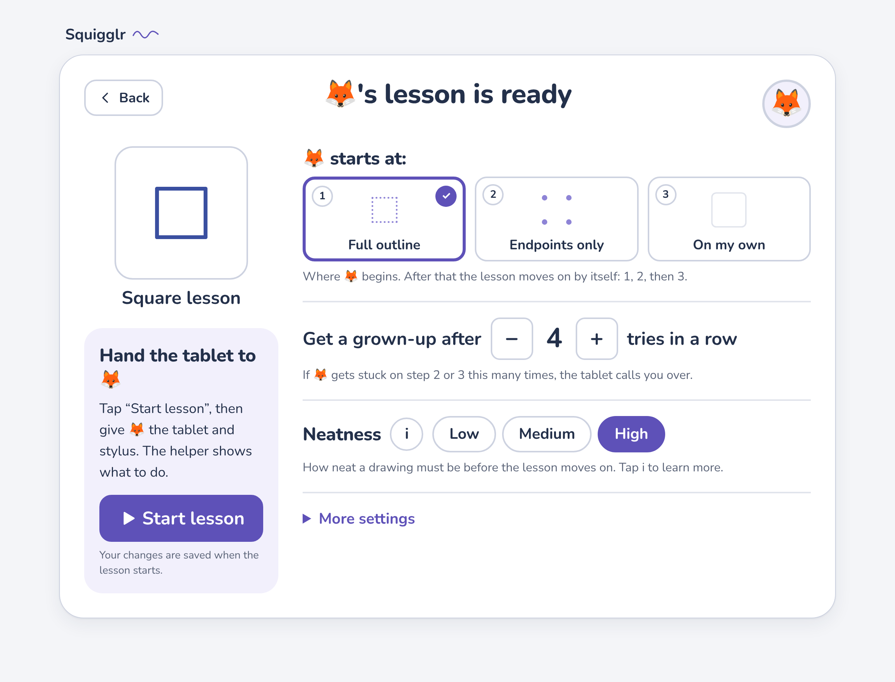
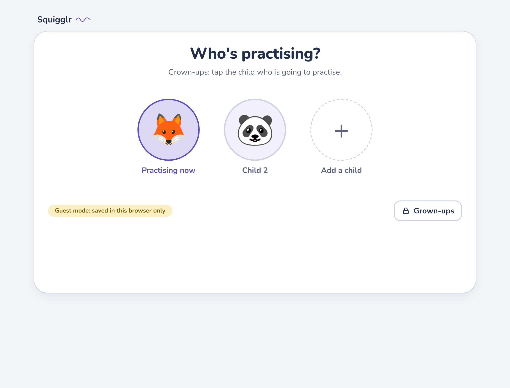
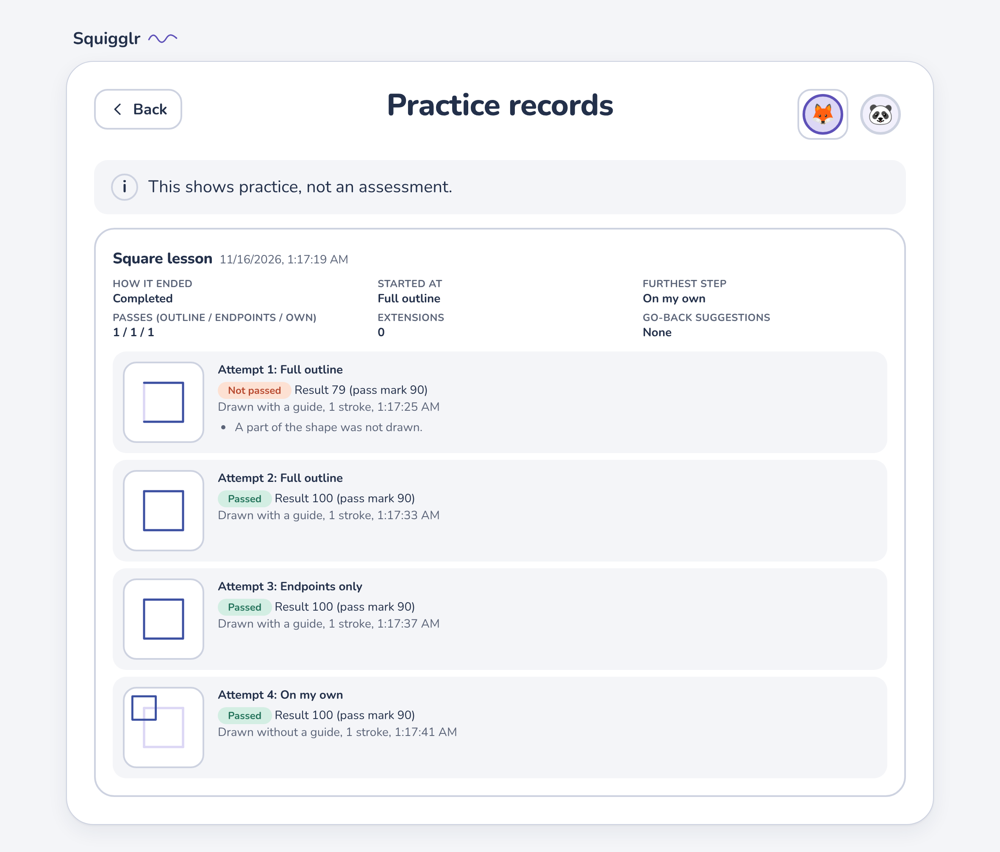
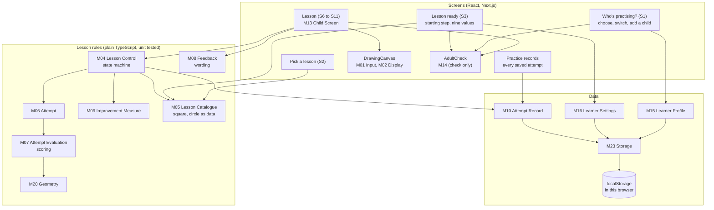
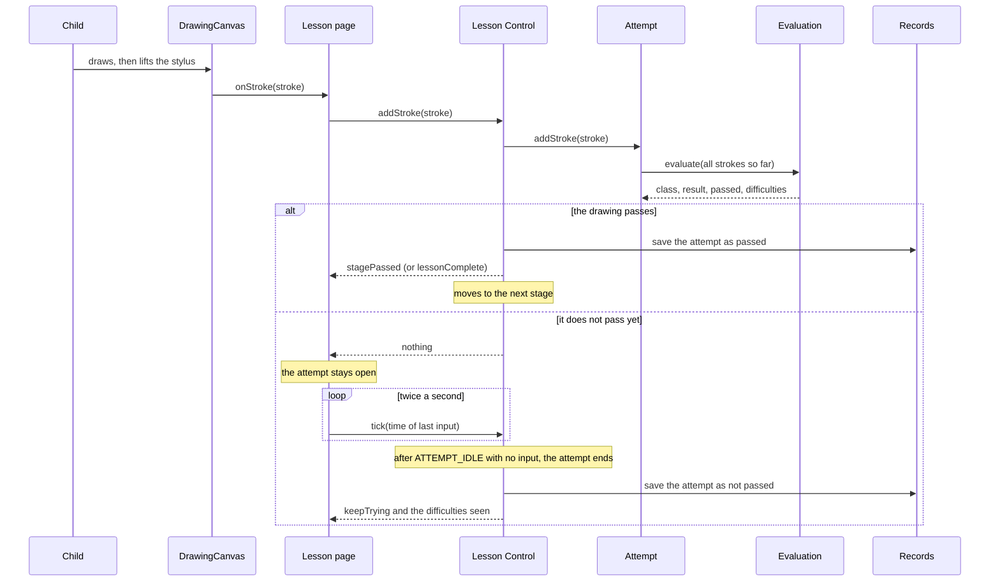

# Squigglr POC: Implementation Plan and Code

This is the plan for the Proof of Concept due **November 23, 2026**, with all of its code. It sits in `src/` beside the app, and every listing below is a copy of the file of that name in this folder. The app's 60 unit tests pass, it compiles as a production Next.js build, and the square lesson was driven from start to finish in a real browser (the screenshots below come from that run).

**What the POC is:** a website where an adult adds a child, sets that child's nine practice values, and starts the Square or Circle lesson. The child watches a demonstration, then draws through three stages with less help each time. Every attempt is scored against the adult's values and saved under that child.

| Lesson ready: the child's settings | Lesson, after an attempt that did not pass |
| --- | --- |
|  |  |

| Who's practising? | Practice records |
| --- | --- |
|  |  |

The screens follow the layout of the team's lo-fi prototype (S1 to S11 in Figma), in the colours of the A-Sense presentation, with one rounded font and soft-edged cards. What the app does follows the SRS: wherever the prototype and the SRS disagree, the SRS wins. [Section 3](#3-design-decisions-and-the-requirements-behind-them) gives the requirement behind each decision, and [section 13](#13-how-the-app-compares-with-the-srs) lists every place the app and the SRS differ.

## Contents

1. [Solution diagram](#1-solution-diagram)
2. [What is in the POC and what is not](#2-what-is-in-the-poc-and-what-is-not)
3. [Design decisions and the requirements behind them](#3-design-decisions-and-the-requirements-behind-them)
4. [How a drawing is scored](#4-how-a-drawing-is-scored)
5. [How a lesson moves](#5-how-a-lesson-moves)
6. [The nine settings](#6-the-nine-settings)
7. [Project layout and file index](#7-project-layout-and-file-index)
8. [The code, part by part](#8-the-code-part-by-part)
9. [Tests](#9-tests)
10. [Build order](#10-build-order)
11. [Deploying and the domain](#11-deploying-and-the-domain)
12. [Demo script](#12-demo-script)
13. [How the app compares with the SRS](#13-how-the-app-compares-with-the-srs)
14. [After the POC](#14-after-the-poc)

## 1. Solution diagram

Everything runs in the browser. There is no server code and no database in the POC: Vercel only serves the pages, and the data lives in the browser's `localStorage`.

The boxes are the modules of the Module Guide, with their numbers. An arrow means "uses".



What happens when the child lifts the stylus:



## 2. What is in the POC and what is not

**In:**

- Guest mode: no sign-in. Several children, each a picture with no name. One is "practising now", and an adult can switch.
- Two lessons, Square and Circle, stored as data.
- The full lesson flow: demonstration, full outline, endpoints only, on my own.
- Scoring as SRS Section 9.2 defines it, checked at every stylus lift.
- All nine adult-set values per child, with their ranges and rules, and every one of them changes how a lesson runs.
- Retry, the go-back suggestion, the one extension, the attempt limit, the hard cap and the two lesson idle timers.
- Feedback from a fixed list: the effort acknowledged first, then what was seen in the drawing, with a glow where a part is missing.
- A record of every attempt (actual strokes, stage, outcome, result, difficulties, the settings in use) and of every start of a lesson, saved per child, on a Practice records screen.
- Example drawings for each pass mark, made from the scoring itself.
- A demo panel on the lesson screen that shows the live result and the counters, for showing the teaching team what the rules are doing.

**Out, on purpose:**

- Accounts and sign-in, the progress summary and the creative space (the Development Plan leaves these out of the POC).
- A database. Records stay in one browser. See [After the POC](#14-after-the-poc).
- Sound, the supported-device notice, and keeping unsaved records while offline. The SRS requires all three; they are not needed to show the lesson working.
- The two refinement experiments of the Development Plan. They are separate from the hosted app and are not covered here.

**Tried and taken out again, because the SRS does not have them:** an eraser and pencil beside the drawing, a "Start again" button, a practice sticker at the end of a lesson, a weekly "practice story" with stickers for the days practised, and a "Let's get a grown-up!" line from the helper. The last four came from the lo-fi prototype. [Section 13](#13-how-the-app-compares-with-the-srs) gives the requirement each one ran against.

The SRS schedules the suggestion, extension and limit rules for Revision 0 (PH-2). They are in the POC anyway, because without them most of the nine settings would change nothing, and showing that the settings drive the lesson is the point of the demo.

## 3. Design decisions and the requirements behind them

Identifiers are those of the SRS (`docs/SRS/SRS.tex`) unless a different document is named. "UC" is a product use case, "FR" a functional requirement, "NFR" a nonfunctional one, "SAF" a safety requirement from the Hazard Analysis, "BR" a business rule, "CON" a constraint.

### What the app is built from

| Decision | Requirements and sources | Why |
| --- | --- | --- |
| A website: Next.js, React, TypeScript (strict), Tailwind, Vitest, Vercel | CON-001, CON-002; Development Plan (technology table) | A website that needs no installation is a mandated constraint. The stack is the one the Development Plan chose. |
| The rules are plain TypeScript in `lib/`, with no React in them | V&V Plan ("in Vitest against the module that applies the lesson rules"); NFR-PERF-004 | The rules can be unit tested without a browser, and the same input always gives the same result. The screens only show what the rules decide. |
| One file per design module, same names | Module Guide; MIS; NFR-MAINT-002 | Anyone holding the MIS can find the code for a module. `src/TraceToDesign.md` lists the mapping. |
| Lessons are data in `catalogue.ts` | NFR-MAINT-001; FR-LRN-001; LC-001 | A lesson is added, changed or removed without touching a rule. |
| `localStorage` behind the Storage module | Development Plan (POC plan: "no adult accounts"); FR-REC-008, FR-REC-009 | No backend to build before the demo. Only `lib/storage.ts` touches it, so a database replaces one file later. A saved attempt is saved once and never changed. The Module Guide plans a hosted database; this is the POC's stand-in. |
| Plain canvas and our own Geometry module, no drawing library | MIS M20 ("no access program depends on the drawing library"); FR-LRN-007 | A guided lesson needs to draw lines and measure them. Paper.js, named in the Development Plan, is for the creative space and comes in with it. |
| The drawing area is always 1000 by 1000 units | SAF-AHM-002 | A point keeps its place when the canvas is resized or the tablet is turned, and a saved attempt can be redrawn at any size. The MIS says CSS pixels; units meet the same requirement with less work. |
| Stylus, finger and mouse all draw; a stylus wins over a palm | CON-003; SAF-AHM-001 | CON-003 asks for a stylus, with finger input as a stretch goal. Accepting a mouse lets the demo run on a laptop. One contact is followed at a time, and the same position reported twice counts once. |
| A tablet on the same Wi-Fi can open the laptop's dev server | CON-003 | `npm run dev` serves its scripts only to its own computer unless other hosts are allowed, so a tablet showed the page but no button worked. Private network addresses are allowed in `next.config.ts`. |

### Who can do what

| Decision | Requirements and sources | Why |
| --- | --- | --- |
| A child is a picture and a generated identifier, no name | BR-001 | The prototype shows first names ("Mia", "Omar"). The SRS collects no name. |
| Guest mode, with the adult check kept | SAF-RAY-001, SAF-RAY-008; Development Plan (POC plan) | Sign-in adds nothing to what the POC must prove. The adult check stays, because choosing a lesson, switching child, changing saved values and answering a suggestion must not be possible for a child. |
| The adult check is a sum | SAF-RAY-001 ("a check that a child cannot complete by tapping icons") | The prototype uses a two-second hold, which a child can do by resting a finger. |
| The adult chooses the lesson and the starting step; a pass moves on by itself | CON-007; BR-002, BR-003; FR-LRN-016, FR-LRN-018, FR-LRN-023 | The child never chooses, skips or goes back. |
| On the lesson screen the child has one control, the start button after the demonstration; Leave is for the adult | FR-LRN-024; FACT-007; NFR-UX-001, NFR-UX-002 | An attempt that has not passed ends after a pause "and by no other event except an interruption", the team did not accept the child restarting, and child screens are to be calm with few controls. So there is no eraser, no "Start again" and no submit button. |

### How a lesson runs

| Decision | Requirements and sources | Why |
| --- | --- | --- |
| The demonstration is always shown first, then practice starts at the adult's chosen step | UC-003 step 1; FR-LRN-003, FR-LRN-025 | The MIS has `beginPractice` go from the demonstration to tracing only; UC-003 is followed. |
| The drawing is checked at every stylus lift; a pass ends the attempt at once | FR-LRN-038, FR-LRN-039 | The child should not have to decide when a drawing is done. |
| A stylus held down, even held still, counts as drawing | FR-LRN-024 (the pause is "with no input after the last stroke") | Otherwise a child resting the stylus mid-line would have the attempt ended under them. |
| The lesson waits while the adult check or the go-back card is open | SAF-RAY-001; FR-LRN-024 | The adult's time at the check is not the child's pause, so no attempt ends and no idle clock runs meanwhile. The card has a "Decide later" that leaves the suggestion pending (FR-LRN-034). |
| An attempt that has not passed ends after a pause the adult sets: 3 to 7 s, default 5 | FR-LRN-024; BR-008 | The SRS leaves the range "TBD". It was 5 to 15 s at first; tried on a tablet, ten seconds of waiting was far too long, so it was halved. |
| The lesson idle ranges are 30 to 60 s and 90 to 180 s | SAF-RAY-009; BR-008 | Also "TBD" in the SRS. The three ranges do not overlap, so the rule that each is shorter than the next can never be broken. |
| A go-back suggestion waits behind a quiet Grown-ups button | FR-LRN-019, FR-LRN-034; UC-005; SAF-RAY-001; NFR-UX-001 | The SRS has the suggestion shown "without blocking practice" and answered only through the adult check. The prototype covers the lesson with a card and has the helper say "Let's get a grown-up!"; neither is in the SRS, and nothing flashes while the child draws. |
| A finished attempt stays on screen with its feedback: 5 s if it did not pass, 2.5 s if it did | FR-LRN-014; NFR-UX-016; SAF-MOU-001 | The SRS does not say what happens on screen when an attempt ends. Without a pause the drawing would vanish and the feedback would refer to nothing. |
| Feedback is a fixed list in one file, effort first, never "wrong" | BR-007; FR-LRN-014, FR-LRN-022; NFR-UX-004, NFR-UX-016 | Every message describes the drawing, not the child. |
| A missing part is shown by a glow where it should be, not drawn in | SAF-MOU-001; NFR-UX-004 | The child is shown where, and still has to draw it. |

### How a drawing is judged

| Decision | Requirements and sources | Why |
| --- | --- | --- |
| Scoring is the SRS's: tolerance band, 90% of every part, result = the lower of two shares | SRS Section 9.2; FR-LRN-011, FR-LRN-013 | See [section 4](#4-how-a-drawing-is-scored). |
| With no guide, the drawing is laid over the figure by a fit that ignores stray marks | SRS Section 9.2 (stage I); FR-LRN-013 | The SRS lays it over by its bounding box. One stray dot, or a line that runs past a corner, stretches that box and fails a good drawing. The SRS's fit is still tried, and is used whenever it scores best. **Goes beyond the SRS wording.** |
| With no guide, a drawing must be at least 40% of the figure's size | SRS Section 9.2 says size does "not affect the result"; FR-LRN-011 | Once any size is scaled up to the figure, a speck passes as a square. The team decided, after trying it on a tablet, that position and size should not matter only down to a minimum. **Contradicts the SRS sentence; the team is asked to change it** (see [section 13](#13-how-the-app-compares-with-the-srs)). |
| Two more things can be said about a drawing made with no guide: "too small" and "stretched" | BR-007; FR-LRN-014; NFR-UX-004 | The SRS lets the team define the difficulties in advance. A rectangle drawn for a square used to be shown a glow where a square's sides would be, right beside lines the child had drawn. It is now told "Try making it as tall as it is wide". The MIS lists three kinds of difficulty; these two need adding to it. |
| A small picture of the shape stays up when there is no guide | FR-LRN-006 | The SRS forbids a tracing outline and endpoint guides at this step. The picture is neither, and sits beside the drawing area, but a strict reading could object. The team should confirm it with the specialists. |

### What the adult sees

| Decision | Requirements and sources | Why |
| --- | --- | --- |
| All nine values are set per child, on the Lesson ready screen | BR-008; FR-LRN-017; UC-001 | Three are up front, as in the prototype, and the rest under "More settings". A value outside its range, or one that breaks a rule between values, cannot be saved. |
| A child starts on the recommended settings, and keeps only what an adult changed | BR-008 ("a value the adult does not choose is set to the middle of its range"); SAF-RAY-008 | Only changed values are saved. A saved value that is no longer in range counts as not chosen, so a change to a range can never leave a child unable to start a lesson. |
| "Neatness" Low, Medium, High is the pass mark at 70, 80, 90, with an example drawing for each | BR-008 ("shows example drawings of what its minimum and maximum look like") | The examples are made from the scoring itself, and a test checks each one. |
| A save that fails never stops the lesson | SAF-RAY-003; FR-REC-008 | If the browser's storage is full, the lesson carries on and the demo panel says how many records were not saved. Keeping them for a later save is not built yet. |
| A lesson that was cut off is closed as unfinished | FR-REC-005, FR-REC-007 | If the page is closed or reloaded mid-lesson, its record would stay "in progress" for ever. It is closed when the child's next lesson starts. |
| Difficulties are noted as the SRS describes, with one exception | FR-REC-003 | With a guide, a line off the shape is noted at each stylus lift and marked corrected later. With no guide nothing is noted until the attempt ends, because a half-finished drawing laid over the figure always looks off it. |
| Practice records show every lesson and attempt; there is no weekly summary | FR-REC-001 to FR-REC-010; Development Plan (POC plan: "no progress summary") | The POC must show that records keep the strokes, the stage and the outcome. The SRS's progress summary is specified separately and belongs to the final phase, so the prototype's weekly "practice story" is not built. |
| The records screen says it shows practice, not an assessment | BR-006; SAF-RAY-004 | No diagnosis, judgement or comparison. |
| No sticker or other reward | Not in the SRS; NFR-UX-001 | The prototype ends a lesson with a sticker. The SRS has no reward, so the lesson ends with the helper's closing line. |
| A demo panel shows the result and the counters | BR-006; FR-LRN-022 | It lets the teaching team see the rules working. The SRS does not want a result shown to the child, so the panel is labelled for adults and must be hidden before real use. |
| Screen layouts follow the lo-fi prototype; colours follow the A-Sense presentation; the style is one rounded font, thin line icons and soft-edged white cards | NFR-UX-001, NFR-UX-002, NFR-UX-004 | The prototype was tried with a parent and child, so its layout is the best evidence the team has. It is black and white on purpose; the colours come from the slides. The team wanted the calm, plain feel of a note-taking app, which also suits the SRS's call for uncluttered child screens. On an iPad or a Mac the font is the system's rounded face; elsewhere Nunito, an open rounded font, is loaded in its place. |
| Progress through the lesson is a trail of the child's animal paw prints | NFR-UX-002; G.1 | Pictures, not text, and nothing for the child to press. |

## 4. How a drawing is scored

Each lesson has a **figure**: its required parts and required endpoints. The square has four sides and four corners.

- **Tolerance.** A point is "on" a line when it is within `TRACE_TOL` = 5% of the figure's diagonal. For the square that is about 35 units, 7% of a side.
- **Drawn.** The share of the figure's length that has a stroke within the tolerance.
- **On figure.** The share of the child's drawn length that is within the tolerance of the figure.
- **Result.** `100 × min(drawn, on figure)`.
- **Complete.** Every part has at least `PART_COVER` = 90% of its length drawn, and every endpoint has a stroke within the tolerance.
- **Pass.** Complete, and the result is at least the child's pass mark.
- **No guide.** At the last stage the whole drawing is first moved and uniformly scaled onto the figure, so where and how big the child drew does not matter. Three ways of laying it over are tried and the best-scoring one is kept: by its bounding box (the SRS's wording); by the box of the bulk of the drawing, leaving out the outermost 8% on each side, so a stray mark or an overshoot does not throw it off; and that second fit nudged by at most 5% in size and one tolerance in position. The nudge is kept small on purpose: with a free fit, a square could be shrunk until it sat inside a circle's tolerance and passed the circle lesson.
- **Stretched.** With no guide, if parts seem to be missing, the drawing is also laid over the figure by width and height separately. If every part is then there, nothing is missing: the drawing is the right shape out of proportion, such as a rectangle for a square. It still does not pass, but the child is told "Try making it as tall as it is wide" and no glow is shown beside lines they did draw.
- **Minimum size.** With no guide, the drawing's longer side must be at least `MIN_DRAW_SCALE` = 40% of the figure's. Smaller is incomplete, and reported as too small.
- **Invalid.** No strokes, a missing coordinate, or less drawn than the tolerance (a tap). An invalid attempt is not saved and not counted.

Measured on prepared squares:

| Drawing | Result | Class | Passes at 80? |
| --- | --- | --- | --- |
| Exact square | 100 | complete | Yes |
| Square drawn 20 units off | 100 | complete | Yes |
| Wobble of up to 30 units | 100 | complete | Yes |
| Wobble of up to 40 units | 71 | incomplete | No |
| Three sides only | 79 | incomplete | No |
| Square plus one stray line across it | 83 | complete | Yes (no at a pass mark of 90) |
| Square plus a large scribble | below 70 | complete | No |

Measured with no guide, at the lowest pass mark of 70:

| Drawing | Passes? |
| --- | --- |
| A square at 60% size in a corner, plus a stray mark far away | Yes |
| A square whose last side runs well past the corner | Yes |
| A square 14% or 20% wider than tall | Yes |
| A rectangle 25% or 40% wider than tall | No, stretched |
| A square at 20% size | No, too small |
| Three sides only | No, a part is missing |
| A triangle, or a circle, in the square lesson | No |
| A square in the circle lesson, any size | No |
| A circle at half size, anywhere | Yes |

The measuring is our own code (`lib/geometry.ts`), not a drawing library. A library such as Paper.js would not make it more accurate: the lengths and distances are exact for straight pieces, and curves are checked every 4 units of a 1000-unit canvas. What decides a pass is the rule (the tolerance, the 90% cover, the fit), not the arithmetic.

## 5. How a lesson moves

The state and the rules are those of SRS Section 9.2. In order, after each attempt that ends:

| What happened | What the lesson does |
| --- | --- |
| The drawing passes, at trace or corners | Saves it, moves to the next stage, resets the stage's counts. |
| The drawing passes with no guide | Saves it and completes the lesson. No other lesson starts. |
| The attempt is invalid or interrupted | Starts a new attempt. Nothing is counted. An interrupted attempt (the browser cuts the contact off, or the adult leaves) is saved, marked interrupted. |
| It does not pass, the failed attempts have reached the limit, and the child is not improving | Ends the lesson. |
| It does not pass, the limit is reached, the child is improving, and the cap is not reached | Gives the one extension. |
| The extension is used up, or the cap is reached | Ends the lesson. |
| It does not pass, the streak has reached the streak setting, the child is not improving, at corners or no guide | Offers the adult a go-back suggestion. The stage does not change and the child keeps practising. |
| Anything else | A new attempt at the same stage. |

"Improving" means the average of the last `IMPROVE_WINDOW` results is at least 5 points above the average of the same number of results before them.

A suggestion that the adult declines resets the streak. One that is accepted moves to the earlier stage the adult picks. One that is never answered stays pending and is recorded as ignored if a pass or the end of the lesson clears it.

## 6. The nine settings

| Setting | Range | Default | What it changes |
| --- | --- | --- | --- |
| Pass mark (`STAGE_PASS`) | 70 to 90 | 80 | How accurate a complete drawing must be. |
| Failed attempts before a suggestion (`DIFFICULTY_STREAK`) | 3 to 5 | 4 | When a go-back suggestion is offered. |
| Failed attempts before the lesson ends (`ATTEMPT_LIMIT`) | 6 to 10 | 8 | When the lesson ends or is extended. |
| Improvement window (`IMPROVE_WINDOW`) | 1 to 3 | 2 | How many attempts are compared to decide "improving". |
| Extra attempts when improving (`ATTEMPT_EXTENSION`) | 1 to 3 | 2 | The size of the one extension. |
| Most attempts at one stage (`ATTEMPT_LIMIT_MAX`) | 8 to 12 | 10 | The hard cap. |
| Pause that ends an attempt (`ATTEMPT_IDLE`) | 3 to 7 s | 5 s | How long the app waits after the last stroke before ending an attempt that has not passed. |
| Pause before a check-in (`LESSON_IDLE_PROMPT`) | 30 to 60 s | 45 s | When "Still drawing?" appears. |
| Pause that ends the lesson (`LESSON_IDLE_END`) | 90 to 180 s | 135 s | When an abandoned lesson ends. |

On the Lesson ready screen, "Neatness" Low, Medium and High set the pass mark to 70, 80 and 90, and "Get a grown-up after" is the failed-attempts-before-a-suggestion value. The other seven are under "More settings".

The first six ranges are the SRS's. The last three are proposed here. A value outside its range cannot be saved, nor can a limit that is not above the streak, or a cap below the limit. A lesson uses the values as they were when it started.

## 7. Project layout and file index

The app is the `src/` folder of this repository.

```
src/
  package.json, tsconfig.json, next.config.ts, postcss.config.mjs, vitest.config.mts
  lib/          the rules and the data: no React
  components/   the canvas, the adult check, the screen frame, the pictures
  app/          one folder per page
  plan-img/     the screenshots in this document
```

| File | MIS module | What it does |
| --- | --- | --- |
| [`lib/types.ts`](#f-types) | Shared types | The data shapes every module uses. |
| [`lib/geometry.ts`](#f-geometry) | M20 Geometry | Lengths, distances, bounding boxes, fit to a box. |
| [`lib/evaluation.ts`](#f-evaluation) | M07 Attempt Evaluation | Scores strokes against a figure. |
| [`lib/catalogue.ts`](#f-catalogue) | M05 Lesson Catalogue | The square and the circle, as data. |
| [`lib/attempt.ts`](#f-attempt) | M06 Attempt | One attempt: strokes, evaluation at each lift, when it ends. |
| [`lib/improvement.ts`](#f-improvement) | M09 Improvement Measure | The "improving" rule. |
| [`lib/lessonControl.ts`](#f-control) | M04 Lesson Control | The lesson's state machine. |
| [`lib/feedback.ts`](#f-feedback) | M08 Feedback | The wording and look of every message. |
| [`lib/settings.ts`](#f-settings) | M16 Learner Settings | Ranges, defaults, checks, load and save. |
| [`lib/profiles.ts`](#f-profiles) | M15 Learner Profile | Children and the active child. |
| [`lib/records.ts`](#f-records) | M10 Attempt Record | Lesson records and attempt records. |
| [`lib/storage.ts`](#f-storage) | M23 Storage | The only file that touches `localStorage`. |
| [`lib/examples.ts`](#f-examples) | part of M16 Learner Settings | Example drawings for each pass mark. |
| [`components/DrawingCanvas.tsx`](#f-canvas) | M01 Input Device, M02 Display | Pointer events to strokes; paints everything. |
| [`components/AdultCheck.tsx`](#f-adultcheck) | M14 Adult Access (check only) | The sum an adult answers. |
| [`components/Screen.tsx`](#f-screen) | part of M18 Adult View | The frame every screen sits in: Back, heading, avatar. |
| [`components/Avatar.tsx`](#f-avatar) | part of M02 Display | A child's picture in a ring. |
| [`components/icons.tsx`](#f-icons) | part of M02 Display | The trail of prints, the helper, stage pictures, small icons. |
| [`components/LessonIcon.tsx`](#f-lessonicon) | part of M02 Display | A lesson's figure as a small picture. |
| [`components/StrokePreview.tsx`](#f-preview) | part of M02 Display | Redraws a saved attempt. |
| [`components/NeatnessInfo.tsx`](#f-neatness) | part of M18 Adult View | The pop-up that explains Neatness with examples. |
| [`components/Squiggle.tsx`](#f-squiggle) | part of M18 Adult View | The squiggle mark. |
| [`components/useActiveLearner.ts`](#f-useactive) | part of M18 Adult View | Reads the active child for a page. |
| [`app/page.tsx`](#f-page-who) | part of M18 Adult View | S1 Who's practising: choose, switch, add a child. |
| [`app/lessons/page.tsx`](#f-page-pick) | part of M18 Adult View | S2 Pick a lesson. |
| [`app/lessons/[id]/page.tsx`](#f-page-ready) | part of M18 Adult View | S3 Lesson ready: starting step and the nine values. |
| [`app/lesson/[id]/page.tsx`](#f-page-lesson) | M13 Child Screen | S6 to S10: the lesson itself. |
| [`app/grown-ups/page.tsx`](#f-page-grownups) | part of M18 Adult View | S4 Grown-ups area. |
| [`app/records/page.tsx`](#f-page-records) | part of M18 Adult View | Practice records: every lesson and attempt. |
| [`app/layout.tsx`, `app/globals.css`](#f-layout) | | The page frame and styles. |
| [Configuration files](#f-config) | | `package.json` and the tool settings. |
| [`lib/evaluation.test.ts`](#f-test-eval), [`lib/rules.test.ts`](#f-test-rules), [`lib/examples.test.ts`](#f-test-examples), [`lib/testHelpers.ts`](#f-test-helpers) | | The unit tests. |

Not in the POC: M03 Audio, M11 and M12 (creative space), M17 Progress Summary, M21, M22, M24 Connection Recovery, M25 Audit Log.

## 8. The code, part by part

### 8.1 Shared types

<a id="f-types"></a>
**`lib/types.ts`**. Every module speaks in these shapes, taken from the MIS table of shared types. They are plain data, so a stroke or a record can be saved as JSON as it is.

`src/lib/types.ts`

```ts
// Types shared between modules (MIS Table "Types shared between modules").
// Everything here is plain data, so it can be saved as JSON.

/** A position on the drawing area, in drawing units (the area is 1000 x 1000). */
export interface Point {
  x: number;
  y: number;
}

/** A line through the points, in order. The parts of a figure are paths. */
export type Path = Point[];

/** One stylus contact: its points in the order drawn, each with its time (ms). */
export interface Stroke {
  points: (Point & { t: number })[];
}

/** D = demonstration, T = trace the outline, E = endpoints only, I = independent. */
export type Stage = "D" | "T" | "E" | "I";
export type DrawingStage = "T" | "E" | "I";

export interface Figure {
  parts: Path[];
  endpoints: Point[];
}

/** What is shown to guide the child at a drawing stage. */
export interface Guide {
  outline: Path[];
  endpoints: Point[];
}

export type DifficultyKind = "missedPart" | "missedEndpoint" | "offFigure" | "tooSmall" | "stretched";

/** One predefined difficulty (BR-007). `index` is the part or endpoint; 0 for the kinds that are about the whole drawing. */
export interface Difficulty {
  kind: DifficultyKind;
  index: number;
}

/** A difficulty seen during an attempt, and whether the child fixed it later. */
export interface Observed {
  difficulty: Difficulty;
  corrected: boolean;
}

export type EvalClass = "complete" | "incomplete" | "invalid";
export type Guidance = "assisted" | "independent";

export interface Evaluation {
  class: EvalClass;
  guidance: Guidance;
  /** Stage result, 0 to 100. */
  result: number;
  passed: boolean;
  difficulties: Difficulty[];
  /** The two shares behind the result, kept for the demo panel. */
  drawn: number;
  onFigure: number;
  /** How the drawing was laid over the figure before it was scored. */
  fit: Fit;
}

/** Maps a point of the drawing onto the figure: scale it, then move it by (dx, dy). */
export interface Fit {
  scale: number;
  dx: number;
  dy: number;
}

/** The nine adult-set values of one learner (BR-008). Times are in seconds. */
export interface Settings {
  stagePass: number;
  difficultyStreak: number;
  attemptLimit: number;
  improveWindow: number;
  attemptExtension: number;
  attemptLimitMax: number;
  attemptIdle: number;
  lessonIdlePrompt: number;
  lessonIdleEnd: number;
}

export type SettingName = keyof Settings;

export type FeedbackKind =
  | "stagePassed"
  | "lessonComplete"
  | "keepTrying"
  | "notEvaluable"
  | "checkIn"
  | "lessonEnded";

/** What the child is told after an event, in the order it is given. */
export interface Report {
  feedback: FeedbackKind[];
  difficulties: Difficulty[];
}

export interface Learner {
  id: string;
  avatar: string;
  createdAt: number;
}

export type RecordOutcome = "passed" | "notPassed" | "interrupted";

export interface AttemptRecord {
  id: string;
  lessonRecordId: string;
  lesson: string;
  stage: DrawingStage;
  outcome: RecordOutcome;
  /** Absent for an interrupted attempt. */
  result: number | null;
  difficulties: Observed[];
  settings: Settings;
  strokes: Stroke[];
  endedAt: number;
}

export type Ending =
  | "inProgress"
  | "completed"
  | "endedAtLimit"
  | "endedAtMax"
  | "endedIdle"
  | "unfinished";

export type SuggestionResponse = "pending" | "accepted" | "declined" | "ignored";

export interface Suggestion {
  from: DrawingStage;
  offeredAt: number;
  response: SuggestionResponse;
  /** The earlier stage the adult chose, or null if not accepted. */
  stage: DrawingStage | null;
}

export interface LessonRecord {
  id: string;
  learner: string;
  lesson: string;
  start: Stage;
  furthest: Stage;
  passes: Record<DrawingStage, number>;
  extensions: number;
  ending: Ending;
  suggestions: Suggestion[];
  startedAt: number;
}
```

### 8.2 Scoring

<a id="f-geometry"></a>
**`lib/geometry.ts`**. The measuring tools. `lengthWithin` is the one the scoring leans on: it cuts a path into short pieces and adds up the pieces that lie near another set of paths. It is used both ways round, for "how much of the figure was drawn" and "how much of the drawing is on the figure".

`src/lib/geometry.ts`

```ts
// M20 Geometry. Pure functions on points and paths. Nothing here knows about
// the canvas, the browser or a drawing library.

import type { Fit, Path, Point, Stroke } from "./types";

export interface Box {
  minX: number;
  minY: number;
  maxX: number;
  maxY: number;
}

export function toPath(stroke: Stroke): Path {
  return stroke.points.map(({ x, y }) => ({ x, y }));
}

function dist(a: Point, b: Point): number {
  return Math.hypot(a.x - b.x, a.y - b.y);
}

/** Length of a path; 0 for a path with fewer than two points. */
export function length(path: Path): number {
  let total = 0;
  for (let i = 1; i < path.length; i++) total += dist(path[i - 1], path[i]);
  return total;
}

function distanceToSegment(p: Point, a: Point, b: Point): number {
  const dx = b.x - a.x;
  const dy = b.y - a.y;
  const len2 = dx * dx + dy * dy;
  if (len2 === 0) return dist(p, a);
  const t = Math.max(0, Math.min(1, ((p.x - a.x) * dx + (p.y - a.y) * dy) / len2));
  return dist(p, { x: a.x + t * dx, y: a.y + t * dy });
}

/** Smallest distance from p to any of the paths. Infinity if there is no point. */
export function distance(p: Point, paths: Path[]): number {
  let best = Infinity;
  for (const path of paths) {
    if (path.length === 1) best = Math.min(best, dist(p, path[0]));
    for (let i = 1; i < path.length; i++) {
      best = Math.min(best, distanceToSegment(p, path[i - 1], path[i]));
    }
  }
  return best;
}

/**
 * Length of the parts of `path` that are within distance d of a path in
 * `others`. The path is cut into pieces no longer than `step`; a piece counts
 * when its midpoint is within d.
 */
export function lengthWithin(path: Path, others: Path[], d: number, step = 4): number {
  let total = 0;
  for (let i = 1; i < path.length; i++) {
    const a = path[i - 1];
    const b = path[i];
    const segLen = dist(a, b);
    if (segLen === 0) continue;
    const pieces = Math.max(1, Math.ceil(segLen / step));
    const pieceLen = segLen / pieces;
    for (let j = 0; j < pieces; j++) {
      const t = (j + 0.5) / pieces;
      const mid = { x: a.x + (b.x - a.x) * t, y: a.y + (b.y - a.y) * t };
      if (distance(mid, others) <= d) total += pieceLen;
    }
  }
  return total;
}

export function boundingBox(paths: Path[]): Box {
  const box = { minX: Infinity, minY: Infinity, maxX: -Infinity, maxY: -Infinity };
  for (const path of paths) {
    for (const p of path) {
      box.minX = Math.min(box.minX, p.x);
      box.minY = Math.min(box.minY, p.y);
      box.maxX = Math.max(box.maxX, p.x);
      box.maxY = Math.max(box.maxY, p.y);
    }
  }
  return box;
}

export function diagonal(box: Box): number {
  return Math.hypot(box.maxX - box.minX, box.maxY - box.minY);
}

/** The move and uniform scale that lay `box` over `target`: centres together, longer sides equal. */
export function boxFit(box: Box, target: Box): Fit {
  const longer = Math.max(box.maxX - box.minX, box.maxY - box.minY);
  const targetLonger = Math.max(target.maxX - target.minX, target.maxY - target.minY);
  const scale = longer > 0 ? targetLonger / longer : 1;
  return {
    scale,
    dx: (target.minX + target.maxX) / 2 - ((box.minX + box.maxX) / 2) * scale,
    dy: (target.minY + target.maxY) / 2 - ((box.minY + box.maxY) / 2) * scale,
  };
}

/**
 * The bounding box of the bulk of the points: on each side, the outermost
 * `trim` share of the points is left out. A short stray mark, or a line that
 * runs on past a corner, then no longer stretches the box.
 */
export function trimmedBox(points: Point[], trim: number): Box {
  const xs = points.map((p) => p.x).sort((a, b) => a - b);
  const ys = points.map((p) => p.y).sort((a, b) => a - b);
  const at = (sorted: number[], share: number) => sorted[Math.round(share * (sorted.length - 1))];
  return { minX: at(xs, trim), minY: at(ys, trim), maxX: at(xs, 1 - trim), maxY: at(ys, 1 - trim) };
}

export const IDENTITY: Fit = { scale: 1, dx: 0, dy: 0 };

export const apply = (fit: Fit, p: Point): Point => ({ x: p.x * fit.scale + fit.dx, y: p.y * fit.scale + fit.dy });
export const applyAll = (fit: Fit, paths: Path[]): Path[] => paths.map((path) => path.map((p) => apply(fit, p)));
/** The Fit that undoes `fit`. */
export const inverse = (fit: Fit): Fit => ({ scale: 1 / fit.scale, dx: -fit.dx / fit.scale, dy: -fit.dy / fit.scale });

/** Points along the paths, no more than `step` apart. */
export function sample(paths: Path[], step: number): Point[] {
  const out: Point[] = [];
  for (const path of paths) {
    if (path.length === 1) out.push(path[0]);
    for (let i = 1; i < path.length; i++) {
      const a = path[i - 1];
      const b = path[i];
      const pieces = Math.max(1, Math.ceil(dist(a, b) / step));
      for (let j = i === 1 ? 0 : 1; j <= pieces; j++) {
        out.push({ x: a.x + ((b.x - a.x) * j) / pieces, y: a.y + ((b.y - a.y) * j) / pieces });
      }
    }
  }
  return out;
}

/**
 * Nudges a Fit so that the drawing lies more closely over the figure. Each
 * round pairs every drawn point with its nearest figure point, and every
 * figure point with its nearest drawn point, leaves out pairs further apart
 * than `reach`, and solves for the scale and move that bring the pairs
 * closest together.
 *
 * It is only a nudge: the scale may change by at most `maxScale` (1.05 is 5%)
 * and the drawing may move by at most `maxShift`. Without those limits the
 * search could shrink a square until it sat inside a circle's tolerance.
 */
export function refineFit(
  drawn: Point[],
  figure: Point[],
  start: Fit,
  reach: number,
  maxScale: number,
  maxShift: number,
): Fit {
  if (drawn.length === 0) return start;
  const centre = {
    x: drawn.reduce((sum, p) => sum + p.x, 0) / drawn.length,
    y: drawn.reduce((sum, p) => sum + p.y, 0) / drawn.length,
  };
  const home = apply(start, centre);
  const nearest = (p: Point, among: Point[]) => {
    let index = 0;
    let d = Infinity;
    for (let i = 0; i < among.length; i++) {
      const di = dist(p, among[i]);
      if (di < d) {
        d = di;
        index = i;
      }
    }
    return { index, d };
  };

  let fit = start;
  for (let round = 0; round < 10; round++) {
    const moved = drawn.map((p) => apply(fit, p));
    const from: Point[] = [];
    const to: Point[] = [];
    moved.forEach((q, i) => {
      const n = nearest(q, figure);
      if (n.d <= reach) {
        from.push(drawn[i]);
        to.push(figure[n.index]);
      }
    });
    figure.forEach((f) => {
      const n = nearest(f, moved);
      if (n.d <= reach) {
        from.push(drawn[n.index]);
        to.push(f);
      }
    });
    if (from.length < 3) break;

    const mean = (ps: Point[]) => ({
      x: ps.reduce((sum, p) => sum + p.x, 0) / ps.length,
      y: ps.reduce((sum, p) => sum + p.y, 0) / ps.length,
    });
    const a = mean(from);
    const b = mean(to);
    let num = 0;
    let den = 0;
    for (let i = 0; i < from.length; i++) {
      num += (from[i].x - a.x) * (to[i].x - b.x) + (from[i].y - a.y) * (to[i].y - b.y);
      den += (from[i].x - a.x) ** 2 + (from[i].y - a.y) ** 2;
    }
    if (den === 0) break;
    const scale = Math.min(start.scale * maxScale, Math.max(start.scale / maxScale, num / den));
    let next: Fit = { scale, dx: b.x - scale * a.x, dy: b.y - scale * a.y };
    // Keep the drawing's centre within maxShift of where the starting fit put it.
    const at = apply(next, centre);
    const moved2 = dist(at, home);
    if (moved2 > maxShift) {
      const k = maxShift / moved2;
      const target = { x: home.x + (at.x - home.x) * k, y: home.y + (at.y - home.y) * k };
      next = { scale, dx: target.x - scale * centre.x, dy: target.y - scale * centre.y };
    }
    fit = next;
  }
  return fit;
}
```

<a id="f-evaluation"></a>
**`lib/evaluation.ts`**. One function, `evaluate`, that turns strokes and a figure into a class, a result and a pass or no pass. It keeps no state and gives the same answer every time for the same input. `TRACE_TOL` and `PART_COVER` live here and nowhere else, so the team's calibration changes two lines.

`src/lib/evaluation.ts`

```ts
// M07 Attempt Evaluation. Scores the strokes of an attempt against a lesson's
// figure, as SRS Section 9.2 defines it. Stateless and deterministic.

import {
  IDENTITY,
  applyAll,
  boundingBox,
  boxFit,
  diagonal,
  distance,
  length,
  lengthWithin,
  refineFit,
  sample,
  toPath,
  trimmedBox,
} from "./geometry";
import type { Difficulty, DrawingStage, Evaluation, Figure, Fit, Path, Stroke } from "./types";

/** Largest distance that counts as "on the figure", in percent of the figure's diagonal. */
export const TRACE_TOL = 5;
/** Share of a required part that must be drawn for the part to count, in percent. */
export const PART_COVER = 90;
/**
 * With no guide, the smallest a drawing may be: its longer side, in percent
 * of the figure's longer side. Smaller than this and it is not a complete
 * attempt, however neat.
 */
export const MIN_DRAW_SCALE = 40;

export type Evaluate = (
  strokes: Stroke[],
  figure: Figure,
  stage: DrawingStage,
  allowed: Difficulty[],
  stagePass: number,
) => Evaluation;

export function tolerance(figure: Figure): number {
  return (TRACE_TOL / 100) * diagonal(boundingBox(figure.parts));
}

function isValid(strokes: Stroke[], tol: number): boolean {
  if (strokes.length === 0) return false;
  for (const s of strokes) {
    if (s.points.length === 0) return false;
    for (const p of s.points) {
      if (!Number.isFinite(p.x) || !Number.isFinite(p.y)) return false;
    }
  }
  // A tap or a mark shorter than the tolerance is too little to judge.
  const total = strokes.reduce((sum, s) => sum + length(toPath(s)), 0);
  return total >= tol;
}

interface Score {
  found: Difficulty[];
  drawn: number;
  onFigure: number;
  result: number;
}

/** Scores paths that already lie where they are to be compared with the figure. */
function score(paths: Path[], figure: Figure, tol: number): Score {
  const found: Difficulty[] = [];

  // Share of the figure that was drawn, and which required parts are missing.
  let figureLength = 0;
  let figureCovered = 0;
  figure.parts.forEach((part, index) => {
    const partLength = length(part);
    const covered = lengthWithin(part, paths, tol);
    figureLength += partLength;
    figureCovered += covered;
    if (covered < (PART_COVER / 100) * partLength) found.push({ kind: "missedPart", index });
  });

  figure.endpoints.forEach((endpoint, index) => {
    if (distance(endpoint, paths) > tol) found.push({ kind: "missedEndpoint", index });
  });

  // Share of what was drawn that lies on the figure.
  const drawnLength = paths.reduce((sum, p) => sum + length(p), 0);
  const drawnOnFigure = paths.reduce((sum, p) => sum + lengthWithin(p, figure.parts, tol), 0);

  const drawn = figureCovered / figureLength;
  const onFigure = drawnOnFigure / drawnLength;
  return { found, drawn, onFigure, result: 100 * Math.min(drawn, onFigure) };
}

export const evaluate: Evaluate = (strokes, figure, stage, allowed, stagePass) => {
  if (figure.parts.length === 0) throw new Error("emptyFigure");
  const guidance = stage === "I" ? "independent" : "assisted";
  const tol = tolerance(figure);

  if (!isValid(strokes, tol)) {
    return {
      class: "invalid",
      guidance,
      result: 0,
      passed: false,
      difficulties: [],
      drawn: 0,
      onFigure: 0,
      fit: IDENTITY,
    };
  }

  const original = strokes.map(toPath);
  let fit: Fit = IDENTITY;
  let best = score(original, figure, tol);
  let tooSmall = false;
  let stretched = false;

  if (stage === "I") {
    // With no guide, where and how big the child drew does not matter: the
    // whole drawing is moved and uniformly scaled onto the figure before it
    // is scored. Three ways of laying it over the figure are tried, and the
    // one that scores best is kept:
    //  1. by its bounding box, exactly as the SRS states it;
    //  2. by the box of the bulk of the drawing, so that a short stray mark or
    //     a line that runs on past a corner does not throw everything off;
    //  3. the second, nudged a little (at most 5% in size and one tolerance
    //     in position) towards the closest fit.
    const figureBox = boundingBox(figure.parts);
    const points = sample(original, 12);
    const byBulk = boxFit(trimmedBox(points, 0.08), figureBox);
    const candidates = [
      boxFit(boundingBox(original), figureBox),
      byBulk,
      refineFit(points, sample(figure.parts, 12), byBulk, 3 * tol, 1.05, tol),
    ];
    const better = (a: Score, b: Score) =>
      a.found.length !== b.found.length ? a.found.length < b.found.length : a.result > b.result;

    fit = candidates[0];
    best = score(applyAll(fit, original), figure, tol);
    for (const candidate of candidates.slice(1)) {
      const other = score(applyAll(candidate, original), figure, tol);
      if (better(other, best)) {
        fit = candidate;
        best = other;
      }
    }

    // If parts seem to be missing, check whether the drawing is the right
    // shape pulled out of proportion, such as a rectangle for a square. Laid
    // over the figure by width and height separately, such a drawing has
    // every part. Then nothing is missing: the drawing is stretched, and the
    // child is told that, not shown a glow beside lines they did draw.
    if (best.found.length > 0) {
      for (const box of [trimmedBox(points, 0.08), boundingBox(original)]) {
        const w = box.maxX - box.minX;
        const h = box.maxY - box.minY;
        if (w === 0 || h === 0) continue;
        const sx = (figureBox.maxX - figureBox.minX) / w;
        const sy = (figureBox.maxY - figureBox.minY) / h;
        const pulled = original.map((path) =>
          path.map((p) => ({
            x: figureBox.minX + (p.x - box.minX) * sx,
            y: figureBox.minY + (p.y - box.minY) * sy,
          })),
        );
        const asPulled = score(pulled, figure, tol);
        if (asPulled.found.length === 0) {
          stretched = true;
          best = { ...best, found: [], onFigure: asPulled.onFigure };
          break;
        }
      }
    }

    // It must still be a real drawing of the shape, not a speck.
    const box = boundingBox(original);
    const longer = Math.max(box.maxX - box.minX, box.maxY - box.minY);
    const figureLonger = Math.max(figureBox.maxX - figureBox.minX, figureBox.maxY - figureBox.minY);
    tooSmall = longer < (MIN_DRAW_SCALE / 100) * figureLonger;
  }

  const found = [...best.found];
  const complete = found.length === 0 && !tooSmall && !stretched;
  if (stretched) found.push({ kind: "stretched", index: 0 });
  if (tooSmall) found.push({ kind: "tooSmall", index: 0 });
  if (100 * best.onFigure < stagePass) found.push({ kind: "offFigure", index: 0 });

  return {
    class: complete ? "complete" : "incomplete",
    guidance,
    result: best.result,
    passed: complete && best.result >= stagePass,
    // Only the difficulties the team predefined for this stage are reported.
    difficulties: found.filter((d) => allowed.some((a) => a.kind === d.kind && a.index === d.index)),
    drawn: best.drawn,
    onFigure: best.onFigure,
    fit,
  };
};
```

<a id="f-catalogue"></a>
**`lib/catalogue.ts`**. The lessons, as data. To add the triangle, add an entry: no rule changes. The guide for each stage is derived from the figure, so a lesson cannot show an outline that differs from what it is scored against.

`src/lib/catalogue.ts`

```ts
// M05 Lesson Catalogue. Lessons are data: adding a lesson means adding an
// entry to LESSONS, with no change to the rules (NFR-MAINT-001).
// The drawing area is 1000 x 1000 units, whatever the size of the screen.

import type { Difficulty, DrawingStage, Figure, Guide, Path, Point } from "./types";

export interface Lesson {
  id: string;
  name: string;
  category: "line" | "shape" | "simpleDrawing";
  /** The required parts, in the order the demonstration draws them, and the required endpoints. */
  figure: Figure;
}

/** A quarter of a circle as a path of short straight pieces. Angles in degrees, clockwise from the top. */
function arc(cx: number, cy: number, r: number, from: number, to: number, pieces = 16): Path {
  const path: Path = [];
  for (let i = 0; i <= pieces; i++) {
    const a = ((from + ((to - from) * i) / pieces) * Math.PI) / 180;
    path.push({ x: cx + r * Math.sin(a), y: cy - r * Math.cos(a) });
  }
  return path;
}

const corners: Point[] = [
  { x: 250, y: 250 },
  { x: 750, y: 250 },
  { x: 750, y: 750 },
  { x: 250, y: 750 },
];

export const LESSONS: Lesson[] = [
  {
    id: "square",
    name: "Square",
    category: "shape",
    // Four sides; four corners (SRS Table "Initial lesson catalogue").
    figure: {
      parts: corners.map((c, i) => [c, corners[(i + 1) % 4]]),
      endpoints: corners,
    },
  },
  {
    id: "circle",
    name: "Circle",
    category: "shape",
    // Four quarter arcs, which together close the circle. The SRS lists no
    // endpoints for the circle, which would leave the endpoints-only stage
    // with nothing to show, so the POC uses the four points where the arcs meet.
    figure: {
      parts: [0, 90, 180, 270].map((a) => arc(500, 500, 250, a, a + 90)),
      endpoints: [0, 90, 180, 270].map((a) => arc(500, 500, 250, a, a, 1)[0]),
    },
  },
];

export function lesson(id: string): Lesson {
  const found = LESSONS.find((l) => l.id === id);
  if (!found) throw new Error("unknownLesson");
  return found;
}

/** The whole figure as the outline at T, only the endpoints at E, nothing at I. */
export function guide(id: string, stage: DrawingStage): Guide {
  const { figure } = lesson(id);
  if (stage === "T") return { outline: figure.parts, endpoints: [] };
  if (stage === "E") return { outline: [], endpoints: figure.endpoints };
  return { outline: [], endpoints: [] };
}

/**
 * The predefined difficulties of a stage: any missed part, any missed
 * endpoint, or drawing off the figure. With no guide, a drawing can also be
 * too small, or stretched (the right shape, but too wide or too tall).
 */
export function difficulties(id: string, stage: DrawingStage): Difficulty[] {
  const { figure } = lesson(id);
  const all: Difficulty[] = [
    ...figure.parts.map((_, index): Difficulty => ({ kind: "missedPart", index })),
    ...figure.endpoints.map((_, index): Difficulty => ({ kind: "missedEndpoint", index })),
    { kind: "offFigure", index: 0 },
  ];
  if (stage === "I") all.push({ kind: "tooSmall", index: 0 }, { kind: "stretched", index: 0 });
  return all;
}
```

### 8.3 The lesson rules

<a id="f-attempt"></a>
**`lib/attempt.ts`**. One attempt. It is evaluated at every stylus lift and ends at once on a pass. Otherwise it stays open until `checkIdle` finds that the pause has run out. It also keeps the list of difficulties seen, marking one as corrected rather than removing it.

`src/lib/attempt.ts`

```ts
// M06 Attempt. One attempt at one drawing stage: it collects strokes, has
// them evaluated at every stylus lift, and decides when it has ended.

import type { Evaluate } from "./evaluation";
import type { Difficulty, DrawingStage, Evaluation, Figure, Observed, Stroke } from "./types";

export type Outcome = "open" | "passed" | "notPassed" | "invalid" | "interrupted";

const same = (a: Difficulty, b: Difficulty) => a.kind === b.kind && a.index === b.index;

export class Attempt {
  strokes: Stroke[] = [];
  /** The evaluation after the most recent stylus lift. */
  last: Evaluation | null = null;
  /** Every difficulty seen so far. A correction marks it; it is never removed. */
  seen: Observed[] = [];
  outcome: Outcome = "open";
  endedAt: number | null = null;

  constructor(
    readonly lesson: string,
    readonly stage: DrawingStage,
    private figure: Figure,
    private allowed: Difficulty[],
    private stagePass: number,
    /** Seconds. */
    private attemptIdle: number,
    private evaluate: Evaluate,
  ) {}

  /** Called at each stylus lift. Evaluates all strokes so far; a pass ends the attempt at once. */
  addStroke(stroke: Stroke, now: number): void {
    if (this.outcome !== "open") throw new Error("attemptEnded");
    this.strokes.push(stroke);
    this.last = this.evaluate(this.strokes, this.figure, this.stage, this.allowed, this.stagePass);
    // Something drawn off the figure is noted at every lift. A missed part or
    // endpoint, or a drawing that is still small, is not: the child may simply
    // not have finished yet.
    // With no guide the drawing is laid over the figure as a whole, so a
    // half-finished one looks off the figure until it is done. There, nothing
    // is noted until the attempt ends.
    if (this.stage !== "I") {
      this.note(this.last.difficulties.filter((d) => d.kind === "offFigure"), ["offFigure"]);
    }
    if (this.last.passed) this.end("passed", now);
  }

  /** Ends an open attempt that has strokes once attemptIdle has passed since the last input. */
  checkIdle(now: number, lastInputAt: number): void {
    if (this.outcome !== "open" || this.strokes.length === 0 || this.last === null) return;
    if (now - lastInputAt < this.attemptIdle * 1000) return;
    if (this.last.class === "invalid") {
      this.end("invalid", now);
      return;
    }
    this.note(this.last.difficulties, ["missedPart", "missedEndpoint", "offFigure", "tooSmall", "stretched"]);
    this.end("notPassed", now);
  }

  /** Ends the attempt with no result, keeping its strokes and difficulties. */
  interrupt(now: number): void {
    if (this.outcome !== "open") throw new Error("attemptEnded");
    this.last = null;
    this.end("interrupted", now);
  }

  private end(outcome: Outcome, now: number): void {
    this.outcome = outcome;
    this.endedAt = now;
  }

  private note(observedNow: Difficulty[], kinds: Difficulty["kind"][]): void {
    for (const entry of this.seen) {
      if (kinds.includes(entry.difficulty.kind)) {
        entry.corrected = !observedNow.some((d) => same(d, entry.difficulty));
      }
    }
    for (const d of observedNow) {
      if (!this.seen.some((entry) => same(entry.difficulty, d))) {
        this.seen.push({ difficulty: d, corrected: false });
      }
    }
  }
}
```

<a id="f-improvement"></a>
**`lib/improvement.ts`**. The "improving" rule on its own, so a different measure later changes only this file.

`src/lib/improvement.ts`

```ts
// M09 Improvement Measure. The measure is this module's secret, so a different
// way of deciding "improving" changes only this file.

/** Smallest rise in the average stage result that counts as improvement. */
export const IMPROVE_MARGIN = 5;

/**
 * True when the average of the last `window` results is at least
 * IMPROVE_MARGIN above the average of the `window` results before them.
 * False when there are fewer than 2 * window results.
 */
export function improving(history: number[], window: number): boolean {
  const m = history.length;
  if (m < 2 * window) return false;
  const avg = (xs: number[]) => xs.reduce((a, b) => a + b, 0) / xs.length;
  const recent = avg(history.slice(m - window));
  const before = avg(history.slice(m - 2 * window, m - window));
  return recent - before >= IMPROVE_MARGIN;
}
```

<a id="f-control"></a>
**`lib/lessonControl.ts`**. The centre of the app. Its fields are the state of SRS Section 9.2 (the comments give the SRS's letters), and `afterFailedAttempt` is the transition table, in the table's order. It has no timers and no screen: the page calls `addStroke` and `tick`, and shows the report that comes back.

`src/lib/lessonControl.ts`

```ts
// M04 Guided Lesson Control. The state machine of SRS Section 9.2: which stage
// the child is at, when an attempt counts, and when the lesson moves on,
// offers a go-back suggestion, grants its one extension or ends.
// It has no UI and no timers of its own: the screen calls addStroke at each
// stylus lift and tick about once a second.

import { Attempt } from "./attempt";
import * as catalogue from "./catalogue";
import { evaluate as realEvaluate, type Evaluate } from "./evaluation";
import { improving } from "./improvement";
import type { RecordStore } from "./records";
import type { DrawingStage, Ending, Evaluation, Report, Settings, Stage, Stroke } from "./types";

export type Status = "noLesson" | "active" | "suggested" | "ended";

const ORDER: Stage[] = ["D", "T", "E", "I"];
const later = (a: Stage, b: Stage): Stage => (ORDER.indexOf(a) >= ORDER.indexOf(b) ? a : b);
const NOTHING: Report = { feedback: [], difficulties: [] };

export interface Deps {
  records: RecordStore;
  /** Tests replace these to give each attempt's result and the time directly. */
  evaluate?: Evaluate;
  now?: () => number;
}

export class LessonControl {
  status: Status = "noLesson"; // q
  lessonId = ""; // l (the lesson)
  learner = ""; // p
  stage: Stage = "D"; // l (the stage)
  furthest: Stage = "D"; // f
  failed = 0; // n_f: failed attempts at this stage
  evaluable = 0; // n_a: counted attempts at this stage
  streak = 0; // k: failed attempts in a row
  history: number[] = []; // H: results of the counted attempts at this stage
  suggestionPending = false; // s
  extended = false; // z
  sinceExtension = 0; // x
  settings!: Settings;
  attempt: Attempt | null = null;
  ending: Ending = "inProgress";
  /** Whether the idle check-in is showing. */
  prompted = false;
  /** The evaluation of the attempt that ended last, for the demo panel. */
  lastFinal: Evaluation | null = null;
  /** How many records could not be saved, for example because the browser's storage is full. */
  unsaved = 0;

  private startAt: DrawingStage = "T";
  private recordId = "";
  private suggestionIndex = 0;
  private activityBase = 0;
  private records: RecordStore;
  private evaluate: Evaluate;
  private now: () => number;

  constructor(deps: Deps) {
    this.records = deps.records;
    this.evaluate = deps.evaluate ?? realEvaluate;
    this.now = deps.now ?? Date.now;
  }

  /**
   * The adult chooses a lesson and its starting stage. The demonstration is
   * always shown first (UC-003 step 1); practice then starts at the chosen stage.
   * The settings are read once, here: a later change applies to the next lesson.
   */
  select(learner: string, lessonId: string, start: Stage, settings: Settings): void {
    catalogue.lesson(lessonId); // throws unknownLesson
    if (this.status === "active" || this.status === "suggested") this.stop();
    this.learner = learner;
    this.lessonId = lessonId;
    this.settings = { ...settings };
    this.startAt = start === "D" ? "T" : start;
    this.stage = "D";
    this.furthest = start;
    this.status = "active";
    this.ending = "inProgress";
    this.lastFinal = null;
    this.attempt = null;
    this.resetStage();
    this.recordId = this.keep(() => this.records.startLesson(learner, lessonId, start)) ?? "";
  }

  /** The child continues after the demonstration. */
  beginPractice(): void {
    if (this.status !== "active" || this.stage !== "D") throw new Error("notAtDemonstration");
    this.enterStage(this.startAt);
  }

  /** A finished stroke. A pass ends the attempt here, at the stylus lift. */
  addStroke(stroke: Stroke): Report {
    if (!this.isRunning() || this.attempt === null) throw new Error("noAttempt");
    const attempt = this.attempt;
    attempt.addStroke(stroke, this.now());
    if (attempt.outcome !== "passed") return NOTHING;

    const stage = attempt.stage;
    this.lastFinal = attempt.last;
    this.save(attempt, "passed");
    this.keep(() => this.records.recordPass(this.recordId, stage));
    this.evaluable += 1;
    this.clearSuggestion("ignored");

    if (stage === "I") {
      this.finish("completed");
      return { feedback: ["lessonComplete"], difficulties: [] };
    }
    this.enterStage(stage === "T" ? "E" : "I");
    return { feedback: ["stagePassed"], difficulties: [] };
  }

  /**
   * Called about once a second with the time of the child's last input.
   * Ends an idle attempt, applies the stopping rules, and handles the
   * lesson's own idle check-in and idle end.
   */
  tick(lastInputAt: number | null): Report {
    if (!this.isRunning()) return NOTHING;
    const now = this.now();
    const lastActivity = Math.max(lastInputAt ?? 0, this.activityBase);
    const idleSeconds = (now - lastActivity) / 1000;

    if (idleSeconds >= this.settings.lessonIdleEnd) {
      this.finish("endedIdle");
      return { feedback: ["lessonEnded"], difficulties: [] };
    }

    const attempt = this.attempt;
    if (attempt !== null) {
      attempt.checkIdle(now, lastActivity);
      if (attempt.outcome === "invalid") {
        // Not saved and not counted (FR-LRN-010, FR-LRN-032).
        this.newAttempt();
        return { feedback: ["notEvaluable"], difficulties: [] };
      }
      if (attempt.outcome === "notPassed") return this.afterFailedAttempt(attempt);
    }

    if (idleSeconds >= this.settings.lessonIdlePrompt) {
      if (!this.prompted) {
        this.prompted = true;
        return { feedback: ["checkIn"], difficulties: [] };
      }
    } else {
      this.prompted = false;
    }
    return NOTHING;
  }

  /** The input was cut off (for example a pointercancel). Kept apart, never counted. */
  interrupt(): void {
    if (!this.isRunning() || this.attempt === null) return;
    if (this.attempt.strokes.length > 0) {
      this.attempt.interrupt(this.now());
      this.save(this.attempt, "interrupted");
    }
    this.newAttempt();
  }

  /** The adult answers a go-back suggestion. Accepting needs an earlier stage. */
  answerSuggestion(accept: boolean, stage?: DrawingStage): void {
    if (!this.suggestionPending) throw new Error("noSuggestion");
    if (!accept) {
      this.clearSuggestion("declined");
      this.streak = 0; // a new suggestion needs a whole new streak
      return;
    }
    if (stage === undefined || ORDER.indexOf(stage) >= ORDER.indexOf(this.stage)) {
      throw new Error("notEarlierStage");
    }
    this.clearSuggestion("accepted", stage);
    this.interruptOpenAttempt();
    this.enterStage(stage);
  }

  /** The adult leaves the lesson. It ends as unfinished. */
  stop(): void {
    if (!this.isRunning()) return;
    this.interruptOpenAttempt();
    this.finish("unfinished");
  }

  // ----- the rules -----

  private afterFailedAttempt(attempt: Attempt): Report {
    const s = this.settings;
    this.lastFinal = attempt.last;
    this.save(attempt, "notPassed");
    this.evaluable += 1;
    this.failed += 1;
    this.streak += 1;
    this.history.push(attempt.last!.result);
    if (this.extended) this.sinceExtension += 1;

    const report: Report = {
      feedback: ["keepTrying"], // the effort is acknowledged first (NFR-UX-016)
      difficulties: attempt.seen.filter((o) => !o.corrected).map((o) => o.difficulty),
    };
    const isImproving = improving(this.history, s.improveWindow);
    const atCap = this.evaluable >= s.attemptLimitMax;

    // The first rule that holds applies, in this order (SRS Table "Guided lesson state transitions").
    const endAtLimit = this.extended
      ? this.sinceExtension >= s.attemptExtension || atCap
      : this.failed >= s.attemptLimit && (!isImproving || atCap);

    if (endAtLimit) {
      this.finish(atCap ? "endedAtMax" : "endedAtLimit");
      report.feedback.push("lessonEnded");
      return report;
    }
    if (!this.extended && this.failed >= s.attemptLimit && isImproving) {
      this.extended = true; // granted once per stage
      this.sinceExtension = 0;
      this.keep(() => this.records.recordExtension(this.recordId));
    } else if (
      this.status === "active" &&
      !this.suggestionPending &&
      (this.stage === "E" || this.stage === "I") &&
      this.streak >= s.difficultyStreak &&
      !isImproving
    ) {
      // The stage does not change; the child keeps practising while it is pending.
      this.suggestionPending = true;
      this.status = "suggested";
      this.suggestionIndex =
        this.keep(() => this.records.offerSuggestion(this.recordId, this.stage as DrawingStage, this.now())) ?? 0;
    }
    this.newAttempt();
    return report;
  }

  // ----- helpers -----

  /**
   * Writes a record. If the write fails (the browser's storage is full, say),
   * the lesson carries on and the failure is counted, so the screen can tell
   * the adult. A child's practice is never stopped by a save.
   */
  private keep<T>(write: () => T): T | undefined {
    try {
      return write();
    } catch {
      this.unsaved += 1;
      return undefined;
    }
  }

  private isRunning(): boolean {
    return this.status === "active" || this.status === "suggested";
  }

  private resetStage(): void {
    this.failed = 0;
    this.evaluable = 0;
    this.streak = 0;
    this.history = [];
    this.suggestionPending = false;
    this.extended = false;
    this.sinceExtension = 0;
    this.prompted = false;
    this.activityBase = this.now();
  }

  private enterStage(stage: DrawingStage): void {
    this.stage = stage;
    this.furthest = later(this.furthest, stage);
    this.resetStage();
    this.newAttempt();
  }

  private newAttempt(): void {
    const stage = this.stage as DrawingStage;
    this.attempt = new Attempt(
      this.lessonId,
      stage,
      catalogue.lesson(this.lessonId).figure,
      catalogue.difficulties(this.lessonId, stage),
      this.settings.stagePass,
      this.settings.attemptIdle,
      this.evaluate,
    );
  }

  private interruptOpenAttempt(): void {
    if (this.attempt !== null && this.attempt.outcome === "open" && this.attempt.strokes.length > 0) {
      this.attempt.interrupt(this.now());
      this.save(this.attempt, "interrupted");
    }
    this.attempt = null;
  }

  private clearSuggestion(response: "accepted" | "declined" | "ignored", stage: DrawingStage | null = null): void {
    if (!this.suggestionPending) return;
    this.keep(() => this.records.answerSuggestion(this.recordId, this.suggestionIndex, response, stage));
    this.suggestionPending = false;
    this.status = "active";
  }

  private save(attempt: Attempt, outcome: "passed" | "notPassed" | "interrupted"): void {
    const record = {
      lesson: attempt.lesson,
      stage: attempt.stage,
      outcome,
      result: outcome === "interrupted" ? null : attempt.last!.result,
      difficulties: attempt.seen,
      settings: this.settings,
      strokes: attempt.strokes, // the actual strokes, never a corrected shape (BR-004)
      endedAt: attempt.endedAt!,
    };
    this.keep(() => this.records.saveAttempt(this.recordId, record));
  }

  private finish(ending: Ending): void {
    this.clearSuggestion("ignored");
    this.status = "ended";
    this.ending = ending;
    this.attempt = null;
    this.keep(() => this.records.endLesson(this.recordId, ending, this.furthest));
  }
}
```

<a id="f-feedback"></a>
**`lib/feedback.ts`**. What each message says. Lesson Control picks the kind of feedback; this file owns the words, so the specialists' wording changes can be made here without touching a rule.

`src/lib/feedback.ts`

```ts
// M08 Feedback. What each message says and shows. Lesson Control decides
// which feedback is given; this file decides only its wording and look, so
// either can change without the other. Every message describes the drawing,
// never the child, and nothing marks a drawing as "wrong".

import type { DifficultyKind, FeedbackKind, Stage } from "./types";

export interface Feedback {
  message: string;
  image: string;
  colour: string;
}

const KINDS: Record<FeedbackKind, Feedback> = {
  stagePassed: { message: "You did it! Here comes the next one.", image: "🌟", colour: "#24735b" },
  lessonComplete: { message: "All done! Great practising!", image: "🎉", colour: "#24735b" },
  keepTrying: { message: "Great try! Let's draw it again.", image: "💪", colour: "#5e51b8" },
  notEvaluable: { message: "Let's try that one again.", image: "✏️", colour: "#5e51b8" },
  checkIn: { message: "Still drawing? Tap to keep going.", image: "👋", colour: "#5e51b8" },
  lessonEnded: { message: "Great practising today!", image: "🌈", colour: "#5e51b8" },
};

const DIFFICULTIES: Record<DifficultyKind, Feedback> = {
  missedPart: { message: "Look where it's glowing.", image: "🧩", colour: "#b84a30" },
  missedEndpoint: { message: "The line missed a dot.", image: "📍", colour: "#b84a30" },
  offFigure: { message: "Some lines went away from the shape.", image: "↗️", colour: "#b84a30" },
  tooSmall: { message: "Try drawing it bigger.", image: "🔍", colour: "#b84a30" },
  stretched: { message: "Try making it as tall as it is wide.", image: "↔️", colour: "#b84a30" },
};

/** What the helper says at the start of each stage. */
const STAGE_LINES: Record<Stage, string> = {
  D: "Watch me!",
  T: "Your turn!",
  E: "Now join the dots!",
  I: "Now draw it on your own!",
};

export const stageLine = (stage: Stage): string => STAGE_LINES[stage];
export const feedback = (kind: FeedbackKind): Feedback => KINDS[kind];
export const difficultyFeedback = (kind: DifficultyKind): Feedback => DIFFICULTIES[kind];
/** Every approved message, so the wording can be reviewed in one place. */
export const allFeedback = (): string[] => [
  ...Object.values(KINDS).map((f) => f.message),
  ...Object.values(DIFFICULTIES).map((f) => f.message),
  ...Object.values(STAGE_LINES),
];
```

### 8.4 Data

<a id="f-storage"></a>
**`lib/storage.ts`**. Four functions: `get`, `put`, `list`, `remove`. Nothing else in the app knows where data is kept. A saved attempt cannot be changed.

`src/lib/storage.ts`

```ts
// M23 Storage. The only file that touches localStorage. Every other module
// saves and reads through these four functions, so moving to a hosted
// database (Supabase, in the Development Plan) changes only this file.

export type Kind = "learner" | "settings" | "lessonRecord" | "attempt" | "active";

interface Item<T> {
  id: string;
  owner: string | null; // the learner the item belongs to, or null
  value: T;
}

const PREFIX = "squigglr:v1";
const key = (kind: Kind, id: string) => `${PREFIX}:${kind}:${id}`;

// On the server (and in unit tests) there is no localStorage; use memory.
const memory = new Map<string, string>();
const store = {
  get: (k: string) => (typeof localStorage === "undefined" ? (memory.get(k) ?? null) : localStorage.getItem(k)),
  set: (k: string, v: string) => (typeof localStorage === "undefined" ? void memory.set(k, v) : localStorage.setItem(k, v)),
  remove: (k: string) => (typeof localStorage === "undefined" ? void memory.delete(k) : localStorage.removeItem(k)),
  keys: () =>
    typeof localStorage === "undefined"
      ? [...memory.keys()]
      : Array.from({ length: localStorage.length }, (_, i) => localStorage.key(i)!),
};

export function get<T>(kind: Kind, id: string): T | null {
  const raw = store.get(key(kind, id));
  return raw === null ? null : (JSON.parse(raw) as Item<T>).value;
}

/**
 * Saves an item, creating or replacing it. A saved attempt is never replaced
 * (FR-REC-009): saving the same attempt again changes nothing, and saving a
 * different one under the same id is refused.
 */
export function put<T>(kind: Kind, id: string, value: T, owner: string | null = null): void {
  const next = JSON.stringify({ id, owner, value } satisfies Item<T>);
  if (kind === "attempt") {
    const existing = store.get(key(kind, id));
    if (existing !== null) {
      if (existing === next) return;
      throw new Error("unchangeable");
    }
  }
  store.set(key(kind, id), next);
}

/** Every item of a kind, or only those of one learner. */
export function list<T>(kind: Kind, owner?: string): T[] {
  const start = `${PREFIX}:${kind}:`;
  return store
    .keys()
    .filter((k) => k.startsWith(start))
    .map((k) => JSON.parse(store.get(k)!) as Item<T>)
    .filter((item) => owner === undefined || item.owner === owner)
    .map((item) => item.value);
}

export function remove(kind: Kind, id: string): void {
  store.remove(key(kind, id));
}

export function newId(): string {
  return typeof crypto !== "undefined" && "randomUUID" in crypto
    ? crypto.randomUUID()
    : `${Date.now()}-${Math.random().toString(36).slice(2)}`;
}
```

<a id="f-settings"></a>
**`lib/settings.ts`**. The ranges, the defaults (the middle of each range) and `check`, which names every value that cannot be saved. The Lesson ready screen and the tests both use `check`, so the screen cannot allow something the rules reject. Only the values an adult has set away from the recommended ones are saved, so a child whose values were never changed always gets the current recommended settings. A saved value that today's ranges no longer allow counts as not chosen: after the pause that ends an attempt was halved, children saved with the old value of 10 could not start a lesson until this was added.

`src/lib/settings.ts`

```ts
// M16 Learner Settings. Ranges, defaults and the rules between values.
// Saving goes through the Storage module.

import * as storage from "./storage";
import type { SettingName, Settings } from "./types";

export interface Range {
  min: number;
  max: number;
  default: number;
  label: string;
  unit: string;
  help: string;
}

const range = (min: number, max: number, label: string, unit: string, help: string): Range => ({
  min,
  max,
  default: Math.round((min + max) / 2), // BR-008: the default is the middle of the range
  label,
  unit,
  help,
});

/**
 * The first six ranges are the SRS's. The SRS leaves the three idle ranges
 * "TBD", so those are this POC's proposal. They are chosen so that
 * attemptIdle < lessonIdlePrompt < lessonIdleEnd holds for every allowed value.
 */
export const RANGES: Record<SettingName, Range> = {
  stagePass: range(70, 90, "Pass mark", "points", "How accurate a complete drawing must be to pass a stage."),
  difficultyStreak: range(3, 5, "Failed attempts before a suggestion", "attempts", "Failed attempts in a row before Squigglr suggests going back a stage."),
  attemptLimit: range(6, 10, "Failed attempts before the lesson ends", "attempts", "Failed attempts at one stage before the lesson ends or is extended."),
  improveWindow: range(1, 3, "Improvement window", "attempts", "How many recent attempts are compared with the ones before them."),
  attemptExtension: range(1, 3, "Extra attempts when improving", "attempts", "Extra attempts given once if the child is improving at the limit."),
  attemptLimitMax: range(8, 12, "Most attempts at one stage", "attempts", "The hard cap on attempts at one stage, extension included."),
  attemptIdle: range(3, 7, "Pause that ends an attempt", "seconds", "Time with no drawing after which an attempt that has not passed ends."),
  lessonIdlePrompt: range(30, 60, "Pause before a check-in", "seconds", "Time with no drawing before the child sees a check-in."),
  lessonIdleEnd: range(90, 180, "Pause that ends the lesson", "seconds", "Time with no drawing after which the lesson ends."),
};

export const SETTING_NAMES = Object.keys(RANGES) as SettingName[];

export function defaults(): Settings {
  const s = {} as Settings;
  for (const name of SETTING_NAMES) s[name] = RANGES[name].default;
  return s;
}

/**
 * The values that cannot be saved: outside their range, not whole numbers, or
 * breaking a rule between values (both values of a broken rule are given).
 * An empty list means the settings can be saved.
 */
export function check(s: Settings): SettingName[] {
  const bad = new Set<SettingName>();
  for (const name of SETTING_NAMES) {
    const v = s[name];
    const r = RANGES[name];
    if (!Number.isInteger(v) || v < r.min || v > r.max) bad.add(name);
  }
  const rule = (ok: boolean, a: SettingName, b: SettingName) => {
    if (!ok) {
      bad.add(a);
      bad.add(b);
    }
  };
  rule(s.attemptLimit > s.difficultyStreak, "attemptLimit", "difficultyStreak");
  rule(s.attemptLimitMax >= s.attemptLimit, "attemptLimitMax", "attemptLimit");
  rule(s.attemptIdle < s.lessonIdlePrompt, "attemptIdle", "lessonIdlePrompt");
  rule(s.lessonIdlePrompt < s.lessonIdleEnd, "lessonIdlePrompt", "lessonIdleEnd");
  return [...bad];
}

/**
 * The learner's saved values, with the default for any value not chosen.
 *
 * What comes back can always be used. A value saved by an earlier version
 * of the app may lie outside today's range (the pause that ends an attempt
 * used to go up to 15 seconds), and a lesson cannot start with it. A value
 * that is not allowed today counts as not chosen, so it takes the default
 * (BR-008). If the values then still break a rule between them, the defaults
 * are used for all.
 */
export function load(learnerId: string): Settings {
  const saved = storage.get<Partial<Settings>>("settings", learnerId) ?? {};
  const s = defaults();
  for (const name of SETTING_NAMES) {
    const value = saved[name];
    const r = RANGES[name];
    if (typeof value === "number" && Number.isInteger(value) && value >= r.min && value <= r.max) s[name] = value;
  }
  return check(s).length === 0 ? s : defaults();
}

/**
 * Saves the values. Only the ones the adult set away from the default are
 * kept, so a child whose values were never changed always gets the current
 * recommended settings. Throws if any value fails `check`, so no bad value is
 * ever saved.
 */
export function save(learnerId: string, s: Settings): void {
  if (check(s).length > 0) throw new Error("invalidSettings");
  const chosen: Partial<Settings> = {};
  for (const name of SETTING_NAMES) {
    if (s[name] !== RANGES[name].default) chosen[name] = s[name];
  }
  storage.put("settings", learnerId, chosen, learnerId);
}
```

<a id="f-examples"></a>
**`lib/examples.ts`**. BR-008 asks for example drawings of what the pass mark's minimum and maximum look like. These are built from the lesson's own figure plus just as many stray lines as the mark allows, and a test checks each one against the scoring.

`src/lib/examples.ts`

```ts
// Example drawings for the pass mark (BR-008): for a given mark, a complete
// drawing of the figure with as many extra lines as that mark still lets
// through. They are made here, not stored, so they always agree with the
// scoring in evaluation.ts.

import { boundingBox, length } from "./geometry";
import type { Figure, Stroke } from "./types";

const toStroke = (points: { x: number; y: number }[]): Stroke => ({
  points: points.map((p, i) => ({ ...p, t: i })),
});

/**
 * The figure drawn exactly, plus a zigzag in the middle of it that lies off
 * the figure. The zigzag is just short enough that the share of the drawing
 * on the figure stays at the mark.
 */
export function passingExample(figure: Figure, mark: number): Stroke[] {
  const figureLength = figure.parts.reduce((sum, p) => sum + length(p), 0);
  // onFigure = figureLength / (figureLength + extra) >= mark / 100, with a small margin.
  const extra = figureLength * (100 / mark - 1) * 0.94;

  const box = boundingBox(figure.parts);
  const cx = (box.minX + box.maxX) / 2;
  const cy = (box.minY + box.maxY) / 2;
  const half = Math.min(box.maxX - box.minX, box.maxY - box.minY) * 0.28;
  const rowGap = half / 3;

  const zigzag = [{ x: cx - half, y: cy - half }];
  let left = extra;
  let row = 0;
  while (left > 0 && row < 7) {
    const y = cy - half + row * rowGap;
    const fromLeft = row % 2 === 0;
    const run = Math.min(left, 2 * half);
    zigzag.push({ x: fromLeft ? cx - half + run : cx + half - run, y });
    left -= run;
    if (left <= 0) break;
    const drop = Math.min(left, rowGap);
    zigzag.push({ x: fromLeft ? cx + half : cx - half, y: y + drop });
    left -= drop;
    row += 1;
  }

  return [...figure.parts.map(toStroke), toStroke(zigzag)];
}
```

<a id="f-profiles"></a>
**`lib/profiles.ts`**. A child is a generated id and a picture.

`src/lib/profiles.ts`

```ts
// M15 Learner Profile. A profile is a generated id and an avatar, nothing
// else: no name and no photo (BR-001).

import * as settings from "./settings";
import * as storage from "./storage";
import type { Learner } from "./types";

export const AVATARS = ["🦊", "🐼", "🐸", "🦁", "🐙", "🦄", "🐢", "🐝"];

/** Creates a profile and saves the default settings for it. */
export function create(avatar: string): Learner {
  const learner: Learner = { id: storage.newId(), avatar, createdAt: Date.now() };
  storage.put("learner", learner.id, learner);
  settings.save(learner.id, settings.defaults());
  return learner;
}

/** Every profile, in the order they were created. */
export function learners(): Learner[] {
  return storage.list<Learner>("learner").sort((a, b) => a.createdAt - b.createdAt);
}

export function setActive(learnerId: string): void {
  storage.put("active", "current", learnerId);
}

export function clearActive(): void {
  storage.remove("active", "current");
}

/** The active learner, or null when no child has been chosen. */
export function active(): Learner | null {
  const id = storage.get<string>("active", "current");
  return id === null ? null : storage.get<Learner>("learner", id);
}
```

<a id="f-records"></a>
**`lib/records.ts`**. A lesson record for every start of a lesson, and an attempt record under it for every attempt that ended. `RecordStore` is the interface Lesson Control writes to; the tests give it an in-memory one.

`src/lib/records.ts`

```ts
// M10 Attempt Record. Lesson records and attempt records, kept per learner.
// Only Lesson Control writes here; the Practice story reads.

import * as storage from "./storage";
import type { AttemptRecord, DrawingStage, Ending, LessonRecord, Stage, SuggestionResponse } from "./types";

/** The interface Lesson Control needs. Tests pass an in-memory version. */
export interface RecordStore {
  startLesson(learner: string, lesson: string, start: Stage): string;
  saveAttempt(recordId: string, attempt: Omit<AttemptRecord, "id" | "lessonRecordId">): void;
  recordPass(recordId: string, stage: DrawingStage): void;
  recordExtension(recordId: string): void;
  offerSuggestion(recordId: string, from: DrawingStage, at: number): number;
  answerSuggestion(recordId: string, index: number, response: SuggestionResponse, stage: DrawingStage | null): void;
  endLesson(recordId: string, ending: Ending, furthest: Stage): void;
}

function open(recordId: string): LessonRecord {
  const record = storage.get<LessonRecord>("lessonRecord", recordId);
  if (record === null) throw new Error("unknownRecord");
  // After a lesson ends, its record never changes (FR-REC-009).
  if (record.ending !== "inProgress") throw new Error("lessonEnded");
  return record;
}

const write = (record: LessonRecord) => storage.put("lessonRecord", record.id, record, record.learner);

export const records: RecordStore = {
  // A new record every time, even for a lesson started before, so earlier
  // attempts are kept.
  startLesson(learner, lesson, start) {
    // One lesson runs at a time. A lesson still marked in progress was cut
    // off (the page was closed or reloaded), so it is closed as unfinished.
    for (const stale of storage.list<LessonRecord>("lessonRecord", learner)) {
      if (stale.ending === "inProgress") write({ ...stale, ending: "unfinished" });
    }
    const record: LessonRecord = {
      id: storage.newId(),
      learner,
      lesson,
      start,
      furthest: start,
      passes: { T: 0, E: 0, I: 0 },
      extensions: 0,
      ending: "inProgress",
      suggestions: [],
      startedAt: Date.now(),
    };
    write(record);
    return record.id;
  },

  saveAttempt(recordId, attempt) {
    const record = open(recordId);
    const id = storage.newId();
    storage.put("attempt", id, { ...attempt, id, lessonRecordId: recordId }, record.learner);
  },

  recordPass(recordId, stage) {
    const record = open(recordId);
    record.passes[stage] += 1;
    write(record);
  },

  recordExtension(recordId) {
    const record = open(recordId);
    record.extensions += 1;
    write(record);
  },

  offerSuggestion(recordId, from, at) {
    const record = open(recordId);
    record.suggestions.push({ from, offeredAt: at, response: "pending", stage: null });
    write(record);
    return record.suggestions.length - 1;
  },

  answerSuggestion(recordId, index, response, stage) {
    const record = open(recordId);
    const suggestion = record.suggestions[index];
    if (!suggestion) throw new Error("unknownSuggestion");
    if (suggestion.response !== "pending") throw new Error("alreadyAnswered");
    suggestion.response = response;
    suggestion.stage = response === "accepted" ? stage : null;
    write(record);
  },

  endLesson(recordId, ending, furthest) {
    const record = open(recordId);
    record.ending = ending;
    record.furthest = furthest;
    write(record);
  },
};

/** A learner's lesson records, oldest first. */
export function lessonRecords(learner: string): LessonRecord[] {
  return storage.list<LessonRecord>("lessonRecord", learner).sort((a, b) => a.startedAt - b.startedAt);
}

/** The attempts of one lesson record, oldest first. */
export function attempts(learner: string, recordId: string): AttemptRecord[] {
  return storage
    .list<AttemptRecord>("attempt", learner)
    .filter((a) => a.lessonRecordId === recordId)
    .sort((a, b) => a.endedAt - b.endedAt);
}
```

### 8.5 Components

<a id="f-canvas"></a>
**`components/DrawingCanvas.tsx`**. The only code that touches pointer events and the canvas. It hands finished strokes up and paints what it is given: the guide, the strokes, the demonstration, and the glow over a stretch that was not drawn. A stylus takes priority over a resting palm, a stylus held still still counts as drawing, positions off the drawing area are left out, and positions closer together than two units are thinned out. It decides nothing about the lesson.

`src/components/DrawingCanvas.tsx`

```tsx
"use client";

import { useCallback, useEffect, useRef } from "react";
import type { Guide, Path, Point, Stroke } from "@/lib/types";

// M01 Input Device and M02 Display in one component. It turns the browser's
// pointer events into strokes in drawing units (the area is always
// 1000 x 1000, whatever the screen), and paints the guide, the strokes, the
// demonstration and the "look here" marks.

const SIZE = 1000;
/** Positions closer together than this, in drawing units, are thinned out. */
const MIN_STEP = 2;
/** For this long after a stylus touches, finger and palm touches do not draw. */
const PALM_MS = 1000;

interface Props {
  guide: Guide;
  /** The finished strokes of the current attempt. */
  strokes: Stroke[];
  /** Called at each stylus lift with the finished stroke. */
  onStroke: (stroke: Stroke) => void;
  /** Called when the browser cuts a contact off (pointercancel). */
  onCancel: () => void;
  /** Called with the time of every accepted input, for the idle rules. */
  onInput: (time: number) => void;
  disabled?: boolean;
  /** When set, the paths are drawn one after another, on a loop. */
  demonstration?: Path[];
  /** Places to point the child to, without drawing the missing line for them. */
  marks?: Point[];
  /** Stretches of the figure that were not drawn, shown as a glow. */
  glow?: Path[];
}

function trace(ctx: CanvasRenderingContext2D, path: Point[], upTo = Infinity) {
  ctx.beginPath();
  let drawn = 0;
  path.forEach((p, i) => {
    if (i === 0) return ctx.moveTo(p.x, p.y);
    const a = path[i - 1];
    const len = Math.hypot(p.x - a.x, p.y - a.y);
    if (drawn >= upTo) return;
    const t = Math.min(1, (upTo - drawn) / len);
    ctx.lineTo(a.x + (p.x - a.x) * t, a.y + (p.y - a.y) * t);
    drawn += len;
  });
  if (path.length === 1) ctx.arc(path[0].x, path[0].y, 1, 0, Math.PI * 2);
  ctx.stroke();
}

const pathLength = (path: Point[]) =>
  path.reduce((sum, p, i) => (i === 0 ? 0 : sum + Math.hypot(p.x - path[i - 1].x, p.y - path[i - 1].y)), 0);

export function DrawingCanvas(props: Props) {
  const canvasRef = useRef<HTMLCanvasElement>(null);
  const current = useRef<Stroke | null>(null);
  const pointerId = useRef<number | null>(null);
  /** When a stylus last touched. A palm resting beside it must not draw. */
  const penAt = useRef(0);
  const latest = useRef(props);
  latest.current = props;

  const paint = useCallback((demoProgress?: number) => {
    const canvas = canvasRef.current;
    const ctx = canvas?.getContext("2d");
    if (!canvas || !ctx) return;
    const { guide, strokes, demonstration, marks, glow } = latest.current;
    const scale = canvas.width / SIZE;
    ctx.setTransform(scale, 0, 0, scale, 0, 0);
    ctx.clearRect(0, 0, SIZE, SIZE);
    ctx.lineCap = "round";
    ctx.lineJoin = "round";

    // The glow over a stretch that was not drawn: a wide pale band, under everything else.
    for (const [colour, width] of [
      ["#fdf8e6", 130],
      ["#f9e7a0", 80],
    ] as const) {
      ctx.strokeStyle = colour;
      ctx.lineWidth = width;
      (glow ?? []).forEach((p) => trace(ctx, p));
    }

    // Marks that show where something is missing: a soft glow, drawn under the strokes.
    (marks ?? []).forEach((p) => {
      ctx.fillStyle = "#f9e7a0";
      ctx.beginPath();
      ctx.arc(p.x, p.y, 60, 0, Math.PI * 2);
      ctx.fill();
      ctx.strokeStyle = "#7a5c00";
      ctx.lineWidth = 5;
      ctx.setLineDash([14, 14]);
      ctx.stroke();
      ctx.setLineDash([]);
    });

    // The guide: a dashed outline (stage T) or dots at the endpoints (stage E).
    ctx.strokeStyle = "#8e84d6";
    ctx.lineWidth = 8;
    ctx.setLineDash([22, 22]);
    guide.outline.forEach((p) => trace(ctx, p));
    ctx.setLineDash([]);
    ctx.fillStyle = "#8e84d6";
    guide.endpoints.forEach((p) => {
      ctx.beginPath();
      ctx.arc(p.x, p.y, 20, 0, Math.PI * 2);
      ctx.fill();
    });

    // The demonstration: each part drawn in turn.
    if (demonstration && demoProgress !== undefined) {
      const total = demonstration.reduce((sum, p) => sum + pathLength(p), 0);
      let budget = demoProgress * total;
      ctx.strokeStyle = "#3a4fa0";
      ctx.lineWidth = 14;
      for (const part of demonstration) {
        if (budget <= 0) break;
        trace(ctx, part, budget);
        budget -= pathLength(part);
      }
      // A green dot shows where the drawing starts.
      const first = demonstration[0]?.[0];
      if (first) {
        ctx.fillStyle = "#2e8b6e";
        ctx.beginPath();
        ctx.arc(first.x, first.y, 22, 0, Math.PI * 2);
        ctx.fill();
      }
    }

    // The child's strokes, exactly as drawn.
    ctx.strokeStyle = "#3a4fa0";
    ctx.lineWidth = 12;
    strokes.forEach((s) => trace(ctx, s.points));
    if (current.current) trace(ctx, current.current.points);
  }, []);

  // Keep the canvas sharp at any size, and repaint when it is resized.
  useEffect(() => {
    const canvas = canvasRef.current!;
    const resize = () => {
      const side = canvas.clientWidth * (window.devicePixelRatio || 1);
      canvas.width = side;
      canvas.height = side;
      paint();
    };
    resize();
    const observer = new ResizeObserver(resize);
    observer.observe(canvas);
    return () => observer.disconnect();
  }, [paint]);

  // Repaint when what should be shown changes, and run the demonstration.
  useEffect(() => {
    if (!props.demonstration) return void paint();
    let frame = 0;
    const start = performance.now();
    const loop = (now: number) => {
      const cycle = ((now - start) % 5000) / 4000; // 4 s of drawing, 1 s of rest
      paint(Math.min(1, cycle));
      frame = requestAnimationFrame(loop);
    };
    frame = requestAnimationFrame(loop);
    return () => cancelAnimationFrame(frame);
  }, [props.demonstration, props.guide, props.strokes, props.marks, props.glow, paint]);

  /** Maps a pointer position to drawing units, so a point keeps its place if the canvas is resized. */
  /** Maps a pointer position to drawing units, so a point keeps its place if the canvas is resized. */
  const toPoint = (e: React.PointerEvent<HTMLCanvasElement>) => {
    const rect = e.currentTarget.getBoundingClientRect();
    const unit = (v: number) => Math.round(v * SIZE * 10) / 10; // a tenth of a unit is finer than any screen
    return {
      x: unit((e.clientX - rect.left) / rect.width),
      y: unit((e.clientY - rect.top) / rect.height),
      t: Date.now(),
    };
  };

  /** Adds the pointer's position to the stroke being drawn. `last` is the point at the stylus lift. */
  const add = (e: React.PointerEvent<HTMLCanvasElement>, last = false) => {
    const stroke = current.current;
    if (!stroke) return;
    const p = toPoint(e);
    latest.current.onInput(p.t);
    // A position that is not on the drawing area cannot be mapped to it, and is left out (SAF-AHM-002).
    if (p.x < 0 || p.x > SIZE || p.y < 0 || p.y > SIZE) return;
    const before = stroke.points[stroke.points.length - 1];
    // The same position reported twice counts once (SAF-AHM-001). Positions
    // closer together than the eye can tell are thinned out, which keeps a
    // long drawing quick to check and small to save.
    if (before) {
      const moved = Math.hypot(p.x - before.x, p.y - before.y);
      if (moved === 0 || (moved < MIN_STEP && !last)) return;
    }
    stroke.points.push(p);
    paint();
  };

  // While the stylus is held down, even held still, the child is still
  // drawing: that is input, and the pause that ends an attempt must not run.
  useEffect(() => {
    const timer = setInterval(() => {
      if (pointerId.current !== null) latest.current.onInput(Date.now());
    }, 250);
    return () => clearInterval(timer);
  }, []);

  // If the drawing area is switched off in the middle of a stroke, the
  // unfinished stroke is dropped. It belongs to no attempt.
  useEffect(() => {
    if (props.disabled && pointerId.current !== null) {
      current.current = null;
      pointerId.current = null;
      paint();
    }
  }, [props.disabled, paint]);

  return (
    <canvas
      ref={canvasRef}
      aria-label="Drawing area"
      className="aspect-square w-full rounded-3xl border-2 border-dashed border-line bg-white"
      onPointerDown={(e) => {
        if (props.disabled) return;
        const pen = e.pointerType === "pen";
        if (pen) penAt.current = Date.now();
        // A stylus wins over a resting palm: a touch is ignored while a stylus
        // is in use, and a stylus takes over from a touch already down.
        if (e.pointerType === "touch" && Date.now() - penAt.current < PALM_MS) return;
        if (pointerId.current !== null) {
          if (!pen) return; // one contact at a time
          current.current = null;
        }
        pointerId.current = e.pointerId;
        e.currentTarget.setPointerCapture(e.pointerId);
        current.current = { points: [] };
        add(e);
      }}
      onPointerMove={(e) => {
        if (e.pointerId !== pointerId.current) return;
        if (e.pointerType === "pen") penAt.current = Date.now();
        add(e);
      }}
      onPointerUp={(e) => {
        if (e.pointerId !== pointerId.current) return;
        add(e, true);
        pointerId.current = null;
        const stroke = current.current;
        current.current = null;
        // A contact that never touched the drawing area leaves no stroke.
        if (stroke && stroke.points.length > 0) props.onStroke(stroke);
        else paint();
      }}
      onPointerCancel={(e) => {
        if (e.pointerId !== pointerId.current) return;
        const wasDrawing = current.current !== null;
        current.current = null;
        pointerId.current = null;
        paint();
        if (wasDrawing) props.onCancel();
      }}
    />
  );
}
```

<a id="f-adultcheck"></a>
**`components/AdultCheck.tsx`**. `const { ask, dialog } = useAdultCheck()`, then `if (await ask()) { ... }` before any adult-only action.

`src/components/AdultCheck.tsx`

```tsx
"use client";

import { useCallback, useRef, useState } from "react";
import { LockIcon } from "./icons";

// M14 Adult Access, POC version. There are no accounts yet, so the only part
// kept is the adult check: a short sum that a young child cannot pass alone
// (SAF-RAY-001). `ask()` resolves to true only if the sum is answered correctly.

interface Question {
  a: number;
  b: number;
}

export function useAdultCheck() {
  const [question, setQuestion] = useState<Question | null>(null);
  const [answer, setAnswer] = useState("");
  const [wrong, setWrong] = useState(false);
  const resolver = useRef<((passed: boolean) => void) | null>(null);

  const ask = useCallback(() => {
    const n = () => 11 + Math.floor(Math.random() * 19);
    setQuestion({ a: n(), b: n() });
    setAnswer("");
    setWrong(false);
    return new Promise<boolean>((resolve) => {
      resolver.current = resolve;
    });
  }, []);

  const close = (passed: boolean) => {
    setQuestion(null);
    resolver.current?.(passed);
    resolver.current = null;
  };

  const dialog = question && (
    <div className="fixed inset-0 z-50 flex items-center justify-center bg-ink/40 p-4">
      <form
        className="w-full max-w-sm rounded-3xl border border-edge shadow-card bg-white p-6"
        onSubmit={(e) => {
          e.preventDefault();
          if (Number(answer) === question.a + question.b) close(true);
          else setWrong(true);
        }}
      >
        <h2 className="flex items-center gap-2 text-2xl font-bold">
          <LockIcon className="h-6 w-6" />
          Grown-ups
        </h2>
        <p className="mt-1 text-muted">Answer this to continue.</p>
        <label className="mt-4 block text-3xl font-bold">
          {question.a} + {question.b} =
          <input
            autoFocus
            inputMode="numeric"
            aria-label="Answer"
            value={answer}
            onChange={(e) => setAnswer(e.target.value)}
            className="ml-3 w-24 rounded-xl border-2 border-edge px-3 py-1"
          />
        </label>
        {wrong && <p className="mt-2 font-bold text-coral">That is not it. Try again.</p>}
        <div className="mt-6 flex justify-end gap-3">
          <button type="button" onClick={() => close(false)} className="rounded-2xl px-4 py-2 text-lg font-bold text-muted">
            Cancel
          </button>
          <button type="submit" className="rounded-2xl border-2 border-brand bg-brand px-5 py-2 text-lg font-bold text-white">
            Continue
          </button>
        </div>
      </form>
    </div>
  );

  return { ask, dialog };
}
```

<a id="f-screen"></a>
**`components/Screen.tsx`**. The rounded "tablet" every screen sits in, as in the prototype: Back on the left, the heading in the middle, the child who is practising on the right.

`src/components/Screen.tsx`

```tsx
import Link from "next/link";
import { Avatar } from "./Avatar";
import { BackIcon } from "./icons";
import { Squiggle } from "./Squiggle";

// The frame every screen sits in. It follows the lo-fi prototype: one
// rounded "tablet" with the heading in the middle, Back on the left and the
// child who is practising on the right.

export const buttonClass =
  "inline-flex items-center gap-2 rounded-2xl border-2 border-edge bg-white px-4 py-2 text-lg font-bold text-ink hover:bg-lavender";

export function Frame({
  children,
  className = "",
  brand = true,
}: {
  children: React.ReactNode;
  className?: string;
  /** The name above the frame. Left off the lesson, where the height is needed for drawing. */
  brand?: boolean;
}) {
  return (
    <div className="mx-auto max-w-5xl">
      {brand && (
        <div className="mb-3 flex items-center gap-2 px-2 text-xl font-bold">
          Squigglr
          <Squiggle className="w-9" />
        </div>
      )}
      <div className={`relative rounded-[2rem] border border-edge shadow-card bg-white p-5 sm:p-8 ${className}`}>{children}</div>
    </div>
  );
}

export function Screen({
  title,
  subtitle,
  back,
  avatar,
  right,
  children,
}: {
  title: React.ReactNode;
  subtitle?: React.ReactNode;
  /** Where Back goes; no Back button when left out. */
  back?: string;
  /** The child who is practising, shown in the corner. */
  avatar?: string;
  /** Shown in the corner in place of the avatar. */
  right?: React.ReactNode;
  children: React.ReactNode;
}) {
  return (
    <Frame className="min-h-[38rem]">
      <div className="grid grid-cols-[1fr_auto_1fr] items-start gap-3">
        <div>
          {back && (
            <Link href={back} className={buttonClass}>
              <BackIcon className="h-5 w-5" />
              Back
            </Link>
          )}
        </div>
        <div className="text-center">
          <h1 className="text-3xl font-bold sm:text-4xl">{title}</h1>
          {subtitle && <p className="mt-2 text-lg text-muted">{subtitle}</p>}
        </div>
        <div className="flex justify-end">{right ?? (avatar && <Avatar avatar={avatar} />)}</div>
      </div>
      {children}
    </Frame>
  );
}
```

<a id="f-avatar"></a>
**`components/Avatar.tsx`**

`src/components/Avatar.tsx`

```tsx
const SIZES = {
  sm: "h-12 w-12 text-2xl",
  md: "h-16 w-16 text-4xl",
  lg: "h-36 w-36 text-7xl",
};

/** A child's picture in a ring. A child has a picture and no name (BR-001). */
export function Avatar({
  avatar,
  size = "md",
  selected = false,
}: {
  avatar: string;
  size?: keyof typeof SIZES;
  selected?: boolean;
}) {
  return (
    <span
      className={`flex shrink-0 items-center justify-center rounded-full border-[3px] leading-none ${SIZES[size]} ${
        selected ? "border-brand bg-lavender-deep" : "border-edge bg-lavender"
      }`}
    >
      {avatar}
    </span>
  );
}
```

<a id="f-icons"></a>
**`components/icons.tsx`**. The prototype's pictures, redrawn in the app's colours: the trail of prints that shows progress (the paw prints of the animal in the child's picture), the helper, and the small picture of what each step shows (drawn from the lesson's own figure).

`src/components/icons.tsx`

```tsx
// The small pictures used across the screens. They follow the lo-fi
// prototype (the trail of prints, the helper, the grown-ups lock) and
// are drawn here so they take the app's colours.

import type { DrawingStage, Figure } from "@/lib/types";

const INK = "#23304a";
const BRAND = "#5e51b8";

type IconProps = { className?: string };

const line = { fill: "none", stroke: "currentColor", strokeWidth: 2, strokeLinecap: "round", strokeLinejoin: "round" } as const;

export const LockIcon = ({ className }: IconProps) => (
  <svg viewBox="0 0 24 24" className={className} aria-hidden="true" {...line}>
    <rect x="5" y="11" width="14" height="9" rx="2" />
    <path d="M8 11V8a4 4 0 0 1 8 0v3" />
  </svg>
);

export const BackIcon = ({ className }: IconProps) => (
  <svg viewBox="0 0 24 24" className={className} aria-hidden="true" {...line}>
    <path d="M15 5l-7 7 7 7" />
  </svg>
);

export const PlayIcon = ({ className }: IconProps) => (
  <svg viewBox="0 0 24 24" className={className} aria-hidden="true">
    <path d="M7 4.5v15a1 1 0 0 0 1.5.86l12.5-7.5a1 1 0 0 0 0-1.72L8.5 3.64A1 1 0 0 0 7 4.5z" fill="currentColor" />
  </svg>
);

export const BookIcon = ({ className }: IconProps) => (
  <svg viewBox="0 0 24 24" className={className} aria-hidden="true" {...line}>
    <rect x="3" y="5" width="8" height="14" rx="1" />
    <rect x="13" y="5" width="8" height="14" rx="1" />
  </svg>
);

export const DoorIcon = ({ className }: IconProps) => (
  <svg viewBox="0 0 24 24" className={className} aria-hidden="true" {...line} strokeWidth={2.4}>
    <path d="M6 20V4h8v16" />
    <path d="M14 6l4 1.5v9L14 18" />
    <path d="M3 20h18" />
    <circle cx="11.2" cy="12" r="0.6" fill="currentColor" />
  </svg>
);

/** The helper who speaks to the child: a friendly round face with an antenna. */
export const Helper = ({ className }: IconProps) => (
  <svg viewBox="0 0 72 84" className={className} aria-hidden="true">
    <line x1="36" y1="6" x2="36" y2="18" stroke={INK} strokeWidth={3} strokeLinecap="round" />
    <circle cx="36" cy="6" r="4" fill={BRAND} />
    <circle cx="36" cy="50" r="30" fill="#f2f0fc" stroke={INK} strokeWidth={3} />
    <circle cx="26" cy="45" r="3.5" fill={INK} />
    <circle cx="46" cy="45" r="3.5" fill={INK} />
    <path d="M24 58 Q36 69 48 58" fill="none" stroke={INK} strokeWidth={3} strokeLinecap="round" />
  </svg>
);

// One print for each animal a child can have as their picture. Each is drawn
// in a 20 x 26 box, toes at the top.
const PRINTS: Record<string, React.ReactNode> = {
  // Fox: a narrow dog-like paw with four toes and small claw marks.
  "🦊": (
    <>
      <path d="M10 13c3.4 0 6 2.6 6 5.6 0 2.6-2.4 4.4-6 4.4s-6-1.8-6-4.400c0-3 2.6-5.6 6-5.600z" />
      <ellipse cx="3.6" cy="11" rx="2" ry="2.8" transform="rotate(-18 3.6 11)" />
      <ellipse cx="7.6" cy="7.4" rx="2" ry="3" />
      <ellipse cx="12.4" cy="7.4" rx="2" ry="3" />
      <ellipse cx="16.4" cy="11" rx="2" ry="2.8" transform="rotate(18 16.4 11)" />
      <path d="M7.6 2.800v-2M12.4 2.800v-2M2.6 6.800l-.8-1.800M17.4 6.800l.8-1.8" fill="none" strokeLinecap="round" />
    </>
  ),
  // Panda: a wide bear paw with five round toes.
  "🐼": (
    <>
      <ellipse cx="10" cy="17.5" rx="7.5" ry="6" />
      <circle cx="2.8" cy="10" r="2" />
      <circle cx="6.2" cy="6.6" r="2.2" />
      <circle cx="10" cy="5.4" r="2.3" />
      <circle cx="13.8" cy="6.6" r="2.2" />
      <circle cx="17.2" cy="10" r="2" />
    </>
  ),
  // Frog: a small heel with three long toes that end in round pads.
  "🐸": (
    <>
      <path d="M10 23L3.5 8M10 23V5M10 23l6.5-15" fill="none" strokeWidth={2.6} strokeLinecap="round" />
      <circle cx="3.5" cy="7" r="2.6" />
      <circle cx="10" cy="4" r="2.6" />
      <circle cx="16.5" cy="7" r="2.6" />
      <circle cx="10" cy="22" r="3.2" />
    </>
  ),
  // Lion: a big round cat paw, four toes, no claws showing.
  "🦁": (
    <>
      <path d="M10 12.500c4 0 7.5 2.7 7.5 6.2 0 2.9-3 4.8-7.5 4.800s-7.5-1.9-7.5-4.800c0-3.5 3.5-6.2 7.5-6.200z" />
      <circle cx="3.2" cy="10" r="2.5" />
      <circle cx="7.6" cy="6" r="2.7" />
      <circle cx="12.4" cy="6" r="2.7" />
      <circle cx="16.8" cy="10" r="2.5" />
    </>
  ),
  // Octopus: the round marks of three suckers.
  "🐙": (
    <>
      <circle cx="10" cy="6.5" r="4.5" />
      <circle cx="5" cy="17" r="4" />
      <circle cx="15" cy="18.5" r="3.4" />
    </>
  ),
  // Unicorn: a hoof print, shaped like a horseshoe.
  "🦄": (
    <path d="M3.5 23C1 16 3 4.5 10 4.500S19 16 16.5 23h-3.600c1.8-5.5 1-12.5-2.9-12.500S5.3 17.5 7.1 23z" />
  ),
  // Turtle: a broad foot with short claws along the front.
  "🐢": (
    <>
      <path d="M10 8.500c4.4 0 7.5 3.3 7.5 7.500s-3.1 7.5-7.5 7.5-7.5-3.3-7.5-7.5 3.1-7.5 7.5-7.500z" />
      <path d="M3.6 8.600L2.4 5.200M7.4 6.200L6.8 2.600M12.6 6.200l.6-3.600M16.4 8.600l1.2-3.4" fill="none" strokeWidth={2.2} strokeLinecap="round" />
    </>
  ),
  // Bee: six tiny feet, three on each side.
  "🐝": (
    <>
      <circle cx="5.5" cy="5" r="2.2" />
      <circle cx="14.5" cy="5" r="2.2" />
      <circle cx="4" cy="13" r="2.2" />
      <circle cx="16" cy="13" r="2.2" />
      <circle cx="5.5" cy="21" r="2.2" />
      <circle cx="14.5" cy="21" r="2.2" />
    </>
  ),
};

/** Two prints, one a step ahead of the other: one step of the lesson, filled once the child has reached it. */
function Prints({ avatar, done }: { avatar: string; done: boolean }) {
  const print = PRINTS[avatar] ?? PRINTS["🦊"];
  const colour = done ? BRAND : "#c9cddb";
  return (
    <svg viewBox="0 0 46 34" className="h-10 w-[3.4rem]" aria-hidden="true" fill={colour} stroke={colour} strokeWidth={1.2}>
      <g transform="translate(1 7) rotate(-8 10 13)">{print}</g>
      <g transform="translate(25 1) rotate(8 10 13)">{print}</g>
    </svg>
  );
}

/**
 * Progress through the lesson as a trail of prints: watch, then the three
 * drawing steps. The prints are those of the animal in the child's picture.
 */
export function Footprints({ reached, labels, avatar }: { reached: number; labels: string[]; avatar: string }) {
  return (
    <ol className="flex gap-2" aria-label="Steps of the lesson">
      {labels.map((label, i) => (
        <li key={label} aria-label={label} aria-current={i === reached ? "step" : undefined}>
          <Prints avatar={avatar} done={i <= reached} />
        </li>
      ))}
    </ol>
  );
}

const d = (points: { x: number; y: number }[]) =>
  points.map((p, i) => `${i === 0 ? "M" : "L"}${p.x.toFixed(1)} ${p.y.toFixed(1)}`).join(" ");

/** What the child sees at a drawing stage, as a small picture: the dotted outline, the dots, or a blank page. */
export function StageGuide({ figure, stage, className }: { figure: Figure; stage: DrawingStage; className?: string }) {
  return (
    <svg viewBox="0 0 1000 1000" className={className} aria-hidden="true">
      {stage === "I" && (
        <rect x="150" y="150" width="700" height="700" rx="90" fill="#ffffff" stroke="#e1e4ec" strokeWidth={28} />
      )}
      {stage === "T" &&
        figure.parts.map((part, i) => (
          <path key={i} d={d(part)} fill="none" stroke="#8e84d6" strokeWidth={36} strokeLinecap="round" strokeDasharray="4 78" />
        ))}
      {stage === "E" && figure.endpoints.map((p, i) => <circle key={i} cx={p.x} cy={p.y} r={56} fill="#8e84d6" />)}
    </svg>
  );
}
```

<a id="f-lessonicon"></a>
**`components/LessonIcon.tsx`**. Drawn from the lesson's own figure, so a new lesson gets its picture with no extra work.

`src/components/LessonIcon.tsx`

```tsx
import type { Figure } from "@/lib/types";

/** A lesson's figure as a small drawing, in the pen colour. */
export function LessonIcon({ figure, className = "" }: { figure: Figure; className?: string }) {
  return (
    <svg viewBox="0 0 1000 1000" className={className} aria-hidden="true">
      {figure.parts.map((part, i) => (
        <path
          key={i}
          d={part.map((p, j) => `${j === 0 ? "M" : "L"}${p.x.toFixed(1)} ${p.y.toFixed(1)}`).join(" ")}
          fill="none"
          stroke="#3a4fa0"
          strokeWidth={40}
          strokeLinecap="round"
          strokeLinejoin="round"
        />
      ))}
    </svg>
  );
}
```

<a id="f-preview"></a>
**`components/StrokePreview.tsx`**

`src/components/StrokePreview.tsx`

```tsx
import type { Figure, Stroke } from "@/lib/types";

const d = (points: { x: number; y: number }[]) =>
  points.map((p, i) => `${i === 0 ? "M" : "L"}${p.x.toFixed(1)} ${p.y.toFixed(1)}`).join(" ");

const SIZES = { sm: "h-24 w-24", md: "h-28 w-28", lg: "h-44 w-44" };

/** A saved attempt, redrawn from its actual strokes, with the lesson's figure faintly behind it. */
export function StrokePreview({
  strokes,
  figure,
  size = "md",
}: {
  strokes: Stroke[];
  figure: Figure;
  size?: keyof typeof SIZES;
}) {
  return (
    <svg viewBox="0 0 1000 1000" className={`shrink-0 rounded-2xl border-2 border-edge bg-white ${SIZES[size]}`}>
      {figure.parts.map((part, i) => (
        <path key={`f${i}`} d={d(part)} fill="none" stroke="#dcd7f5" strokeWidth={30} strokeLinecap="round" />
      ))}
      {strokes.map((s, i) => (
        <path
          key={i}
          d={d(s.points)}
          fill="none"
          stroke="#3a4fa0"
          strokeWidth={26}
          strokeLinecap="round"
          strokeLinejoin="round"
        />
      ))}
    </svg>
  );
}
```

<a id="f-neatness"></a>
**`components/NeatnessInfo.tsx`**. The pop-up behind the "i" (prototype S3-info).

`src/components/NeatnessInfo.tsx`

```tsx
"use client";

import { passingExample } from "@/lib/examples";
import type { Figure } from "@/lib/types";
import { StrokePreview } from "./StrokePreview";

// The "i" pop-up beside Neatness (prototype S3-info). It shows, for each
// choice, an example drawing that still moves the child on (BR-008). The
// examples are made from the scoring itself, so they are always true to it.

export const NEATNESS = [
  { mark: 70, name: "Low", text: "Moves on even with a lot of extra lines. Good when just starting." },
  { mark: 80, name: "Medium", text: "Moves on when most of the lines are on the shape." },
  { mark: 90, name: "High", text: "Moves on only when nearly every line is on the shape. Can feel hard." },
];

export function NeatnessInfo({ figure, avatar, onClose }: { figure: Figure; avatar: string; onClose: () => void }) {
  return (
    <div className="fixed inset-0 z-40 flex items-center justify-center bg-ink/40 p-4" role="dialog" aria-label="Neatness">
      <div className="max-h-full w-full max-w-3xl overflow-auto rounded-3xl border border-edge shadow-card bg-white p-6 sm:p-8">
        <h2 className="text-3xl font-bold">Neatness</h2>
        <p className="mt-2 text-lg">
          How neat {avatar}&apos;s drawing has to be before the lesson moves on to the next step. Every part of the
          shape always has to be drawn. Neatness sets how many lines may lie away from the shape.
        </p>
        <p className="mt-4 font-bold text-muted">The messiest drawing that still moves on:</p>
        <div className="mt-3 grid gap-4 sm:grid-cols-3">
          {NEATNESS.map(({ mark, name, text }) => (
            <div key={mark} className="text-center">
              <div className="flex justify-center">
                <StrokePreview strokes={passingExample(figure, mark)} figure={figure} size="lg" />
              </div>
              <p className="mt-2 text-xl font-bold">
                {name}
                {mark === 80 && " (recommended)"}
              </p>
              <p className="text-muted">{text}</p>
            </div>
          ))}
        </div>
        <div className="mt-6 flex justify-end">
          <button
            onClick={onClose}
            className="rounded-2xl border-2 border-edge bg-white px-8 py-2 text-xl font-bold hover:bg-lavender"
          >
            Got it
          </button>
        </div>
      </div>
    </div>
  );
}
```

<a id="f-squiggle"></a>
**`components/Squiggle.tsx`**

`src/components/Squiggle.tsx`

```tsx
/** The wavy line from the presentation: the mark beside the name. */
export function Squiggle({ className = "", colour = "#5e51b8" }: { className?: string; colour?: string }) {
  return (
    <svg viewBox="0 0 64 20" className={className} aria-hidden="true" fill="none">
      <path
        d="M3 12 C 9 0, 15 0, 21 10 S 33 20, 39 10 S 51 0, 61 9"
        stroke={colour}
        strokeWidth={3}
        strokeLinecap="round"
      />
    </svg>
  );
}
```

<a id="f-useactive"></a>
**`components/useActiveLearner.ts`**

`src/components/useActiveLearner.ts`

```ts
"use client";

import { usePathname } from "next/navigation";
import { useCallback, useEffect, useState } from "react";
import * as profiles from "@/lib/profiles";
import type { Learner } from "@/lib/types";

/**
 * The active child, read from storage after the page has loaded (storage
 * only exists in the browser). `ready` is false until that first read.
 */
export function useActiveLearner() {
  const pathname = usePathname();
  const [learner, setLearner] = useState<Learner | null>(null);
  const [ready, setReady] = useState(false);

  const refresh = useCallback(() => {
    setLearner(profiles.active());
    setReady(true);
  }, []);

  useEffect(() => {
    refresh();
    window.addEventListener("squigglr:active", refresh);
    return () => window.removeEventListener("squigglr:active", refresh);
  }, [pathname, refresh]);

  return { learner, ready };
}

/** Tells every screen (the header included) that the active child changed. */
export const activeChanged = () => window.dispatchEvent(new Event("squigglr:active"));
```

### 8.6 Pages

<a id="f-layout"></a>
**`app/layout.tsx`** and **`app/globals.css`**. The stylesheet names every colour and font of the look once; the pages use those names.

`src/app/layout.tsx`

```tsx
import type { Metadata, Viewport } from "next";
import "@fontsource/nunito/400.css";
import "@fontsource/nunito/700.css";
import "@fontsource/nunito/800.css";
import "./globals.css";

export const metadata: Metadata = {
  title: "Squigglr",
  description: "Guided drawing practice for young children.",
};

export const viewport: Viewport = { width: "device-width", initialScale: 1, maximumScale: 1 };

export default function RootLayout({ children }: { children: React.ReactNode }) {
  return (
    <html lang="en">
      <body className="min-h-screen font-sans antialiased">
        <main className="px-3 py-5 sm:px-6 sm:py-8">{children}</main>
      </body>
    </html>
  );
}
```

`src/app/globals.css`

```css
@import "tailwindcss";

/*
 * The look: one rounded sans-serif for everything, thin line icons, white
 * cards with soft edges and a light shadow, and plenty of space, in the
 * manner of a calm note-taking app. The colours are those of the team's
 * A-Sense presentation. The layout of the screens follows the lo-fi
 * prototype.
 *
 * On an iPad or a Mac the font is the system's own rounded face. Elsewhere
 * Nunito, an open rounded font, is loaded in its place.
 */
@theme {
  --font-sans: ui-rounded, "SF Pro Rounded", Nunito, "Segoe UI", system-ui, sans-serif;

  --color-ink: #23304a;
  --color-muted: #5b6478;
  --color-brand: #5e51b8;
  --color-stroke: #3a4fa0;
  --color-panel: #f4f5f8;
  --color-line: #e1e4ec;
  /* The edge of a card or a button: light, but clear against white. */
  --color-edge: #cdd2e0;
  --shadow-card: 0 1px 2px rgb(35 48 74 / 0.06), 0 8px 24px rgb(35 48 74 / 0.07);
  --color-lavender: #f2f0fc;
  --color-lavender-deep: #dcd7f5;
  --color-mint: #edf7f2;
  --color-mint-deep: #d3eee3;
  --color-green: #24735b;
  --color-peach: #fef3ec;
  --color-peach-deep: #fde1d3;
  --color-coral: #b84a30;
  --color-butter: #fbf0c4;
  --color-butter-ink: #7a5c00;
}

body {
  background: var(--color-panel);
  color: var(--color-ink);
}

h1,
h2 {
  font-weight: 800;
  letter-spacing: -0.01em;
}

/* On a tablet: no grey flash on a tap, no wait for a double tap, and no
   pop-up menu or text selection when a finger rests on a button. */
button,
a,
summary {
  -webkit-tap-highlight-color: transparent;
  -webkit-touch-callout: none;
  touch-action: manipulation;
  user-select: none;
  -webkit-user-select: none;
}

/* The drawing area must not scroll or zoom the page while the child draws. */
canvas {
  touch-action: none;
  user-select: none;
  -webkit-user-select: none;
}
```

<a id="f-page-who"></a>
**`app/page.tsx`** (S1). The grown-up taps the child who is going to practise. Adding a child needs no adult check (nothing saved is changed); switching away from a child does. "Grown-ups" opens the grown-ups area through the adult check.

`src/app/page.tsx`

```tsx
"use client";

import { useRouter } from "next/navigation";
import { useEffect, useState } from "react";
import { useAdultCheck } from "@/components/AdultCheck";
import { Avatar } from "@/components/Avatar";
import { LockIcon } from "@/components/icons";
import { Screen, buttonClass } from "@/components/Screen";
import { activeChanged, useActiveLearner } from "@/components/useActiveLearner";
import * as profiles from "@/lib/profiles";
import type { Learner } from "@/lib/types";

// S1 "Who's practising?" The grown-up taps the child who is going to
// practise. Guest mode: there is no sign-in, and everything is kept in this
// browser.

export default function WhoIsPractising() {
  const router = useRouter();
  const { learner: active } = useActiveLearner();
  const { ask, dialog } = useAdultCheck();
  const [learners, setLearners] = useState<Learner[]>([]);
  const [adding, setAdding] = useState(false);

  useEffect(() => setLearners(profiles.learners()), []);

  const choose = async (learner: Learner) => {
    // Switching away from the child in use needs the adult check (SAF-RAY-001).
    if (active && learner.id !== active.id && !(await ask())) return;
    profiles.setActive(learner.id);
    activeChanged();
    router.push("/lessons");
  };

  const add = (avatar: string) => {
    const learner = profiles.create(avatar);
    // The first child becomes the one in use; later ones are chosen by the adult.
    if (!active) profiles.setActive(learner.id);
    setLearners(profiles.learners());
    setAdding(false);
    activeChanged();
  };

  const openGrownUps = async () => {
    if (await ask()) router.push("/grown-ups");
  };

  return (
    <Screen title="Who's practising?" subtitle="Grown-ups: tap the child who is going to practise.">
      <div className="mt-10 flex flex-wrap justify-center gap-x-10 gap-y-8">
        {learners.map((learner, i) => (
          <button
            key={learner.id}
            onClick={() => choose(learner)}
            aria-label={`Child ${i + 1}`}
            aria-pressed={learner.id === active?.id}
            className="flex flex-col items-center gap-2 rounded-3xl p-2 hover:bg-lavender"
          >
            <Avatar avatar={learner.avatar} size="lg" selected={learner.id === active?.id} />
            <span className={`text-lg font-bold ${learner.id === active?.id ? "text-brand" : "text-muted"}`}>
              {learner.id === active?.id ? "Practising now" : `Child ${i + 1}`}
            </span>
          </button>
        ))}
        <button
          onClick={() => setAdding((a) => !a)}
          className="flex flex-col items-center gap-2 rounded-3xl p-2 hover:bg-lavender"
        >
          <span className="flex h-36 w-36 items-center justify-center rounded-full border-2 border-dashed border-edge text-6xl text-muted">
            +
          </span>
          <span className="text-lg font-bold text-muted">Add a child</span>
        </button>
      </div>

      {adding && (
        <div className="mx-auto mt-8 max-w-xl rounded-3xl bg-mint p-5 text-center">
          <h2 className="font-sans text-xl font-bold text-green">Choose a picture</h2>
          <div className="mt-3 flex flex-wrap justify-center gap-3">
            {profiles.AVATARS.map((avatar) => (
              <button
                key={avatar}
                onClick={() => add(avatar)}
                aria-label={`Picture ${avatar}`}
                className="h-16 w-16 rounded-full border-2 border-edge bg-white text-4xl hover:bg-mint-deep"
              >
                {avatar}
              </button>
            ))}
          </div>
          <p className="mt-3 text-muted">A child has a picture and no name. They start with the recommended settings.</p>
        </div>
      )}

      <div className="mt-12 flex flex-wrap items-center justify-between gap-3">
        <p className="rounded-full bg-butter px-4 py-1 text-sm font-bold text-butter-ink">
          Guest mode: saved in this browser only
        </p>
        <button onClick={openGrownUps} className={buttonClass}>
          <LockIcon className="h-5 w-5" />
          Grown-ups
        </button>
      </div>
      {dialog}
    </Screen>
  );
}
```

<a id="f-page-pick"></a>
**`app/lessons/page.tsx`** (S2). One picture per lesson.

`src/app/lessons/page.tsx`

```tsx
"use client";

import Link from "next/link";
import { useRouter } from "next/navigation";
import { useEffect } from "react";
import { LessonIcon } from "@/components/LessonIcon";
import { Screen } from "@/components/Screen";
import { useActiveLearner } from "@/components/useActiveLearner";
import { LESSONS } from "@/lib/catalogue";

// S2 "Pick a lesson". Each card is a picture of the shape. Only the grown-up
// uses this screen, so the child never has to choose anything.

export default function PickALesson() {
  const router = useRouter();
  const { learner, ready } = useActiveLearner();

  useEffect(() => {
    if (ready && !learner) router.replace("/");
  }, [ready, learner, router]);

  return (
    <Screen
      title="Pick a lesson"
      subtitle={<>Tap a picture to choose {learner?.avatar}&apos;s lesson.</>}
      back="/"
      avatar={learner?.avatar}
    >
      <div className="mt-12 flex flex-wrap justify-center gap-8">
        {LESSONS.map((lesson) => (
          <Link
            key={lesson.id}
            href={`/lessons/${lesson.id}`}
            aria-label={`${lesson.name} lesson`}
            className="flex h-60 w-60 flex-col items-center justify-center rounded-3xl border-2 border-edge bg-white hover:bg-lavender"
          >
            <LessonIcon figure={lesson.figure} className="h-40 w-40" />
            <span className="mt-2 text-lg font-bold text-muted">{lesson.name}</span>
          </Link>
        ))}
      </div>
    </Screen>
  );
}
```

<a id="f-page-ready"></a>
**`app/lessons/[id]/page.tsx`** (S3). The lesson, where the child starts, and the child's values, each with a line saying what it changes. "Start lesson" runs the adult check once, saves any changed values, and opens the lesson.

`src/app/lessons/[id]/page.tsx`

```tsx
"use client";

import { useParams, useRouter } from "next/navigation";
import { useEffect, useState } from "react";
import { useAdultCheck } from "@/components/AdultCheck";
import { PlayIcon, StageGuide } from "@/components/icons";
import { LessonIcon } from "@/components/LessonIcon";
import { NEATNESS, NeatnessInfo } from "@/components/NeatnessInfo";
import { Screen } from "@/components/Screen";
import { useActiveLearner } from "@/components/useActiveLearner";
import { LESSONS } from "@/lib/catalogue";
import * as settings from "@/lib/settings";
import type { DrawingStage, SettingName, Settings } from "@/lib/types";

// S3 "Lesson ready". The chosen lesson and this child's settings, each with
// one line saying what it changes. The grown-up can start straight away or
// change any of them first. The values are the nine adult-set values of
// BR-008: three up front, as in the prototype, and the rest under "More
// settings".

const STAGES: { stage: DrawingStage; label: string }[] = [
  { stage: "T", label: "Full outline" },
  { stage: "E", label: "Endpoints only" },
  { stage: "I", label: "On my own" },
];

const MORE: SettingName[] = [
  "stagePass",
  "attemptLimit",
  "attemptLimitMax",
  "improveWindow",
  "attemptExtension",
  "attemptIdle",
  "lessonIdlePrompt",
  "lessonIdleEnd",
];

const RULES: { names: [SettingName, SettingName]; text: string }[] = [
  {
    names: ["attemptLimit", "difficultyStreak"],
    text: "The failed attempts before the lesson ends must be more than the tries before a grown-up is called.",
  },
  {
    names: ["attemptLimitMax", "attemptLimit"],
    text: "The most attempts at one step cannot be fewer than the failed attempts before the lesson ends.",
  },
];

function Stepper({
  name,
  values,
  set,
  big = false,
}: {
  name: SettingName;
  values: Settings;
  set: (name: SettingName, value: number) => void;
  big?: boolean;
}) {
  const r = settings.RANGES[name];
  const box = big ? "h-14 w-14 text-3xl" : "h-11 w-11 text-2xl";
  return (
    <span className="inline-flex items-center gap-3">
      <button
        type="button"
        aria-label={`Less: ${r.label}`}
        disabled={values[name] <= r.min}
        onClick={() => set(name, values[name] - 1)}
        className={`${box} rounded-xl border-2 border-edge bg-white font-bold hover:bg-lavender disabled:border-line disabled:text-line`}
      >
        −
      </button>
      <output id={name} className={`${big ? "text-4xl" : "text-2xl"} min-w-8 text-center font-bold`}>
        {values[name]}
      </output>
      <button
        type="button"
        aria-label={`More: ${r.label}`}
        disabled={values[name] >= r.max}
        onClick={() => set(name, values[name] + 1)}
        className={`${box} rounded-xl border-2 border-edge bg-white font-bold hover:bg-lavender disabled:border-line disabled:text-line`}
      >
        +
      </button>
    </span>
  );
}

export default function LessonReady() {
  const { id } = useParams<{ id: string }>();
  const router = useRouter();
  const { learner, ready } = useActiveLearner();
  const { ask, dialog } = useAdultCheck();
  const lesson = LESSONS.find((l) => l.id === id);
  const [start, setStart] = useState<DrawingStage>("T");
  const [saved, setSaved] = useState<Settings>(settings.defaults());
  const [values, setValues] = useState<Settings>(settings.defaults());
  const [info, setInfo] = useState(false);

  useEffect(() => {
    if (ready && (!learner || !lesson)) router.replace("/");
    if (learner) {
      const loaded = settings.load(learner.id);
      setSaved(loaded);
      setValues(loaded);
    }
  }, [ready, learner, lesson, router]);

  if (!learner || !lesson) return null;

  const set = (name: SettingName, value: number) => setValues((v) => ({ ...v, [name]: value }));
  const bad = settings.check(values);
  const brokenRules = RULES.filter((rule) => rule.names.every((n) => bad.includes(n)));
  const changed = settings.SETTING_NAMES.some((n) => values[n] !== saved[n]);

  const begin = async () => {
    if (bad.length > 0) return;
    // Starting a lesson, and changing saved values, need the adult check (SAF-RAY-001, SAF-RAY-008).
    if (!(await ask())) return;
    if (changed) settings.save(learner.id, values);
    router.push(`/lesson/${lesson.id}?start=${start}`);
  };

  return (
    <Screen title={<>{learner.avatar}&apos;s lesson is ready</>} back="/lessons" avatar={learner.avatar}>
      <div className="mt-6 grid gap-8 md:grid-cols-[16rem_1fr]">
        <div>
          <div className="mx-auto flex h-44 w-44 items-center justify-center rounded-3xl border-2 border-edge bg-white">
            <LessonIcon figure={lesson.figure} className="h-32 w-32" />
          </div>
          <p className="mt-2 text-center text-2xl font-bold">{lesson.name} lesson</p>

          <div className="mt-6 rounded-3xl bg-lavender p-5">
            <h2 className="text-2xl font-bold">Hand the tablet to {learner.avatar}</h2>
            <p className="mt-2 text-lg">
              Tap &ldquo;Start lesson&rdquo;, then give {learner.avatar} the tablet and stylus. The helper shows what
              to do.
            </p>
            <button
              onClick={begin}
              disabled={bad.length > 0}
              className="mt-4 flex w-full items-center justify-center gap-2 rounded-2xl border-[3px] border-brand bg-brand py-3 text-2xl font-bold text-white hover:opacity-90 disabled:border-line disabled:bg-line"
            >
              <PlayIcon className="h-6 w-6" />
              Start lesson
            </button>
            {changed && bad.length === 0 && <p className="mt-2 text-sm text-muted">Your changes are saved when the lesson starts.</p>}
          </div>
        </div>

        <div className="divide-y-2 divide-line">
          <section className="pb-5">
            <h2 className="font-sans text-2xl font-bold">{learner.avatar} starts at:</h2>
            <div className="mt-2 grid grid-cols-3 gap-3" role="radiogroup" aria-label="Starting step">
              {STAGES.map(({ stage, label }, i) => {
                const selected = start === stage;
                return (
                  <button
                    key={stage}
                    type="button"
                    role="radio"
                    aria-checked={selected}
                    onClick={() => setStart(stage)}
                    className={`relative rounded-2xl bg-white px-2 pt-2 pb-1 text-center ${
                      selected ? "border-4 border-brand bg-lavender" : "border-2 border-edge"
                    }`}
                  >
                    <span className="absolute top-2 left-2 flex h-7 w-7 items-center justify-center rounded-full border-2 border-edge bg-white text-sm font-bold">
                      {i + 1}
                    </span>
                    {selected && (
                      <span className="absolute top-2 right-2 flex h-7 w-7 items-center justify-center rounded-full bg-brand text-sm font-bold text-white">
                        ✓
                      </span>
                    )}
                    <StageGuide figure={lesson.figure} stage={stage} className="mx-auto h-16 w-16" />
                    <span className="text-lg font-bold">{label}</span>
                  </button>
                );
              })}
            </div>
            <p className="mt-2 text-muted">
              Where {learner.avatar} begins. After that the lesson moves on by itself: 1, 2, then 3.
            </p>
          </section>

          <section className="py-5">
            <div className="flex flex-wrap items-center gap-3 text-2xl font-bold">
              Get a grown-up after
              <Stepper name="difficultyStreak" values={values} set={set} big />
              tries in a row
            </div>
            <p className="mt-2 text-muted">
              If {learner.avatar} gets stuck on step 2 or 3 this many times, the tablet calls you over.
            </p>
          </section>

          <section className="py-5">
            <div className="flex flex-wrap items-center gap-3">
              <h2 className="font-sans text-2xl font-bold">Neatness</h2>
              <button
                type="button"
                onClick={() => setInfo(true)}
                aria-label="About neatness"
                className="h-11 w-11 rounded-full border-2 border-edge bg-white text-xl font-bold hover:bg-lavender"
              >
                i
              </button>
              <div className="flex gap-2" role="radiogroup" aria-label="Neatness">
                {NEATNESS.map(({ mark, name }) => {
                  const selected = values.stagePass === mark;
                  return (
                    <button
                      key={mark}
                      type="button"
                      role="radio"
                      aria-checked={selected}
                      onClick={() => set("stagePass", mark)}
                      className={`rounded-full border-2 px-5 py-2 text-xl font-bold ${
                        selected ? "border-brand bg-brand text-white" : "border-edge bg-white hover:bg-lavender"
                      }`}
                    >
                      {name}
                    </button>
                  );
                })}
              </div>
            </div>
            <p className="mt-2 text-muted">
              How neat a drawing must be before the lesson moves on. Tap i to learn more.
              {!NEATNESS.some((n) => n.mark === values.stagePass) && ` Now set to a pass mark of ${values.stagePass}.`}
            </p>
          </section>

          <details className="pt-5">
            <summary className="cursor-pointer text-xl font-bold text-brand">More settings</summary>
            <div className="mt-3 space-y-3">
              {MORE.map((name) => {
                const r = settings.RANGES[name];
                return (
                  <div
                    key={name}
                    className={`flex flex-wrap items-center gap-x-4 gap-y-2 rounded-2xl p-3 ${
                      bad.includes(name) ? "bg-peach" : "bg-panel"
                    }`}
                  >
                    <div className="min-w-0 flex-1 basis-60">
                      <p className="text-lg font-bold">{r.label}</p>
                      <p className="text-muted">{r.help}</p>
                    </div>
                    <Stepper name={name} values={values} set={set} />
                    <span className="w-24 text-sm text-muted">
                      {r.unit}
                      <br />
                      {r.min} to {r.max}
                    </span>
                  </div>
                );
              })}
              <button
                type="button"
                onClick={() => setValues(settings.defaults())}
                className="rounded-2xl border-2 border-edge bg-white px-4 py-2 font-bold hover:bg-lavender"
              >
                Back to the recommended settings
              </button>
            </div>
          </details>

          {brokenRules.map((rule) => (
            <p key={rule.text} role="alert" className="mt-3 rounded-2xl bg-peach px-4 py-3 font-bold text-coral">
              {rule.text}
            </p>
          ))}
        </div>
      </div>

      {info && <NeatnessInfo figure={lesson.figure} avatar={learner.avatar} onClose={() => setInfo(false)} />}
      {dialog}
    </Screen>
  );
}
```

<a id="f-page-lesson"></a>
**`app/lesson/[id]/page.tsx`** (S6 to S11). The child's screen. It creates one `LessonControl`, passes it strokes, ticks it twice a second and shows its reports through the helper's speech bubble. Leaving the page ends the lesson as unfinished.

`src/app/lesson/[id]/page.tsx`

```tsx
"use client";

import { useParams, useRouter } from "next/navigation";
import { useCallback, useEffect, useReducer, useRef, useState } from "react";
import { useAdultCheck } from "@/components/AdultCheck";
import { Avatar } from "@/components/Avatar";
import { DrawingCanvas } from "@/components/DrawingCanvas";
import { DoorIcon, Footprints, Helper, LockIcon, PlayIcon, StageGuide } from "@/components/icons";
import { LessonIcon } from "@/components/LessonIcon";
import { Frame, buttonClass } from "@/components/Screen";
import * as catalogue from "@/lib/catalogue";
import { tolerance } from "@/lib/evaluation";
import { difficultyFeedback, feedback, stageLine } from "@/lib/feedback";
import { apply, applyAll, distance, inverse, toPath } from "@/lib/geometry";
import { LessonControl } from "@/lib/lessonControl";
import * as profiles from "@/lib/profiles";
import { records } from "@/lib/records";
import * as settings from "@/lib/settings";
import type { DrawingStage, Figure, Guide, Path, Point, Report, Stage, Stroke } from "@/lib/types";

// M13 Child Screen (prototype S6 to S11, without its Start again button and
// sticker, which the SRS does not have). It shows the lesson and relays
// input: each finished stroke goes to Lesson Control, which is also ticked
// twice a second. All the rules live in lib/lessonControl.ts; nothing here
// decides a pass.

const ORDER: Stage[] = ["D", "T", "E", "I"];
const STEP_LABELS = ["Watch", "Full outline", "Endpoints only", "On my own"];
const STEP: Record<DrawingStage, { number: number; name: string }> = {
  T: { number: 1, name: "Full outline" },
  E: { number: 2, name: "Endpoints only" },
  I: { number: 3, name: "On my own" },
};
const NO_GUIDE: Guide = { outline: [], endpoints: [] };
/** How long a finished attempt stays on screen with its feedback: longer when there is something to look at. */
const SHOW_PASSED_MS = 2500;
const SHOW_NOT_PASSED_MS = 5000;

/** The stretches of a part of the figure that no drawn line comes near. */
function undrawn(part: Path, drawn: Path[], tol: number): Path[] {
  const runs: Path[] = [];
  let run: Path = [];
  for (let i = 1; i < part.length; i++) {
    const a = part[i - 1];
    const b = part[i];
    const pieces = Math.max(1, Math.ceil(Math.hypot(b.x - a.x, b.y - a.y) / 10));
    for (let j = 0; j <= pieces; j++) {
      const p = { x: a.x + ((b.x - a.x) * j) / pieces, y: a.y + ((b.y - a.y) * j) / pieces };
      if (distance(p, drawn) > tol) run.push(p);
      else if (run.length > 0) {
        runs.push(run);
        run = [];
      }
    }
  }
  if (run.length > 0) runs.push(run);
  return runs.filter((r) => r.length > 1);
}

export default function LessonPage() {
  const { id } = useParams<{ id: string }>();
  const router = useRouter();
  const { ask, dialog } = useAdultCheck();
  const control = useRef<LessonControl | null>(null);
  const lastInput = useRef<number | null>(null);
  const strokesRef = useRef<Stroke[]>([]);
  const [, refresh] = useReducer((n: number) => n + 1, 0);
  const [avatar, setAvatar] = useState("");
  const [strokes, setStrokesState] = useState<Stroke[]>([]);
  const [report, setReport] = useState<Report | null>(null);
  const [marks, setMarks] = useState<Point[]>([]);
  const [glow, setGlow] = useState<Path[]>([]);
  const [showing, setShowing] = useState(false); // a finished attempt is on screen
  const [card, setCard] = useState(false); // the go-back card is open
  const [panel, setPanel] = useState(true);
  /** While a finished attempt is on screen: the stage it was made at, so its guide stays under it. */
  const [shownStage, setShownStage] = useState<Stage | null>(null);
  const clearTimer = useRef<ReturnType<typeof setTimeout> | null>(null);
  /** True while the adult check or the go-back card is open. The lesson waits. */
  const paused = useRef(false);

  const setStrokes = (next: Stroke[]) => {
    strokesRef.current = next;
    setStrokesState(next);
  };

  // Start the lesson for the active child, with the child's settings as they are now.
  useEffect(() => {
    const learner = profiles.active();
    if (!learner || !catalogue.LESSONS.some((l) => l.id === id)) {
      router.replace("/");
      return;
    }
    const start = new URLSearchParams(window.location.search).get("start");
    const c = new LessonControl({ records });
    c.select(learner.id, id, start === "E" || start === "I" ? start : "T", settings.load(learner.id));
    control.current = c;
    setAvatar(learner.avatar);
    refresh();
    return () => {
      if (clearTimer.current) clearTimeout(clearTimer.current);
      c.stop(); // leaving the screen ends the lesson as unfinished
    };
  }, [id, router]);

  /** Shows what Lesson Control reported after an event. */
  const show = useCallback((r: Report, stageOfAttempt: Stage) => {
    if (r.feedback.length === 0) return;
    setReport(r);
    if (r.feedback[0] === "checkIn") return;
    // An attempt just ended: leave it on screen for a moment, then clear it.
    const figure: Figure = catalogue.lesson(control.current!.lessonId).figure;
    // The glow is worked out on the figure, then laid back over the drawing
    // where the child made it. (With a guide the two are the same place.)
    const fit = control.current!.lastFinal?.fit ?? { scale: 1, dx: 0, dy: 0 };
    const back = inverse(fit);
    const drawn = applyAll(fit, strokesRef.current.map(toPath));
    setGlow(
      applyAll(
        back,
        r.difficulties
          .filter((d) => d.kind === "missedPart")
          .flatMap((d) => undrawn(figure.parts[d.index], drawn, tolerance(figure))),
      ),
    );
    setMarks(
      r.difficulties.filter((d) => d.kind === "missedEndpoint").map((d) => apply(back, figure.endpoints[d.index])),
    );
    const passed = r.feedback[0] === "stagePassed" || r.feedback[0] === "lessonComplete";
    setShowing(true);
    setShownStage(stageOfAttempt);
    clearTimer.current = setTimeout(
      () => {
        setStrokes([]);
        setMarks([]);
        setGlow([]);
        setShowing(false);
        setShownStage(null);
        setReport((current) => (current === r ? null : current));
        lastInput.current = Date.now(); // the idle clocks start again once the child can draw
      },
      passed ? SHOW_PASSED_MS : SHOW_NOT_PASSED_MS,
    );
  }, []);

  // Tick: lets an idle attempt end, and runs the lesson's idle rules.
  useEffect(() => {
    const timer = setInterval(() => {
      const c = control.current;
      if (!c || showing || paused.current) return;
      const stage = c.stage;
      show(c.tick(lastInput.current), stage);
      refresh();
    }, 500);
    return () => clearInterval(timer);
  }, [show, showing]);

  const c = control.current;
  if (!c) return null;
  const lesson = catalogue.lesson(c.lessonId);
  const running = c.status === "active" || c.status === "suggested";
  const live = c.attempt?.last ?? (showing ? c.lastFinal : null);
  const suggested = c.status === "suggested";
  // The guide on screen: the current stage's, or, while a finished attempt is
  // still showing, the one that attempt was drawn over.
  const guideStage = shownStage ?? (running ? c.stage : "D");
  const guide = guideStage === "D" ? NO_GUIDE : catalogue.guide(c.lessonId, guideStage);

  // What the helper says: the latest feedback, or else the line for this stage.
  const bubble = !running
    ? feedback(c.ending === "completed" ? "lessonComplete" : "lessonEnded").message
    : report
      ? feedback(report.feedback[0]).message
      : stageLine(c.stage);
  const hints = report && running ? [...new Set(report.difficulties.map((d) => d.kind))] : [];

  const onStroke = (stroke: Stroke) => {
    if (!running || c.stage === "D") return;
    const stage = c.stage;
    setStrokes([...strokesRef.current, stroke]);
    show(c.addStroke(stroke), stage);
    refresh();
  };

  /**
   * Runs the adult check. While it is open the lesson waits: the adult's time
   * at the check is not the child's pause, so no attempt ends and no idle
   * clock runs.
   */
  const adultCheck = async () => {
    paused.current = true;
    const passed = await ask();
    paused.current = false;
    lastInput.current = Date.now();
    return passed;
  };

  const openCard = async () => {
    if (!(await adultCheck())) return; // only an adult can answer (SAF-RAY-001)
    paused.current = true;
    setCard(true);
  };

  const answer = (accept: boolean, stage?: DrawingStage) => {
    c.answerSuggestion(accept, stage);
    if (accept) setStrokes([]);
    setReport(null);
    setCard(false);
    paused.current = false;
    lastInput.current = Date.now();
    refresh();
  };

  const leave = async (to: string) => {
    if (await adultCheck()) router.push(to);
  };

  const childButton =
    "flex h-16 w-16 items-center justify-center rounded-2xl border-2 border-edge bg-white hover:bg-lavender disabled:border-line disabled:text-line";

  return (
    <>
      <Frame brand={false} className="!p-4 sm:!p-5">
        <div className="flex items-start justify-between">
          <div>
            <Footprints
              reached={c.ending === "completed" ? 3 : ORDER.indexOf(c.stage)}
              labels={STEP_LABELS}
              avatar={avatar}
            />
            {/* With no guide, a small picture reminds the child what to draw. */}
            {running && c.stage === "I" && (
              <div className="mt-3 flex h-20 w-20 items-center justify-center rounded-2xl border-2 border-edge bg-white">
                <LessonIcon figure={lesson.figure} className="h-14 w-14" />
              </div>
            )}
          </div>
          {avatar && <Avatar avatar={avatar} />}
        </div>

        <div className="relative mx-auto -mt-4 w-full max-w-[min(100%,max(22rem,calc(100vh-20rem)))]">
          <div className="relative min-w-0 flex-1">
            <DrawingCanvas
              guide={guide}
              strokes={strokes}
              marks={marks}
              glow={glow}
              demonstration={running && c.stage === "D" ? lesson.figure.parts : undefined}
              disabled={!running || c.stage === "D" || showing}
              onStroke={onStroke}
              onCancel={() => {
                c.interrupt();
                setStrokes([]);
                refresh();
              }}
              onInput={(t) => {
                lastInput.current = t;
                if (report?.feedback[0] === "checkIn") setReport(null);
              }}
            />

            {running && c.stage === "D" && (
              <button
                onClick={() => {
                  c.beginPractice();
                  lastInput.current = Date.now();
                  refresh();
                }}
                aria-label="Start drawing"
                className="absolute bottom-5 left-1/2 flex h-24 w-24 -translate-x-1/2 items-center justify-center rounded-full border-2 border-edge bg-green text-white"
              >
                <PlayIcon className="h-12 w-12" />
              </button>
            )}

            {!running && (
              <div className="absolute inset-0 flex items-center justify-center rounded-3xl bg-white">
                <LessonIcon figure={lesson.figure} className="h-3/5 w-3/5" />
              </div>
            )}
          </div>
        </div>

        <div className="mt-4 flex flex-wrap items-end justify-between gap-3">
          <div className="flex min-w-0 items-center gap-3" aria-live="polite">
            <Helper className="h-20 w-[4.25rem] shrink-0" />
            <div>
              <p className="rounded-[2rem] border-2 border-edge bg-white px-6 py-3 text-2xl font-bold">{bubble}</p>
              {hints.length > 0 && (
                <p className="mt-1 pl-6 text-lg font-bold text-butter-ink">
                  {hints
                    .slice(0, 2)
                    .map((kind) => difficultyFeedback(kind).message)
                    .join(" ")}
                </p>
              )}
            </div>
          </div>

          <div className="flex items-center gap-3">
            {running && suggested && (
              <button onClick={openCard} className={`${buttonClass} border-brand text-brand`}>
                <LockIcon className="h-5 w-5" />
                Grown-ups
              </button>
            )}
            {running && (
              <button onClick={() => leave("/")} aria-label="Leave the lesson (grown-ups)" className={childButton}>
                <DoorIcon className="h-8 w-8" />
              </button>
            )}
            {!running && (
              <button onClick={() => leave("/grown-ups")} className={buttonClass}>
                <LockIcon className="h-5 w-5" />
                Grown-ups
              </button>
            )}
          </div>
        </div>
      </Frame>

      {/* The go-back suggestion (UC-005). It waits behind the Grown-ups button, which appears when a
          suggestion is pending, and never blocks practice. Nothing is said to the child about it. */}
      {card && suggested && c.stage !== "D" && c.stage !== "T" && (
        <div
          className="fixed inset-0 z-40 flex items-center justify-center bg-ink/40 p-4"
          role="dialog"
          aria-label="Go back a step?"
        >
          <div className="w-full max-w-2xl rounded-3xl border border-edge shadow-card bg-white p-6 sm:p-8">
            <p className="flex items-center gap-2 text-xl font-bold">
              <LockIcon className="h-6 w-6" />
              Grown-ups
            </p>
            <p className="mt-3 text-2xl">
              {avatar} has tried step {STEP[c.stage].number}, &ldquo;{STEP[c.stage].name}&rdquo;, {c.streak} times in a
              row.
            </p>
            <div className="mt-4 flex flex-wrap items-center gap-4">
              <StepTile figure={lesson.figure} stage={c.stage} caption="Now" />
              <span className="text-4xl" aria-hidden="true">
                →
              </span>
              <StepTile figure={lesson.figure} stage="T" caption="Back to" strong />
              {c.stage === "I" && <StepTile figure={lesson.figure} stage="E" caption="Or back to" strong />}
            </div>
            <p className="mt-5 text-2xl">Go back to an earlier step?</p>
            <div className="mt-3 flex flex-wrap gap-3">
              <button
                onClick={() => answer(true, "T")}
                className="rounded-2xl border-2 border-edge bg-white px-5 py-3 text-xl font-bold hover:bg-lavender"
              >
                Yes, go back to step 1
              </button>
              {c.stage === "I" && (
                <button
                  onClick={() => answer(true, "E")}
                  className="rounded-2xl border-2 border-edge bg-white px-5 py-3 text-xl font-bold hover:bg-lavender"
                >
                  Yes, go back to step 2
                </button>
              )}
              <button
                onClick={() => answer(false)}
                className="rounded-2xl border-2 border-edge bg-white px-5 py-3 text-xl font-bold hover:bg-lavender"
              >
                No, keep trying step {STEP[c.stage].number}
              </button>
            </div>
            <p className="mt-4 text-muted">Either way, {avatar} carries on alone once you hand the tablet back.</p>
            <button
              onClick={() => {
                setCard(false);
                paused.current = false;
                lastInput.current = Date.now();
              }}
              className="mt-3 font-bold text-brand underline"
            >
              Decide later
            </button>
          </div>
        </div>
      )}

      {/* For the demonstration to the teaching team, not for the child. */}
      <div className="mx-auto mt-5 max-w-5xl rounded-3xl bg-white p-5 text-sm">
        <button onClick={() => setPanel((p) => !p)} className="flex items-center gap-2 font-bold">
          {panel ? "▾" : "▸"} Demo panel
          <span className="rounded-full bg-butter px-3 py-0.5 text-xs text-butter-ink">For adults</span>
        </button>
        {panel && (
          <dl className="mt-3 grid grid-cols-2 gap-x-6 gap-y-1 sm:grid-cols-4" data-testid="panel">
            <Item label="Lesson status" value={c.status} />
            <Item label="Stage" value={c.stage} />
            <Item label="Pass mark" value={c.settings.stagePass} />
            <Item label="Result so far" value={live ? Math.round(live.result) : "none"} />
            <Item label="Figure drawn" value={live ? `${Math.round(live.drawn * 100)}%` : "none"} />
            <Item label="Drawing on figure" value={live ? `${Math.round(live.onFigure * 100)}%` : "none"} />
            <Item label="Class" value={live?.class ?? "none"} />
            <Item label="Failed at this stage" value={`${c.failed} of ${c.settings.attemptLimit}`} />
            <Item label="Attempts at this stage" value={`${c.evaluable} of ${c.settings.attemptLimitMax}`} />
            <Item label="Failed in a row" value={`${c.streak} (suggest at ${c.settings.difficultyStreak})`} />
            <Item
              label="Extension"
              value={c.extended ? `${c.sinceExtension} of ${c.settings.attemptExtension} used` : "not given"}
            />
            <Item label="Attempt ends after" value={`${c.settings.attemptIdle} s with no drawing`} />
            {c.unsaved > 0 && (
              <Item label="Records not saved" value={`${c.unsaved} (this browser's storage is full)`} />
            )}
          </dl>
        )}
      </div>
      {dialog}
    </>
  );
}

function StepTile({
  figure,
  stage,
  caption,
  strong = false,
}: {
  figure: Figure;
  stage: DrawingStage;
  caption: string;
  strong?: boolean;
}) {
  return (
    <div className="text-center">
      <div
        className={`relative h-28 w-28 rounded-2xl bg-white ${strong ? "border-4 border-brand" : "border-2 border-edge"}`}
      >
        <span className="absolute top-1.5 left-1.5 flex h-7 w-7 items-center justify-center rounded-full border-2 border-edge bg-white text-sm font-bold">
          {STEP[stage].number}
        </span>
        <StageGuide figure={figure} stage={stage} className="h-full w-full p-3" />
      </div>
      <p className="mt-1 text-muted">
        {caption}: {STEP[stage].name}
      </p>
    </div>
  );
}

function Item({ label, value }: { label: string; value: string | number }) {
  return (
    <div>
      <dt className="text-xs font-bold tracking-wide text-muted uppercase">{label}</dt>
      <dd className="font-bold">{value}</dd>
    </div>
  );
}
```

<a id="f-page-grownups"></a>
**`app/grown-ups/page.tsx`** (S4)

`src/app/grown-ups/page.tsx`

```tsx
"use client";

import Link from "next/link";
import { BookIcon, LockIcon, PlayIcon } from "@/components/icons";
import { Screen } from "@/components/Screen";

// S4 "Grown-ups". Kept apart from the child's screens, with two large
// buttons: start another lesson, or look at the practice records. It is
// reached through the adult check, from "Who's practising?" or the end of a
// lesson.

const CHOICES = [
  { href: "/", title: "Start a lesson", text: "Choose a child and a lesson", Icon: PlayIcon, tint: "bg-lavender" },
  { href: "/records", title: "Practice records", text: "See every lesson and attempt", Icon: BookIcon, tint: "bg-mint" },
];

export default function GrownUps() {
  return (
    <Screen
      title={
        <span className="inline-flex items-center gap-3">
          <LockIcon className="h-8 w-8" />
          Grown-ups
        </span>
      }
      subtitle="What would you like to do?"
    >
      <div className="mx-auto mt-10 max-w-2xl space-y-8">
        {CHOICES.map(({ href, title, text, Icon, tint }) => (
          <Link
            key={href}
            href={href}
            className="flex items-center gap-6 rounded-3xl border-2 border-edge bg-white p-8 hover:bg-lavender"
          >
            <span className={`flex h-20 w-20 shrink-0 items-center justify-center rounded-full ${tint}`}>
              <Icon className="h-10 w-10" />
            </span>
            <span>
              <span className="block text-3xl font-bold">{title}</span>
              <span className="mt-1 block text-xl text-muted">{text}</span>
            </span>
          </Link>
        ))}
      </div>
    </Screen>
  );
}
```

<a id="f-page-records"></a>
**`app/records/page.tsx`**. For one child, every start of a lesson and every attempt under it, with its strokes redrawn. The child shown can be changed at the top.

`src/app/records/page.tsx`

```tsx
"use client";

import { useEffect, useState } from "react";
import { Avatar } from "@/components/Avatar";
import { Screen } from "@/components/Screen";
import { StrokePreview } from "@/components/StrokePreview";
import { useActiveLearner } from "@/components/useActiveLearner";
import * as catalogue from "@/lib/catalogue";
import { difficultyFeedback } from "@/lib/feedback";
import * as profiles from "@/lib/profiles";
import * as records from "@/lib/records";
import type { AttemptRecord, Ending, Learner, LessonRecord, Stage } from "@/lib/types";

// "Practice records" (in the place of the prototype's S5). For one child:
// every start of a lesson, and under it every attempt with its actual
// strokes, step, outcome, result and the difficulties seen (FR-REC-001 to
// FR-REC-010). The SRS's progress summary is a later phase and is not here.

const STAGE: Record<Stage, string> = {
  D: "Demonstration",
  T: "Full outline",
  E: "Endpoints only",
  I: "On my own",
};

const ENDING: Record<Ending, string> = {
  inProgress: "In progress",
  completed: "Completed",
  endedAtLimit: "Ended at the attempt limit",
  endedAtMax: "Ended at the most attempts allowed",
  endedIdle: "Ended after no drawing",
  unfinished: "Left unfinished",
};

const OUTCOME = { passed: "Passed", notPassed: "Not passed", interrupted: "Interrupted" } as const;
const PILL = {
  passed: "bg-mint-deep text-green",
  notPassed: "bg-peach-deep text-coral",
  interrupted: "bg-butter text-butter-ink",
} as const;

interface LessonStory {
  record: LessonRecord;
  attempts: AttemptRecord[];
}

export default function PracticeRecords() {
  const { learner: active, ready } = useActiveLearner();
  const [learners, setLearners] = useState<Learner[]>([]);
  const [shown, setShown] = useState<Learner | null>(null);
  const [lessons, setLessons] = useState<LessonStory[]>([]);

  useEffect(() => {
    const all = profiles.learners();
    setLearners(all);
    if (ready) setShown((s) => s ?? active ?? all[0] ?? null);
  }, [ready, active]);

  useEffect(() => {
    if (!shown) return;
    setLessons(
      records
        .lessonRecords(shown.id)
        .reverse()
        .map((record) => ({ record, attempts: records.attempts(shown.id, record.id) })),
    );
  }, [shown]);

  return (
    <Screen
      title="Practice records"
      back="/grown-ups"
      right={
        <div className="flex gap-2">
          {learners.map((learner, i) => (
            <button
              key={learner.id}
              onClick={() => setShown(learner)}
              aria-label={`Show child ${i + 1}`}
              aria-pressed={learner.id === shown?.id}
              className={`rounded-2xl p-1 ${learner.id === shown?.id ? "border-2 border-edge" : "border-2 border-transparent"}`}
            >
              <Avatar avatar={learner.avatar} size="sm" selected={learner.id === shown?.id} />
            </button>
          ))}
        </div>
      }
    >
      <p className="mt-6 flex items-center gap-3 rounded-2xl bg-panel px-5 py-4 text-xl">
        <span className="flex h-8 w-8 shrink-0 items-center justify-center rounded-full border-2 border-edge font-bold">
          i
        </span>
        This shows practice, not an assessment.
      </p>

      <div>
        {lessons.length === 0 && (
          <p className="mt-6 text-center text-xl text-muted">{shown?.avatar} has no lessons yet.</p>
        )}
        {lessons.map(({ record, attempts }) => {
          const lesson = catalogue.lesson(record.lesson);
          return (
            <section key={record.id} className="mt-4 rounded-3xl border-2 border-edge p-5">
              <h2 className="font-sans text-lg font-bold">
                {lesson.name} lesson
                <span className="ml-2 text-sm font-normal text-muted">
                  {new Date(record.startedAt).toLocaleString()}
                </span>
              </h2>
              <dl className="mt-2 grid grid-cols-2 gap-x-6 gap-y-1 text-sm sm:grid-cols-3">
                <Item label="How it ended" value={ENDING[record.ending]} />
                <Item label="Started at" value={STAGE[record.start]} />
                <Item label="Furthest step" value={STAGE[record.furthest]} />
                <Item
                  label="Passes (outline / endpoints / own)"
                  value={`${record.passes.T} / ${record.passes.E} / ${record.passes.I}`}
                />
                <Item label="Extensions" value={record.extensions} />
                <Item
                  label="Go-back suggestions"
                  value={
                    record.suggestions.length === 0
                      ? "None"
                      : record.suggestions.map((s) => `${STAGE[s.from]}: ${s.response}`).join("; ")
                  }
                />
              </dl>
              <ol className="mt-3 space-y-2">
                {attempts.map((attempt, i) => (
                  <li key={attempt.id} className="flex gap-4 rounded-2xl bg-panel p-3">
                    <StrokePreview strokes={attempt.strokes} figure={lesson.figure} size="sm" />
                    <div className="text-sm">
                      <p className="font-bold">
                        Attempt {i + 1}: {STAGE[attempt.stage]}
                      </p>
                      <p className="mt-1">
                        <span className={`rounded-full px-3 py-0.5 text-xs font-bold ${PILL[attempt.outcome]}`}>
                          {OUTCOME[attempt.outcome]}
                        </span>
                        {attempt.result !== null &&
                          ` Result ${Math.round(attempt.result)} (pass mark ${attempt.settings.stagePass})`}
                      </p>
                      <p className="text-muted">
                        {attempt.stage === "I" ? "Drawn without a guide" : "Drawn with a guide"},{" "}
                        {attempt.strokes.length} {attempt.strokes.length === 1 ? "stroke" : "strokes"},{" "}
                        {new Date(attempt.endedAt).toLocaleTimeString()}
                      </p>
                      {attempt.difficulties.length > 0 && (
                        <ul className="mt-1 list-disc pl-5 text-muted">
                          {attempt.difficulties.map((o, j) => (
                            <li key={j}>
                              {DIFFICULTY[o.difficulty.kind]}
                              {o.corrected && " (corrected later in the attempt)"}
                            </li>
                          ))}
                        </ul>
                      )}
                    </div>
                  </li>
                ))}
                {attempts.length === 0 && <li className="text-sm text-muted">No attempts were saved.</li>}
              </ol>
            </section>
          );
        })}
      </div>
    </Screen>
  );
}

/** How a difficulty reads to an adult. The child's wording is in lib/feedback.ts. */
const DIFFICULTY = {
  missedPart: "A part of the shape was not drawn.",
  missedEndpoint: "The line did not reach an endpoint.",
  offFigure: difficultyFeedback("offFigure").message,
  tooSmall: "The drawing was very small.",
  stretched: "The drawing was the right shape, but too wide or too tall.",
} as const;

function Item({ label, value }: { label: string; value: string | number }) {
  return (
    <div>
      <dt className="text-xs font-bold tracking-wide text-muted uppercase">{label}</dt>
      <dd className="font-bold">{value}</dd>
    </div>
  );
}
```

### 8.7 Configuration

<a id="f-config"></a>

`src/package.json`

```json
{
  "name": "squigglr",
  "version": "0.1.0",
  "private": true,
  "scripts": {
    "dev": "next dev",
    "build": "next build",
    "start": "next start",
    "typecheck": "tsc --noEmit",
    "test": "vitest run"
  },
  "dependencies": {
    "@fontsource/nunito": "^5.3.0",
    "next": "^16.4.6",
    "react": "^19.3.1",
    "react-dom": "^19.3.1"
  },
  "devDependencies": {
    "@tailwindcss/postcss": "^4.3.5",
    "@types/node": "^26.6.6",
    "@types/react": "^19.3.0",
    "@types/react-dom": "^19.3.0",
    "tailwindcss": "^4.3.5",
    "typescript": "^7.0.2",
    "vitest": "^5.1.0"
  }
}
```

`src/tsconfig.json`

```json
{
  "compilerOptions": {
    "target": "ES2022",
    "lib": [
      "dom",
      "dom.iterable",
      "esnext"
    ],
    "strict": true,
    "noEmit": true,
    "module": "esnext",
    "moduleResolution": "bundler",
    "resolveJsonModule": true,
    "isolatedModules": true,
    "esModuleInterop": true,
    "skipLibCheck": true,
    "jsx": "react-jsx",
    "incremental": true,
    "plugins": [
      {
        "name": "next"
      }
    ],
    "paths": {
      "@/*": [
        "./*"
      ]
    },
    "allowJs": true
  },
  "include": [
    "next-env.d.ts",
    "**/*.ts",
    "**/*.tsx",
    ".next/types/**/*.ts",
    ".next/dev/types/**/*.ts"
  ],
  "exclude": [
    "node_modules"
  ]
}
```

`src/next.config.ts`

```ts
import type { NextConfig } from "next";

const config: NextConfig = {
  // Strict mode mounts every screen twice in development, which would start
  // and stop each lesson twice and leave an extra "unfinished" lesson record.
  reactStrictMode: false,

  // `npm run dev` only serves the app's scripts to the computer it runs on,
  // unless other hosts are listed here. Without this, a tablet on the same
  // Wi-Fi shows the page but no button responds. These are the private
  // network address ranges, so a tablet can open http://<laptop address>:3000.
  allowedDevOrigins: ["192.168.*.*", "10.*.*.*", "172.*.*.*", "*.local"],
};

export default config;
```

`src/postcss.config.mjs`

```js
export default { plugins: { "@tailwindcss/postcss": {} } };
```

`src/vitest.config.mts`

```ts
import { defineConfig } from "vitest/config";
import { fileURLToPath } from "node:url";

export default defineConfig({
  resolve: { alias: { "@": fileURLToPath(new URL(".", import.meta.url)) } },
  test: { include: ["lib/**/*.test.ts"] },
});
```

`src/.gitignore`:

```
node_modules
.next
next-env.d.ts
*.tsbuildinfo
```

## 9. Tests

`npm test` runs 60 tests in under a second. They follow the V&V Plan's own method: prepared drawings for the scoring, and attempts with a given result for the rules.

| Area | What is checked |
| --- | --- |
| Scoring, square | An exact square scores 100. Four separate strokes count as one attempt. A missing side or corner is incomplete and reported. Inside the tolerance passes, outside fails. A stray line lowers the result. The same drawing passes at a pass mark of 70 and fails at 90. With no guide, position and size do not matter. No strokes, a tap and a missing coordinate are invalid. The result is repeatable. |
| Scoring, circle | An exact circle passes, an open one does not, a square does not. |
| Progression | Trace to corners to no guide to complete. The adult's starting stage is used. Pass at the mark and not one point below, at 70, 80 and 90. Incomplete never passes. A retry follows a failed attempt. |
| Records | A save that fails does not stop the lesson and is counted. Starting a lesson closes one that was cut off. With no guide, a square drawn one side at a time is not noted as off the shape; with a guide, a stray line is noted and later marked corrected. |
| Not counted | Invalid input is neither saved nor counted. An interrupted attempt is saved as interrupted and not counted. A stylus lift alone does not end an attempt. |
| Stopping | The lesson ends at the limit. One extension when improving, then the end. A pass during the extension still moves on. The cap is never passed. The adult's limit is used. |
| Suggestion | Offered at the streak, never at trace, held back while improving. Declining needs a new streak. Accepting moves to the chosen earlier stage and keeps the furthest stage. A pass records it as ignored. The adult's streak is used. |
| Idle | The check-in appears once, then the lesson ends. |
| Settings | The defaults are the middle of each range. Out of range is rejected. Both values of a broken rule are named. A value saved under an older, wider range takes the default when loaded. Saved values that break a rule between them fall back to the defaults. Only values changed from the default are saved. |
| No guide | A stray mark far away does not spoil the fit. A square a little wider than tall passes; a long thin rectangle does not. A very small drawing is incomplete and reported as too small. A rectangle or an oval is reported as stretched, not as missing parts; a rectangle with a side missing is still reported as missing a part. The wrong shape does not pass even at the lowest pass mark. A smaller circle drawn anywhere passes. |
| Pass mark examples | For both lessons at 70, 80 and 90: the example drawing is complete, passes at its mark, and would not pass six points higher. |

<a id="f-test-helpers"></a>
**`lib/testHelpers.ts`**

`src/lib/testHelpers.ts`

```ts
// Helpers for the unit tests: prepared strokes and an in-memory record store.

import type { RecordStore } from "./records";
import type { AttemptRecord, Ending, Path, Point, Stage, Stroke, Suggestion } from "./types";

/** A stroke through the given points, with extra points every 10 units, like real input. */
export function stroke(...points: Point[]): Stroke {
  const out: Stroke["points"] = [];
  points.forEach((p, i) => {
    if (i === 0) return void out.push({ ...p, t: 0 });
    const a = points[i - 1];
    const n = Math.max(1, Math.ceil(Math.hypot(p.x - a.x, p.y - a.y) / 10));
    for (let j = 1; j <= n; j++) {
      out.push({ x: a.x + ((p.x - a.x) * j) / n, y: a.y + ((p.y - a.y) * j) / n, t: out.length });
    }
  });
  return { points: out };
}

export const strokeOf = (path: Path): Stroke => stroke(...path);

/** A closed square drawn in one stroke, moved by (dx, dy) and scaled about its centre. */
export function squareStroke(dx = 0, dy = 0, scale = 1): Stroke {
  const c = (v: number) => 500 + (v - 500) * scale;
  const p = (x: number, y: number) => ({ x: c(x) + dx, y: c(y) + dy });
  return stroke(p(250, 250), p(750, 250), p(750, 750), p(250, 750), p(250, 250));
}

export interface MemoryRecords extends RecordStore {
  attempts: Omit<AttemptRecord, "id" | "lessonRecordId">[];
  suggestions: Suggestion[];
  extensions: number;
  ending: Ending;
  furthest: Stage;
}

export function memoryRecords(): MemoryRecords {
  const m: MemoryRecords = {
    attempts: [],
    suggestions: [],
    extensions: 0,
    ending: "inProgress",
    furthest: "D",
    startLesson: () => "r1",
    saveAttempt: (_r, a) => void m.attempts.push(a),
    recordPass: () => {},
    recordExtension: () => void (m.extensions += 1),
    offerSuggestion: (_r, from, at) => m.suggestions.push({ from, offeredAt: at, response: "pending", stage: null }) - 1,
    answerSuggestion: (_r, i, response, stage) => void Object.assign(m.suggestions[i], { response, stage }),
    endLesson: (_r, ending, furthest) => void Object.assign(m, { ending, furthest }),
  };
  return m;
}
```

<a id="f-test-eval"></a>
**`lib/evaluation.test.ts`**

`src/lib/evaluation.test.ts`

```ts
import { describe, expect, it } from "vitest";
import { Attempt } from "./attempt";
import * as catalogue from "./catalogue";
import { evaluate } from "./evaluation";
import { squareStroke, stroke, strokeOf } from "./testHelpers";
import type { DrawingStage, Stroke } from "./types";

const run = (id: string, strokes: Stroke[], stage: DrawingStage = "T", stagePass = 80) =>
  evaluate(strokes, catalogue.lesson(id).figure, stage, catalogue.difficulties(id, stage), stagePass);

describe("evaluate: square", () => {
  it("passes an exact square with a result of 100", () => {
    const e = run("square", [squareStroke()]);
    expect(e.class).toBe("complete");
    expect(e.result).toBeCloseTo(100);
    expect(e.passed).toBe(true);
    expect(e.guidance).toBe("assisted");
  });

  it("evaluates four separate strokes together as one attempt", () => {
    const sides = catalogue.lesson("square").figure.parts.map(strokeOf);
    expect(run("square", sides.slice(0, 3)).passed).toBe(false);
    expect(run("square", sides).passed).toBe(true);
  });

  it("a square with one side missing is incomplete and does not pass", () => {
    const e = run("square", catalogue.lesson("square").figure.parts.slice(0, 3).map(strokeOf));
    expect(e.class).toBe("incomplete");
    // Not 75: the two ends of the missing side lie within the tolerance of the
    // sides next to it, so they count as drawn. See "Findings" in the plan.
    expect(e.result).toBeCloseTo(78.6, 0);
    expect(e.passed).toBe(false);
    expect(e.difficulties).toContainEqual({ kind: "missedPart", index: 3 });
  });

  it("reports a missed corner", () => {
    // The top side stops short of the top-right corner, and the right side starts below it.
    const e = run("square", [
      stroke({ x: 250, y: 250 }, { x: 700, y: 250 }),
      stroke({ x: 750, y: 300 }, { x: 750, y: 750 }, { x: 250, y: 750 }, { x: 250, y: 250 }),
    ]);
    expect(e.passed).toBe(false);
    expect(e.difficulties).toContainEqual({ kind: "missedEndpoint", index: 1 });
  });

  it("accepts a square drawn within the tolerance and rejects one drawn outside it", () => {
    expect(run("square", [squareStroke(20, 20)]).passed).toBe(true); // tolerance is about 35 units
    expect(run("square", [squareStroke(60, 60)]).passed).toBe(false);
  });

  it("does not pass a complete square with a lot drawn off the figure", () => {
    const scribble = stroke({ x: 300, y: 300 }, { x: 700, y: 700 }, { x: 300, y: 700 }, { x: 700, y: 300 });
    const e = run("square", [squareStroke(), scribble]);
    expect(e.class).toBe("complete");
    expect(e.result).toBeLessThan(70);
    expect(e.passed).toBe(false);
    expect(e.difficulties).toContainEqual({ kind: "offFigure", index: 0 });
  });

  it("uses the adult's pass mark: the same drawing passes at 70 and fails at 90", () => {
    // A complete square plus an extra line off the figure: about 83% of the drawing is on the figure.
    const drawing = [squareStroke(), stroke({ x: 300, y: 500 }, { x: 700, y: 500 })];
    const result = run("square", drawing).result;
    expect(result).toBeGreaterThan(70);
    expect(result).toBeLessThan(90);
    expect(run("square", drawing, "T", 70).passed).toBe(true);
    expect(run("square", drawing, "T", 90).passed).toBe(false);
  });

  it("at the independent stage, position and size do not matter", () => {
    const small = squareStroke(-200, 150, 0.5);
    expect(run("square", [small], "E").passed).toBe(false);
    const e = run("square", [small], "I");
    expect(e.passed).toBe(true);
    expect(e.guidance).toBe("independent");
  });

  it("at the independent stage, a stray mark far from the square does not spoil the fit", () => {
    const drawing = [squareStroke(-150, 100, 0.6), stroke({ x: 900, y: 80 }, { x: 960, y: 120 })];
    const e = run("square", drawing, "I");
    expect(e.class).toBe("complete");
    expect(e.passed).toBe(true);
  });

  it("at the independent stage, a square drawn a little wider than tall still passes", () => {
    const p = (x: number, y: number) => ({ x: 500 + (x - 500) * 1.14, y });
    const wide = stroke(p(250, 250), p(750, 250), p(750, 750), p(250, 750), p(250, 250));
    expect(run("square", [wide], "I").passed).toBe(true);
  });

  it("at the independent stage, a rectangle is not a square, and is reported as stretched, not as missing parts", () => {
    // 435 wide and 316 tall, as drawn on a tablet by the team.
    const wide = stroke({ x: 290, y: 240 }, { x: 725, y: 240 }, { x: 725, y: 556 }, { x: 290, y: 556 }, { x: 290, y: 240 });
    const thin = stroke({ x: 200, y: 400 }, { x: 800, y: 400 }, { x: 800, y: 600 }, { x: 200, y: 600 }, { x: 200, y: 400 });
    for (const drawing of [wide, thin]) {
      const e = run("square", [drawing], "I", 70);
      expect(e.passed).toBe(false);
      expect(e.class).toBe("incomplete");
      expect(e.difficulties).toEqual([{ kind: "stretched", index: 0 }]);
    }
  });

  it("at the independent stage, an oval is reported as stretched in the circle lesson", () => {
    const oval = catalogue
      .lesson("circle")
      .figure.parts.map((part) => strokeOf(part.map((p) => ({ x: 500 + (p.x - 500) * 1.5, y: p.y }))));
    expect(run("circle", oval, "I", 70).difficulties).toEqual([{ kind: "stretched", index: 0 }]);
  });

  it("at the independent stage, a rectangle with a side missing is still reported as missing a part", () => {
    const open = stroke({ x: 290, y: 240 }, { x: 725, y: 240 }, { x: 725, y: 556 }, { x: 290, y: 556 });
    const kinds = run("square", [open], "I", 70).difficulties.map((d) => d.kind);
    expect(kinds).toContain("missedPart");
    expect(kinds).not.toContain("stretched");
  });

  it("at the independent stage, a very small drawing is incomplete and reported as too small", () => {
    const e = run("square", [squareStroke(0, 0, 0.2)], "I");
    expect(e.class).toBe("incomplete");
    expect(e.passed).toBe(false);
    expect(e.difficulties).toContainEqual({ kind: "tooSmall", index: 0 });
    // With a guide, size is set by the guide, so "too small" is never reported there.
    expect(run("square", [squareStroke(0, 0, 0.2)], "T").difficulties).not.toContainEqual({ kind: "tooSmall", index: 0 });
  });

  it("is invalid for no strokes, a tap, or a missing coordinate, and never passes", () => {
    expect(run("square", []).class).toBe("invalid");
    expect(run("square", [stroke({ x: 250, y: 250 })]).class).toBe("invalid");
    const broken = squareStroke();
    broken.points[3].x = NaN;
    const e = run("square", [broken]);
    expect(e.class).toBe("invalid");
    expect(e.passed).toBe(false);
  });

  it("gives the same result every time for the same input", () => {
    const drawing = [squareStroke(15, -10)];
    expect(run("square", drawing)).toEqual(run("square", drawing));
  });
});

describe("what an attempt notes about the drawing (FR-REC-003)", () => {
  const sides = catalogue.lesson("square").figure.parts.map(strokeOf);
  const attemptAt = (stage: DrawingStage) =>
    new Attempt("square", stage, catalogue.lesson("square").figure, catalogue.difficulties("square", stage), 80, 5, evaluate);

  it("with no guide, a square drawn one side at a time is not noted as off the shape along the way", () => {
    const attempt = attemptAt("I");
    sides.forEach((side, i) => attempt.addStroke(side, i));
    expect(attempt.outcome).toBe("passed");
    expect(attempt.seen).toEqual([]);
  });

  it("with a guide, a line off the shape is noted, and marked corrected once the drawing is mostly on it", () => {
    const attempt = attemptAt("T");
    attempt.addStroke(stroke({ x: 300, y: 500 }, { x: 700, y: 500 }), 0);
    expect(attempt.seen).toEqual([{ difficulty: { kind: "offFigure", index: 0 }, corrected: false }]);
    sides.forEach((side, i) => attempt.addStroke(side, i + 1));
    expect(attempt.outcome).toBe("passed");
    expect(attempt.seen).toEqual([{ difficulty: { kind: "offFigure", index: 0 }, corrected: true }]);
  });
});

describe("evaluate: circle", () => {
  const parts = catalogue.lesson("circle").figure.parts;

  it("passes an exact circle", () => {
    expect(run("circle", parts.map(strokeOf)).passed).toBe(true);
  });

  it("does not pass a circle left open", () => {
    const e = run("circle", parts.slice(0, 3).map(strokeOf));
    expect(e.class).toBe("incomplete");
    expect(e.passed).toBe(false);
  });

  it("does not pass a square drawn in the circle lesson", () => {
    expect(run("circle", [squareStroke()]).passed).toBe(false);
  });

  it("with no guide, the wrong shape does not pass even at the lowest pass mark", () => {
    const triangle = stroke({ x: 500, y: 250 }, { x: 750, y: 750 }, { x: 250, y: 750 }, { x: 500, y: 250 });
    expect(run("circle", [squareStroke()], "I", 70).passed).toBe(false);
    expect(run("circle", [squareStroke(100, -80, 0.6)], "I", 70).passed).toBe(false);
    expect(run("square", parts.map(strokeOf), "I", 70).passed).toBe(false);
    expect(run("square", [triangle], "I", 70).passed).toBe(false);
  });

  it("with no guide, a smaller circle drawn anywhere passes", () => {
    const small = parts.map((part) => strokeOf(part.map((p) => ({ x: p.x * 0.5 + 50, y: p.y * 0.5 + 300 }))));
    expect(run("circle", small, "I").passed).toBe(true);
  });
});
```

<a id="f-test-rules"></a>
**`lib/rules.test.ts`**

`src/lib/rules.test.ts`

```ts
import { describe, expect, it } from "vitest";
import type { Evaluate } from "./evaluation";
import { IDENTITY } from "./geometry";
import { improving } from "./improvement";
import { LessonControl } from "./lessonControl";
import { check, defaults, load, save } from "./settings";
import * as storage from "./storage";
import { lessonRecords, records as realRecords } from "./records";
import { memoryRecords, stroke } from "./testHelpers";
import type { Settings, Stage } from "./types";

// As the V&V Plan does for its rule tests, each attempt's completeness and
// result are given directly, so exact boundary values can be set.
type Prepared = number | "inv" | { result: number; complete: false };

function harness(start: Stage = "T", overrides: Partial<Settings> = {}) {
  const settings = { ...defaults(), ...overrides };
  const records = memoryRecords();
  let now = 1_000_000;
  let next: Prepared = 0;

  const evaluate: Evaluate = (_x, _f, stage, _ds, stagePass) => {
    const guidance = stage === "I" ? "independent" : "assisted";
    if (next === "inv") {
      return { class: "invalid", guidance, result: 0, passed: false, difficulties: [], drawn: 0, onFigure: 0, fit: IDENTITY };
    }
    const result = typeof next === "number" ? next : next.result;
    const complete = typeof next === "number";
    return {
      class: complete ? "complete" : "incomplete",
      guidance,
      result,
      passed: complete && result >= stagePass,
      difficulties: [],
      drawn: result / 100,
      onFigure: result / 100,
      fit: IDENTITY,
    };
  };

  const control = new LessonControl({ records, evaluate, now: () => now });
  control.select("p1", "square", start, settings);
  control.beginPractice();

  /** One whole attempt: draw, then (if it did not pass) wait out ATTEMPT_IDLE. */
  const attempt = (prepared: Prepared) => {
    next = prepared;
    now += 1000;
    const drawnAt = now;
    const report = control.addStroke(stroke({ x: 0, y: 0 }, { x: 100, y: 0 }));
    if (report.feedback.length > 0) return report;
    now += settings.attemptIdle * 1000;
    return control.tick(drawnAt);
  };
  const attempts = (...list: Prepared[]) => list.map(attempt);

  return { control, records, settings, attempt, attempts, wait: (s: number) => void (now += s * 1000), time: () => now };
}

describe("progression (FR-LRN-023, I6 to I8)", () => {
  it("a pass moves T to E to I, and a pass at I completes the lesson", () => {
    const h = harness();
    expect(h.control.stage).toBe("T");
    expect(h.attempt(85).feedback).toEqual(["stagePassed"]);
    expect(h.control.stage).toBe("E");
    expect(h.attempt(85).feedback).toEqual(["stagePassed"]);
    expect(h.control.stage).toBe("I");
    expect(h.attempt(85).feedback).toEqual(["lessonComplete"]);
    expect(h.control.status).toBe("ended");
    expect(h.records.ending).toBe("completed");
    expect(h.records.furthest).toBe("I");
    expect(h.records.attempts.map((a) => [a.stage, a.outcome])).toEqual([
      ["T", "passed"],
      ["E", "passed"],
      ["I", "passed"],
    ]);
  });

  it("starts at the stage the adult chose", () => {
    const h = harness("E");
    expect(h.control.stage).toBe("E");
  });

  it("passes at the pass mark and not one point below it", () => {
    for (const mark of [70, 80, 90]) {
      const h = harness("T", { stagePass: mark });
      expect(h.attempt(mark - 1).feedback).toEqual(["keepTrying"]);
      expect(h.control.stage).toBe("T");
      expect(h.attempt(mark).feedback).toEqual(["stagePassed"]);
    }
  });

  it("an incomplete drawing never passes, whatever its result (I3)", () => {
    const h = harness();
    expect(h.attempt({ result: 95, complete: false }).feedback).toEqual(["keepTrying"]);
    expect(h.control.stage).toBe("T");
  });

  it("a failed attempt is followed by a retry at the same stage", () => {
    const h = harness();
    h.attempt(40);
    expect(h.control.status).toBe("active");
    expect(h.control.attempt?.outcome).toBe("open");
    expect(h.control.failed).toBe(1);
  });
});

describe("attempts that do not count", () => {
  it("invalid input is neither saved nor counted", () => {
    const h = harness();
    expect(h.attempt("inv").feedback).toEqual(["notEvaluable"]);
    expect(h.control.failed).toBe(0);
    expect(h.control.evaluable).toBe(0);
    expect(h.records.attempts).toHaveLength(0);
  });

  it("an interrupted attempt is saved as interrupted and not counted", () => {
    const h = harness();
    h.control.addStroke(stroke({ x: 0, y: 0 }, { x: 100, y: 0 }));
    h.control.interrupt();
    expect(h.control.failed).toBe(0);
    expect(h.control.evaluable).toBe(0);
    expect(h.records.attempts[0]).toMatchObject({ outcome: "interrupted", result: null });
    expect(h.control.stage).toBe("T");
  });

  it("a stylus lift alone does not end an attempt that has not passed", () => {
    const h = harness();
    h.control.addStroke(stroke({ x: 0, y: 0 }, { x: 100, y: 0 }));
    h.wait(h.settings.attemptIdle - 1);
    expect(h.control.tick(h.time() - (h.settings.attemptIdle - 1) * 1000).feedback).toEqual([]);
    expect(h.control.failed).toBe(0);
  });
});

describe("records are kept faithfully", () => {
  it("a save that fails does not stop the lesson, and is counted", () => {
    const h = harness();
    h.records.saveAttempt = () => {
      throw new Error("QuotaExceededError");
    };
    expect(h.attempt(40).feedback).toEqual(["keepTrying"]);
    expect(h.attempt(85).feedback).toEqual(["stagePassed"]);
    expect(h.control.stage).toBe("E");
    expect(h.control.unsaved).toBe(2);
  });

  it("starting a lesson closes one that was cut off, as unfinished", () => {
    const first = realRecords.startLesson("cut-off-child", "square", "T");
    const second = realRecords.startLesson("cut-off-child", "circle", "T");
    const all = lessonRecords("cut-off-child");
    expect(all.find((r) => r.id === first)!.ending).toBe("unfinished");
    expect(all.find((r) => r.id === second)!.ending).toBe("inProgress");
  });
});

describe("stopping rules (FR-LRN-019 to FR-LRN-021)", () => {
  it("ends the lesson at ATTEMPT_LIMIT when the child is not improving", () => {
    const h = harness();
    const reports = h.attempts(40, 40, 40, 40, 40, 40, 40, 40);
    expect(reports[6].feedback).toEqual(["keepTrying"]);
    expect(reports[7].feedback).toEqual(["keepTrying", "lessonEnded"]);
    expect(h.records.ending).toBe("endedAtLimit");
    expect(h.records.furthest).toBe("T");
    expect(h.records.attempts).toHaveLength(8);
  });

  it("grants one extension when improving at the limit, then ends", () => {
    const h = harness();
    h.attempts(40, 40, 40, 40, 40, 40, 50, 50); // last two average 50, the two before 40
    expect(h.control.status).toBe("active");
    expect(h.control.extended).toBe(true);
    expect(h.records.extensions).toBe(1);
    h.attempt(60);
    expect(h.control.status).toBe("active");
    h.attempt(60); // ATTEMPT_EXTENSION (2) used up
    expect(h.control.status).toBe("ended");
    expect(h.records.extensions).toBe(1);
    expect(h.records.attempts).toHaveLength(10);
  });

  it("a pass during the extension still moves on", () => {
    const h = harness();
    h.attempts(40, 40, 40, 40, 40, 40, 50, 50);
    expect(h.attempt(85).feedback).toEqual(["stagePassed"]);
    expect(h.control.stage).toBe("E");
    expect(h.control.extended).toBe(false);
  });

  it("never goes past ATTEMPT_LIMIT_MAX (I5)", () => {
    const h = harness("T", { attemptLimit: 8, attemptLimitMax: 8 });
    h.attempts(40, 40, 40, 40, 40, 40, 50, 50); // improving, but already at the cap
    expect(h.control.status).toBe("ended");
    expect(h.records.ending).toBe("endedAtMax");
    expect(h.records.extensions).toBe(0);
  });

  it("uses the adult's limit", () => {
    const h = harness("T", { attemptLimit: 6 });
    h.attempts(40, 40, 40, 40, 40, 40);
    expect(h.control.status).toBe("ended");
  });
});

describe("go-back suggestion (FR-LRN-019, FR-LRN-033 to FR-LRN-036)", () => {
  it("is offered after DIFFICULTY_STREAK failures in a row at E, and changes nothing by itself", () => {
    const h = harness("E");
    h.attempts(40, 40, 40);
    expect(h.control.status).toBe("active");
    h.attempt(40);
    expect(h.control.status).toBe("suggested");
    expect(h.control.stage).toBe("E");
    expect(h.records.suggestions).toMatchObject([{ from: "E", response: "pending" }]);
    h.attempt(40); // practice continues, and no second suggestion is made
    expect(h.records.suggestions).toHaveLength(1);
  });

  it("is never offered at T, which has no earlier drawing stage", () => {
    const h = harness("T");
    h.attempts(40, 40, 40, 40, 40);
    expect(h.control.status).toBe("active");
    expect(h.records.suggestions).toHaveLength(0);
  });

  it("is held back while the child is improving", () => {
    const h = harness("E");
    h.attempts(30, 30, 40, 40); // last two average 10 above the two before
    expect(h.control.status).toBe("active");
  });

  it("declining keeps the stage and needs a whole new streak", () => {
    const h = harness("E");
    h.attempts(40, 40, 40, 40);
    h.control.answerSuggestion(false);
    expect(h.control.status).toBe("active");
    expect(h.control.stage).toBe("E");
    expect(h.control.failed).toBe(4); // the counts are kept
    expect(h.records.suggestions[0].response).toBe("declined");
    h.attempts(40, 40, 40);
    expect(h.control.status).toBe("active");
  });

  it("accepting moves to the earlier stage the adult chose and keeps the furthest stage", () => {
    const h = harness("I");
    h.attempts(40, 40, 40, 40);
    expect(() => h.control.answerSuggestion(true, "I")).toThrow("notEarlierStage");
    h.control.answerSuggestion(true, "T");
    expect(h.control.stage).toBe("T");
    expect(h.control.failed).toBe(0);
    expect(h.control.furthest).toBe("I");
    expect(h.records.suggestions[0]).toMatchObject({ response: "accepted", stage: "T" });
  });

  it("a pass clears a pending suggestion and records it as ignored", () => {
    const h = harness("E");
    h.attempts(40, 40, 40, 40);
    h.attempt(85);
    expect(h.control.stage).toBe("I");
    expect(h.records.suggestions[0].response).toBe("ignored");
  });

  it("uses the adult's streak", () => {
    const h = harness("E", { difficultyStreak: 3 });
    h.attempts(40, 40, 40);
    expect(h.control.status).toBe("suggested");
  });
});

describe("lesson idle (SAF-RAY-009)", () => {
  it("shows a check-in, then ends the lesson", () => {
    const h = harness();
    h.wait(h.settings.lessonIdlePrompt);
    expect(h.control.tick(null).feedback).toEqual(["checkIn"]);
    expect(h.control.tick(null).feedback).toEqual([]); // shown once
    h.wait(h.settings.lessonIdleEnd);
    expect(h.control.tick(null).feedback).toEqual(["lessonEnded"]);
    expect(h.records.ending).toBe("endedIdle");
  });
});

describe("improving", () => {
  it("is false without 2 x window results", () => {
    expect(improving([10, 90, 90], 2)).toBe(false);
  });
  it("needs a rise of at least IMPROVE_MARGIN", () => {
    expect(improving([40, 40, 44, 44], 2)).toBe(false);
    expect(improving([40, 40, 45, 45], 2)).toBe(true);
    expect(improving([40, 45], 1)).toBe(true);
  });
});

describe("settings check (BR-008)", () => {
  it("accepts the defaults, which are the middle of each range", () => {
    expect(check(defaults())).toEqual([]);
    expect(defaults()).toMatchObject({ stagePass: 80, difficultyStreak: 4, attemptLimit: 8, attemptLimitMax: 10 });
  });
  it("rejects a value outside its range", () => {
    expect(check({ ...defaults(), stagePass: 69 })).toEqual(["stagePass"]);
    expect(check({ ...defaults(), stagePass: 91 })).toEqual(["stagePass"]);
    expect(check({ ...defaults(), improveWindow: 1.5 })).toEqual(["improveWindow"]);
  });
  it("a value saved under an older, wider range counts as not chosen and takes the default", () => {
    // The pause that ends an attempt used to default to 10 seconds; today it goes from 3 to 7.
    storage.put("settings", "old-child", { ...defaults(), attemptIdle: 10, stagePass: 70 }, "old-child");
    const loaded = load("old-child");
    expect(loaded.attemptIdle).toBe(defaults().attemptIdle);
    expect(loaded.stagePass).toBe(70);
    expect(check(loaded)).toEqual([]);
  });

  it("saved values that cannot be used at all fall back to the defaults", () => {
    storage.put("settings", "odd-child", { attemptLimit: 6, attemptLimitMax: 8, stagePass: "high" }, "odd-child");
    expect(load("odd-child")).toEqual({ ...defaults(), attemptLimit: 6, attemptLimitMax: 8 });
    // 6 failed attempts with a cap of 8 is fine. A limit of 10 with a cap of 8 is not, so nothing saved is used.
    storage.put("settings", "odd-child", { attemptLimit: 10, attemptLimitMax: 8 }, "odd-child");
    expect(load("odd-child")).toEqual(defaults());
  });

  it("a child whose values were never changed is saved with nothing chosen", () => {
    save("new-child", defaults());
    expect(storage.get("settings", "new-child")).toEqual({});
    save("new-child", { ...defaults(), stagePass: 90 });
    expect(storage.get("settings", "new-child")).toEqual({ stagePass: 90 });
    expect(load("new-child")).toEqual({ ...defaults(), stagePass: 90 });
  });

  it("gives both values of a broken rule", () => {
    expect(check({ ...defaults(), attemptLimit: 10, attemptLimitMax: 8 }).sort()).toEqual([
      "attemptLimit",
      "attemptLimitMax",
    ]);
  });
});
```

<a id="f-test-examples"></a>
**`lib/examples.test.ts`**

`src/lib/examples.test.ts`

```ts
import { describe, expect, it } from "vitest";
import * as catalogue from "./catalogue";
import { evaluate } from "./evaluation";
import { passingExample } from "./examples";

describe("pass mark examples (BR-008)", () => {
  for (const { id } of catalogue.LESSONS) {
    for (const mark of [70, 80, 90]) {
      it(`${id} at ${mark}: the example just passes, and would not pass 6 points higher`, () => {
        const figure = catalogue.lesson(id).figure;
        const strokes = passingExample(figure, mark);
        const at = evaluate(strokes, figure, "T", catalogue.difficulties(id, "T"), mark);
        expect(at.class).toBe("complete");
        expect(at.passed).toBe(true);
        expect(at.result).toBeLessThan(mark + 6);
      });
    }
  }
});
```

## 10. Build order

Each step ends in something that can be checked. Steps 2 to 4 need no browser and can be done by different people at the same time once step 1 is merged.

1. **Set up the project.** In `src/`, add the [configuration files](#f-config) and `src/.gitignore`, then run `npm install`. Check: `npm run typecheck` runs.
2. **Types, geometry, scoring, catalogue.** Add [`types.ts`](#f-types), [`geometry.ts`](#f-geometry), [`evaluation.ts`](#f-evaluation), [`catalogue.ts`](#f-catalogue), [`testHelpers.ts`](#f-test-helpers) and [`evaluation.test.ts`](#f-test-eval). Check: the scoring tests pass.
3. **Lesson rules.** Add [`attempt.ts`](#f-attempt), [`improvement.ts`](#f-improvement), [`lessonControl.ts`](#f-control), [`feedback.ts`](#f-feedback) and [`rules.test.ts`](#f-test-rules). Check: all 60 tests pass.
4. **Data.** Add [`storage.ts`](#f-storage), [`settings.ts`](#f-settings), [`profiles.ts`](#f-profiles), [`records.ts`](#f-records). (Steps 3 and 4 share `records.ts` for its `RecordStore` type.)
5. **Frame and adult screens.** Add the [layout](#f-layout), [screen frame](#f-screen), [avatar](#f-avatar), [icons](#f-icons), [lesson icon](#f-lessonicon), [adult check](#f-adultcheck), [pass mark examples](#f-examples) and [neatness pop-up](#f-neatness), then [who's practising](#f-page-who), [pick a lesson](#f-page-pick), [lesson ready](#f-page-ready) and [grown-ups](#f-page-grownups). Check: add two children, give them different settings, start a lesson for each, and each child's values are still there on the Lesson ready screen.
6. **The lesson.** Add [`DrawingCanvas.tsx`](#f-canvas) and the [lesson page](#f-page-lesson). Check: the square lesson can be completed with a mouse.
7. **Practice records.** Add [`StrokePreview.tsx`](#f-preview) and the [practice records](#f-page-records). Check: each child's records show only their own attempts.
8. **Deploy** ([section 11](#11-deploying-and-the-domain)) and try it on the target tablet with a stylus. This is experiment 1 of the Development Plan, and it is the one thing this plan could not test: everything above was driven with a mouse.
9. **Calibrate.** Have adults draw good and poor squares on the tablet, and decide whether `TRACE_TOL` = 5 is right ([gap 1](#13-how-the-app-compares-with-the-srs)).
10. **Rehearse** the [demo script](#12-demo-script), and fill in `src/TraceToDesign.md` from the [file index](#7-project-layout-and-file-index).

Commands, from `src/`:

```bash
npm install
```

```bash
npm run dev
```

```bash
npm test
```

```bash
npm run build
```

## 11. Deploying and the domain

1. Merge the app to the branch you deploy from (`main`).
2. In Vercel, import the GitHub repository. Set **Root Directory** to `src`. The framework is detected as Next.js and nothing else needs setting: there are no environment variables.
3. Every push gets a preview address, and the production branch gets a `*.vercel.app` address that can be used for the demo with no domain at all.
4. For a domain: buy it from a registrar, add it under the Vercel project's **Settings, Domains**, and set the DNS records Vercel shows you at the registrar.

**Trying it on a tablet before it is deployed.** With the laptop and the tablet on the same Wi-Fi, run `npm run dev` and open the "Network" address it prints (for example `http://192.168.1.20:3000`) in the tablet's browser. `next.config.ts` allows private network addresses for this; without that, the page appears but no button responds.

The repository and the documents spell the name **Squigglr**, with no "e". Check which spelling you want to buy, and whether it is free, before deciding between `.com`, `.ca` and `.io`.

## 12. Demo script

About eight minutes, with no slides.

1. **Who's practising.** Add two children. Point out: a picture, no name, guest mode. Tap the first child.
2. **Pick a lesson.** Tap the square.
3. **Lesson ready.** Show the three settings up front, each with its line of explanation. Tap "i" beside Neatness: three example drawings, made from the scoring itself. Choose High. Open "More settings", set "Pause that ends an attempt" to 3, and show that − and + stop at the ends of each range. Tap "Start lesson" and answer the adult check.
4. **Watch, then full outline.** Watch the demonstration and press start. Draw three sides and stop. The demo panel shows a result near 79 and "incomplete". After the pause the attempt ends, the missing side glows for five seconds, and "failed at this stage" goes to 1.
5. **Pass.** Trace the whole square. It passes at the lift, with no button, a paw print fills in, and the outline is replaced by dots.
6. **Endpoints only, then on my own.** Pass the dots. With no guide, draw a small square in a corner of the canvas: it still passes, and the lesson ends. Then show the two things that do not pass with no guide: a tiny square ("Try drawing it bigger") and a rectangle ("Try making it as tall as it is wide").
7. **Grown-ups and the records.** Tap "Grown-ups", answer the check, open "Practice records": each attempt with its strokes, step, outcome, result and the pass mark in use. Tap the second child at the top: nothing yet.
8. **Settings change the lesson.** Start the square for the second child with Neatness Low and draw a square with a stray line across it: it passes. Do the same for the first child at High: it does not.
9. **Stopping rules,** if there is time. Start at "Endpoints only" with "Get a grown-up after" at 3 and scribble three times: a Grown-ups button appears, the grown-up opens the card and chooses, and meanwhile the child's canvas keeps working.

## 13. How the app compares with the SRS

### Where the app goes beyond or against the SRS

Three things in the app are not what the SRS says. Each is a change the team asked for after trying the app on a tablet, or one that makes the SRS's own rule sturdier. The SRS should be changed to match, or the app changed back.

| In the app | What the SRS says | What to change |
| --- | --- | --- |
| With no guide, a drawing smaller than 40% of the figure does not pass, and the child is told "Try drawing it bigger" (`MIN_DRAW_SCALE` in `lib/evaluation.ts`). | Section 9.2: at the independent stage "position and size on the screen therefore do not affect the result". | **Change the requirement.** Reword it so that position does not affect the result, and size does not above a minimum, and add `MIN_DRAW_SCALE` to the symbolic constants. Without a minimum, a speck passes as a square. |
| With no guide, the drawing is laid over the figure in three ways and the best is kept. | Section 9.2: the attempt is "moved and uniformly scaled so that its bounding box is centred on the figure's and its longer side matches". | Loosen the wording to "moved and uniformly scaled onto the figure", leaving the method to the design. The SRS's own fit is one of the three. |
| Two more predefined difficulties, with no guide only: "too small" and "stretched". | BR-007 lets the team define difficulties; the MIS type `DifficultyT` lists three kinds. | Add the two kinds to `DifficultyT` in the MIS. |

### Where the prototype and the SRS differ

The screens follow the lo-fi prototype's layout. Where the prototype and the SRS disagree, the app follows the SRS.

| Prototype | SRS | In the app |
| --- | --- | --- |
| Children have a first name (Mia, Omar). | A profile is an identifier and an avatar, no name (BR-001). | Pictures only. |
| "Grown-ups" and "Leave" open by holding for 2 seconds. | A check that a child cannot complete by tapping icons (SAF-RAY-001). | A sum. |
| After a gap, the child's line stays and "finishing where it glows" passes (S8). | An attempt that has not passed ends after `ATTEMPT_IDLE`, and a new attempt starts (FR-LRN-024, FR-LRN-015). | The attempt ends, the gap glows for five seconds, and the child draws again. |
| The helper says "Let's get a grown-up!" and a card covers the lesson (S9 + O11). | The suggestion is shown without blocking practice (FR-LRN-034, UC-005). | A quiet Grown-ups button; the card opens only for the adult. The line is not used. |
| "Start again" wipes the try (S7 to S10). | The child never restarts (FACT-007), and an attempt ends by a pass, a pause or an interruption only (FR-LRN-024). | No such button. |
| A practice sticker ends the lesson (S11). | No reward is specified. | No sticker. |
| A weekly "practice story" with a sticker for each day practised (S5). | The progress summary is specified separately, for the final phase; the POC plan has none. | Practice records only. |
| Three settings, plus the helper's voice. | Nine adult-set values (BR-008). | The prototype's three up front, the other values under "More settings". No voice yet. |
| A small picture of the shape stays up at "On my own" (S10). | No outline or endpoint guides at the independent stage (FR-LRN-006). | Kept, to be confirmed with the specialists. |

### What the SRS requires that the POC does not have yet

All are outside the POC plan: sound for the helper (NFR-UX-010), the notice for an unsupported device (SAF-RAY-002), keeping attempts on the device while the connection is down (SAF-RAY-003), accounts, the progress summary and the creative space.

### Gaps found in the SRS and MIS

Building the rules turned up ten places where the documents are silent or do not match what they define. Each has the choice made here.

1. **The pass mark only measures stray drawing.** A complete drawing has at least 90% of every part drawn (`PART_COVER`), so its "drawn" share is always at least 90. The pass mark ranges from 70 to 90, so it can only ever fail a complete drawing on the other share, "on figure". A wobbly or short line fails on completeness before the pass mark is looked at. In the measurements of [section 4](#4-how-a-drawing-is-scored), a wobble of 30 units scores 100 and a wobble of 40 is incomplete, with nothing in between. If the adult's pass mark is meant to grade how closely the child follows the line, the team should lower `PART_COVER`, tighten `TRACE_TOL`, or score distance from the line and not only inside or outside a band. This is the calibration of open issue OI-05, and it is the most important thing to settle before Revision 0.
2. **"A square with one side missing scores at most 75" is not true under the SRS's own definition.** It scores about 79, because the two ends of the missing side lie within the tolerance of the neighbouring sides and count as drawn. It is still incomplete and cannot pass. The sentence in SRS Section 9.2 should be reworded.
3. **The circle has no endpoints, so its endpoints-only stage would show nothing.** The POC uses the four points where the quarter arcs meet.
4. **The three idle ranges are "TBD".** Proposed: 3 to 7, 30 to 60 and 90 to 180 seconds.
5. **"Valid" has no concrete definition.** Here: at least one stroke, every coordinate a number, and at least a tolerance's length drawn, so that a tap or a brush of the palm is not counted as a failed attempt.
6. **When "drawn off the figure" is observed is not defined.** Here: when the on-figure share is below the pass mark.
7. **UC-003 and the MIS disagree on a later starting stage.** UC-003 shows the demonstration and then moves to the starting stage; the MIS has `beginPractice` go from D to T. The POC follows UC-003.
8. **What happens on screen when an attempt ends is not specified.** The POC keeps the drawing and its feedback up for 5 seconds after an attempt that did not pass and 2.5 seconds after a pass, during which input is off and the idle clocks do not run.
9. **The tolerance is generous for shape.** With `TRACE_TOL` = 5, a rectangle 20% wider than tall passes as a square with no guide, and an oval 20% wider than tall passes as a circle. That may be right for young children, but it is the team's call, and it is the same OI-05 calibration as gap 1.
10. **Laying the drawing over the figure "by its bounding box" is fragile.** One stray dot changes the box and fails a good drawing. See the second row of the first table in this section.

## 14. After the POC

[`KNOWN-LIMITS.md`](KNOWN-LIMITS.md) lists what the app does not do yet, with what it would take to close each one.

- **Settle the three SRS changes** in [section 13](#13-how-the-app-compares-with-the-srs), the minimum size first.
- **Database.** Replace the inside of `lib/storage.ts` with Supabase calls, and make its four functions `async`. The callers then need `await`, which is the one change that reaches outside the file.
- **Accounts.** Add sign-in to the adult check component and pass the adult's id to storage, as the MIS interfaces already do.
- **The rest of the catalogue.** Lines, triangle, house and sun are new entries in `LESSONS`.
- **Left out above:** sound, the supported-device notice, offline keeping of unsaved records, the progress summary, the creative space.
- **Checks in CI.** ESLint, Prettier and a Playwright run of the lesson, as the Development Plan lists.
- **Hide the demo panel** before anyone uses the app with a child.
